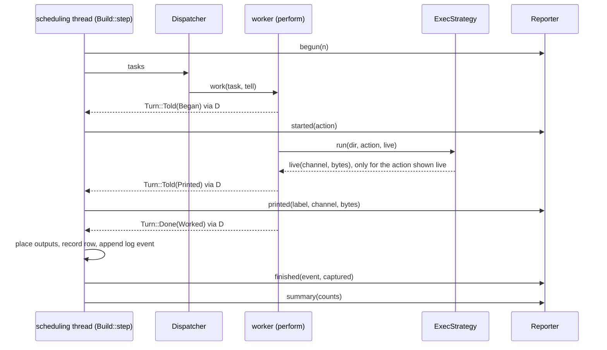
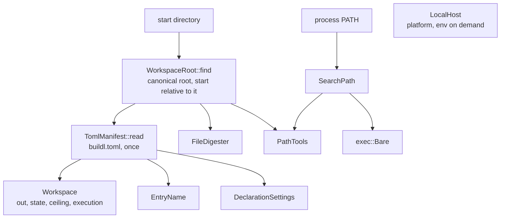
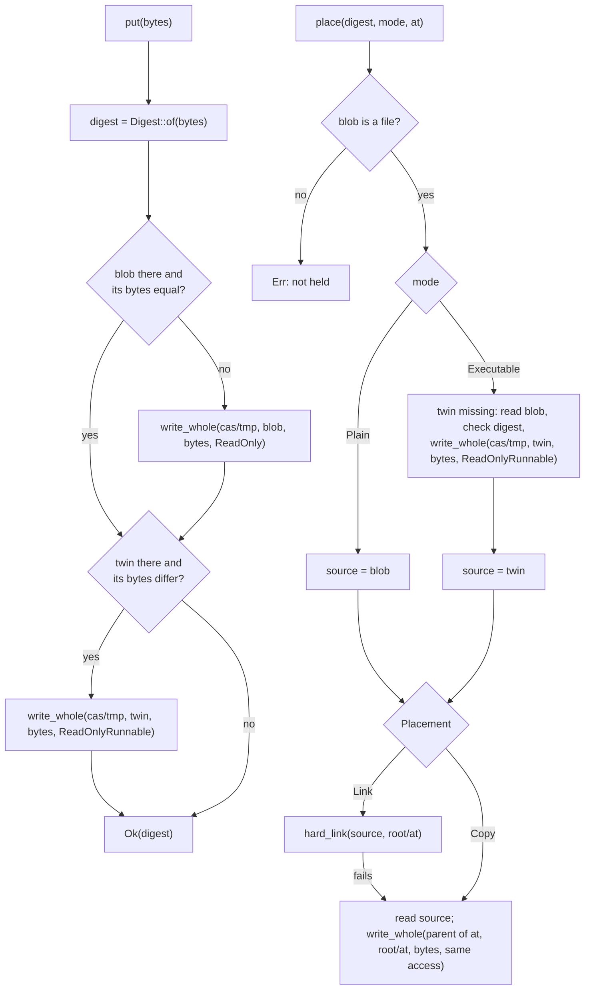
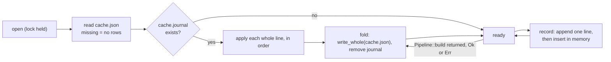
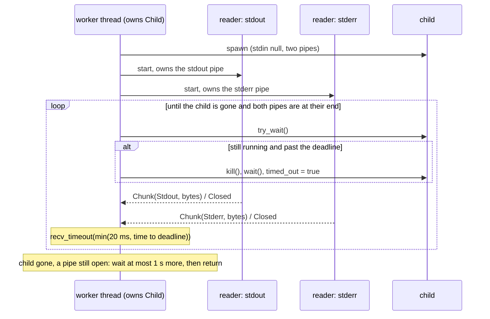
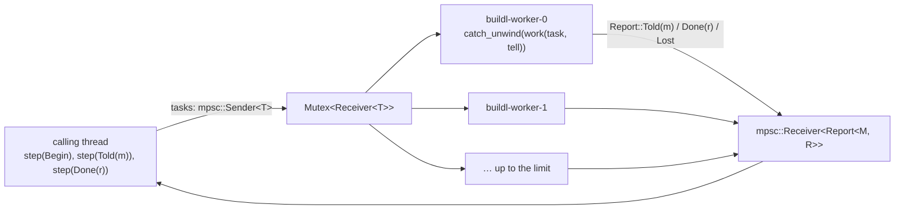
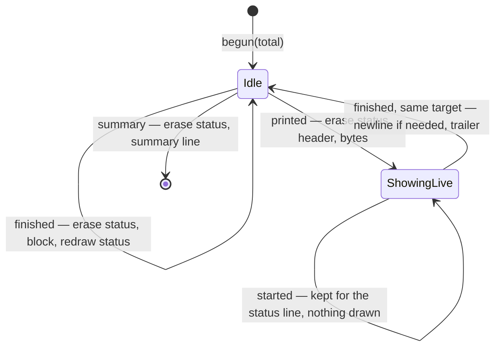
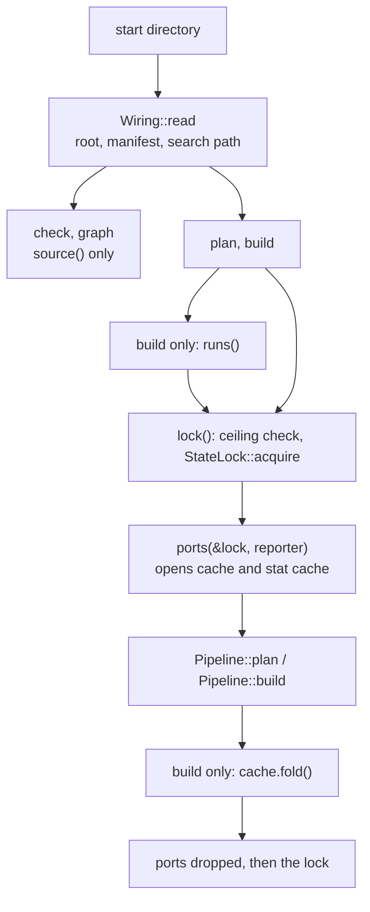
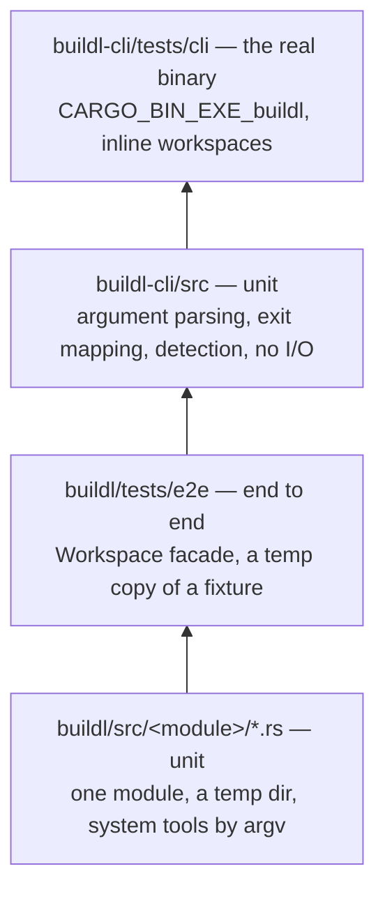

# Spec: adapters and CLI — a `buildl` that builds

`buildl-core` holds the whole pipeline and `buildl-lua` evaluates a real build file; nothing else is
real. This spec fills the two empty crates. `buildl` gains an adapter for every port milestone 1
uses, the two modules those adapters share, the bundle that names them together and the `Workspace`
facade an embedder opens. `buildl-cli` gains the `buildl` binary: `check`, `graph`, `plan` and
`build`, their output and their exit codes. `buildl-core` gains what a real build showed it was
missing: a `Reporter` port and the way a running build reaches it, live output, building one named
target, the record of the graph, a class for an action a signal ended, an error that names a corrupt
state file, an error for an input that is not a regular file, and a streaming hasher. The decisions
of §1.2 answer every question the intent left open; §16 gives every command of design §7 a
milestone, and lists the other work it found without an owner for the author to place.

---

## 1. Design premises, decisions, and facts established by running something

Every claim in this spec was checked against the artifact named beside it: a `file:line` in this
repository for structure, a command and its real output for behaviour, `cargo info` for a crate.
Paths are relative to the repository root. `ABB` abbreviates `docs/architecture-building-blocks.md`.
Probes ran on `rustc 1.99.0 (b940084d7 2026-09-28)`, the repository's `stable` channel
(`rust-toolchain.toml`), on `Darwin 25.3.0 arm64` with APFS, as uid 501; where a probe ran on the
workspace's `rust-version` it says `1.94.1`. What was proved on macOS alone is listed once, in §17.

### 1.1 Premises

|Premise|Evidence|
|---|---|
|`crates/buildl` is a doc comment and `crates/buildl-cli`'s `main` is empty|`crates/buildl/src/lib.rs:14-30`; `crates/buildl-cli/src/main.rs:4-10`|
|Milestone 1 names four commands|`docs/design.md:198-207` (§7), `:688` (§13 item 1)|
|A build prints one block per action, a status line on a terminal, plain blocks elsewhere, `--stream`, a summary, and replays a cached target's output|`docs/design.md:317`, `:340-342` (§8.7)|
|Each failure class has its own exit code, and no code is named|`docs/design.md:340`|
|`Reporter` is in the port catalog and is not a trait|`ABB:360`, `:283`; `grep -rn "trait Reporter" crates/` finds nothing, the same search for `trait Dispatcher` finds `crates/buildl-core/src/ports/dispatcher.rs:18`|
|The reporter is single, and on the scheduling side; a worker never prints|`docs/architecture.md:266`, `:344`|
|`step` of a dispatch runs on the calling thread, which blocks in the dispatcher|`crates/buildl-core/src/ports/dispatcher.rs:25`|
|Every ready task is handed out at once|`crates/buildl-core/src/execute/assembly.rs:327-350`|
|An `OutcomeEvent` holds label, build file, expanded command, class, diagnostic and digests|`crates/buildl-core/src/types/outcome_event.rs:24-41`|
|A cache row holds digests of what was printed, never the bytes|`crates/buildl-core/src/types/cache_row.rs:61-71`|
|A target is cached only when what it printed and every output are still held|`crates/buildl-core/src/execute/settle.rs:73-91`, `:139`|
|Plan asks for the tool and every input of every node of the graph it is given|`crates/buildl-core/src/plan/assembly.rs:69-73`|
|Plan holds the output and the state directory to `fs.write` before it asks any other port|`crates/buildl-core/src/plan/authority.rs:106-115`; `plan/assembly.rs:70-72`|
|`ContentStore::clear` removes a directory with everything below it|`crates/buildl-core/src/ports/content_store.rs:45-56`|
|`Exit` is `Exited(i32)` or `TimedOut`|`crates/buildl-core/src/types/raw_outcome.rs:20-25`|
|`ActionCache::row` returns a reference and cannot fail; `record` is durable once it returns `Ok`|`crates/buildl-core/src/ports/action_cache.rs:21`, `:25-27`|
|`Pipeline::check` loads twice and compares; `Pipeline::graph` loads once and resolves; both read only `ports.source`|`crates/buildl-core/src/pipeline/driver.rs:71-90`|
|`Isolation::default()` is `Sandbox`|`crates/buildl-core/src/types/isolation.rs:39-40`; `docs/design.md:125`|
|`Workspace` holds `out`, `state`, `ceiling`, `execution`; `Execution` holds `workers`, `timeout`, `strategy`|`crates/buildl-core/src/types/workspace.rs:18-25`, `:39-46`|
|A `Digest` is made only by `Digest::of(&[u8])` and `Digest::from_hex`|`crates/buildl-core/src/types/digest.rs:42`, `:55`|
|`UnreadableJson` and `NonCanonicalJson` name no file|`crates/buildl-core/src/error.rs:67-81`|
|`Label::resolve(raw, base)` takes `//dir:name`, `:name` and `name`|`crates/buildl-core/src/types/label.rs:66-85`|
|`LuaSource::new(root, limits, skipped)` needs the canonical, absolute root|`crates/buildl-lua/src/source.rs:74-86`|
|`DeclarationLimits::new(memory_bytes, instructions)`, `with_walk_entries`, each a `NonZeroU64`|`crates/buildl-lua/src/limits.rs:57`, `:67`|
|`buildl-core` may not spawn a thread or a process, or read `Instant`; no `clippy.toml` bans anything in `crates/buildl`|`crates/buildl-core/clippy.toml:64`, `:67`, `:118`, `:133`; `ls crates/buildl` lists no `clippy.toml`|
|Adapter modules inside `buildl` never import each other, checked by review today|`ABB:367`, `:376`|
|The crate-edge guard diffs `crates/expected-edges.txt`; the module-edge guard reads `buildl-core` only|`Makefile.toml:121-144`, `:146-202`|
|`cargo deny` bans `toml` and `tempfile` outside named wrappers, and denies duplicate versions|`deny.toml:66`, `:90-98`|
|The CI matrix is `ubuntu-latest` and `macos-latest`|`.github/workflows/ci.yml:36`|
|`std::env::set_var` is `unsafe` in edition 2024, and `unsafe_code` is forbidden|`Cargo.toml:64`; probe: `error[E0133]: call to unsafe function 'set_var' is unsafe`|
|`walkdir` is banned outside `buildl-lua`|`deny.toml:93`|
|The design's cas path is `cas/<sha256>` in one document and `cas/ab/…` in two|`docs/design.md:74`; `docs/architecture.md:270`; `ABB:353`|
|`test`, `clean`, `gc` and `doctor` are rows of design §7's command table, `log` and `verify` are commands the design names outside it, and none of the six is in a milestone|`docs/design.md:205`, `:207` (the table); `:317` (`buildl log <target>`); `:659` (`buildl verify`); `sed -n 688,695p docs/design.md` (§13's list) and `sed -n 34,43p docs/roadmap.md` (§2's table), each through `grep -c -E "test\|clean\|gc\|doctor\|verify\|buildl log"`: `0` and `0`; the same two through `grep -c -E "query\|Plugins"`: `2` and `2`|
|`Digester::stat` answers `Ok(None)` for a path that holds nothing, which Plan turns into `Error::MissingInput` with the declaring target; it has no answer for a path that holds something other than a file|`crates/buildl-core/src/ports/digester.rs:19-25`; `crates/buildl-core/src/plan/inputs.rs:37-42`|
|Load evaluates build files one at a time, from one queue of directories; `buildl-core` may not start a thread|`crates/buildl-core/src/load/traversal.rs:45-63`; `crates/buildl-core/clippy.toml:64-67`|
|The architecture document describes Load as parallel, in a document whose scope is milestone 1|`docs/architecture.md:205`, `:3`|

### 1.2 Decisions

Each row is closed here; the section named holds the detail and the proof.

|#|Question|Decision|Reason|Where|
|---|---|---|---|---|
|D1|What `Reporter` is and where|A trait in `buildl-core`, five methods, `&mut self`, none fallible; an associated type of `Ports` and a field of `PortSet`. `&mut R` is a `Reporter` when `R` is|Only the scheduling thread calls it; a display failure must not change what is stored or returned|§2.2|
|D2|How a running build reaches it|`Dispatcher::dispatch` carries messages: `work(task, tell)`, `step(Turn<M, R>)`|The scheduling thread blocks in the dispatcher, whose channel is the only way in without a second consumer|§2.3|
|D3|When a target is "started"|When a worker begins it, not when it is handed out|Forty ready tasks on eight workers would show forty running|§2.5|
|D4|How a cache hit shows its output|The core reads the stored bytes from the content store by digest and hands them to `finished`, for a built target and a cached one alike. Bytes that are not held are an error naming the content store|One path, so a hit shows exactly the stored bytes; a lost warning is never silent|§2.5|
|D5|`--stream`|`ExecStrategy::run` gains a live sink; `LiveOutput::OneAction` shows one action at a time as it prints, the rest as blocks once it has ended|Never interleaved, parallelism kept, and the stored bytes cannot differ|§2.4, §2.5|
|D6|How a named target narrows a build|`resolve::narrow(&graph, &Scope)` between Resolve and Plan. `plan` and `build` take targets; `check` and `graph` take none. An unknown label is `Error::UnknownTarget`|Plan asks for every input of every node it is given; narrowing later would fail a build on a missing input of an unrelated target|§2.6|
|D7|Targets outside the request|Not part of the run, except that output places are checked over the whole graph|An unchecked collision would delete another target's output|§2.7|
|D8|When `graph.json` is written|By every `build`, right after Resolve, always the whole graph, through a new port `GraphRecord`|The graph on disk then matches the rows and blobs beside it, and is the same bytes for `build` and `build <target>`|§2.7, §5.7|
|D9|A child a signal ended|`Exit::Signaled(n)` → `OutcomeClass::Killed { signal }`, a failed action|`ExitStatus::code()` is `None` then, and `Exited(i32)` has nothing true to hold|§2.1|
|D10|`check` and `graph` without a state directory|Free functions `pipeline::check` and `pipeline::graph` over a source alone; the `Pipeline` methods call them|A command that reads only build files must not need, lock or be stopped by a state file|§2.7, §8|
|D11|A corrupt state file|`Error::CorruptState { file, source }` wrapping the JSON variant|The JSON variants name no file, so a person could not be told what to remove|§2.8, §5.4|
|D12|Hashing a large file|A `Hasher` in `buildl-core` beside `Digest::of`|One SHA-256 for every digest, and `sha2` stays a dependency of the core alone|§2.8|
|D13|The `buildl` module tree|§3's: thirteen adapter modules, two composition modules, and two shared modules, `state` and `search_path`, that implement no port|Adapters never import each other, and two rules must still be written once|§3|
|D14|The import rule, checked|`cargo make guard-adapter-isolation`: an adapter module names `state`, `search_path` and no other module of the crate|Thirteen adapters written at once is when a cross-import slips in|§3, §13.2|
|D15|When ports are wired|`check` and `graph` make a `LuaSource` and nothing else. `plan` and `build` take the lock and wire the whole set, per call|`Pipeline` needs every port; a corrupt `cache.json` must not stop `check`|§8|
|D16|Who owns the reporter|The caller. `Workspace::build` is lent `&mut R` for one build|Only `build` reports; an embedder supplies its own|§8.2|
|D17|An unknown key in `buildl.toml`|Refused, everywhere, with line and column; `[approver]` included|A typo such as `fs.wirte` must not silently drop a grant|§4.2|
|D18|No `buildl.toml`, or an empty one|None: an error, never a default ceiling. Empty: valid, every default, an empty ceiling|The file is both the root marker and the ceiling|§4.1, §4.2|
|D19|Where the root is|The nearest `buildl.toml` at or above the canonical start directory. No flag names a root or a start directory|Nothing in the intent or design §7 names one; a test passes the start directory as a value|§4.1, §9.1|
|D20|A relative target argument|`:name` and `name` resolve against the directory the command was started in|It is what `Label::resolve` means for a build file|§8.2|
|D21|A strategy milestone 1 cannot run|Only `build` refuses it, as `Error::Adapter { port: Manifest }`, exit 5. `check`, `graph` and `plan` work under any strategy|Nothing runs in the other three; the remedy is one line of `buildl.toml`|§8.3|
|D22|A tool's fingerprint|SHA-256 of the bytes of the file its name leads to, links followed|No clock value in a key; nothing is run at plan|§4.6|
|D23|Finding the program|One lookup, `SearchPath`, used by `tools/` and `exec/`; no trait between them|The file run must be the file fingerprinted; a value built from any list of directories needs no seam to test|§4.5, §6.1|
|D24|cas layout and protection|`cas/<2 hex>/<62 hex>`, blobs 0444, an executable twin `….x` 0555, each less the umask; `out/` hard-links to them only where a write to a read-only file is seen to be refused, else copies. `put` rewrites a blob or a twin whose bytes differ and never removes either|Covers every accidental write through an output; which files the store holds depends on the graph alone, never on the order workers finished in|§5.3|
|D25|fsync|None, for any file|Rename covers the death of the process, which is what design §8.5 promises; a sync costs 32× the write|§5.2|
|D26|The action cache on disk|`cache.json`, a canonical snapshot, and `cache.journal`, one line per `record`. The facade folds the journal into the snapshot after every build; a journal left behind is replayed at the next open|A whole-file rewrite per row is quadratic: 8.9 s per 1,000 rows|§5.4, §8.2|
|D27|A second buildl|Refused through `.buildl/lock`, taken by `plan` and `build` only, for the length of the call|Two builds at tier 1 write the same `out/` paths|§5.2, §8.2|
|D28|The lock and the ceiling|A state directory outside `fs.write` is refused before it is made, with the error Plan would give|The ceiling is never exceeded, and the lock is taken before Plan runs|§8.2|
|D29|The stat cache|Keyed by path; keeps an entry only for a file modified more than 2 s before the run began; a corrupt file is discarded|A same-size edit inside the timestamp's granule leaves the stat equal|§5.6|
|D30|The log|Grows across builds; a cut last line is removed at the next append|It is an artifact; pruning is `gc`'s|§5.5|
|D31|The child process|Workspace root as working directory; exactly the declared environment; stdin empty; no shell|The port's contract, and what the key folded|§6.1|
|D32|Timeout and kill|The worker waits with a deadline and kills the direct child. No process group. One second for a held pipe to drain|A child in its own group stops receiving the terminal's Ctrl-C|§6.1|
|D33|The dispatcher|Scoped threads started as tasks need them; a panicking task is reported lost, which the core turns into `Error::DispatcherFault`|`work` borrows; a no-op build starts no thread|§6.3|
|D34|Signals to buildl|No handler|std has no safe way to install one; storage survives a kill at any instruction|§6.5|
|D35|The re-export|`pub use buildl_core;`|`as core` breaks the crate root and any downstream glob import|§8.4|
|D36|stdout and stderr|stdout carries what the command was asked for (`graph`, `plan`); stderr carries how it went|`buildl graph --json \| jq` is never polluted|§9.2|
|D37|Exit codes|0 done, 1 action failure, 2 usage, 3 infrastructure, 4 refusal, 5 build files or manifest, 6 corrupt state, 7 internal|Structural, and clear of 126, 127 and 128+n|§9.3|
|D38|Tools in tests|System tools run by argv; `sh -c` in tests only. No compiled helper|Cargo gives `CARGO_BIN_EXE_*` only to integration tests of the bin's own package|§12.1|
|D39|"Built twice, byte-identical"|Two copies in two directories, four workers and one, of each of two fixtures; `out/`, `cache.json`, `graph.json` and the cas compared. The second fixture, `twins`, has three targets with equal bytes, one placed executable|Catches an absolute path, a listing order and a scheduling order reaching an artifact; equal bytes under two modes is where the store's two files for one digest meet|§12.3, §12.4|
|D40|Unowned commands|`test`, `log`, `clean`, `gc` → milestone 2; `doctor` → 4|Each lands with the first milestone that holds what it needs|§16 part 1|
|D41|Loading build files|Sequential in milestone 1, by decision. Parallel load is a Non-goal this spec adds, put to the author at approval|Measured: 1,001 build files load in 61 to 69 ms, under 70 µs a file; a pool would need threads `buildl-core` may not start|§1.3 (PF), §16 part 2, §19|
|D42|A declared input that is a link, a directory or a special file|`Digester::stat` reports what stands at the path; Plan raises `Error::InputNotAFile` with the declaring target, the path and what was found. Exit 5|It is a mistake of the build file, the class `MissingInput` is in; an adapter error would exit 3 and blame the builder|§2.12, §4.4, §9.3|
|D43|Other work found without an owner|Listed with a proposed milestone each, apart from the five commands the intent asks about; nothing of it is built or decided here|A milestone's content is the author's to set|§16 part 2|

### 1.3 Facts established by running something

Each probe was a throwaway program or a throwaway copy of part of this workspace, built with a
target directory of its own, outside the repository; `git status --short` afterwards listed only this
chain's directory and `docs/roadmap.md`. Probes that belong to one section are beside the claim they
prove. The six below carry more than one section.

**PA — every change of §2 compiles and passes the gate.** A copy of `crates/buildl-core` with all of
§2 applied, in a scratch workspace carrying the repository's lint table and the crate's own
`clippy.toml`. The unchanged crate first: `cargo test --all-targets` → `535 passed`, `108 passed`.
With §2:

```text
$ cargo fmt -p buildl-core -- --check                                        -> exit 0
$ cargo clippy -p buildl-core --all-targets --all-features -- -D warnings    Finished
$ RUSTDOCFLAGS="-D warnings" cargo doc -p buildl-core --all-features --no-deps   Generated …/doc/buildl_core/index.html
$ cargo test -p buildl-core --all-targets --all-features
test result: ok. 547 passed; 0 failed      (unit)
test result: ok. 125 passed; 0 failed      (flows; the three golden files unchanged)
$ cargo test -p buildl-core --all-features --doc
test result: ok. 13 passed; 0 failed
$ <the body of `cargo make guard-module-edges`>
guard-module-edges: OK (24 edges, golden file unchanged)
```

`Error` then has 30 variants (the lines of `pub enum Error` that open a variant, counted: 30; 27
before §2). Three findings came from running it rather than reading: clippy refuses
`Option<&(dyn Fn(Channel, &[u8]) + Sync)>` in a signature as `type_complexity`, hence the `LiveSink`
alias; a unit test of `narrow` that imported `crate::json` added a `resolve -> json` edge the guard
refused, so that test compares graphs; and `std::error::Error::source` on a `Box<Error>` source does
not downcast to `Error`, so a caller reads `CorruptState`'s `source` field, never the trait method.

**PB — a bundle generic over its reporter, lent a caller's reporter, over real threads.** A second
crate in that workspace, using `buildl-core`'s public API alone: the thread pool of §6.3; a bundle
`struct Lent<R>(PhantomData<fn() -> R>)` with `impl<R: Reporter> Ports for Lent<R> { type Reporter = R; … }`
and the core's own test fakes for the other ports; a strategy that panics for one named target. Each
test wires `PortSet<Lent<&mut FakeReporter>>` and calls `Pipeline::build` on 41 targets.

```text
$ cargo test -p merge --test merge -- --nocapture --test-threads=1
lent reporter: 133 calls; summaries [Summary { failed: 0, skipped: 0, built: 41, cached: 0 },
  Summary { failed: 0, skipped: 0, built: 0, cached: 41 }]; threads started 8 then 0
thread 'buildl-worker-1' panicked at …: the strategy panics
panic in //:leaf07: dispatcher: returned without an outcome for //:all, //:leaf07; rows kept: 39; summary calls: 0
one worker: first //:leaf00 last //:all
test result: ok. 27 passed; 0 failed
```

So: the port set needs no bound beyond `R: Reporter`; a reporter lent for a build holds every call
once the build returns; a build of cached targets starts no thread; a panic in an adapter ends the
build as `Error::DispatcherFault` naming the target and what waited on it, with the other 39 rows
kept and no summary; one worker runs tasks in the order they were handed out.

**PC — a dispatcher on eight threads reports in order and stores what one thread stores.** In the same
workspace, a strategy calling the live sink from two threads of its own; 41 targets, 25 builds under
`LiveOutput::OneAction`. Asserted per build: never interleaved; every target started once and
finished once; each target's output shown exactly once, live or at the end; live bytes equal stored
bytes; rows, cas digests and placements equal a one-worker quiet build's.

```text
25 rounds, 8 workers: most actions running at once = 8; actions shown live = 108 of 1025
test a_build_over_eight_threads_reports_in_order_and_stores_what_one_thread_stores ... ok
```

**PD — the dependency edits of §14 pass the supply-chain gate.** A copy of the workspace's manifests,
lockfile, `deny.toml` and crates, with §14's lines added:

```text
$ cargo deny --offline check -D unused-wrapper          (deny.toml unchanged)
error[banned]: crate 'tempfile = 3.27.0' is explicitly banned
error[banned]: crate 'toml = 0.8.23' is explicitly banned
advisories ok, bans FAILED, licenses ok, sources ok
$ cargo deny --offline check -D unused-wrapper          (with §13.4's edits)
advisories ok, bans ok, licenses ok, sources ok
$ cargo tree -d
warning: nothing to print.
```

The lockfile gained twelve packages and no second version of any: `anstyle`, `clap`, `clap_builder`,
`clap_derive`, `clap_lex`, `crossbeam-deque`, `crossbeam-epoch`, `crossbeam-utils`, `heck`, `rayon`,
`rayon-core`, `strsim`. The crate-edge guard's own command printed the listing of §13.3.

**PE — what each damage to `cache.json` reads as.** One row, 586 bytes, written by
`json::canonical::to_vec` and read back by `json::canonical::from_slice`:

```text
as written        -> Ok, equal to what was written: true
cut in half       -> Err(canonical JSON could not be read: EOF while parsing a string at line 1 column 293)
a space appended  -> Err(JSON is not in canonical form: it differs from it at byte 586)
one hex digit of the key's digest changed
                  -> Err(canonical JSON could not be read: 08e0…da8e is not the digest of its components, which is a8e0…da8e at line 1 column 353)
```

**PF — sequential Load over 1,001 build files.** A scratch crate depending by path on the
`buildl-core` and `buildl-lua` of this repository as they are today, release build, the repository's
lockfile: `Pipeline<P>` over `buildl_lua::LuaSource` (default limits) with the core's own test fakes
for every other port. The workspace is generated: a root `build.lua` of 1,000 `b.subdir("dNNNN")`
lines, and in each of the 1,000 directories a `build.lua` declaring one target
(`b.target("t", { run = { "true" } })`). `Pipeline::check` loads the workspace twice and compares;
`Pipeline::graph` loads it once and resolves. On an Apple M2, files in the page cache:

```text
$ loadprobe gen big 1000
wrote 1001 build files under big
$ loadprobe check big 5
round 0: Pipeline::check (two loads of 1001 build files): 1000 declarations in 129.0185ms; per build file per load: 64.444µs
round 1: Pipeline::check (two loads of 1001 build files): 1000 declarations in 127.772709ms; per build file per load: 63.822µs
round 2: Pipeline::check (two loads of 1001 build files): 1000 declarations in 122.7505ms; per build file per load: 61.313µs
round 3: Pipeline::check (two loads of 1001 build files): 1000 declarations in 123.149209ms; per build file per load: 61.513µs
round 4: Pipeline::check (two loads of 1001 build files): 1000 declarations in 122.5215ms; per build file per load: 61.199µs
round 0: Pipeline::graph (one load, then resolve): 1000 targets in 63.488084ms; per build file: 63.424µs
round 1: Pipeline::graph (one load, then resolve): 1000 targets in 61.938125ms; per build file: 61.876µs
round 2: Pipeline::graph (one load, then resolve): 1000 targets in 68.563584ms; per build file: 68.495µs
round 3: Pipeline::graph (one load, then resolve): 1000 targets in 61.777208ms; per build file: 61.715µs
round 4: Pipeline::graph (one load, then resolve): 1000 targets in 61.102167ms; per build file: 61.041µs
```

So one sequential load of 1,001 trivial build files costs 61 to 69 ms, 61 to 69 µs a build file,
resolving included: a fresh Lua engine, the read and the evaluation. `check` pays it twice, 123 to
129 ms; `graph`, `plan` and `build` once. This is the measurement D41 rests on. A build file that does real work in
Lua, or lists many sources, costs more than a trivial one; that cost was not measured.

---

## 2. Changes to `buildl-core`

This section is the whole list. `buildl-core` still names no I/O API and gains no production
implementation of a port: everything here is a value, a trait, a pure function, a fake or a test,
and all of it passes the gate with the purity bans on (PA). No new dependency; the crate's rows in
`crates/expected-edges.txt` and the whole of `crates/expected-module-edges.txt` are unchanged (PA:
`24 edges, golden file unchanged`).

### 2.1 New and changed values (`src/types/`, one file each)

```rust
// turn.rs — what a dispatcher hands the scheduling thread
pub enum Turn<M, R> { Begin, Told(M), Done(R) }
// channel.rs — which of its two streams an action wrote to
pub enum Channel { Stdout, Stderr }
// live_sink.rs — clippy::type_complexity refuses the bare type in a signature
pub type LiveSink<'a> = &'a (dyn Fn(Channel, &[u8]) + Sync);
// live_output.rs
#[derive(Default)] pub enum LiveOutput { #[default] Off, OneAction }
// scope.rs — what a run was asked for
#[derive(Default)] pub enum Scope { #[default] Workspace, Targets(BTreeSet<Label>) }
// captured.rs — what an action printed, as handed to a reporter
#[derive(Default, Clone, Copy)] pub struct Captured<'a> { pub stdout: &'a [u8], pub stderr: &'a [u8] }
// digest.rs — beside Digest
#[derive(Debug, Clone, Default)] pub struct Hasher(Sha256);
// input_stat.rs — what stands at the path of a declared input (§2.12)
pub enum InputStat { Missing, File(FileStat), Other(InputKind) }
pub enum InputKind { Symlink, Directory, Special }
```

- `Exit` gains `Signaled(i32)` (`raw_outcome.rs`). `OutcomeClass` gains `Killed { signal: i32 }`
  (`outcome.rs`): `Summary::of` counts it as failed, it is not `succeeded()`, and it serializes as
  `{"Killed":{"signal":11}}`. Proof that a signal leaves no exit code, `rustc 1.94.1`:
  `exit 3: code() = Some(3), signal() = None`; `SIGSEGV: code() = None, signal() = Some(11)`;
  `SIGKILL: code() = None, signal() = Some(9)`.
- `Scope::Targets` with no label is a build of nothing. A label in it may be an alias.
- `Hasher::new()`, `update(&mut self, bytes: &[u8])`, `finish(self) -> Digest`. The digest is the one
  `Digest::of` gives for the pieces joined; it is computation over bytes in memory and names no I/O
  API. PA runs two unit tests for it: 200,000 bytes in pieces of 1, 7, 64, 65,536, 200,000 and
  300,000 bytes, and a hasher handed nothing.

All are re-exported from `lib.rs`.

### 2.2 `Reporter` (`src/ports/reporter.rs`)

```rust
pub trait Reporter {
    /// `targets` targets are about to be built; every refusal check has passed. Once, first.
    fn begun(&mut self, targets: usize);
    /// A worker began `action`. Never called for a cached or a skipped target.
    fn started(&mut self, action: &ReadyAction);
    /// The action shown live wrote `bytes`. Only under `LiveOutput::OneAction`.
    fn printed(&mut self, label: &Label, channel: Channel, bytes: &[u8]);
    /// A target has its outcome; `event` is what the build log holds for it. Once per target.
    fn finished(&mut self, event: &OutcomeEvent, printed: Captured<'_>);
    /// Every target has its outcome. Once, last; never after an error.
    fn summary(&mut self, summary: Summary);
}

impl<R: Reporter + ?Sized> Reporter for &mut R { /* each method forwards */ }
```

Contract:

- Every call is made on the thread that called `build`. No call can fail.
- Order: `begun`, then any number of `started`, `printed` and `finished`, then `summary`. A build
  refused before anything runs makes no call. A build that ends in an error makes no `summary`.
- From the first `printed` for a target until that target's `finished`, no `printed` and no
  `finished` is about another target. `started` may arrive in between.
- `started` hands the whole `ReadyAction`: its `description` is the status text, and where that is
  `None` the reporter chooses (`crates/buildl-core/src/types/ready_action.rs:31-35`).
- `finished`'s `printed` is what the action wrote that `printed()` was not handed: everything it
  wrote when it last ran, for a cached target as for one that ran now; and nothing for the target
  shown live, or for one with no output stored (a skipped target, a failed prepare).
- An error is not shown through this port. It is the return value of the command, and its caller
  renders it (§9.4): `check`, `graph` and `plan` errors never pass a build.

`Ports` gains `type Reporter: Reporter;` and `PortSet` gains `pub reporter: P::Reporter`; the
hand-written `Debug` of `PortSet` asks `P::Reporter: Debug`. The blanket implementation is what lets
a facade lend a caller's reporter to one build's port set (PB). Its unit test makes one call of each
kind through `&mut` and reads them back in order.

Fake (`tests/flows/common.rs`): `FakeReporter { pub calls: Vec<Reported> }` with
`Reported::{Begun(usize), Started(Label, Option<String>), Printed(Label, Channel, Vec<u8>),
Finished { label, class, stdout, stderr }, Summary(Summary)}`: every call kept as an owned value, in
order.

### 2.3 `Dispatcher` (`src/ports/dispatcher.rs`)

```rust
fn dispatch<T, M, R, W, S>(&mut self, work: W, step: S) -> Result<()>
where
    T: Send, M: Send, R: Send,
    W: Fn(T, &(dyn Fn(M) + Sync)) -> R + Sync,
    S: FnMut(Turn<M, R>) -> Vec<T>;
```

Added to the contract: `step(Turn::Begin)` once, first. Each message `work` hands to its second
argument reaches `step` as `Turn::Told`, on the calling thread: the messages of one task in the order
sent, all before that task's `Turn::Done`; messages of different tasks in any order. That argument
may be called from any thread until `work` returns. Every message reaches `step`, none twice. Tasks
`step` returns for a message are run like any other. Losing a task or a result is still
`Error::DispatcherFault`.

`&dyn Fn` is the short-lived borrowed callback the guidelines allow; a generic would need a
two-parameter generic associated type on the port for no gain. `FakeDispatcher` keeps what a task
said in a `Mutex<Vec<M>>` and hands it over before the result. It gains
`pace: Pace { OneAtATime, Together }`: `Together` runs every waiting task, hands over what each said
in the order taken, then the results last-taken first, which is what a build sees when the first
action to begin is the last to end.

### 2.4 `ExecStrategy::run` (`src/ports/exec_strategy.rs`)

```rust
fn run(&self, dir: &Self::Dir, action: &ReadyAction, live: Option<LiveSink<'_>>) -> Result<RawOutcome>;
```

With `live`, every run of bytes the command writes is also handed to it as it is read, with its
channel, before the command ends; `live` may be called from any thread until `run` returns. For each
channel, the bytes handed over, joined in order, are exactly that channel's bytes in the result. The
returned `RawOutcome` is the same with or without `live`, so storing what was printed stays one code
path (`crates/buildl-core/src/execute/perform.rs:355-360`) and the stored bytes cannot differ. A
command a signal ended is `Ok` with `Exit::Signaled(n)`, never an error.

### 2.5 The scheduling side (`src/execute/`)



- `perform.rs`: crate-private `Told { Began(NodeId), Printed { node, channel, bytes: Vec<u8> } }` and
  `Shared<'a> { stop: &'a AtomicBool, live: Option<&'a AtomicBool> }`.
  `perform(task, strategy, cas, clock, shared, tell: &(dyn Fn(Told) + Sync)) -> Worked`: after the
  stop check it tries the one live place with `compare_exchange(false, true)`, says `Began`, and
  passes `Some(sink)` to `run` only when it took the place. `Performed` gains `live: bool`. `exited`
  maps `Exit::Signaled(n)` to `OutcomeClass::Killed { signal: n }`.
- `record.rs`: `append` returns the `OutcomeEvent` it logged. New
  `shown(cas, label, digest: Option<Digest>) -> Result<Vec<u8>>`: empty for `None` and for the
  digest of nothing (no read); else `cas.get`; and when that is `None`,
  `Error::Adapter { port: ContentStore }` with the text `what <label> printed is not held: <digest>`.
- `assembly.rs`: `Build` gains `reporter`, `shared`, `live: Option<NodeId>`,
  `held: Vec<OutcomeEvent>`. `step(Turn<Told, Worked>)`. `conclude` fills the outcome slot, appends
  the event, then shows it: held while another target is live; reported with an empty `Captured`
  when it is the live one, after which the held events are reported oldest first; otherwise reported
  with bytes read by `shown`. The live place is given back after that target's `finished` returns.
  `begun(graph.len())` is called right before `dispatcher.dispatch`; `summary(Summary::of(&outcomes))`
  after the `DispatcherFault` check, on success only.

**Log before report.** An event is appended before any byte is read for display, so "log always"
holds whatever the reporter or the read does.

**Content that is not held.** A target is cached only when the store `contains` what it printed
(§1.1). `shown` can therefore meet `None` only for a blob that is there and no longer has its digest:
the store's `get` removes such a blob (§5.3), the build ends with the content store's error, and the
next build finds `contains` false and runs that target again. Showing nothing instead would lose a
warning silently, which the intent's "on a cache hit, what the action printed when it last ran"
rules out.

**One action live at a time.** The place is one `AtomicBool`: the worker that begins while it is
free is shown live, and the scheduling thread gives it back after that target's `finished`.
Outcomes that end meanwhile are logged at once and reported after. PC asserts the grammar over 25
threaded builds.

### 2.6 Narrowing (`src/resolve/narrow.rs`)

```rust
pub fn narrow<'g>(graph: &'g TargetGraph, scope: &Scope) -> Result<Cow<'g, TargetGraph>>;
```

`Scope::Workspace` borrows the graph. Otherwise each label is resolved with `graph.id_of` (a target
or an alias, `crates/buildl-core/src/types/target_graph.rs:144-149`); the first, in label order,
that names nothing is `Error::UnknownTarget`, its suggestion from `resolve::suggest::nearest` over
target and alias labels. The kept set is the labels' targets and everything reachable through
`deps`, walked with an explicit stack. The result is built with `TargetGraph::new`
(`target_graph.rs:74`): nodes in label order, renumbered; each node's edges in written order; an
alias kept when its target is; every setting kept, because a setting belongs to the workspace, so
`--set` on a setting no requested target names stays valid.

### 2.7 `GraphRecord`, `Pipeline`, `execute`

```rust
// ports/graph_record.rs
pub trait GraphRecord { fn record(&mut self, graph: &TargetGraph) -> Result<()>; }
// Ports: type Graph: GraphRecord;        PortSet: pub graph: P::Graph

// execute/assembly.rs
pub fn execute<P: Ports>(whole: &TargetGraph, graph: &TargetGraph, plan: &Plan,
    on_failure: OnFailure, live: LiveOutput, ports: &mut PortSet<P>) -> Result<Vec<ActionOutcome>>;

// pipeline/driver.rs — exported from `pipeline`
pub fn check<S: DeclarationSource>(source: &S, entry: &EntryName) -> Result<Vec<Declaration>>;
pub fn graph<S: DeclarationSource>(source: &S, entry: &EntryName) -> Result<TargetGraph>;

impl<P: Ports> Pipeline<P> {
    pub fn check(&self, entry: &EntryName) -> Result<Vec<Declaration>>;   // check(&self.ports.source, entry)
    pub fn graph(&self, entry: &EntryName) -> Result<TargetGraph>;        // graph(&self.ports.source, entry)
    pub fn plan(&mut self, entry: &EntryName, scope: &Scope,
        overrides: &BTreeMap<SettingName, SettingValue>) -> Result<Plan> {
        let whole = resolve(load(&self.ports.source, entry)?)?;
        let graph = narrow(&whole, scope)?;
        plan(&graph, overrides, &mut self.ports)
    }
    pub fn build(&mut self, entry: &EntryName, scope: &Scope,
        overrides: &BTreeMap<SettingName, SettingValue>, on_failure: OnFailure, live: LiveOutput,
    ) -> Result<Vec<ActionOutcome>> {
        let whole = resolve(load(&self.ports.source, entry)?)?;
        self.ports.graph.record(&whole)?;
        let graph = narrow(&whole, scope)?;
        let plan = plan(&graph, overrides, &mut self.ports)?;
        execute(&whole, &graph, &plan, on_failure, live, &mut self.ports)
    }
}
```

- **`pipeline::check` and `pipeline::graph`** are the bodies the two methods had
  (`crates/buildl-core/src/pipeline/driver.rs:71-90`), moved out so a caller that holds only a
  source of build files can run them: `check` loads twice and compares, `graph` loads once and
  resolves. The sequence stays in the core. Two flow tests hold the free functions to the methods'
  results (PA).
- **`GraphRecord::record`** replaces what is kept with `graph`. An implementation stores the bytes
  `json::canonical::to_vec(graph)` returns and no other byte (no trailing newline), and a reader
  finds the old record whole or the new one whole. Its error is
  `Error::Adapter { port: PortName::GraphRecord }`. `TargetGraph` has one `Serialize`
  (`target_graph.rs:199`), so these are the bytes of `Pipeline::graph`'s value under the serializer
  the golden test pins (`crates/buildl-core/tests/flows/graph.rs:80-81`). `plan` and `graph` record
  nothing. Cost of a whole write per build, measured: 10,000 targets are 2.8 MB, 45 ms to serialize
  and 3.8 ms to write.
- **`execute`**: `whole` is the graph `graph` was narrowed from, or `graph` itself.
  `Layout::of(whole, out)` runs first, for its refusal only; then `Layout::of(graph, out)` gives the
  paths used.
- **Error order of `build`**: Load → Resolve → `GraphRecord` → `UnknownTarget` → Plan's, unchanged →
  `ForeignPlan` → manifest → `OutputConflict` (whole graph) → `NoProgram` / `Refused` → then as
  today.
- **Targets outside the request** have no outcome, no event, no report call and no count, and their
  rows and outputs are left alone.

### 2.8 `Error`, `PortName` (`src/error.rs`)

```rust
/// A run was asked for a target, and no target or alias has that label.
#[error("target {label} was asked for but is not declared{}", suggestion_suffix(.suggestion.as_ref()))]
UnknownTarget { label: Label, suggestion: Option<Label> },

/// A file an adapter keeps a workspace's state in does not hold what the adapter writes there.
#[error("{} is not a file buildl wrote: {source}", .file.display())]
CorruptState { file: PathBuf, #[source] source: Box<Self> },

/// A target reads a workspace path that holds something other than a regular file.
#[error("{}: {}: input {path} is {found}; an input must be a regular file", .site.provenance, .site.label)]
InputNotAFile { site: Box<DeclarationSite>, path: SourcePath, found: InputKind },
```

- `UnknownTarget` because `UnknownReference` needs a declaring site (`error.rs:158-167`) and a
  command line has none; `UnknownOverride` is the precedent (`:252-256`). Real text:
  `target //:libs was asked for but is not declared (did you mean //:lib?)`.
- `CorruptState` is distinct from `Error::Adapter`, which is a file that could not be read at all.
  `source` is `UnreadableJson` or `NonCanonicalJson`; a caller reads the field. Real text, built in
  another crate (PB):
  `/ws/.buildl/cache.json is not a file buildl wrote: JSON is not in canonical form: it differs from it at byte 1384`.
- `InputNotAFile` stands beside `MissingInput` (`error.rs:239-250`) and has its shape: the
  lowest-labelled target declaring the input, and the path. §2.12 has how it is raised. Real text:
  `build.lua: //:lib: input lib.c is a directory; an input must be a regular file`.
- `PortName` gains `GraphRecord`, displayed `graph record`.
- The module doc's sentence "how a command surfaces it belongs to the `Reporter` port"
  (`error.rs:23-25`) becomes: an error is returned, and its caller shows it.

`Error` has 30 variants after this (PA); §9.3 gives each an exit code.

### 2.9 Sentences added to port contracts

No signature changes but those of §2.3, §2.4 and §2.12.

|Port, method|Sentence added|Why|
|---|---|---|
|`Manifest::workspace`|Every call on one instance returns the same value|Plan and Execute each call it (`plan/assembly.rs:67`, `execute/assembly.rs:88`); a differing answer would lay outputs under a directory the ceiling never checked|
|`ContentStore::contains`|An implementation that cannot tell answers `false`, which makes the target that needs the content run again|`bool` has no room for an I/O error|
|`ContentStore::get`|Content that no longer has that digest is not held|A store that checks what it reads answers `None` for a damaged blob|
|`StatCache::record`|An implementation may decline to keep an entry it cannot vouch for; `entry` then returns `None` for that path|§5.6's window; no core logic reads an entry back after recording it (`plan/inputs.rs:57-60`)|

`ActionCache` is unchanged: `record` stays durable per row, which is what makes "an interrupted build
remembers finished work" true (`docs/design.md:293`); §5.4 honours it without a whole-file write.

### 2.10 Files that change

|File|Change|
|---|---|
|`src/types/{turn,channel,live_sink,live_output,scope,captured}.rs`|new|
|`src/types/input_stat.rs`|new (§2.12)|
|`src/types/digest.rs`, `raw_outcome.rs`, `outcome.rs`, `mod.rs`|`Hasher`; `Exit::Signaled`; `OutcomeClass::Killed`; exports|
|`src/ports/{reporter,graph_record}.rs`|new|
|`src/ports/{dispatcher,exec_strategy,digester,bundle,port_set,manifest,content_store,stat_cache,mod}.rs`|§2.3, §2.4, §2.12, two associated types and fields, §2.9|
|`src/plan/{inputs,assembly}.rs`|§2.12: the three answers of `stat`; the error order's fifth step|
|`src/resolve/narrow.rs`, `resolve/mod.rs`|new; export|
|`src/execute/{perform,record,assembly}.rs`|§2.5, §2.7|
|`src/pipeline/{driver,mod}.rs`|§2.7|
|`src/error.rs`, `src/lib.rs`, `README.md`|§2.8; exports, status text, module table|
|`tests/flows/common.rs`|`FakeReporter`, `FakeGraphRecord`, `FakeDispatcher`'s `pace`, `FakeDigester`'s `others`, the fakes' new signatures|
|`tests/flows/plan.rs`|one flow for §2.12|
|`tests/flows/report.rs`|new: the thirteen flows of §2.11|
|`tests/flows/check.rs`|two flows for the free functions|
|`tests/flows/golden/*`|unchanged (PA)|

### 2.11 Tests in `buildl-core`

Flow tests, `tests/flows/report.rs`. All thirteen exist and pass in PA.

|Test|Proves|
|---|---|
|`a_build_reports_each_action_as_it_begins_and_ends_and_the_summary_last`|exact call sequence of a four-target build|
|`a_cached_target_never_starts_and_is_reported_with_what_it_printed_when_it_ran`|second build: no `started`; stored stdout and stderr handed over again|
|`a_failure_and_what_it_skips_are_reported_and_a_skipped_target_never_starts`|`Killed { signal: 11 }`, no row, two `Skipped`, summary `1 failed, 2 skipped, 1 built`|
|`live_output_shows_an_action_as_it_prints_and_stores_exactly_what_a_quiet_build_stores`|chunks arrive in order; `finished` hands nothing over again; rows, events and cas digests equal a quiet build's|
|`while_one_action_is_shown_live_the_outcomes_of_the_others_wait_for_it_to_end`|held outcome reported after the live one; log written in completion order|
|`a_build_of_one_target_builds_what_it_needs_and_nothing_else`|two outcomes, two rows, two events; unrelated inputs may be missing; whole graph recorded|
|`a_whole_build_after_a_build_of_one_target_finds_that_part_cached`|2 built, 2 cached; both builds record the same graph bytes|
|`a_plan_of_one_target_holds_only_what_that_target_needs`|plan of two targets; no graph recorded|
|`asking_for_a_target_nothing_declares_is_refused_and_nothing_runs`|`UnknownTarget` with suggestion; no report call|
|`two_targets_claiming_one_place_are_refused_even_when_only_one_is_asked_for`|`OutputConflict` from the whole graph|
|`a_graph_that_cannot_be_recorded_fails_the_build_before_anything_is_planned`|`Adapter { GraphRecord }`; no tool lookup|
|`a_build_that_fails_as_a_whole_reports_no_summary`|broken log → error, no `summary`|
|`asking_for_no_target_builds_nothing`|empty `Scope::Targets`|

`tests/flows/check.rs`: `a_caller_holding_only_a_source_checks_like_a_pipeline`,
`a_caller_holding_only_a_source_gets_the_graph_a_pipeline_gets`. `tests/flows/plan.rs`:
`an_input_that_is_not_a_regular_file_names_the_target_declaring_it_and_what_it_is` (§2.12). All
three exist and pass in PA.

Unit tests. In PA: `resolve/narrow.rs` — `the_whole_workspace_is_the_graph_itself`,
`a_target_brings_everything_it_depends_on_and_nothing_else`,
`an_alias_names_its_target_and_is_kept_with_it`,
`asking_for_every_target_gives_back_an_equal_graph`, `no_label_is_no_target`,
`a_label_naming_nothing_is_refused_with_the_nearest_one`; `types/digest.rs` —
`bytes_handed_in_pieces_hash_like_the_bytes_joined`,
`a_hasher_handed_nothing_gives_the_digest_of_nothing`; `ports/reporter.rs` —
`a_borrowed_reporter_receives_every_call_made_through_the_borrow`; `error.rs` —
`corrupt_state_names_the_file_and_keeps_the_reading_failure`,
`an_input_that_is_not_a_file_names_the_site_the_path_and_what_was_found`; `types/input_stat.rs` —
`each_kind_is_shown_as_what_a_person_would_call_it`. Written with the implementation:
`perform.rs` — `exited(Exit::Signaled(n))` is `Killed`; `outcome.rs` — `Summary::of` counts `Killed`
as failed and its JSON is `{"Killed":{"signal":11}}`; `record.rs` — `shown` reads nothing for `None`
and for the empty digest, and names the content store when the content is not held; `error.rs` —
`UnknownTarget`'s text with and without a suggestion. Fakes held to their contracts (`common.rs`
self-tests): what a task said reaches `step` before its result; `Pace::Together`'s order; a broken
`FakeGraphRecord` records nothing; `a_digester_reports_a_file_nothing_and_what_is_not_a_file` (in
PA).

### 2.12 An input that is not a regular file (`Digester::stat`, `src/plan/inputs.rs`)

A declared input is a regular file. A path that holds nothing is already a mistake of the build
file, raised by Plan as `Error::MissingInput` from the digester's `Ok(None)` (§1.1). A path that
holds a link, a directory or a special file is the same kind of mistake, and travels the same way:
the port reports what it found, and the core, which knows the declaring target, raises the error.
An adapter error could not name the target and would carry the wrong exit code (§9.3).

```rust
// types/input_stat.rs
/// What a digester found at the path of one input, following no symbolic link.
#[derive(Debug, Clone, Copy, PartialEq, Eq)]
pub enum InputStat { Missing, File(FileStat), Other(InputKind) }

/// What stands at a path that holds something other than a regular file.
#[derive(Debug, Clone, Copy, PartialEq, Eq, PartialOrd, Ord, Hash)]
pub enum InputKind { Symlink, Directory, Special }
// Display: "a symbolic link", "a directory", "a pipe, a socket or a device"

// ports/digester.rs
/// What stands at `path`, following no symbolic link: nothing, a regular file with its
/// metadata, or something that is not a regular file, with what it is.
fn stat(&self, path: &SourcePath) -> Result<InputStat>;      // was Result<Option<FileStat>>
```

- **Plan** (`plan/inputs.rs`, the loop that reads each input's metadata in path order):
  `InputStat::File(stat)` goes on as `Some(stat)` did; `Missing` is `Error::MissingInput` as today;
  `Other(found)` is `Error::InputNotAFile { site, path, found }`, with the same site: the
  lowest-labelled target declaring the input. The first input in path order that is not a regular
  file decides the error, and nothing is hashed before it is returned.
- **Error order of `plan`** (`plan/assembly.rs:50-60`): step 5 becomes `MissingInput` for an input
  that does not exist and `InputNotAFile` for one that is not a regular file.
- **`digest`** is unchanged. A path that stops being a regular file between Plan's `stat` and its
  `digest`, within one plan, is the adapter's own failure, `Error::Adapter { port: Digester }`: the
  workspace changed under the run, and running again is the remedy (§4.4).
- **Fake**: `FakeDigester` gains `pub others: BTreeMap<SourcePath, InputKind>`; a path named there
  is reported as `InputStat::Other`, whatever `files` holds for it.

Real texts, from the flow test, one per kind:

```text
build.lua: //:lib: input lib.c is a directory; an input must be a regular file
build.lua: //:lib: input lib.c is a symbolic link; an input must be a regular file
build.lua: //:lib: input lib.c is a pipe, a socket or a device; an input must be a regular file
```

The change is part of PA: applied to the prototype with the rest of §2, the gate printed
`547 passed`, `125 passed`, `13 passed` and `guard-module-edges: OK (24 edges, golden file
unchanged)`, and the two crates of PB and PC, which build the core's fakes, passed again (`27 passed`,
`22 passed` and `1 passed`).

---

## 3. The `buildl` crate: module tree and import rule

```text
crates/buildl/src/
  lib.rs            exports only                                        §8.4
  state/            shared, no port: StateLayout, StateLock, LockError,
                    write_whole, clear_path                             §5.2
  search_path.rs    shared, no port: SearchPath                         §4.5
  manifest/         buildl.toml; the workspace root  -> Manifest        §4.1–§4.2
  host/             OS, architecture, env values     -> Host            §4.3
  digest/           file hashing, rayon              -> Digester        §4.4
  tools/            lookup and fingerprint           -> ToolResolver    §4.6
  cas/              .buildl/cas, out/                -> ContentStore    §5.3
  cache/            cache.json, cache.journal        -> ActionCache     §5.4
  log/              log.jsonl                        -> EventLog        §5.5
  statcache/        statcache.json                   -> StatCache       §5.6
  graph/            graph.json                       -> GraphRecord     §5.7
  exec/             tier 1, "bare"                   -> ExecStrategy    §6.1
  dispatch/         worker threads                   -> Dispatcher      §6.3
  clock/            system clock                     -> Clock           §6.4
  report/           terminal output, renderings      -> Reporter        §7
  local_ports.rs    the Ports bundle and its wiring                     §8.1
  workspace.rs      the Workspace facade                                §8.2
```

`DeclarationSource` is `buildl_lua::LuaSource`; `Approver` is milestone 4 and has no module.

Three kinds of module, and what each may import of this crate:

|Kind|Modules|May name (`crate::…`)|
|---|---|---|
|shared|`state`, `search_path`|nothing|
|adapter|the thirteen from `manifest` to `report`|`state`, `search_path`|
|composition|`local_ports`, `workspace`|anything|

Every module names `buildl_core` and `std` freely; only `local_ports` names `buildl_lua`. A
`buildl-core` item is written `buildl_core::<Item>`, a module's own as `crate::<module>::<item>`.
The rule is `ABB` §7 rule 2 with one addition: what several adapters need lives in a shared module
that implements no port. `cargo make guard-adapter-isolation` checks it (§13.2); the guard reads test
code too, so an adapter's unit tests name no other adapter. In a module that is one file
(`search_path`, `local_ports`, `workspace`) `super` is the crate root, so such a file never writes
`super::`: it names its own items as `crate::<module>::<item>`, in its tests too, and the guard
refuses the other spelling.

Every adapter module is `pub` and exports its adapter type: the bundle's associated types are public
API and must be nameable (`crates/buildl-core/src/ports/bundle.rs:207`). The crate uses
`std::os::unix` (modes, signals), so it builds on Unix targets only: Linux and macOS, the CI matrix.

---

## 4. Reading inputs: `manifest/`, `host/`, `digest/`, `search_path.rs`, `tools/`

Nothing in this section writes a file.



### 4.1 Finding the workspace root (`manifest/root.rs`)

```rust
/// The canonical, absolute directory that holds a workspace's `buildl.toml`, and where the
/// search for it began.
#[derive(Debug, Clone, PartialEq, Eq)]
pub struct WorkspaceRoot { root: PathBuf, within: PathBuf }

impl WorkspaceRoot {
    /// The nearest directory, `start` itself or one above it, that holds `buildl.toml`.
    pub fn find(start: &Path) -> Result<Self>;
    /// The root: canonical and absolute.
    pub fn as_path(&self) -> &Path;
    /// `start`, relative to the root; empty when `start` is the root.
    pub fn within(&self) -> &Path;
}
```

- `start` is canonicalized first, so a root reached through a symbolic link is the real directory.
  This is the one place the root is canonicalized; every adapter is handed the result.
- A directory holds the manifest when `fs::symlink_metadata(dir.join("buildl.toml"))` succeeds. The
  nearest entry of any kind wins: an unreadable or odd `buildl.toml` fails in `TomlManifest::read`
  instead of being passed over in favour of an outer workspace with another ceiling.
- A nested workspace is its own root.
- One constructor serves an embedder that passes the root and a command that passes its working
  directory: the root holds its own `buildl.toml`.

```text
from ws/a/b/c                                   -> ws
nested ws/a/buildl.toml, from ws/a/b/c          -> ws/a
from a symlink to ws/a/b                        -> ws/a
from /                                          -> none
```

|Failure|`Error::Adapter { port: PortName::Manifest, diagnostic }`|
|---|---|
|nothing up to `/`|`no buildl.toml in <start> or any directory above it` (absolute: there is no root to be relative to)|
|`start` cannot be canonicalized|`<start>: <io error>`|

Every path buildl prints is relative to the workspace root, whatever directory the command ran in:
provenance, source and output paths already are
(`crates/buildl-core/src/types/provenance.rs:69-83`). Two are absolute, because they must be usable
from any directory: the start directory in the message above, and a state file in
`Error::CorruptState` and in the lock's message.

### 4.2 `buildl.toml` (`manifest/`)

```text
manifest/  mod.rs · root.rs · schema.rs (the tables as serde reads them) · interpret.rs (tables to
           values; the position of a byte offset) · memory.rs (the `16MB` grammar) · toml_manifest.rs
```

Parsed with `toml` 0.8.23, parse only (§14). Every table and every key is optional. Every table
struct carries `#[serde(deny_unknown_fields)]`, so a key this version does not read is an error:
`[approver]`, a plugin table and a typo alike. Dotted keys, `[ceiling.fs]` headers and inline tables
are the same TOML and read alike.

|Key|TOML type|When absent|Becomes|Refused when|
|---|---|---|---|---|
|`workspace.name`|string|—|nothing; a label for people|empty|
|`workspace.entry`|string|`"build.lua"`|`EntryName` → `TomlManifest::entry()` → the `entry` of every pipeline call|`EntryName::parse` fails|
|`workspace.out`|string|`"out"`|`Workspace::out: Directory`|`Directory::parse` fails; it is the root; it equals, contains or lies inside `.buildl`|
|`workspace.config`|integer|`1`|nothing|not `1`|
|`ceiling.proc.run`|array of strings|`[]`|`Ceiling::run: BTreeSet<Program>`|`Program::parse` fails|
|`ceiling.env.read`|array of strings|`[]`|`Ceiling::env: BTreeSet<EnvName>`|`EnvName::parse` fails|
|`ceiling.fs.read`|array of strings|`[]`|`Ceiling::read: BTreeSet<Directory>`|`Directory::parse` fails; `""`|
|`ceiling.fs.write`|array of strings|`[]`|`Ceiling::write: BTreeSet<Directory>`|same|
|`declaration.memory`|string|—|`DeclarationSettings::memory_bytes`|grammar below|
|`declaration.instructions`|integer|—|`DeclarationSettings::instructions`|below 1|
|`declaration.walk_entries`|integer|—|`DeclarationSettings::walk_entries`|below 1|
|`execution.workers`|integer|`0`|`Workers::of(usize)` → `Execution::workers`|negative, or beyond `usize`|
|`execution.timeout`|string|`"10m"`|`Timeout::parse` → `Execution::timeout`|`Timeout::parse` fails|
|`execution.strategy`|string|`"sandbox"`|`Isolation::parse` → `Execution::strategy`|`Isolation::parse` fails|
|—|—|`.buildl`|`Workspace::state`|—|

Rules:

- **Directory entries.** `"."` is the workspace root (`Directory::root()`), the spelling a refusal
  prints (`crates/buildl-core/src/error.rs:396`); the adapter maps it, since `Directory::parse(".")`
  is an error (`invalid directory: "." — must not contain a '.' or '..' segment`). Any other text
  goes to `Directory::parse`, whose grammar cannot leave the workspace. Repeats collapse: each list
  is a set.
- **No implicit grant.** `out` and `.buildl` are not added to `fs.write`. The core holds both to the
  ceiling (§1.1), so a manifest lists them, as design §4's example does.
- **The state directory is fixed.** Design §4 has no key for it and §3 names it
  (`docs/design.md:71`, `:89-115`).
- **No build settings.** A setting's value is its `b.option` default or `--set`
  (`docs/design.md:540-542`).
- **Memory.** A whole number in ASCII digits directly followed by one unit: `B`, `KB`, `MB`, `GB`,
  each 1024 times the one before, so `"16MB"` is the 16 MiB `buildl-lua` defaults to
  (`crates/buildl-lua/src/limits.rs:15-16`). Never zero; a product beyond `u64` is `is too large`.
  `manifest/memory.rs`: `fn memory_bytes(raw: &str) -> core::result::Result<NonZeroU64, &'static str>`.
- **Absent declaration limits stay absent.** Their defaults live in one place,
  `buildl_lua::DeclarationLimits::default()`; `manifest/` may not name another adapter's type, so it
  hands over plain numbers.
- **The strategy is reported as written**, `sandbox` when it is not: the port's contract fixes the
  default (`crates/buildl-core/src/ports/manifest.rs:26-29`). What a command does with a strategy
  this version cannot run is §8.3.
- **An empty file is valid**: every default, an empty ceiling. `check` and `graph` work on it;
  `plan` and `build` are refused, because an empty ceiling allows nothing.

```rust
/// A workspace's `buildl.toml`, read and checked once.
#[derive(Debug, Clone, PartialEq, Eq)]
pub struct TomlManifest { workspace: Workspace, entry: EntryName, declaration: DeclarationSettings }

impl TomlManifest {
    /// Reads `buildl.toml` at `root`.
    pub fn read(root: &WorkspaceRoot) -> Result<Self>;
    /// Reads a manifest from its text.
    pub fn parse(text: &str) -> Result<Self>;
    /// The file name a build file has in every directory.
    pub const fn entry(&self) -> &EntryName;
    /// The declaration ceilings the manifest sets.
    pub const fn declaration(&self) -> DeclarationSettings;
}

impl Manifest for TomlManifest {
    fn workspace(&self) -> Result<Workspace>;   // always Ok: a clone of what `read` checked
}

/// The `[declaration]` table: each ceiling the manifest sets, `None` for one it leaves out.
#[derive(Debug, Clone, Copy, PartialEq, Eq, Default)]
pub struct DeclarationSettings {
    pub memory_bytes: Option<NonZeroU64>,
    pub instructions: Option<NonZeroU64>,
    pub walk_entries: Option<NonZeroU64>,
}
```

`schema.rs` holds the raw tables with `Option<toml::Spanned<String>>`, `Option<toml::Spanned<i64>>`
and `Vec<toml::Spanned<String>>` fields, so every value keeps its byte span. `interpret.rs` builds
each value through its core type and, on a failure, reports where the value is.

**Diagnostics.** One line each, the file always named `buildl.toml`:
`buildl.toml:<line>:<column>: <message>`. Line and column are 1-based, the column counted in
characters. For a syntax error, an unknown key or a wrong type, `<message>` is
`toml::de::Error::message()` with each newline replaced by `: `. For a value its type rejects it is
`<key path>: <the core error's text>`, as in
`buildl.toml:3:11: execution.timeout: invalid timeout: "10" — must end in one of the units ms, s, m and h`.
A file that cannot be read is `buildl.toml: <io error>`; one
that is not UTF-8 is `buildl.toml: not UTF-8 text`. All are
`Error::Adapter { port: PortName::Manifest, .. }`, displayed `manifest: buildl.toml:…`. Real lines
from the parser, toml 0.8.23:

```text
buildl.toml:4:2: unknown field `approver`, expected one of `workspace`, `ceiling`, `declaration`, `execution`
buildl.toml:3:4: unknown field `wirte`, expected `read` or `write`
buildl.toml:2:1: unknown field `net`, expected one of `proc`, `env`, `fs`
buildl.toml:2:11: invalid type: string "4", expected i64
buildl.toml:2:12: invalid type: string "cc", expected a sequence
buildl.toml:3:1: duplicate key `out` in table `workspace`
```

A negative `workers` parses as an `i64` (`execution.workers = -1 at (2, 11)`), which is why the
adapter, not serde, refuses it.

### 4.3 `host/` — `LocalHost: Host`

```rust
#[derive(Debug, Clone, PartialEq, Eq)]
pub struct LocalHost { platform: Platform }
impl LocalHost {
    /// # Errors: `Error::InvalidName` if the compiler's OS or architecture text is not a platform part.
    pub fn new() -> Result<Self>;
}
impl Host for LocalHost {
    fn platform(&self) -> Platform;                            // "linux/x86_64", "macos/aarch64"
    fn env(&self, name: &EnvName) -> Result<Option<EnvValue>>;
}
```

- The platform is `format!("{}/{}", std::env::consts::OS, std::env::consts::ARCH)`: the one the
  binary was compiled for, the spelling the type asks for
  (`crates/buildl-core/src/types/platform.rs:52-56`). Probe: `consts: macos/aarch64`,
  `Platform::parse -> Ok(Platform("macos/aarch64"))`.
- `env` calls `std::env::var_os` each time it is asked and reads nothing else: a snapshot would read
  names outside the ceiling. Unset → `Ok(None)`; empty → `Some("")`; not Unicode →
  `Error::Adapter { port: PortName::Host, diagnostic: "environment variable <NAME> does not hold valid Unicode" }`.
  Probe, in a child process: `P_UNSET: var_os=None`, `P_EMPTY: var_os=Some("")`,
  `P_BAD: var_os=Some("caf\xE9\xFF") into_string=Some(Err(…))`.
- It checks no ceiling: Plan asks only for names that passed it
  (`crates/buildl-core/src/plan/authority.rs:90-96`).
- **One value, three places.** Plan folds each declared name with its value, or its absence, into
  the key. Execute builds `ReadyAction::env` from the key's own components, leaving out a name that
  has no value (`crates/buildl-core/src/execute/assembly.rs:166-170`). The strategy gives the child
  exactly that map (§6.1). So what a child sees is what was keyed: a declared name that is set, even
  to the empty string, and nothing else.

### 4.4 `digest/` — `FileDigester: Digester`

```rust
#[derive(Debug, Clone, PartialEq, Eq)]
pub struct FileDigester { root: PathBuf }
impl FileDigester {
    /// `root` must be the workspace root's canonical, absolute path.
    pub fn new(root: impl Into<PathBuf>) -> Self;
}
impl Digester for FileDigester {
    fn stat(&self, path: &SourcePath) -> Result<InputStat>;          // §2.12
    fn digest(&self, paths: &[SourcePath]) -> Result<Vec<Digest>>;
}
```

`digest/file_digester.rs` is the only file in the workspace that names rayon. `stat` is one
`fs::symlink_metadata(root.join(path))`: 1.9 µs a file against 13.4 µs for a `canonicalize`,
measured over 2,000 files; it runs for every input on every plan.

|What is at the path|`stat`|`digest`|
|---|---|---|
|a regular file|`Ok(InputStat::File(FileStat { modified, size }))`|its SHA-256|
|nothing, or a parent that is a file (`NotFound`, `NotADirectory`)|`Ok(InputStat::Missing)`; the core raises `Error::MissingInput`|`Error::Adapter`, `<path>: <io error>`|
|a symbolic link, dangling or not|`Ok(InputStat::Other(InputKind::Symlink))`; the core raises `Error::InputNotAFile`|`Error::Adapter`, `<path>: is a symbolic link; an input must be a regular file`|
|a directory|`Ok(InputStat::Other(InputKind::Directory))`; the core raises `Error::InputNotAFile`|`Error::Adapter`, `<path>: is a directory; an input must be a regular file`|
|a pipe, socket or device|`Ok(InputStat::Other(InputKind::Special))`; the core raises `Error::InputNotAFile`|`Error::Adapter`, `<path>: is not a regular file`; it is never opened|
|a regular file reached through a directory link that resolves outside the root|as a regular file|`Error::Adapter`, `<path>: resolves outside the workspace`|
|anything unreadable|`Error::Adapter`, `<path>: <io error>`|same|

Every `Error::Adapter` here names `PortName::Digester`; `<path>` is the workspace-relative
`SourcePath`. An input is a regular file because `b.sources()` lists regular files only and never
follows a link (`crates/buildl-lua/src/sources.rs:80-86`, `:116`). What `stat` finds that is not one
is the build file's mistake, so it is an answer, not a failure: the core turns it into the error
that names the declaring target (§2.12), and the run exits 5 (§9.3). Plan asks `digest` only for
paths `stat` has just reported as regular files (`crates/buildl-core/src/plan/inputs.rs:36-58`), so
`digest` meets a link, a directory or a special file only when the path changed between the two
calls; that is the workspace changing under the run, an adapter error, exit 3.

- `modified` is the whole of `metadata.modified()` as nanoseconds since the Unix epoch, not rounded,
  into `Timestamp::from_unix_nanos`; §5.6 depends on that. A time before 1970 is `Error::Adapter`,
  `<path>: its modification time is before 1970`.
- `digest` runs
  `paths.par_iter().map_init(|| vec![0_u8; 64 * 1024], |buffer, path| self.hash(path, buffer))`
  and collects into `Vec<Result<Digest>>`: rayon's indexed collect keeps input order whatever the
  scheduling. The vector is then folded in order, so the error returned is the one for the first
  failing path in the order given. Probe: 2,000 files × 20 parallel runs equal sequential
  `Digest::of` in input order; the first failing index over 50 runs was always the same, while
  `collect::<Result<Vec<_>>>` returned three different errors over the same 50 runs.
- `hash` checks the file type again with `symlink_metadata`, so nothing but a regular file is
  opened; canonicalizes the path and requires it to start with the root; then reads through the
  buffer into the core's `Hasher` (§2.1). No file is read whole: 256 MiB streamed at 327 MiB/s.
- rayon's global pool is used and nothing else in the process touches it.
- The digester never touches the stat cache: the core consults it
  (`crates/buildl-core/src/plan/inputs.rs:30-63`).

### 4.5 `search_path.rs` — `SearchPath`

```rust
/// The directories a bare program name is looked for in, in order.
#[derive(Debug, Clone, PartialEq, Eq, Default)]
pub struct SearchPath(Vec<PathBuf>);

impl SearchPath {
    /// The `PATH` of this process, read once.
    pub fn from_process() -> Self;
    /// These directories, in order. One that is not absolute is left out.
    pub fn new(directories: impl IntoIterator<Item = PathBuf>) -> Self;
    /// The file `program` names, for a command run in `base`.
    pub fn locate(&self, program: &Program, base: &Path) -> Option<PathBuf>;
}
```

|Program|Candidates|
|---|---|
|holds a `/` and is absolute (`/usr/bin/cc`)|that path only|
|holds a `/` and is relative (`scripts/gen.sh`, `out/greet`)|`base.join(program)` only; `base` is the workspace root|
|no `/` (`cc`)|`dir.join(program)` for each directory of the search path, in order|

A candidate is taken when `fs::metadata`, which follows links, says it is a regular file with at
least one execute bit (`mode & 0o111 != 0`). A directory of that name, a file with no execute bit, a
dangling link and a directory that does not exist are passed over, and the search goes on. The path
returned is the candidate as found, not its canonical form, so a multi-call binary still sees the
name it was called by. An empty or unset `PATH` finds no bare name. The lookup reads buildl's own
`PATH` whether or not `PATH` is in `env.read`: that list governs what targets read, not how buildl
finds a tool. The execute test is by mode bits: std offers no `access(2)` and the workspace forbids
`unsafe`; a file the caller may not run is located, and fails when it is started.

Probe (fixture `PATH` = `""`, `relative/bin`, `bin-a`, `no-such-dir`, `bin-b`):

```text
linked: Some("bin-a/linked")       (bin-a/linked -> bin-b/real-tool)
noexec: Some("bin-b/noexec")       (bin-a/noexec has mode 0644)
adir: None                         (a directory)        dangling: None
```

**One mechanism, and why.** `tools/` fingerprints the file `locate` returns and `exec/` runs the
file `locate` returns, from one `SearchPath` value the composition root hands to both: for every
program Plan fingerprints — one the command writes out or names through a setting — the file run
is the file fingerprinted by construction (§6.2 says what holds for a program named through `$in`,
`$out` or `$deps`). Without it they differ. With two directories each holding
an executable `probe-tool` and the parent's `PATH = first:second`:

```text
inherit env:                                        ran, stdout="first"
env_clear (the target reads no PATH):               spawn failed: No such file or directory (os error 2)
env_clear + PATH=second (the target's PATH differs): ran, stdout="second"
env_clear, absolute located path:                   ran, stdout="first"
```

There is no trait between `exec/` and `tools/`. A seam would exist only for tests, and
`SearchPath::new` already builds a search path over any directories: the two tests that need a
chosen lookup (§12.2, `the_located_file_is_the_one_run` and
`a_program_that_is_not_located_is_an_adapter_error`) pass a temp directory and an empty list.

### 4.6 `tools/` — `PathTools: ToolResolver`

```rust
#[derive(Debug, Clone, PartialEq, Eq)]
pub struct PathTools { root: PathBuf, search: SearchPath }
impl PathTools { pub fn new(root: impl Into<PathBuf>, search: SearchPath) -> Self; }
impl ToolResolver for PathTools {
    fn fingerprint(&self, program: &Program) -> Result<Option<Digest>>;
}
```

1. `search.locate(program, &root)`; `None` → `Ok(None)`, and the core raises `Error::MissingTool`
   with the target and its build file (`crates/buildl-core/src/plan/tools.rs:60-64`).
2. Open the located path, which follows links, and stream it through a 64 KiB buffer into `Hasher`.
   The fingerprint is that digest: equal to `Digest::of` over the file's bytes, with no path, size
   or time in it.
3. A read failure is
   `Error::Adapter { port: PortName::ToolResolver, diagnostic: "<located path>: <io error>" }`.

What a fingerprint sees, stated as a property:

- It changes exactly when the bytes of the file the name leads to change. A linked tool is
  identified by its target's bytes. Probe: `linked: fingerprint == hash of real-tool's bytes: true`;
  `after the target's content changes (same length), the fingerprint changes: true`.
- A launcher that chooses the real tool when it runs is fingerprinted as the launcher. On macOS
  `/usr/bin/cc`, `ld` and `python3` are one stub
  (`shasum -a 256`: all three `a961f78075d8e762…`), and `cargo` and `rustc` under rustup are links to
  one proxy. A change behind a launcher, and a change to a library a tool loads, are not seen. A
  workspace that needs them seen names the real program by its path in the command and in
  `proc.run`, or declares the file that pins the version as an input.
- Cost: one pass over each distinct program a command names, per plan. Measured at 327 MiB/s:
  0.4 ms for a 119 KB stub, 35 ms for an 11 MB binary, 393 ms for a 128 MB one.

Path + size + mtime would put a clock value in a key; `--version` would run a program at plan and is
not universal. Both are ruled out by the intent's constraints.

---

## 5. State on disk: `state/`, `cas/`, `cache/`, `log/`, `statcache/`, `graph/`

### 5.1 Layout

```text
<root>/                      the workspace root (§4.1)
  .buildl/                   Workspace::state
    lock                     "<pid>\n"; locked while a plan or a build uses the directory
    cache.json               canonical BTreeMap<Label, CacheRow>; no trailing newline
    cache.journal            rows recorded since cache.json was written; absent after a build has returned
    statcache.json           canonical BTreeMap<SourcePath, {digest, modified, size}>
    log.jsonl                one canonical OutcomeEvent per line
    graph.json               canonical TargetGraph of the last build; no trailing newline
    .tmp-XXXXXX              staging for the files above; swept when the lock is taken
    cas/
      tmp/                   staging for blobs and twins; swept when the lock is taken
      ab/cdef…(62 hex)       blob: the bytes whose SHA-256 is abcdef…; mode 0444 less the umask
      ab/cdef…(62 hex).x     executable twin: the same bytes; mode 0555 less the umask
  out/                       Workspace::out
    <directory>/<name>       hard link to a blob or a twin; a copy with the same mode where linking is not used
```

**Every mode in this spec is the mode asked for when the file or directory is made; what it gets is
that mode less the process's umask.** Directories are asked for with 0777 (`create_dir_all`), state
files with 0644, blobs with 0444, twins with 0555. Under the usual umask of 022 the last three are
exactly as written; under 077 a blob is 0400 and a twin 0500 (§5.2's probe). No mode is changed
after the file is made. Who makes what: `.buildl/` — `StateLock::acquire`; shards and `cas/tmp/` — the first `put`;
directories under `out/` — `Bare::prepare` for a target that runs and `LocalCas::place` for every
target. No constructor writes, so `check` and `graph` leave no trace.

### 5.2 `state/` — shared, not an adapter

```text
state/  mod.rs · layout.rs (StateLayout) · lock.rs (StateLock, LockError) · write.rs (write_whole,
        Access) · clear.rs (clear_path)
```

```rust
/// Where each file of a workspace's state directory is.
#[derive(Debug, Clone, PartialEq, Eq)]
pub struct StateLayout { dir: PathBuf }
impl StateLayout {
    pub fn new(root: &Path, state: &Directory) -> Self;
    pub fn dir(&self) -> &Path;
    pub fn lock(&self) -> PathBuf;          // lock
    pub fn cache(&self) -> PathBuf;         // cache.json
    pub fn journal(&self) -> PathBuf;       // cache.journal
    pub fn stat_cache(&self) -> PathBuf;    // statcache.json
    pub fn log(&self) -> PathBuf;           // log.jsonl
    pub fn graph(&self) -> PathBuf;         // graph.json
    pub fn blobs(&self) -> PathBuf;         // cas
    pub fn blob_staging(&self) -> PathBuf;  // cas/tmp
}

/// Proof that this process alone uses a state directory. Dropping it frees the directory.
#[derive(Debug)]
pub struct StateLock { file: File, layout: StateLayout, acquired: Timestamp }
impl StateLock {
    pub fn acquire(layout: StateLayout) -> Result<Self, LockError>;
    pub const fn layout(&self) -> &StateLayout;
    /// The filesystem's own time when the lock was taken.
    pub const fn acquired(&self) -> Timestamp;
}

#[derive(Debug, thiserror::Error)]
#[non_exhaustive]
pub enum LockError {
    #[error("{} is in use by another buildl", .path.display())]
    Busy { path: PathBuf },
    #[error("{}: {source}", .path.display())]
    Io { path: PathBuf, #[source] source: std::io::Error },
}

/// What may be done with a file once it is written.
#[derive(Debug, Clone, Copy, PartialEq, Eq)]
pub(crate) enum Access { Rewritable /* 0o644 */, ReadOnly /* 0o444 */, ReadOnlyRunnable /* 0o555 */ }

/// Makes `bytes` the whole of `target`: written to a new file in `staging`, then renamed onto it.
pub(crate) fn write_whole(staging: &Path, target: &Path, bytes: &[u8], access: Access) -> io::Result<()>;

/// Removes whatever is at `path`, following no symbolic link. Nothing being there is not an error.
pub(crate) fn clear_path(path: &Path) -> io::Result<()>;
```

**`write_whole`**: `tempfile::Builder::new().prefix(".tmp-").permissions(mode).tempfile_in(staging)`,
`write_all`, `persist(target)`. A missing `staging`, or a missing parent of `target`, is made and the
step tried once more (both report `NotFound`). Any failure drops the temp file, which removes it,
and leaves `target` as it was. `staging` and `target` must be on one filesystem; otherwise the
rename fails with `CrossesDevices` and that is what is returned. Probe, tempfile 3.27.0:

```text
temp name: ".tmp-U9pwRB"     default: 600     asked 444: got 444     asked 555: got 555     asked 644: got 644
dropped without persist: exists=false          persist over a 0444 file: "second"
tempfile_in(missing dir): kind=NotFound
```

tempfile hands the mode to `open(2)` (§14), so the umask applies to it. The same three modes asked
for under four umasks, tempfile 3.27.0; `allowed` is the mode of a file the probe creates asking for
0777, which is how a program that may not call `umask(2)` learns what the umask lets through:

```text
umask 022: allowed = 755 | asked 644 got 644 (asked & allowed = 644: true) | asked 444 got 444 (asked & allowed = 444: true) | asked 555 got 555 (asked & allowed = 555: true) | create_dir_all: 755
umask 027: allowed = 750 | asked 644 got 640 (asked & allowed = 640: true) | asked 444 got 440 (asked & allowed = 440: true) | asked 555 got 550 (asked & allowed = 550: true) | create_dir_all: 750
umask 077: allowed = 700 | asked 644 got 600 (asked & allowed = 600: true) | asked 444 got 400 (asked & allowed = 400: true) | asked 555 got 500 (asked & allowed = 500: true) | create_dir_all: 700
umask 002: allowed = 775 | asked 644 got 644 (asked & allowed = 644: true) | asked 444 got 444 (asked & allowed = 444: true) | asked 555 got 555 (asked & allowed = 555: true) | create_dir_all: 775
```

So a file's mode is always `asked & allowed`, and every test that asserts a mode computes its
expectation that way (§12.2).

**No sync, for any file.** A rename already covers a killed process: a reader finds the old file
whole or the new one whole. A sync would add safety only against the machine itself dying, whose
remedy is `rm -rf .buildl out`. Measured, 200 files of 4 KiB, temp file then rename:
`no sync: 131.639µs per file`; `sync_all: 4.189259ms per file`.

**`clear_path`** is the one rule for removing what stands at a path, used by `cas/` and `exec/`:
`symlink_metadata` — nothing there (`NotFound`, or a parent that is not a directory) → `Ok`; a real
directory → `remove_dir_all`; anything else, a link to a directory included → `remove_file`. The
link's target is never touched. It unlinks and never opens a file for writing, which is what keeps a
blob intact when one of its links is removed. `remove_file` on a directory and `remove_dir_all` on a
file both fail, with different error kinds per system, which is why it looks first. Probe:

```text
remove_file(read-only link): ok; blob: mode=444 nlink=1
remove_dir_all(tree of read-only links): ok; exists=false blob: mode=444 nlink=1
remove_file(directory): kind=PermissionDenied os=Some(1)      remove_dir_all(regular file): Err(NotADirectory)
remove_file(symlink to dir): ok; target file survives=true    remove_file(dangling symlink): ok
```

**`StateLock::acquire`**, in order: `create_dir_all(dir)`; open `lock` (write, create, no truncate);
`File::try_lock` — `WouldBlock` becomes `LockError::Busy`; `set_len(0)` then write `"<pid>\n"`, which
stamps the file's modification time; read that time as `acquired`; remove every `.tmp-*` entry
directly in `dir` and every entry of `cas/tmp/`. The sweep is safe because the lock is held. The lock
file is never deleted. `File::try_lock` is std (stable since 1.89, `flock(LOCK_EX|LOCK_NB)` on
Unix), so the system frees the lock when its holder dies and no stale lock exists. std opens files
`O_CLOEXEC`, so an action does not inherit it. Probe, across processes:

```text
holder: locked
while the holder (pid 77924) lives:    try: WouldBlock (held by another process)
after kill -9 of the holder:           try: locked
```

The lock is taken by `plan` and `build` only, and held for the length of that one call (§8.2).

### 5.3 `cas/` — `LocalCas: ContentStore`

```text
cas/  mod.rs · local_cas.rs (LocalCas) · blob.rs (BlobPath) · placement.rs (Placement)
```

```rust
#[derive(Debug)]
pub struct LocalCas { root: PathBuf, blobs: PathBuf, staging: PathBuf, placement: OnceLock<Placement> }
impl LocalCas {
    /// Touches nothing on disk.
    #[must_use]
    pub fn new(root: &Path, layout: &StateLayout) -> Self;
}
/// The two files the store may hold for one digest.
pub(crate) struct BlobPath { plain: PathBuf, runnable: PathBuf }
impl BlobPath {
    pub(crate) fn of(blobs: &Path, digest: &Digest) -> Self;
    pub(crate) fn for_mode(&self, mode: FileMode) -> &Path;
}
/// How a held file becomes a file of the workspace.
#[derive(Debug, Clone, Copy, PartialEq, Eq)]
pub(crate) enum Placement { Link, Copy }
impl Placement {
    /// `Link` when a write to a read-only file in `staging` is refused, `Copy` when it is allowed.
    pub(crate) fn probe(staging: &Path) -> io::Result<Self>;
}
```



|Method|Behaviour|
|---|---|
|`put`|As the diagram. The blob, and a twin when one is there, are each read and compared with the bytes in hand, and written again only when they differ: a name is never trusted over the bytes in hand, and a re-run action heals a damaged blob and a damaged twin. `put` makes no twin and removes no file; a twin is made by `place` alone. Called from several threads at once: two writers of one digest each rename a whole file with the same bytes onto the same name|
|`contains`|`symlink_metadata(blob)` is a regular file. Any error is `false`|
|`get`|`fs::read(blob)`: `NotFound` → `Ok(None)`; another error → `Err`. Bytes whose digest is not the one asked for: blob and twin are removed, `Ok(None)`|
|`clear`|`state::clear_path(root/at)`|
|`place`|As the diagram. `hard_link` answers: `NotFound` → make the parent directories, make the twin again if it is gone, link once more; `AlreadyExists` → `clear_path` what is there, link once more; anything else → the copy. Never link-to-temp-then-rename: renaming one link of an inode over another is a silent no-op that leaves the temp name. `Placement` is probed on the first call and kept|

**The executable twin.** The store keeps bytes; whether a file may be run is said at each placement
(`crates/buildl-core/src/ports/content_store.rs:19-20`), and a mode belongs to the inode. The twin
is a second cas file with the same bytes and mode 0555, made on the first executable placement from
bytes re-hashed at that moment: one copy per digest instead of one per placement. Probe:

```text
cas blob      : mode=444 ino=113433788 nlink=3 bytes="hello"
cas twin (.x) : mode=555 ino=113433793 nlink=2 bytes="hello"
out/lib/text  : mode=444 ino=113433788        out/bin/tool  : mode=555 ino=113433793
```

**Which files the store holds depends on the graph alone.** After a build from an empty store,
`cas/ab/….x` is there exactly when some output with that digest was placed executable, whatever
order the workers finished in. That holds because nothing a build does removes a twin: `place`
makes one, `put` at most rewrites one, and `get` removes one only together with a blob it found
damaged, which a build from an empty store never meets. It matters when two targets produce the
same bytes, X placed executable and Y placed plain: `put` runs on a worker, `place` on the
scheduling thread, and each target's `put` comes before its own `place`, so whole calls can
interleave in six orders. A probe ran the six against a real directory, under this rule and under
a `put` that removes the twin on every call:

```text
== whole calls, from an empty store (Xp = X put, Xl = X place; X executable, Y plain)
  rule RemoveAlways
    Xp Xl Yp Yl: .buildl/cas/ab/cdef
    Xp Yp Xl Yl: .buildl/cas/ab/cdef  .buildl/cas/ab/cdef.x
    Xp Yp Yl Xl: .buildl/cas/ab/cdef  .buildl/cas/ab/cdef.x
    Yp Xp Xl Yl: .buildl/cas/ab/cdef  .buildl/cas/ab/cdef.x
    Yp Xp Yl Xl: .buildl/cas/ab/cdef  .buildl/cas/ab/cdef.x
    Yp Yl Xp Xl: .buildl/cas/ab/cdef  .buildl/cas/ab/cdef.x
  rule RewriteWhenDiffers
    Xp Xl Yp Yl: .buildl/cas/ab/cdef  .buildl/cas/ab/cdef.x
    Xp Yp Xl Yl: .buildl/cas/ab/cdef  .buildl/cas/ab/cdef.x
    Xp Yp Yl Xl: .buildl/cas/ab/cdef  .buildl/cas/ab/cdef.x
    Yp Xp Xl Yl: .buildl/cas/ab/cdef  .buildl/cas/ab/cdef.x
    Yp Xp Yl Xl: .buildl/cas/ab/cdef  .buildl/cas/ab/cdef.x
    Yp Yl Xp Xl: .buildl/cas/ab/cdef  .buildl/cas/ab/cdef.x
```

A call is not atomic, so the probe also split each `put` into its three steps (compare the blob,
write it, see to the twin) and each `place` into its two (make the twin when it is missing, link),
and ran all 252 merges of the two targets' steps, std only, from four starting stores: empty; the
blob damaged; blob and twin damaged; the twin alone damaged. `RewriteWhenDiffers` is the rule of
this section. Two narrower rules were tried first and are not used: removing the twin on every
`put`, and removing it only when `put` replaced a blob whose bytes differed. The probe's output,
with lines left out and none changed:

```text
steps of a target: put = check, write, twin; place = twin, link. 252 orders of X (executable) and Y (plain)
== rule RemoveAlways
  start Empty: 2 distinct cas listing(s), 1 distinct out listing(s)
     21 orders (first: XXXXXYYYYY): .buildl/cas/ab/cdef 444 "same bytes\n"
    231 orders (first: XXXXYYYXYY): .buildl/cas/ab/cdef 444 "same bytes\n" | .buildl/cas/ab/cdef.x 555 "same bytes\n"
== rule RemoveWhenReplaced
  start Empty: 1 distinct cas listing(s), 1 distinct out listing(s)
  start DamagedBlob: 2 distinct cas listing(s), 1 distinct out listing(s)
     11 orders (first: XYXXXXYYYY): .buildl/cas/ab/cdef 444 "same bytes\n"
    241 orders (first: XXXXXYYYYY): .buildl/cas/ab/cdef 444 "same bytes\n" | .buildl/cas/ab/cdef.x 555 "same bytes\n"
  start DamagedBlobAndTwin: 2 distinct cas listing(s), 2 distinct out listing(s)
    out/ in   1 orders: out/x 555 "damaged!!!\n" | out/y 444 "same bytes\n"
    out/ in 251 orders: out/x 555 "same bytes\n" | out/y 444 "same bytes\n"
  start DamagedTwinOnly: 1 distinct cas listing(s), 1 distinct out listing(s)
    252 orders (first: XXXXXYYYYY): .buildl/cas/ab/cdef 444 "same bytes\n" | .buildl/cas/ab/cdef.x 555 "damaged!!!\n"
== rule RewriteWhenDiffers
  start Empty: 1 distinct cas listing(s), 1 distinct out listing(s)
    252 orders (first: XXXXXYYYYY): .buildl/cas/ab/cdef 444 "same bytes\n" | .buildl/cas/ab/cdef.x 555 "same bytes\n"
    order A, X then Y: .buildl/cas/ab/cdef 444 "same bytes\n" | .buildl/cas/ab/cdef.x 555 "same bytes\n"
    order B, Y then X: .buildl/cas/ab/cdef 444 "same bytes\n" | .buildl/cas/ab/cdef.x 555 "same bytes\n"
    out/ in 252 orders: out/x 555 "same bytes\n" | out/y 444 "same bytes\n"
  start DamagedBlob: 1 distinct cas listing(s), 1 distinct out listing(s)
  start DamagedBlobAndTwin: 1 distinct cas listing(s), 1 distinct out listing(s)
  start DamagedTwinOnly: 1 distinct cas listing(s), 1 distinct out listing(s)
    252 orders (first: XXXXXYYYYY): .buildl/cas/ab/cdef 444 "same bytes\n" | .buildl/cas/ab/cdef.x 555 "same bytes\n"
    out/ in 252 orders: out/x 555 "same bytes\n" | out/y 444 "same bytes\n"
```

Removing on every `put` gives two listings from an empty store: the fault a one-worker build and a
four-worker build would show against each other. Removing only when the blob was replaced is right
from an empty store and still gives two listings from a damaged one, where two `put`s both replace
the blob and the later one removes the twin the other target's `place` has just made; it also never
heals a twin damaged beside a sound blob. Treating the twin as the blob is treated gives one cas
listing and one `out/` listing in every order from all four stores. The cost is one more read of
the twin, only for a digest that has one, only when an action has run. In the probe the digest
check of `place` is a comparison with the known bytes, std having no SHA-256. Against the real
store, `the_twin_stays_whatever_order_puts_and_places_come_in` (§12.2) runs the six whole-call
orders, and the fixture `twins` (§12.3) runs the three targets under real workers.

**When a link is not used.** (a) Once per store, a 0444 file is written in `cas/tmp/` and opened for
writing: if that succeeds (root, FAT), nothing is ever linked. (b) Otherwise any failed `hard_link`
is followed by a copy, and the copy's error is the one reported; this needs no table of error kinds,
which differ per system. Probe over four mounted filesystems:

```text
hard_link across filesystems:  CrossesDevices (os 18) on all
hard_link inside:              APFS, HFS+: Ok nlink=2 | FAT, exFAT: Uncategorized os=Some(45) Operation not supported
created with 0444, then opened for write:  APFS, HFS+: Err(PermissionDenied) | FAT, exFAT: mode=700, Ok
```

**What the read-only modes give, exactly.** A process that is not root and opens a file under `out/`
for writing, truncating or appending gets `EACCES`, and the blob is unchanged. A tool that replaces
an output by rename or unlink changes only the name under `out/`. A tool that changes the mode first
can then write the blob; that is not defended, since a tier 1 tool holds the user's authority and can
write under `.buildl/` directly. Where permission bits are not enforced the probe sees it and nothing
under `out/` shares an inode with the cas. Probe, and the reason blobs are read-only at all:

```text
open(link, write) / write+truncate / append:  kind=PermissionDenied os=Some(13); blob still = "hello"
after chmod 755 on link, then write through it:  blob = "EVIL!"
rename over the read-only link:  link="replaced"; the blob keeps its bytes
blob mode 644: an action appends to out/dep/x -> exit 0, blob now "dep bytescorrupt\n"
blob mode 444: an action appends to out/dep/x -> exit 1, "Permission denied", blob still "dep bytes"
```

A file standing where `place` needs a directory (`out/app` from an older graph, now needing
`out/app/bin`) is not removed: `place` fails naming it. The store deletes only at a path it was
asked to clear, because `out` is the user's choice of directory. `rm -rf out` is always safe: every
build places every output again (`crates/buildl-core/src/execute/record.rs:192`).

### 5.4 `cache/` — `LocalCache: ActionCache`

```text
cache/  mod.rs · local_cache.rs (LocalCache) · journal.rs (Journal, Entry)
```

```rust
#[derive(Debug)]
pub struct LocalCache { rows: BTreeMap<Label, CacheRow>, snapshot: PathBuf, staging: PathBuf, journal: Journal, unfolded: bool }
impl LocalCache {
    /// Reads `cache.json`, then folds in a journal an earlier run left.
    pub fn open(layout: &StateLayout) -> buildl_core::Result<Self>;
    /// Writes every row to `cache.json` and removes the journal. Does nothing when no row was
    /// recorded since the last fold.
    pub fn fold(&mut self) -> buildl_core::Result<()>;
}
/// One line of the journal.
#[derive(Serialize, Deserialize)]
#[serde(deny_unknown_fields)]
struct Entry { label: Label, row: CacheRow }

pub(crate) struct Journal { path: PathBuf, file: Option<File>, broken: bool }
impl Journal {
    pub(crate) fn new(path: PathBuf) -> Self;
    /// Every whole line of the file at `path`, in order. A last line with no newline is left out.
    pub(crate) fn read(path: &Path) -> buildl_core::Result<Vec<Entry>>;
    pub(crate) fn append(&mut self, entry: &Entry) -> buildl_core::Result<()>;
    pub(crate) fn remove(&mut self) -> io::Result<()>;
}
```



- **Why a journal.** `record` is durable per row (§2.9), and rewriting the whole file for each row
  is quadratic. Measured on rows of 1,386 bytes: 1,000 rewrites take 8.9 s and write 693 MB; 5,000
  take 265 s. One appended line is 23 µs; one fold of 5,000 rows is 102 ms.
- **`record`**: serialize, one `write_all` on the append-mode file (opened on first use), then
  insert. The row is kept once `record` returns: its line has been handed to the kernel. After `Err`,
  memory is unchanged, as the port requires. After one failed append the journal takes no more rows
  in this process and every later `record` fails: a second line after a part-written one would join
  it.
- **`fold`**: `write_whole(dir, cache.json, bytes, Rewritable)`, then remove the journal. A crash
  between the two leaves both; the next `open` applies the journal again and gets the same rows. A
  build that records nothing leaves `cache.json` untouched, bytes and modification time.
- **Who folds, and when.** Two callers, and no third. `Workspace::build` calls `fold` once after
  `Pipeline::build` has returned, whatever it returned: outcomes, outcomes that hold failures, or an
  error (§8.2). `LocalCache::open` calls it when it found a journal an earlier run left, as the
  diagram shows. `plan` records no row, so it has nothing of its own to fold; the fold a `plan` can
  cause is the one inside `open`.
- **When the fold never happened** — buildl was killed, or the fold failed — the rows are in
  `cache.journal`. The next `plan` or `build` opens the cache under the lock; `open` reads
  `cache.json`, applies every whole journal line in order, and folds at once. A last line with no newline was
  never acknowledged and is left out. So an interrupted build is remembered, and `cache.json` is
  the canonical snapshot again before anything is planned.
- **Determinism.** Rows reach `cache.json` only through the `BTreeMap` and the canonical
  serializer, so the order workers finished in is in the journal alone, and the journal is gone once
  a build has returned. Probe, 5,000 rows: `fold: 102.442083ms; folded bytes equal the snapshot's: true`;
  `replay: 172.440084ms; equal to the rows appended: true`. A canonical line holds no raw newline
  (`raw newline bytes in the line: 0`).
- **A corrupt file is refused.** `cache.json`, or a whole journal line, that
  `json::canonical::from_slice` refuses is `Error::CorruptState { file, source }`; PE shows which
  source each damage gives. The file's bytes are left as they are. A read that fails for another
  reason is `Error::Adapter { port: ActionCache }`.
- **Rows of targets no longer declared stay.** Removing them is `gc`'s (§16).

### 5.5 `log/` — `LocalLog: EventLog`

```rust
#[derive(Debug)]
pub struct LocalLog { path: PathBuf, file: Option<File> }
impl LocalLog {
    /// Touches nothing on disk until the first event.
    #[must_use]
    pub fn new(layout: &StateLayout) -> Self;
}
```

First `append`: open `log.jsonl` (read, append, create); if the last byte is not `\n`, `set_len` to
just after the last `\n`, to 0 when there is none: a cut line was never acknowledged, and every line
left is then one whole event. Every `append`: `canonical::to_vec(event)` plus `\n`, one `write_all`,
no buffering, so "log always" holds as far as the process is concerned. The log grows across builds
and no build truncates it: design §7 rule 3 calls it an artifact (`docs/design.md:213`), and the
newest line for a label is that target's latest. A line is about 480 bytes. Probe of the tail rule:
`log: was 21 bytes, kept 16, now "{\"a\":1}\n{\"b\":2}\n{\"d\":4}\n"`.

### 5.6 `statcache/` — `LocalStatCache: StatCache`

```rust
#[derive(Debug)]
pub struct LocalStatCache { path: PathBuf, staging: PathBuf, entries: BTreeMap<SourcePath, StatEntry>, trusted_before: Timestamp, changed: bool }
impl LocalStatCache {
    /// `began` is `StateLock::acquired()`.
    pub fn open(layout: &StateLayout, began: Timestamp) -> buildl_core::Result<Self>;
}
/// An entry as it is written.
#[derive(Serialize, Deserialize)]
#[serde(deny_unknown_fields)]
struct StoredEntry { digest: Digest, modified: Timestamp, size: u64 }
```

- **`open`**: missing file → empty. Bytes `canonical::from_slice` refuses → empty, and marked
  changed so the next commit replaces the file: it holds nothing a hash cannot give again, and no
  artifact depends on it. A read that fails for another reason → `Error::Adapter { port: StatCache }`.
- **`entry`**: the entry held for the path, copied. The key is the path alone: `FileStat` holds no
  inode (`crates/buildl-core/src/types/file_stat.rs:21-26`), and a renamed file is hashed once.
- **`record`**: `trusted_before = began − 2 s`. An entry with `stat.modified < trusted_before`
  replaces the one held. Any other entry is not kept, and the one held for that path is removed.
- **`commit`**: when something changed, `write_whole(dir, statcache.json, bytes, Rewritable)`;
  otherwise nothing.

Why the rule is sound: an edit Plan cannot see must leave modification time and size equal, so it
must fall in the same granule as the recorded time, so that time is later than `began − granule`.
Every kept entry is older than `began − 2 s`, and 2 s is the coarsest granule met. `began` comes
from the filesystem's clock, the one that stamps the inputs; no wall clock is read, so
`docs/architecture.md` §5 rule 4 stands. The cost: a file edited in the two seconds before a run is
hashed again on the next run. Probe, on mounted HFS+ and FAT images and on APFS:

```text
HFS+, FAT: recorded (1791882104000000000, 10)  after a same-size edit (1791882104000000000, 10)
  stat unchanged though content changed: true;  entry kept by the rule: false;  a file modified 10 s ago is kept: true
APFS: recorded (…276275120, 10)  after an edit (…276363124, 10);  stat unchanged though content changed: false
mtime trailing digits: APFS nanoseconds | HFS+ 1 s | FAT 2 s | exFAT 10 ms
```

### 5.7 `graph/` — `GraphFile: GraphRecord`

```rust
#[derive(Debug)]
pub struct GraphFile { path: PathBuf, staging: PathBuf }
impl GraphFile {
    /// Touches nothing on disk.
    #[must_use]
    pub fn new(layout: &StateLayout) -> Self;
}
impl GraphRecord for GraphFile {
    fn record(&mut self, graph: &TargetGraph) -> Result<()>;
}
```

`record` is `state::write_whole(dir, graph.json, &json::canonical::to_vec(graph)?, Access::Rewritable)`.
A failure is `Error::Adapter { port: PortName::GraphRecord }`. It is called only by a `build`, which
holds the lock.

### 5.8 Errors, and what each does to a run

Every I/O failure becomes `Error::Adapter { port, diagnostic }` with the adapter's own `PortName` and
a diagnostic of the form `<what was being done> <path>: <io error>`.

|Call|Failure|Becomes|Effect (the core's existing contract)|
|---|---|---|---|
|`StateLock::acquire`|held elsewhere / I/O|`LockError::Busy` / `Io`|§8.2 turns it into `Error::Adapter { port: ActionCache }`; nothing is wired|
|`LocalCache::open`|`cache.json` or a journal line is not canonical|`Error::CorruptState`|nothing is wired|
|`LocalCache::open`|cannot read|`Adapter { ActionCache }`|nothing is wired|
|`ContentStore::put`|any|`Adapter { ContentStore }`|that target ends `InfraFailure { Store }`, no row (`execute/perform.rs:316-340`)|
|`ContentStore::get`|read error|`Adapter { ContentStore }`|the build stops with that error (`execute/assembly.rs:69-73`)|
|`ContentStore::get`|an output's manifest gone or damaged|`Ok(None)`|the target runs again (`execute/settle.rs:139`)|
|`ContentStore::get`|what a cached target printed is damaged|`Ok(None)`|the build stops (§2.5); the next build runs that target again|
|`clear` / `place`|any|`Adapter { ContentStore }`|the target ends `InfraFailure { Store }`, its output path is cleared again, no row (`execute/record.rs:174-178`, `:236-241`)|
|`ActionCache::record`|any|`Adapter { ActionCache }`|the target ends `InfraFailure { Store }`; `row` unchanged|
|`LocalCache::fold`|any|`Adapter { ActionCache }`|the rows are safe in the journal; the next open folds them; §8.2 says what the build returns|
|`EventLog::append`|any|`Adapter { EventLog }`|the build stops; no port is asked anything more|
|`GraphRecord::record`|any|`Adapter { GraphRecord }`|the build stops before anything is planned|
|`LocalStatCache::open`|cannot read|`Adapter { StatCache }`|nothing is wired|
|`StatCache::commit`|any|`Adapter { StatCache }`|`plan` fails (`plan/inputs.rs:61`)|

---

## 6. Running actions: `exec/`, `dispatch/`, `clock/`

std only, no `unsafe`, no dependency.

### 6.1 `exec/` — `Bare`, the tier 1 strategy

```text
exec/  mod.rs · bare.rs (Bare, impl ExecStrategy) · capture.rs (reader threads, the wait loop,
       deadline, drain) · outputs.rs (walking one output -> Found)
```

```rust
/// Tier 1: a plain process in the workspace root, with only the environment it was handed.
#[derive(Debug)]
pub struct Bare { root: PathBuf, timeout: Duration, search: SearchPath }

impl Bare {
    /// `root` is the absolute workspace root; `timeout` the longest one action may run; `search`
    /// the search path the plan's tools were fingerprinted through.
    #[must_use]
    pub fn new(root: PathBuf, timeout: Timeout, search: SearchPath) -> Self;
}

impl ExecStrategy for Bare {
    type Dir = ();
    fn prepare(&self, action: &ReadyAction) -> Result<()>;
    fn run(&self, (): &(), action: &ReadyAction, live: Option<LiveSink<'_>>) -> Result<RawOutcome>;
    fn collect<C: ContentStore>(&self, (): &(), action: &ReadyAction, cas: &C) -> Result<Vec<Found>>;
}

// crate-private
pub(crate) struct Capture { pub status: ExitStatus, pub timed_out: bool, pub stdout: Vec<u8>, pub stderr: Vec<u8> }
/// Spawns `command` with stdin null and both outputs piped, and waits for it at most `timeout`.
pub(crate) fn capture(command: &mut Command, timeout: Duration, live: Option<LiveSink<'_>>) -> io::Result<Capture>;
/// What is at `path`, following no symbolic link; every regular file is stored through `cas`.
pub(crate) fn found<C: ContentStore>(path: &Path, cas: &C) -> Result<Found, Unread>;   // Unread = Io(io::Error) | Store(Error)
```

`type Dir = ()`: the command already holds workspace-relative paths
(`crates/buildl-core/src/execute/expand.rs:38-46`) and tier 1 makes no directory, so nothing travels
from `prepare` to `run`.

**`prepare`.** For each path of `action.outputs`, joined to the root: make the containing directory
with `create_dir_all`, then `state::clear_path` it (§5.2). It unlinks and never writes through what
is there, because what is there is a read-only link to the cas. Inputs and dependencies need
nothing: an input is a workspace file, and a dependency's outputs were placed before its dependent
was released. Probe, with a blob linked at an output path:
`before prepare: blob nlink=2`; `after prepare: … blob="held by the store" nlink=1 | outside/keep="untouched"`.

**`run`.**

1. The first argument, as a `Program`, is asked of `search.locate(&program, &root)` (§4.5). `None` →
   `Error::Adapter`.
2. `Command::new(path).args(rest).current_dir(root).env_clear().envs(action.env)`, stdin
   `Stdio::null()`, stdout and stderr `Stdio::piped()`. The located path is argv[0]; the other
   arguments are as written.
3. `capture`, below, handed `live`.
4. `timed_out` → `Exit::TimedOut`, by flag, never by reading signal 9; else `status.code()` is
   `Some(n)` → `Exit::Exited(n)`; else `status.signal()` is `Some(n)` → `Exit::Signaled(n)`.

Nothing is added to the environment: no `PATH`, no `TZ`, no `LC_ALL`. `action.network` is not read:
tier 1 cannot seal the network. buildl never composes a shell command. Probe:

```text
env_clear + FOO=bar, /usr/bin/env               stdout="FOO=bar\n"
current_dir(root), /bin/pwd                     stdout="…/ws\n"
/bin/cat with stdin null                        code=Some(0) stdout=""
exit 3                                          code=Some(3) signal=None
killed by SIGSEGV                               code=None signal=Some(11)
program does not exist                          spawn error kind=NotFound os=Some(2)
current_dir does not exist                      spawn error kind=NotFound os=Some(2)
```

**`capture`** — the loop every run goes through:



- The readers are detached `std::thread::Builder` threads named `buildl-capture`, each owning one
  pipe and a `Sender`; a reader reads 64 KiB at a time and ends at end of stream, at a read error, or
  when its `send` fails because the worker has returned.
- The worker hands each chunk to `live` when there is one, then appends it to its channel's buffer,
  in arrival order. So `live` is called on the worker thread, once per chunk, each channel's order
  exact, with exactly the bytes `RawOutcome` later holds. It is the only thread that touches the
  `Child`, so `try_wait`, `kill` and `wait` need no lock.
- Deadline: `Instant::now() + timeout`, read at spawn. `try_wait` is checked before the deadline, so
  a child that ends on the deadline is not a timeout. std has no timed wait; the pipes closing is the
  wake-up, so a short action pays nothing.
- Both pipes at their end while the child still runs (it closed them): nothing more can arrive, so
  the worker sleeps instead of receiving, 100 µs doubling to 20 ms, until the child ends or the
  deadline passes.
- Child gone, a pipe still open: something the child started holds it. The readers get
  `DRAIN = 1 s`; then `capture` returns what arrived and drops its `Receiver`. A left-behind reader
  ends when the holder closes the pipe or writes to it.
- **No process group.** Only the direct child is killed; what it started is not. A child in a group
  of its own no longer receives the terminal's Ctrl-C, and std can neither signal a group nor install
  a handler to forward one (`send_signal` and `setsid` are unstable).
- A reader thread that cannot be started, or a `try_wait`/`kill`/`wait` that fails: the child is
  killed and reaped as far as it can be, and the error is returned.

Probe of the loop, every case a `sh -c` script over system tools:

```text
A. child sleeps past the timeout (sleep 30, timeout 300ms)          exit=TimedOut took=301ms
B. child exits at once, grandchild holds both pipes for 30s         exit=Exited(0) stdout=3B abandoned=true took=1043ms
D. 10 MB on stdout and 10 MB on stderr at once                      exit=Exited(0) stdout=10000000B stderr=10000000B took=19ms
E. child closes both streams and keeps running past the timeout     exit=TimedOut took=301ms turns=23
G. killed by a signal of its own (SIGSEGV)                          exit=Signaled(11)
H. live sink saw [(3, Stdout, "one\n"), (310, Stdout, "two\n")]; captured "one\ntwo\n"
I. /usr/bin/true x200: this loop 1.061452ms per run, Command::output() 1.030205ms per run
J. naive wait_with_output with a 3s grandchild: took=3011ms
```

Probe of the group: a leader with child A in its group and child B in a group of its own, sent
`SIGINT` as a terminal sends it: `leader ended; A (leader's group) alive=false; B (own group) alive=true`.

**`collect`.** One `Found` per output, in declared order, from `symlink_metadata`; nothing is
followed. The core judges what was found (`crates/buildl-core/src/execute/perform.rs:194-239`);
`collect` only reports.

|At the path|Reported|
|---|---|
|nothing (`NotFound`)|`Found::Nothing`|
|a symbolic link|`Found::Symlink`|
|a regular file|`Found::File(StoredFile { digest: cas.put(&fs::read(path)?)?, mode })`|
|a directory|`Found::Tree(entries)`, walked with an explicit stack; an empty one is `Tree(vec![])`|
|anything else|`Found::Special`|

`mode` is `FileMode::Executable` when any of the three execute bits is set (`mode & 0o111 != 0`).
Below a directory, each entry's path is its segments joined by `/`: a regular file →
`FoundKind::File` (stored); a link → `Symlink`; a directory holding nothing → `EmptyDirectory`; a
directory holding something is not listed; anything else → `Special`. A name that is not Unicode →
`NotText` with the path rendered lossily; a directory with such a name is still walked, and
everything below it is reported `NotText` and not stored. Entries come back in the order the
filesystem lists them; the core sorts (`perform.rs:217`). `collect` holds each file whole in memory
once, because `ContentStore::put` takes bytes.

**Errors, and what the core makes of them** (`perform.rs:306-340`):

|Where|What|Port result|Outcome class|
|---|---|---|---|
|`prepare`|containing directory cannot be made; path cannot be cleared|`Error::Adapter { port: ExecStrategy }`|`InfraFailure { Prepare }`|
|`run`|program not located; spawn fails; reader cannot start; `try_wait`/`kill`/`wait` fails|`Error::Adapter { port: ExecStrategy }`|`InfraFailure { Run }`|
|`run`|exit status `n ≠ 0`|`Exit::Exited(n)`|`ActionFailure { status: n }`|
|`run`|ran past the timeout|`Exit::TimedOut`|`InfraFailure { TimedOut }`|
|`run`|ended by a signal buildl did not send|`Exit::Signaled(n)`|`Killed { signal: n }`|
|`collect`|metadata, listing or read fails|`Error::Adapter { port: ExecStrategy }`|`InfraFailure { Store }`|
|`collect`|`cas.put` fails|the store's error, unchanged|`InfraFailure { Store }`|

Every diagnostic starts with the action's label and says what was being done, then the `io::Error`
text; none is ever parsed.

### 6.2 What tier 1 guarantees, and what it does not

The text for design §12.2:

> **Tier 1, `bare`, runs an action as a plain process in the workspace root.** It guarantees five
> things: the command is started as an argument vector, never through a shell; its program, when
> the command writes it out or names it through a build setting, is the file the plan
> fingerprinted; its environment holds exactly the variables the target declared that have a value,
> and nothing of the host's; its standard input is empty; and its own process is stopped when it
> runs past the workspace's `timeout`. A program the command names through `$in`, `$out` or `$deps`
> has no fingerprint: it is known only once the command is expanded, when its expanded text is held
> to `proc.run` and the file is found by the rule every program is found by. Named through `$deps`
> it is a dependency's output under `out/`, the file that dependency's build placed, and its bytes
> are in this action's key. Named through `$in` it is the input file, its digest in the key, when
> the input's path holds a `/`; an input at the workspace root is a bare name, looked for on
> buildl's `PATH` like any other and never in the workspace. `$out` names the action's own output,
> which is not there when the action starts. Tier 1 confines nothing. An action can read any file
> the user can, declared or not, so a hidden input is silent instead of an error; it can reach the
> network whatever `network` says; it can write anywhere the user can, another target's output
> included; the processes it starts are not stopped with it, at a timeout or at its exit; and it
> writes its outputs in place, so an action that fails, times out or is interrupted can leave a
> partial output at its path. No cache row names such a file, buildl never reads it as a result,
> and the next build clears the path before it runs the action again. A dependency's output under
> `out/` is read-only, and a tool that changes its mode first can damage the store. The machine's
> clock, time zone and locale are the action's. Tier 2 is where an undeclared input becomes an
> error, and tier 3 where the network does.

What the second guarantee rests on: Plan fingerprints the first argument only when it names a
program once settings are put in, and one that still holds `$in`, `$out` or `$deps` names none
there (`crates/buildl-core/src/plan/tools.rs:21-30`); Execute holds every expanded program to the
ceiling by its text (`crates/buildl-core/src/execute/admission.rs:32-50`); and `Bare::run` asks
`SearchPath::locate` for whatever the first argument is (§6.1), whose rule for a name with and
without a `/` is §4.5's. The fixture `chain` runs a program through `$deps`: `out/greet`, listed in
`proc.run`, never asked of the tool resolver (§12.3: `tool lookups at plan: ["cp", "sort"]`).

### 6.3 `dispatch/` — `ThreadPool: Dispatcher`

```rust
/// Runs tasks on up to a fixed number of threads, started as tasks need them.
#[derive(Debug)]
pub struct ThreadPool { workers: NonZeroUsize }
impl ThreadPool {
    /// As many workers as `workers` says for this machine: one per core for `Workers::PerCore`.
    #[must_use]
    pub fn new(workers: Workers) -> Self;      // workers.on(available_parallelism().unwrap_or(1))
}
/// What a worker hands back.
enum Report<M, R> { Told(M), Done(R), Lost }
```



`dispatch`, all inside one `std::thread::scope`:

1. `ready = step(Turn::Begin)`. Empty → `Ok(())`, no channel and no thread.
2. For each ready task: `running += 1`; when `started < limit && started < running`, start a worker
   (`thread::Builder::new().name("buildl-worker-{n}").spawn_scoped`); send the task. Tasks leave in
   the order `step` returned them.
3. `running == 0` → done. Otherwise block on the reports channel: `Told(m)` → `ready = step(Turn::Told(m))`;
   `Done(r)` → `running -= 1; ready = step(Turn::Done(r))`; `Lost` → `running -= 1`, `step` is not
   called. Back to 2.
4. The tasks `Sender` is owned by the scope's closure, so it drops when the closure returns on any
   path; each worker's `recv` then fails and it ends; the scope joins them.

A worker loops: lock the queue, `recv`, unlock; run
`catch_unwind(AssertUnwindSafe(|| work(task, &tell)))`, where `tell` sends `Report::Told` on the
worker's clone of the reports `Sender` (`mpsc::Sender` is `Sync`, proved on 1.94.1, so `tell` may be
called from other threads); send `Done` or `Lost`. It never unwinds, so the pool keeps its size and
`scope` never panics. Scoped threads because `work` borrows the strategy, the store, the clock and
the flags and the port has no `'static` bound
(`crates/buildl-core/src/execute/assembly.rs:117-120`).

|Situation|`dispatch` returns|The build ends as|
|---|---|---|
|every task ran|`Ok(())`|its outcomes|
|a task panicked, in an adapter or in the core's `work`|`Ok(())`; the rest of the build still runs|`Error::DispatcherFault { targets }`: the lost target and all that waited on it|
|the first worker cannot be started|`Error::Adapter { port: Dispatcher }`|that error|
|a later worker cannot be started|carries on with the workers there are|its outcomes|
|the build stopped at a failure|`Ok(())` once running actions end and queued tasks came back not begun|its outcomes: failed, built, skipped|

The pool knows nothing of stopping at a failure: the flag is the core's, and nothing running is
cancelled (design §8.7). It calls `step` only when a report arrives and has no tick. PB ran exactly
this pool under `Pipeline::build`: eight threads for 41 targets, none for a cached build, a panic
ending as `DispatcherFault` with 39 rows kept, and one worker running tasks in the order handed out.
With two workers and a failing first target, a probe saw the action already running kept as built,
the queued ones skipped, and nothing cancelled.

### 6.4 `clock/` — `SystemClock: Clock`

```rust
/// Reads the host wall clock.
#[derive(Debug, Clone, Copy, Default)]
pub struct SystemClock;
impl Clock for SystemClock {
    fn now(&self) -> Timestamp {
        let since = SystemTime::now().duration_since(UNIX_EPOCH).unwrap_or_default();
        Timestamp::from_unix_nanos(u64::try_from(since.as_nanos()).unwrap_or(u64::MAX))
    }
}
```

A clock set before 1970 reads as the epoch; `u64` nanoseconds last until 2554. This is the only
place the wall clock is read. `Bare`'s deadline uses `std::time::Instant`: a monotonic reading that
reaches no key, file or log, and that a wall clock stepping backwards cannot stretch. The stat
cache's `began` is a file's modification time, not a clock reading (§5.6).

### 6.5 Signals to buildl itself

Milestone 1 installs no signal handler: std has no safe way to install one (a search of std's
source for a public `signal`, `sigaction` or `set_handler` function finds only
`ExitStatusExt::signal`, which reads an exit status). `Bare` leaves every action in buildl's own
process group, so a terminal's Ctrl-C reaches buildl and every running action together and the
default action ends them all. buildl prints no summary and ends by the signal. What it leaves:

- everything finished before the signal — blobs, rows, log events — kept: every blob was renamed
  into place whole, every row is a whole journal line, and a cut last line of the journal or the log
  is left out or removed by the next run (§5.4, §5.5);
- an action that was running: perhaps a partial output at its path under `out/`, named by no row;
  the next build's `prepare` removes it and runs the action again.

**What "an interrupted build leaves no half-written file" means here.** It is met in this reading:
no file buildl keeps its state in is half-written, and no row is without its content. Every state
file and every blob is renamed into place whole; the journal and the log are append-only, and a cut
last line is left out or removed; a row is recorded only after every blob it names is in the cas.
It is not met in the wider reading, no half-written file anywhere under the workspace: tier 1 runs
the command in the workspace itself, so the command's own output under `out/` can be partial when
the command is interrupted, exactly as when it fails. Such a file is never trusted. A row is
recorded only for an action that ended with status 0 and whose outputs were collected, so no row
names the partial file; nothing reads `out/` as the result of a target; and the next build's
`prepare` clears the path before the action runs again (§6.1). The wider reading becomes true at
tier 2, where an action writes into a directory of its own (milestone 3). Proved by
`prepare_makes_the_directory_and_leaves_nothing_at_the_path` in `exec/` (§12.2) and, through a
whole build, by `a_partial_output_no_row_names_is_cleared_and_built_again` (§12.4).

---

## 7. Reporting: `report/`

```text
report/  mod.rs · paint.rs (Paint) · block.rs (block, trailer, summary_line, command_text) ·
         plan_text.rs · dot.rs · message.rs (check_line, error_text) · terminal.rs (TerminalReporter,
         Mode) · silent.rs (Silent)
```

`report/` imports `buildl_core` and `std` only. It holds the one `Reporter` adapter and every
rendering of a value into text, so the binary formats nothing itself.

```rust
pub enum Paint { Plain, Ansi }
pub enum Mode  { Plain, Live }       // Live keeps a status line on the last row

/// Writes a build's blocks, status line and summary to `out`.
pub struct TerminalReporter<W: Write> { /* out, mode, paint, total, done,
    running: Vec<(Label, String)>, live: Option<Label>, mid_line, drawn, broken */ }
impl<W: Write> TerminalReporter<W> {
    pub const fn new(out: W, mode: Mode, paint: Paint) -> Self;
    /// Erases the status line and ends a line left open; for a build that ended in an error
    /// before its summary.
    pub fn close(&mut self);
}
impl<W: Write> Reporter for TerminalReporter<W> { /* §2.2 */ }

/// A reporter that shows nothing.
#[derive(Debug, Clone, Copy, Default)]
pub struct Silent;
impl Reporter for Silent { /* every method empty */ }

pub fn plan_text(plan: &Plan) -> String;
pub fn graph_dot(graph: &TargetGraph) -> String;
pub fn check_line(declarations: &[Declaration]) -> String;
pub fn error_text(error: &Error, paint: Paint) -> String;
```

The reporter is given its sink as a value and told its mode and paint, so a test captures output in
a `Vec<u8>` and no test needs a terminal. What each call does:

|Call|Writes|
|---|---|
|`begun(total)`|nothing; keeps `total`|
|`started(action)`|adds the action to `running`, with its description or, without one, its label. `Live`, and nothing shown live: redraws the status line|
|`printed(label, _, bytes)`|the first for a target: erases the status line and writes the header `--- <label>`. Then the bytes, as they are|
|`finished(event, printed)`|for the target shown live: a newline if its output ended mid-line, then its trailer if it failed. For any other: its block (§9.2), when it printed something or failed. `Live`: erases the status line first and redraws it after|
|`summary(summary)`|erases the status line; the summary line|



The core guarantees that between a target's first `printed` and its `finished` no other target is
printed or finished (§2.2), so the reporter holds nothing back and has no queue.

- **One write per call.** Each call builds one buffer and hands it to `write_all` once, then
  flushes. `Stderr::write_all` holds the lock for the whole buffer (std 1.94.1 `io/stdio.rs:1059-1060`).
  A failed write sets `broken` and nothing more is written; the build goes on and its exit code is
  unchanged.
- **Status line** (`Live` only, and only while nothing is shown live): `\r\x1b[2K` erases it;
  `\x1b[?7l` + text + `\x1b[?7h` draws it. Auto-wrap is off only inside that one write, so a kill
  cannot leave the terminal changed, and no width is probed: the terminal clips. Text:
  `[2/4] 1 running: compile main.c` — targets finished of all, how many run, and the longest-running
  one. Redrawn on calls only: no timer, no clock. Real bytes, live mode with colour:
  `<CR><ESC>[2K<ESC>[?7l[2/4] 1 running: compile main.c<ESC>[?7h<CR><ESC>[2K<ESC>[1m--- //:main.o<ESC>[0m<LF>`.
  In a 40-column tmux 3.4 pane a status line of 118 characters in that format stays one row,
  clipped at the pane's edge with the text's last character in the last cell; the same text without
  the two auto-wrap sequences takes three rows; and after a block and the summary the pane holds
  only the block and the summary. What the pane showed, each row closed with `|`, the probe's own
  first two rows cut:

```text
=== clip stop-after-status: pane, 40 columns ===
[1/3] 2 running: compile a-very-long-deg|
=== wrap stop-after-status: pane, 40 columns ===
[1/3] 2 running: compile a-very-long-des|
cription-that-is-far-wider-than-the-fort|
y-columns-of-this-pane-and-keeps-going|
=== clip full: pane, 40 columns ===
--- //lib:text|
lib/text.c:4:9: warning: unused 'n'|
2 built, 1 cached|
```

- **Colour** by hand, two sequences: bold header, bold red `FAILED` and `error`.
- **Bytes that are not UTF-8** are written raw, and a newline is added when the last byte is not
  one: a cache hit must replay the stored bytes exactly. Real bytes kept: `[99, 97, 102, 233]`.
- **Skipped targets** are counted in the summary and get no line each: stopping at a failure skips
  everything left, and hundreds of lines would bury the failure.

---

## 8. Composition: `local_ports.rs`, `workspace.rs`, `lib.rs`

### 8.1 `LocalPorts` and its wiring (`local_ports.rs`)

```rust
/// The bundle of real adapters. `R` is the reporter a build is lent.
#[derive(Debug)]
pub struct LocalPorts<R>(PhantomData<fn() -> R>);

impl<R: Reporter> Ports for LocalPorts<R> {
    type Source     = buildl_lua::LuaSource;
    type Manifest   = manifest::TomlManifest;
    type Host       = host::LocalHost;
    type Digester   = digest::FileDigester;
    type StatCache  = statcache::LocalStatCache;
    type Tools      = tools::PathTools;
    type Cache      = cache::LocalCache;
    type Cas        = cas::LocalCas;
    type Log        = log::LocalLog;
    type Strategy   = exec::Bare;
    type Dispatcher = dispatch::ThreadPool;
    type Clock      = clock::SystemClock;
    type Graph      = graph::GraphFile;
    type Reporter   = R;
}

/// The pipeline over the real adapters.
pub type LocalPipeline<R> = Pipeline<LocalPorts<R>>;

/// A workspace whose manifest has been read: everything a port is made from. It holds no lock
/// and has written nothing.
#[derive(Debug)]
pub struct Wiring { root: WorkspaceRoot, manifest: TomlManifest, workspace: buildl_core::Workspace, search: SearchPath }

impl Wiring {
    /// Finds the workspace at or above `start` and reads its manifest.
    pub fn read(start: &Path) -> Result<Self>;
    pub fn root(&self) -> &WorkspaceRoot;
    pub fn entry(&self) -> &EntryName;
    /// The source of build files: all that `check` and `graph` need.
    pub fn source(&self) -> LuaSource;
    /// Whether this version of buildl can run actions under the workspace's strategy (§8.3).
    pub fn runs(&self) -> Result<()>;
    /// Takes the state directory for this process, after holding it to the ceiling (§8.2).
    pub fn lock(&self) -> Result<StateLock>;
    /// Every port, for one `plan` or one `build`. `lock` proves the state directory is ours.
    pub fn ports<R: Reporter>(&self, lock: &StateLock, reporter: R) -> Result<PortSet<LocalPorts<R>>>;
}
```

`local_ports.rs` and `workspace.rs` are the only files that name more than one adapter. `read`, in
order: `WorkspaceRoot::find(start)`; `TomlManifest::read(&root)`; `manifest.workspace()`;
`SearchPath::from_process()`. It writes nothing and makes no directory.

`source()`:

```rust
let defaults = DeclarationLimits::default();
let settings = self.manifest.declaration();
let limits = DeclarationLimits::new(
        settings.memory_bytes.unwrap_or(defaults.memory_bytes()),
        settings.instructions.unwrap_or(defaults.instructions()),
    ).with_walk_entries(settings.walk_entries.unwrap_or(defaults.walk_entries()));
LuaSource::new(self.root.as_path(), limits, [self.workspace.out.clone(), self.workspace.state.clone()])
```

`buildl-lua` does not change: `LuaSource::new` and `DeclarationLimits` take exactly the values §4
produces (`crates/buildl-lua/src/source.rs:83-87`, `limits.rs:57`, `:67`).

`ports(lock, reporter)`, in order, with `layout = lock.layout()` and `root = self.root.as_path()`:

|Field|Made by|
|---|---|
|`source`|`self.source()`|
|`manifest`|`self.manifest.clone()`|
|`host`|`LocalHost::new()?`|
|`digester`|`FileDigester::new(root)`|
|`stat_cache`|`LocalStatCache::open(layout, lock.acquired())?`|
|`tools`|`PathTools::new(root, self.search.clone())`|
|`cache`|`LocalCache::open(layout)?`|
|`cas`|`LocalCas::new(root, layout)`|
|`log`|`LocalLog::new(layout)`|
|`strategy`|`Bare::new(root.to_path_buf(), self.workspace.execution.timeout, self.search.clone())`|
|`dispatcher`|`ThreadPool::new(self.workspace.execution.workers)`|
|`clock`|`SystemClock`|
|`graph`|`GraphFile::new(layout)`|
|`reporter`|`reporter`|

`tools` and `strategy` get the same `SearchPath` value, read once. The worker count and the timeout
reach the dispatcher and the strategy here and nowhere else: from `[execution]` through
`Workspace::execution`. Errors pass through unchanged. PB proves the shape: a bundle generic over
`R`, a port set holding `&mut R`, no bound beyond `R: Reporter`.



### 8.2 The `Workspace` facade (`workspace.rs`)

```rust
/// A workspace wired with the real adapters.
#[derive(Debug)]
pub struct Workspace { wiring: Wiring }

impl Workspace {
    /// The workspace at or above `start`. Reads `buildl.toml`; writes nothing.
    pub fn open(start: impl AsRef<Path>) -> Result<Self>;
    /// The workspace root: canonical and absolute.
    pub fn root(&self) -> &Path;
    /// A target as a person names it: `//dir:name`, or `:name` / `name` in the directory the
    /// workspace was opened from.
    pub fn label(&self, raw: &str) -> Result<Label>;
    pub fn check(&self) -> Result<Vec<Declaration>>;
    pub fn graph(&self) -> Result<TargetGraph>;
    pub fn plan(&self, scope: &Scope, overrides: &BTreeMap<SettingName, SettingValue>) -> Result<Plan>;
    pub fn build<R: Reporter>(
        &self,
        scope: &Scope,
        overrides: &BTreeMap<SettingName, SettingValue>,
        on_failure: OnFailure,
        live: LiveOutput,
        reporter: &mut R,
    ) -> Result<Vec<ActionOutcome>>;
}
```

No pipeline logic, no printing. Each method:

- **`label`**: `Label::resolve(raw, &base)`, where `base` is `Directory::parse` of
  `WorkspaceRoot::within()` as text (the empty text is the root). A start directory whose path below
  the root is not in the directory grammar fails only here, and only for the relative forms: for
  `//dir:name` the base is not read.
- **`check`**: `buildl_core::pipeline::check(&wiring.source(), wiring.entry())`.
- **`graph`**: `buildl_core::pipeline::graph(&wiring.source(), wiring.entry())`.
  Neither takes the lock, opens a state file or makes a directory, so neither is stopped by a
  running build or a corrupt `cache.json`.
- **`plan`**: `let lock = wiring.lock()?;` then
  `Pipeline::new(wiring.ports(&lock, Silent)?).plan(entry, scope, overrides)`. It writes the lock
  file, `statcache.json` when an entry changed, and `cache.json` when an earlier run left a journal;
  nothing else.
- **`build`**:

```rust
self.wiring.runs()?;                                             // §8.3, before anything is made
let lock = self.wiring.lock()?;
let mut pipeline = Pipeline::new(self.wiring.ports(&lock, reporter)?);
let built = pipeline.build(self.wiring.entry(), scope, overrides, on_failure, live);
let folded = pipeline.ports_mut().cache.fold();                  // always: Ok or Err
drop(pipeline);                                                  // the adapters, then the lock
concluded(built, folded)
```

```rust
/// What a build returns once its rows were folded: its own error first, then the fold's.
fn concluded<T>(built: Result<T>, folded: Result<()>) -> Result<T> {
    match (built, folded) {
        (Err(error), _) | (Ok(_), Err(error)) => Err(error),
        (Ok(value), Ok(())) => Ok(value),
    }
}
```

The choice between the two results is a function of its own, private to `workspace.rs`, so that it
is tested without a build (§12.2).

A fold that fails after a build that succeeded is that build's error: the outputs are placed and
the rows are safe in the journal, but `cache.json` is not what the build should have left, and that
is never silent.

**The lock.** `Wiring::lock`:

1. The state directory must lie inside `fs.write`:
   `ceiling.write.iter().any(|allowed| allowed.contains(&workspace.state))`. If not, it returns
   `Error::Refused { want: Want::Write(state), site: None, ceiling }` — the error Plan gives for the
   same want (§1.1) — and nothing has been made. The ceiling is never exceeded, and the lock must be
   taken before Plan can refuse. Real text, built outside the core:
   `directory .buildl is outside the ceiling (fs.write allows: out)`.
2. `StateLock::acquire(StateLayout::new(root, &workspace.state))`. A `LockError` becomes
   `Error::Adapter { port: PortName::ActionCache, diagnostic: <the LockError's text> }`: the lock
   exists to keep two processes from writing one action cache, and a busy workspace needs no exit
   code of its own (§11). Real text:
   `action cache: /ws/.buildl/lock is in use by another buildl`.

The lock is held for the length of one `plan` or `build` call, so an embedder that keeps a
`Workspace` open does not hold the directory while idle, and each call reads `cache.json` as the
last run left it.

### 8.3 A strategy this version cannot run

`Isolation::default()` is `sandbox`, and milestone 1 has tier 1 alone. Running `bare` where the
manifest says or defaults to `sandbox` would silently drop a guarantee, and would change meaning the
day tier 2 ships. So:

- **Only `build` refuses.** `check`, `graph` and `plan` run nothing, and work under any strategy.
- `Wiring::runs` is `Ok` for `Isolation::Bare`. For any other value it returns
  `Error::Adapter { port: PortName::Manifest, diagnostic }`, before the lock is taken, so nothing is
  written. Real text:

```text
manifest: buildl.toml: [execution] strategy is "sandbox" (the default when it is not written), and this version of buildl runs "bare" only: write strategy = "bare" under [execution]
```

- **Exit code 5**, "fix your build files or `buildl.toml`" (§9.3). The remedy is one line of
  `buildl.toml`; nothing is wrong with the machine (3) and no grant is exceeded (4). It is the
  manifest's port because it is the manifest that asks for what cannot be given.

A milestone 1 workspace therefore writes `strategy = "bare"`. The default stays `sandbox`, so
nothing changes for a manifest when tier 2 lands.

### 8.4 `lib.rs`

```rust
pub mod cache;    pub mod cas;      pub mod clock;   pub mod digest;  pub mod dispatch;
pub mod exec;     pub mod graph;    pub mod host;    pub mod log;     pub mod manifest;
pub mod report;   pub mod search_path;  pub mod state;  pub mod statcache;  pub mod tools;
mod local_ports;
mod workspace;

pub use buildl_core;
pub use local_ports::{LocalPipeline, LocalPorts, Wiring};
pub use workspace::Workspace;
```

`buildl-cli` writes `use buildl::buildl_core::{Error, OutcomeClass, …}`. The re-export is under the
crate's own name because `pub use buildl_core as core` is unusable, and a third name would invent
vocabulary. Five `rustc --edition 2024` runs over one inner crate: (a) `pub use inner as core;` in
a crate root that also names `core::fmt`: `error[E0432]: unresolved import core::fmt … could not find
fmt in core`; (b) the same re-export where only a submodule names `core::fmt`: exit 0, so the fault
does not always show where it is made; (c) a downstream crate with `use outer::*;` of (b) and
`use core::fmt::Debug;`: `error[E0659]: core is ambiguous`; (d) `pub use inner;` beside a facade
`Workspace`: exit 0; (e) a downstream crate whose only dependency is (d): exit 0, and it runs. The
facade `buildl::Workspace`
and the manifest value `buildl::buildl_core::Workspace` stay apart.

An embedder gets a wired workspace with `Workspace::open` and lends its own `Reporter` to `build`;
it copies nothing from the binary. The renderings of §7 are `buildl::report`'s, so it can print what
the binary prints.

---

## 9. The CLI: `crates/buildl-cli`

Files: `main.rs` (module list, and a `main` that gathers process facts and calls `run`), `cli.rs`
(the clap surface), `run.rs` (one function per command), `exit.rs`, `terminal.rs`. The binary
depends on `buildl` and `clap` alone and reaches every core type through `buildl::buildl_core`.

### 9.1 The clap surface (`cli.rs`)

clap 4.6.7, derive, `default-features = false` (§14).

```rust
#[derive(Debug, Parser)]
#[command(name = "buildl", version, propagate_version = true)]
pub(crate) struct Cli {
    #[arg(long, value_enum, value_name = "WHEN", default_value_t = Color::Auto, global = true)]
    pub color: Color,
    #[command(subcommand)]
    pub command: Command,
}
#[derive(Debug, Clone, Copy, PartialEq, Eq, ValueEnum)]
pub(crate) enum Color { Auto, Always, Never }
#[derive(Debug, Subcommand)]
pub(crate) enum Command { Check, Graph(GraphArgs), Plan(PlanArgs), Build(BuildArgs) }
#[derive(Debug, Args)]
pub(crate) struct GraphArgs { #[command(flatten)] pub format: GraphFormat }
#[derive(Debug, Args)]
#[group(multiple = false)]
pub(crate) struct GraphFormat { #[arg(long)] pub json: bool, #[arg(long)] pub dot: bool }
#[derive(Debug, Args)]
pub(crate) struct Selection {
    #[arg(value_name = "TARGET")]
    pub targets: Vec<String>,
    #[arg(long = "set", value_name = "NAME=VALUE", value_parser = parse_override)]
    pub overrides: Vec<Override>,
}
#[derive(Debug, Args)]
pub(crate) struct PlanArgs { #[command(flatten)] pub selection: Selection, #[arg(long)] pub json: bool }
#[derive(Debug, Args)]
pub(crate) struct BuildArgs {
    #[command(flatten)] pub selection: Selection,
    #[arg(short = 'k', long)] pub keep_going: bool,
    #[arg(long)] pub stream: bool,
}
#[derive(Debug, Clone)]
pub(crate) struct Override { pub name: SettingName, pub value: SettingValue }
fn parse_override(raw: &str) -> Result<Override, String>;   // split at the first '='
pub(crate) fn overrides(given: Vec<Override>)
    -> Result<BTreeMap<SettingName, SettingValue>, clap::Error>;   // a repeated name is an error
```

How each argument becomes a value of the core:

|Argument|Value|Through|
|---|---|---|
|`[TARGET]...`|`Scope::Targets(set)`; none → `Scope::Workspace`|`Workspace::label` for each (§8.2)|
|`--set NAME=VALUE`|`BTreeMap<SettingName, SettingValue>`|`SettingName::parse`, `SettingValue::parse`; a name the build files do not declare is `Error::UnknownOverride` at Plan|
|`-k`, `--keep-going`|`OnFailure::KeepGoing`, else `OnFailure::Stop`|—|
|`--stream`|`LiveOutput::OneAction`, else `LiveOutput::Off`|—|
|`--json`, `--dot` (`graph`)|the format; `--json` when neither is given|a clap group, one at most|
|`--color WHEN`|`Paint` (§9.5)|—|

The clap flags are `bool` fields and become those enums before anything else sees them. `plan` and
`build` take targets and `--set`; `check` and `graph` take neither: `check` has no graph to narrow,
and a narrowed graph is `query`, milestone 2. `plan` takes exactly the targets `build` does because
it is the dry run of `build` and must refuse and accept what the build would. There is no flag for
a workspace root or a start directory (D19); a relative target and the root both come from the
directory the command runs in.

Real output of this surface, built against the core of §2; blank lines, the `Possible values` list
under `--color`, the texts of `-h` and `-V`, and each error's `Usage:` and `For more information`
lines are cut, nothing reworded:

```text
$ buildl --version
buildl 0.1.0                                                                   [exit 0]
$ buildl build --help
Build targets and what they need

Usage: buildl build [OPTIONS] [TARGET]...

Arguments:
  [TARGET]...
          Targets to build, as //dir:name, :name or name; every target when none is given

Options:
      --color <WHEN>
          When to colour what is printed
          [default: auto]
      --set <NAME=VALUE>
          Give a build setting a value for this run; may be repeated
  -k, --keep-going
          After a failure, still build everything that does not depend on it
      --stream
          Show one running action's output as it is printed
  -h, --help
  -V, --version                                                                [exit 0]
$ buildl build --set a=b --set c=d -k --stream //lib:text app
build targets=["//lib:text", "app"] overrides={SettingName("a"): SettingValue("b"), SettingName("c"): SettingValue("d")} keep_going=true stream=true color=Auto   [exit 0]
$ buildl build --set a=b --set a=c
error: setting a is given more than once                                       [exit 2]
$ buildl build --set novalue
error: invalid value 'novalue' for '--set <NAME=VALUE>': expected NAME=VALUE   [exit 2]
$ buildl graph --json --dot
error: the argument '--json' cannot be used with '--dot'                       [exit 2]
$ buildl check extra
error: unexpected argument 'extra' found                                       [exit 2]
$ buildl -C /tmp plan
error: unexpected argument '-C' found                                          [exit 2]
$ buildl build --keep-goin
error: unexpected argument '--keep-goin' found
  tip: a similar argument exists: '--keep-going'                               [exit 2]
```

`buildl` with no command prints the help to stderr and exits 2. `--help` and `--version` print to
stdout and exit 0. A setting given twice is a usage error: an ambiguity is never resolved silently.
The definitions are clean under the workspace lints (`cargo clippy -- -D warnings` with pedantic,
nursery, `unwrap_used` and `panic` set: `Finished`, on 1.99.0 and on 1.94).

### 9.2 What each command prints

**stdout carries what the command was asked for; stderr carries everything about how it went.**
`graph` and `plan` have a product; `check` and `build` have none, so they write nothing to stdout.
Products are never coloured. Every rendering below was produced by the functions of §7 from real
`buildl-core` values.

**`check`** — stderr, one line: `ok: 7 declarations in 2 build files`. It confirms that
subdirectories were reached.

**`graph`**, `graph --json` — stdout: `json::canonical::to_vec(&graph)` then one `\n`. Without that
last byte it is the content of `.buildl/graph.json` after a build of the same build files.

**`graph --dot`** — stdout. Targets in label order, then edges by dependent in label order and
dependency in written order, then aliases in label order. A label holds only ASCII letters, digits,
`.`, `-`, `_`, `/` and `:` (`crates/buildl-core/src/types/grammar.rs:20-22`, `:31-55`), so quoting
needs no escape:

```text
digraph buildl {
  "//:app";
  "//:docs";
  "//:main.o";
  "//lib:text";
  "//:app" -> "//:main.o";
  "//:app" -> "//lib:text";
  "//:default" [shape=plaintext];
  "//:default" -> "//:app" [style=dashed];
}
```

**`plan`** — stdout, one line per target in label order, then the counts. Exit 0 whatever would
run. **`plan --json`**: the canonical bytes of `Plan`, then `\n`; the form is already pinned by a
golden file (`crates/buildl-core/tests/flows/golden/plan.json`).

```text
maybe  //:app: runs only if //:main.o produces something else
clean  //:docs
run    //:main.o: input main.c changed
clean  //lib:text
1 to run, 1 conditional, 2 clean
```

|Verdict or reason (`crates/buildl-core/src/types/plan.rs:30-103`)|Text|
|---|---|
|`Clean`|`clean  <label>`|
|`Dirty` + `NeverBuilt`|`run    <label>: never built`|
|`Dirty` + `Always`|`run    <label>: declared to run on every build`|
|`Dirty` + `Changed(list)`|`run    <label>: ` then each difference, joined by `; `|
|`Conditional`|`maybe  <label>: runs only if <awaited labels> produces something else`|
|`Command` / `Outputs` / `Network` / `Platform`|`command changed` / `declared outputs changed` / `network access changed` / `platform changed`|
|`Input(p)` / `InputOrder`|`input <p> changed` / `inputs reordered`|
|`Env(n)` / `Setting(n)`|`environment variable <n> changed` / `setting <n> changed`|
|`Tool`|`tool <program> changed`, the program from the planned key's `own.tool`|
|`Dep(l)` / `DepOrder`|`dependency <l> changed` / `dependencies reordered`|
|a difference added later (`_`)|`something this buildl cannot name changed`|

With `--set mode=release` and a new compiler:
`run    //:main.o: input main.c changed; tool cc changed; setting mode changed`.

**`build`** — stderr gets blocks, the status line and the summary. A block is a header and what the
action printed, stdout then stderr, only when it printed something; a failure adds a trailer whether
or not it printed. A build under `--keep-going` where `//lib:text` fails and `//:docs` cannot be
started:

```text
--- //:main.o (cached)
main.c:4:9: warning: unused variable 'n'
FAILED //:docs: infrastructure failure (the command could not be started)
    exec strategy: //:docs: the command cannot be started
    declared in build.lua
    command: cc --doc README "a b"
--- //lib:text
lib/text.c:3:1: error: expected ';'
FAILED //lib:text: action failure (exit status 1)
    declared in lib/build.lua
    command: cc -c lib/text.c -o out/lib/text
2 failed, 1 skipped, 1 cached
[exit 3]
```

|Part|Rule|
|---|---|
|header|`--- <label>`; ` (cached)` for a target whose class is `Cached`|
|trailer|`FAILED <label>: <class>`, then the outcome's diagnostic when it has one, `declared in <provenance>`, `command: <argv>`|
|class text|`action failure (exit status N)`; `action failure (ended by signal N)`; `action failure (declared output <name> was not produced)`; `action failure (output <name> cannot be kept: <why>)`; `infrastructure failure (<the directory to run it in could not be made \| the command could not be started \| the command ran longer than the timeout \| what it produced could not be stored>)`|
|argv|arguments joined by a space; one that is empty or holds whitespace, a control character, `"` or `\` is written as a Rust string literal|
|summary|the non-zero counts as `N failed, N skipped, N built, N cached`, in that order; `nothing to build` when all are zero|

A first build of the same workspace prints the two blocks below without `(cached)` and ends
`4 built`; the unchanged second build prints this and exits 0. The third line is `caf` and the byte
`0xE9`, which is not UTF-8 and is written as it was stored:

```text
--- //:docs (cached)
wrote 3 pages
caf<0xE9>
--- //:main.o (cached)
main.c:4:9: warning: unused variable 'n'
4 cached
```

Without `--keep-going` the first example stops at its first failure. With one worker that is
`//:docs`, the first of the two failing targets in label order: `//lib:text` comes back not begun
and is skipped with `//:app`, `//:main.o` was already found cached, and the build ends
`1 failed, 2 skipped, 1 cached` with exit 3. With more workers `//lib:text` may have begun before
`//:docs` failed; it then runs to its end and the line is the keep-going one. Both counts, and the
keep-going one, come from running that graph through `Pipeline::build` over the core's fakes, with
`//:docs` unable to start and `//lib:text` exiting 1:

```text
second build, keep going: Summary { failed: 2, skipped: 1, built: 0, cached: 1 }
third build, stop, one at a time: Summary { failed: 1, skipped: 2, built: 0, cached: 1 }
    //:app Skipped { because: Label { directory: Directory(""), name: TargetName("docs") } }
    //:docs InfraFailure { kind: Run }
    //:main.o Cached
    //lib:text Skipped { because: Label { directory: Directory(""), name: TargetName("docs") } }
fourth build, stop, all at once: Summary { failed: 2, skipped: 1, built: 0, cached: 1 }
```

A timeout gives `FAILED //:docs: infrastructure failure (the command ran longer than the timeout)`
and exit 3. An interrupted build prints no summary (§6.5).

**`build --stream`** — the first action to begin while none is shown live is shown as it prints,
under its header, with a newline added if it ends mid-line and then its trailer if it failed. Every
other action prints as a block once the live one has ended, and the next action to begin is then
shown live. Nothing interleaves, and what is stored is what a quiet build stores (§2.4).

### 9.3 Exit codes (`exit.rs`)

```rust
#[derive(Debug, Clone, Copy, PartialEq, Eq)]
#[repr(u8)]
pub(crate) enum Exit {
    Success = 0, ActionFailure = 1, Usage = 2, Infrastructure = 3,
    Refused = 4, Definition = 5, CorruptState = 6, Internal = 7,
}
impl Exit {
    pub(crate) const fn of_class(class: &OutcomeClass) -> Self;
    pub(crate) fn of_outcomes(outcomes: &[ActionOutcome]) -> Self;   // the most severe
    pub(crate) const fn of_error(error: &Error) -> Self;
}
```

|Code|Means|From `OutcomeClass`|From `Error` (30 variants, §2.8)|
|---|---|---|---|
|0|done|`Cached`, `Built`, `Skipped` (a skip never decides the code: a failure caused it)|—|
|1|fix your code|`ActionFailure`, `Killed`, `OutputMissing`, `OutputRefused`|—|
|2|fix the command line|—|`UnknownOverride`, `UnknownTarget`; everything clap rejects; a target or `--set` that fails its grammar|
|3|fix your builder, or run again|`InfraFailure`|`MissingTool` (design §8.7 lists it); `Adapter` for every port but `Manifest`, a workspace another buildl holds included|
|4|the build wants more than the ceiling|—|`Refused`|
|5|fix your build files or `buildl.toml`|—|`Evaluation`, `MissingBuildFile`, `InvalidDeclaration`, `ActionConflict`, `Nondeterministic`, `DuplicateLabel`, `DuplicateSetting`, `UnknownReference`, `WrongReferenceKind`, `UnknownSetting`, `DependencyCycle`, `TooManyTargets`, `MissingInput`, `InputNotAFile`, `OutputConflict`, `NoProgram`, `Adapter { port: Manifest }` (no `buildl.toml`, an invalid one, a strategy this version cannot run)|
|6|a state file is not what buildl writes|—|`CorruptState`, `UnreadableJson`, `NonCanonicalJson`|
|7|buildl is at fault|any class added later (`_`)|`InvalidName`, `CanonicalJson`, `FloatRejected`, `ForeignPlan`, `DispatcherFault`, `InvalidTree`, and `_`|

The six `Error` cells hold 2, 2, 1, 16, 3 and 6 variants: 30, each once (`Adapter` is one
variant, in the row of code 3, and its `Manifest` port alone is sent to 5). Both functions are one
`match` on the variant; no text is read. The wildcard maps to 7: a variant
this binary has no row for is a defect in buildl, never the user's code. Severity for
`of_outcomes`: 7 > 3 > 1 > 0, so under `--keep-going` an infrastructure failure beats an action
failure: a sick builder means the run says nothing reliable about the code. A failed write of a
product to stdout is 3, except a closed pipe (`ErrorKind::BrokenPipe`), which is 0 and silent. The
action's own exit status is never the process's: it is in the failure report. The codes avoid 126,
127 and 128+n, which a shell gives its own meanings. clap's own codes agree: `USAGE_CODE: i32 = 2`
(`clap_builder-4.6.7/src/util/mod.rs:32`), 0 for help and version (`error/mod.rs:233-239`).

The numbers are the public contract: the binary's integration tests assert them as literals (§12.5).

### 9.4 Errors, and `main`

`run(args, start, terminal, stdout, stderr) -> Exit` holds the flow, so tests drive it without a
process. `main` reads the arguments, the current directory, whether stderr is a terminal, `TERM` and
`NO_COLOR`, calls `run` with `io::stdout()` and `io::stderr()`, and returns
`ExitCode::from(exit as u8)`. It never calls `process::exit`, and nothing uses `println!`, which
panics on a closed pipe. A current directory that cannot be read is
`error: the current directory cannot be read: <io error>` and exit 3.

1. `Cli::try_parse_from(args)`. On an error, what clap has to say is `error.render()`, written to
   the `stderr` writer with exit 2 when `error.use_stderr()`, and to the `stdout` writer with exit 0
   otherwise (help and version). `error.print()` and `error.exit()` are never called: they write to
   the process's own streams, past the writers `run` was given. One function, `told`, does this for
   every clap error, the ones `run` makes itself included.
2. `Workspace::open(start)`; then per command: resolve each target with `Workspace::label` (a
   failure is a clap `ValueValidation` error, exit 2), call the facade, write the product. `build`
   makes a `TerminalReporter` over stderr and lends it to `Workspace::build`.
3. On `Err(error)`: `reporter.close()` for a build, then `error_text` to stderr and
   `Exit::of_error`.

`told`, and what it wrote when the argument half of `run` was driven in process over two
`Vec<u8>` with clap 4.6.7 and §14's features (`clippy -- -D warnings`: `Finished`). The first line
of each buffer is shown; the process's own stderr received 0 bytes:

```rust
fn told<O: Write, E: Write>(error: &clap::Error, stdout: &mut O, stderr: &mut E) -> Exit {
    let text = error.render();                   // StyledStr; its Display never colours
    if error.use_stderr() { let _ = write!(stderr, "{text}"); Exit::Usage }
    else { let _ = write!(stdout, "{text}"); Exit::Success }
}
```

```text
$ buildl --version   -> exit 0; captured stdout 13 bytes, stderr 0 bytes
    stdout| buildl 0.1.0
$ buildl build --help   -> exit 0; captured stdout 851 bytes, stderr 0 bytes
    stdout| Build targets and what they need
$ buildl build --set a=b --set a=c   -> exit 2; captured stdout 0 bytes, stderr 113 bytes
    stderr| error: setting a is given more than once
$ buildl graph --json --dot   -> exit 2; captured stdout 0 bytes, stderr 122 bytes
    stderr| error: the argument '--json' cannot be used with '--dot'
$ buildl build --keep-goin   -> exit 2; captured stdout 0 bytes, stderr 180 bytes
    stderr| error: unexpected argument '--keep-goin' found
$ buildl   -> exit 2; captured stdout 0 bytes, stderr 541 bytes
    stderr| A sandboxed, deterministic build system
```

`render` is `clap_builder-4.6.7/src/error/mod.rs:300`; the `Display` of the `StyledStr` it returns
is "Color-unaware printing. Never uses coloring." (`src/builder/styled_str.rs:212-213`), which is
what the binary wants: clap is built without `color` (§14).

`Error`'s `Display` already says what was wanted, what was found and where it was declared
(`crates/buildl-core/src/error.rs:44-311`), so `error_text` is `error: <Display>` plus two cases:
for `Nondeterministic`, the two declarations it carries as canonical JSON; for `CorruptState`, the
line `    remove <file> and run the command again: every target is then built anew`. Real lines
(the two JSON lines cut with `…`), each with the status it maps to:

```text
error: build.lua: //:app: program cc is outside the ceiling (proc.run allows: nothing)          [exit 4]
error: setting optimise is overridden but not declared                                          [exit 2]
error: target //:libs was asked for but is not declared (did you mean //:lib?)                  [exit 2]
error: dependency cycle: //:app (build.lua) -> //lib:text (lib/build.lua) -> //:docs (build.lua) -> //:app   [exit 5]
error: build.lua: //:app: program cc was not found                                              [exit 3]
error: no build file in //lib (requested by build.lua)                                          [exit 5]
error: lib/build.lua: declarations differ between two evaluations                               [exit 5]
    first evaluation:  {"item":{"Target":{…"deps":[],…}},"provenance":{…}}
    second evaluation: {"item":{"Target":{…"deps":["//:main.o"],…}},"provenance":{…}}
```

### 9.5 Terminal detection (`terminal.rs`)

A pure function of four facts `main` reads: `Mode::Live` iff `io::stderr().is_terminal()` (stable
since 1.70) and `TERM` is set, not empty and not `dumb`. `Paint::Ansi` iff `--color always`, or
`--color auto` with the same condition and `NO_COLOR` unset or empty. Piping stderr therefore gives
plain blocks, which is what CI sees. There is no separate "plain" flag.

---

## 10. Formats, byte for byte

All JSON is written by `buildl_core::json::canonical` and read back by its reader: keys in byte
order, no whitespace. Nothing in `buildl` names `serde_json`.

|File or stream|Bytes|Compared byte for byte across two builds|
|---|---|---|
|`.buildl/graph.json`|`canonical::to_vec(&TargetGraph)`; no trailing newline|yes|
|`.buildl/cache.json`|`canonical::to_vec(&BTreeMap<Label, CacheRow>)`; no trailing newline (one is refused, PE). `{}` when there is no row|yes|
|`.buildl/cache.journal`|per `record`: `canonical::to_vec(&Entry)` then `\n`, where `Entry` is `{"label":…,"row":…}`; absent after a build has returned|—|
|`.buildl/cas/<2 hex>/<62 hex>`|the bytes whose SHA-256 is the 64 hex digits; mode 0444 less the umask. `….x`: the same bytes, mode 0555 less the umask, there exactly for a digest some output was placed executable with (§5.3)|yes: which files there are, and their bytes|
|`out/**`|each output's bytes, 0444 or 0555 less the umask|yes, with the executable bit|
|`.buildl/log.jsonl`|per target: `canonical::to_vec(&OutcomeEvent)` then `\n`: the twelve keys `at`, `class`, `command`, `diagnostic`, `file`, `finished`, `key`, `label`, `outputs`, `started`, `stderr`, `stdout` (`crates/buildl-core/src/types/outcome_event.rs:45-59`)|no: it holds clock readings and completion order|
|`.buildl/statcache.json`|`canonical::to_vec(&BTreeMap<SourcePath, StoredEntry>)`; `modified` is nanoseconds since the epoch|no: it holds modification times|
|`.buildl/lock`|`<pid>\n`|no|
|stdout of `graph`, `graph --json`|`graph.json`'s bytes then `\n`|yes|
|stdout of `graph --dot`|§9.2|yes|
|stdout of `plan --json`|`canonical::to_vec(&Plan)` then `\n`|yes|
|stdout of `plan`|§9.2|yes|

Real bytes:

```text
cache.json, one row (586 bytes):
{"//:leaf00":{"key":{"components":{"deps":[],"own":{"command":["cc"],"env":{},"inputs":[],"network":"Sealed","outputs":["leaf00"],"platform":"linux/x86_64","settings":{},"tool":{"fingerprint":"12d0…63aa","program":"cc"}}},"digest":"a8e0…da8e"},"outputs":["3533…"],"stderr":"<64 hex>","stdout":"<64 hex>"}}

a journal line:
{"label":"//lib:text","row":{…the same row object…}}

statcache.json:
{"build.lua":{"digest":"9e21…db42","modified":1791881298000000000,"size":42},"lib/a.c":{"digest":"c8ba…e4bf","modified":1791881299183323724,"size":42}}

a class in log.jsonl:  {"Killed":{"signal":11}}
```

`cache.json` holds no path outside the workspace and no time: each key component is a command as
written, a workspace-relative path, a digest, an environment value, a setting value or the platform.
Two builds of one workspace on one machine therefore write the same bytes wherever the workspace
stands.

---

## 11. Error mapping

Where each failure is raised, what it is, and the exit code §9.3 gives it.

|Failure|Raised by|`Error` variant or outcome class|Exit|
|---|---|---|---|
|bad flag, unknown command, `--set` without `=`, a setting given twice|clap, `cli.rs`|`clap::Error`|2|
|a target argument that fails the label grammar|`Workspace::label`|`Error::InvalidName`, turned into a clap `ValueValidation` error by `run`|2|
|a target nothing declares|`resolve::narrow`|`Error::UnknownTarget`|2|
|`--set` on a setting nothing declares|Plan|`Error::UnknownOverride`|2|
|no `buildl.toml`; an unknown key; a wrong type; a value its type rejects|`manifest/`|`Error::Adapter { port: Manifest }`|5|
|`build` under a strategy other than `bare`|`Wiring::runs`|`Error::Adapter { port: Manifest }`|5|
|a build file that fails, is missing, or declares differently twice|`buildl-lua`, Load, `pipeline::check`|`Evaluation`, `MissingBuildFile`, `InvalidDeclaration`, `ActionConflict`, `Nondeterministic`|5|
|a duplicate, a bad reference, a cycle|Resolve|`DuplicateLabel`, `DuplicateSetting`, `UnknownReference`, `WrongReferenceKind`, `UnknownSetting`, `DependencyCycle`, `TooManyTargets`|5|
|an input that does not exist|Plan|`MissingInput`|5|
|an input that is a symbolic link, a directory or a special file|Plan, from what `digest/` reports (§2.12)|`InputNotAFile`|5|
|two outputs at one place; a command that names no program|Execute, before anything runs|`OutputConflict`, `NoProgram`|5|
|a want outside the ceiling; a state directory outside `fs.write`|Plan, Execute; `Wiring::lock`|`Refused`|4|
|a program that is not found|Plan|`MissingTool`|3|
|an input that cannot be read, that resolves outside the workspace, or that stops being a regular file while it is planned|`digest/`|`Adapter { port: Digester }`|3|
|an environment value that is not Unicode|`host/`|`Adapter { port: Host }`|3|
|a tool that cannot be read|`tools/`|`Adapter { port: ToolResolver }`|3|
|another buildl holds the workspace; the state directory cannot be made|`Wiring::lock`|`Adapter { port: ActionCache }`|3|
|`cache.json` or a journal line that is not canonical|`cache/`|`CorruptState { file, source }`|6|
|a state file that cannot be read or written|`cache/`, `statcache/`, `log/`, `graph/`|`Adapter` naming that port|3|
|`statcache.json` that is not canonical|`statcache/`|none: discarded and replaced|—|
|what a cached target printed is damaged in the store|Execute (`shown`)|`Adapter { port: ContentStore }`|3|
|the first worker thread cannot be started|`dispatch/`|`Adapter { port: Dispatcher }`|3|
|an action exits non-zero|Execute|`ActionFailure { status }`|1|
|an action is ended by a signal|Execute|`Killed { signal }`|1|
|a declared output is missing, or is something the core refuses to keep|Execute|`OutputMissing`, `OutputRefused`|1|
|the output directory cannot be prepared; the command cannot be started; it runs past the timeout; its output cannot be stored, placed or recorded|Execute|`InfraFailure { Prepare \| Run \| TimedOut \| Store }`|3|
|a target downstream of a failure|Execute|`Skipped { because }`|the failure's|
|an adapter panics while an action runs|`dispatch/`, then Execute|`DispatcherFault { targets }`|7|
|a product cannot be written to stdout|`run`|`io::Error`; a closed pipe is success|3; 0|

---

## 12. Testing

### 12.1 Layers



|Layer|Lives in|May touch|Must not|
|---|---|---|---|
|Adapter unit|`crates/buildl/src/<module>/<file>.rs`, colocated `#[cfg(test)] mod tests`|its own module, `state`, `search_path`, `buildl_core`, one `tempfile::tempdir()`; `exec/` spawns system tools|name another adapter module; read the process's current directory; set an environment variable|
|End to end|`crates/buildl/tests/e2e/{main,common,identical,incremental,named,failure,recovery,facade}.rs`; fixtures in `crates/buildl/tests/fixtures/<name>/`; golden in `tests/e2e/golden/`|`buildl`'s public API; a temp copy of a fixture|a private item; a path outside the package|
|CLI unit|`crates/buildl-cli/src/*.rs`, colocated|`Cli::try_parse_from`, the exit mapping, the detection function, `run` over byte buffers and a temp workspace|a process; a terminal|
|CLI binary|`crates/buildl-cli/tests/cli/{main,common,exit_codes,output,arguments}.rs`|the binary through `env!("CARGO_BIN_EXE_buildl")`, `.current_dir(root)`, `.env(..)`, piped output|`buildl` internals; a terminal|

All four run under `cargo make dod` with no change to its commands: `cargo test --workspace
--all-targets` builds the unit tests, both integration binaries and the `buildl` binary they run.
Each integration root opens with `#![expect(clippy::unwrap_used, clippy::panic, reason = "…")]`, as
`crates/buildl-lua/tests/flows/main.rs:6` does. Rules every test follows: the workspace root is
passed explicitly; no test calls `set_current_dir` or `set_var`; an edit to an input always changes
the file's length, so the stat cache sees it whatever the filesystem's timestamp granule.

**Tools in tests are system tools, run by argv.** No compiled helper program exists. Cargo sets
`CARGO_BIN_EXE_<name>` only for integration tests of the package that owns the bin, so a helper
would cost the published `buildl` crate a `[[bin]]` or a feature, or the workspace a fifth member.
Probe (a package with a bin, a second package, `cargo test --workspace --all-targets`):

```text
UNIT TEST of the bin target: CARGO_BIN_EXE_probe = None
SAME PACKAGE integration test: exe ends with Some("probe")
OTHER PACKAGE integration test: CARGO_BIN_EXE_probe = None
```

`env!("CARGO_BIN_EXE_…")` in a test also compiles under `cargo check` and `cargo clippy
--all-targets` with no binary on disk, so the clippy step and the minimum-version job are safe.
`sh -c` is used in tests only, where one tool cannot print to a chosen stream, pick an exit status
or hold a pipe; never in the `chain` fixture and never by buildl itself. No shared kit of fakes is
published: `exec/`'s tests write one small in-memory `ContentStore`, the only place an adapter test
needs another port (`collect<C: ContentStore>`), and it may not import `cas/`.

### 12.2 Adapter unit tests

`state/`

|Test|Proves|
|---|---|
|`write_whole_replaces_the_target_and_leaves_no_temp_file`|rename over an existing file; staging empty after|
|`write_whole_gives_the_file_its_access`|each of 0644, 0444 and 0555 less the umask: the expected mode is the asked one masked with the mode of a file the test creates asking for 0777 (§5.2), so the test holds under any umask and sets none|
|`write_whole_makes_a_missing_directory`|staging and the target's parent|
|`a_write_that_fails_leaves_the_old_file`|target unchanged, no temp file|
|`clear_path_removes_nothing_a_file_a_read_only_tree_and_a_link_alone`|§5.2's rule; a link's target survives|
|`clear_path_unlinks_and_never_writes_through_a_hard_link`|the other link keeps its bytes|
|`a_second_lock_is_refused_and_a_dropped_one_is_free`|`Busy`, then success|
|`taking_the_lock_sweeps_staging`|`.tmp-*` and `cas/tmp/*` gone, other files kept|
|`the_lock_stamp_is_not_before_a_file_written_earlier`|`acquired` ordering|

`cas/`: `a_digest_splits_into_shard_and_rest`; `put_holds_the_bytes_under_their_digest_read_only`;
`put_of_held_bytes_keeps_the_inode_of_the_blob_and_of_its_twin`;
`put_replaces_a_blob_whose_bytes_differ`; `put_replaces_a_twin_whose_bytes_differ_and_removes_none`
(a damaged twin beside a sound blob, and beside a damaged one); `put_makes_no_twin`;
`the_twin_stays_whatever_order_puts_and_places_come_in` (the six orders of §5.3, each from an empty
store: one listing);
`eight_threads_put_the_same_bytes`; `get_of_nothing_is_none`;
`get_drops_a_blob_that_does_not_hash_to_its_name` (`None`, blob removed, `contains` false after);
`a_plain_file_is_a_link_to_the_blob` (same inode, 0444 less the umask);
`one_blob_placed_plain_and_executable_uses_two_inodes`;
`place_makes_directories_and_replaces_a_file_or_a_directory`; `place_of_a_digest_not_held_fails`;
`place_names_a_file_standing_where_a_directory_is_needed`;
`a_write_through_a_placed_file_is_refused` (skipped when the probe answers `Copy`);
`a_store_that_copies_shares_no_inode` (placement forced);
`a_link_that_fails_is_followed_by_a_copy` (the linking step passed in as a function).

`cache/`: `no_file_is_no_rows`; `a_recorded_row_is_returned`;
`a_row_survives_a_cache_that_was_never_folded` (reopen: row present, `cache.json` written, journal
gone); `fold_writes_canonical_bytes_and_removes_the_journal`;
`rows_recorded_in_any_order_fold_to_the_same_bytes`; `a_fold_with_nothing_recorded_touches_nothing`
(bytes and modification time); `a_last_line_with_no_newline_is_ignored`;
`a_cut_or_reordered_cache_json_is_refused_naming_the_file`;
`a_damaged_journal_line_is_refused_naming_the_journal`;
`after_a_failed_append_no_row_is_taken_and_none_is_lost`.

`log/`: `nothing_is_written_before_the_first_event`; `each_event_is_one_canonical_line`;
`a_second_run_appends`; `a_cut_last_line_is_removed_before_the_first_append`.

`statcache/`: `the_entry_of_an_old_file_comes_back_after_commit_and_open` (the file's time set back
with `File::set_modified`); `an_entry_inside_the_window_is_not_kept_and_removes_the_older_one`;
`a_commit_with_nothing_changed_writes_nothing`;
`a_file_that_is_not_canonical_is_discarded_and_replaced`.

`graph/`: `the_record_is_the_canonical_bytes_and_nothing_else`;
`a_second_record_replaces_the_first_and_leaves_no_temp_file`.

`manifest/`: `root.rs` — `finds_the_nearest_manifest_above_the_start`,
`a_start_reached_through_a_link_gives_the_real_root`,
`no_manifest_up_to_the_filesystem_root_is_an_error`,
`within_is_the_start_relative_to_the_root_and_empty_at_the_root`; `memory.rs` —
`each_unit_is_1024_times_the_one_before`, `zero_a_missing_unit_and_an_overflow_are_rejected`;
`interpret.rs` — `a_byte_offset_becomes_a_line_and_a_column_in_characters`,
`dot_is_the_root_and_empty_text_is_refused`,
`out_may_not_be_the_root_or_overlap_the_state_directory`; `toml_manifest.rs` —
`the_design_example_reads_into_a_workspace`, `an_empty_file_gives_every_default`,
`an_unknown_key_is_refused_at_its_position` (`[approver]`, `fs.wirte`, `net.connect`, `worker`, a
bare top-level key), `a_value_of_the_wrong_type_is_refused_at_its_position`,
`a_value_its_type_rejects_names_the_key_and_the_reason` (timeout `10`, strategy `docker`, workers
`-1`, config `2`, a bad env name, `../x`), `the_three_spellings_of_a_table_read_alike`,
`every_failure_is_an_adapter_error_naming_the_manifest`,
`a_file_that_is_not_utf8_or_cannot_be_read_is_refused`.

`host/`: `the_platform_is_the_compiled_os_and_architecture` (expected text gated by `cfg`);
`a_variable_reads_as_the_process_holds_it` — for `PATH`, `HOME` and a name nothing sets, `env`
answers what `std::env::var_os` answers. A chosen value, an empty one and one that is not Unicode
are tested in §12.5, where a child's environment can be set.

`digest/`: `stat_reports_size_and_modification_time`; `stat_of_nothing_is_missing`;
`stat_reports_a_link_a_directory_and_a_pipe_as_what_they_are` (`InputStat::Other` with each kind; a
link to a file and a dangling one; the pipe made with the system's `mkfifo`);
`digest_refuses_a_path_that_is_not_a_regular_file` (the same three, each an adapter error, the pipe
never opened); `digests_come_back_in_the_order_asked` (500 files, 20 runs, equal to `Digest::of`);
`the_first_failing_path_in_order_is_the_error`; `a_file_larger_than_the_buffer_hashes_like_its_bytes`;
`a_file_that_resolves_outside_the_workspace_is_refused`.

`search_path.rs`: `the_first_executable_file_in_order_is_found`;
`a_directory_a_file_without_the_bit_and_a_dangling_link_are_passed_over`;
`a_name_with_a_slash_is_not_searched`; `a_relative_directory_is_left_out`.

`tools/`: `the_fingerprint_is_the_digest_of_the_file`; `a_linked_tool_has_its_targets_fingerprint`;
`a_program_that_is_not_found_is_none`.

`exec/` — a `tempfile` root, a `SearchPath::new(["/bin", "/usr/bin"])` unless said, an in-memory
store. Every process is a system tool; each row names it, to show that none needs a compiled helper.
In a script, a tool is named by its absolute path, because the child has no `PATH`.

|Test|Proves|Tool|
|---|---|---|
|`the_command_runs_in_the_workspace_root`|working directory|`pwd`|
|`the_child_sees_only_the_declared_variables`|env cleared, then `env`|`env`|
|`standard_input_is_empty`|stdin null|`cat`|
|`the_located_file_is_the_one_run`|a same-named file later on the path is not run|two `#!/bin/sh` scripts the test writes; `SearchPath::new([first, second])`|
|`a_program_that_is_not_located_is_an_adapter_error`|not an outcome|`SearchPath::new([])`|
|`a_command_that_cannot_be_started_is_an_adapter_error`|a spawn failure is an adapter error|`sh`, a `Bare` whose root does not exist|
|`an_exit_status_is_reported_as_it_is`|`Exited(3)`, both streams captured apart|`sh -c 'echo out; echo err >&2; exit 3'`|
|`ten_megabytes_on_each_stream_do_not_block`|no pipe deadlock|`sh -c '/usr/bin/head -c 10000000 /dev/zero & /usr/bin/head -c 10000000 /dev/zero >&2; wait'`|
|`an_action_past_its_timeout_is_stopped_and_reported_timed_out`|deadline, kill|`sh -c 'exec /bin/sleep 30'`, timeout 300 ms|
|`an_action_killed_by_a_signal_is_reported_signaled`|`Signaled(n)`|`sh -c 'kill -SEGV $$'`|
|`a_grandchild_holding_the_pipes_does_not_hang_the_run`|drain bound, output so far kept|`sh -c '/bin/sleep 30 & echo hi; exit 0'`|
|`a_child_that_closes_its_streams_is_still_timed_out`|wait without pipes|`sh -c 'exec >&- 2>&-; exec /bin/sleep 30'`|
|`a_live_sink_is_handed_each_chunk_before_the_command_ends`|`live`, and equality with the result|`sh -c 'echo one; /bin/sleep 0.3; echo two'`|
|`prepare_makes_the_directory_and_leaves_nothing_at_the_path`|file, tree and link removed; missing parent made|none|
|`collect_reports_one_entry_per_output_in_order`|count and order|none|
|`collect_reports_a_file_with_its_mode_and_stores_it`|`File`, executable bit, blob held|none|
|`collect_reports_everything_below_a_directory`|files, `EmptyDirectory`, `Symlink`, `Special`, nested paths|`mkfifo` for the special file|
|`collect_reports_nothing_a_link_and_a_special_file_at_the_path`|`Nothing`, `Symlink`, `Special`, `Tree(vec![])`|`mkfifo`|
|`collect_reports_a_name_that_is_not_unicode` (`cfg(target_os = "linux")`)|`NotText`, below a non-text directory too|none|
|`a_store_that_fails_fails_the_collect_with_its_own_error`|error passed through|none|

Each of those tools and scripts ran on macOS in the probes of §6.1.

`dispatch/`: `every_task_is_run_and_every_result_reaches_step`;
`what_a_task_says_reaches_step_before_its_result_and_in_order`;
`step_is_only_called_on_the_calling_thread`; `no_more_tasks_run_at_once_than_there_are_workers`;
`no_task_starts_no_thread`; `one_task_at_a_time_uses_one_thread`;
`one_worker_runs_tasks_in_the_order_they_were_handed_out`;
`a_task_that_panics_is_lost_and_the_rest_are_reported`;
`workers_per_core_is_the_machines_parallelism`. That a lost task ends a build as
`Error::DispatcherFault` is the core's flow, already tested there against a fake dispatcher, and PB
ran it over this pool.

`clock/`: `the_clock_reads_after_the_epoch_and_does_not_run_backwards_between_two_reads`.

`report/` (over a `Vec<u8>`): `block.rs` — `a_silent_success_prints_nothing`,
`a_cached_target_is_marked`, `a_failure_without_output_still_has_a_trailer`,
`an_action_a_signal_ended_says_which`, `bytes_that_are_not_text_pass_unchanged`,
`a_last_line_without_a_newline_gets_one`, `an_argument_with_a_space_is_quoted`,
`the_summary_leaves_out_zero_counts`, `a_build_of_nothing_says_so`; `plan_text.rs` —
`every_reason_has_its_words` (one plan holding every verdict and every `Difference`); `dot.rs` —
`nodes_edges_and_aliases_come_in_a_fixed_order`; `message.rs` —
`a_corrupt_state_error_says_what_to_remove`, `a_nondeterministic_error_shows_both_declarations`;
`terminal.rs` — `plain_never_writes_an_escape`, `live_erases_before_a_block_and_redraws_after`,
`nothing_is_drawn_after_the_summary`, `a_failed_write_stops_writing_and_does_not_panic`,
`a_live_action_gets_its_header_once_and_its_bytes_as_they_come`,
`a_live_action_that_ends_mid_line_gets_a_newline_before_its_trailer`,
`no_status_line_is_drawn_while_an_action_is_shown_live`, `close_erases_the_status_line`;
`silent.rs` — `every_call_is_taken_and_nothing_happens` (one call of each of the five methods on a
`Silent`). The file holds an `impl` of a trait that is not derived,
which the Rust guideline's unit-test rule counts as logic, and it fits none of that rule's five
exemptions (export-only module, type alias, trait definition, generated test double, data table).

`local_ports.rs`: `only_bare_can_be_run`; `a_state_directory_outside_the_ceiling_is_refused`;
`a_busy_lock_is_the_action_caches_adapter_error`.

`workspace.rs` (a temp directory holding a `buildl.toml`, a `lib/` and a directory named `my dir`):

|Test|Proves|
|---|---|
|`a_relative_target_is_read_against_the_directory_the_workspace_was_opened_from`|opened from `lib/`: `label("words")` and `label(":words")` are `//lib:words`; opened from the root they are `//:words`|
|`a_full_label_is_read_the_same_from_any_directory`|`label("//lib:words")` from the root, from `lib/` and from `my dir`|
|`a_start_directory_outside_the_directory_grammar_fails_only_the_relative_forms`|opened from `my dir`: `label("words")` is `Error::InvalidName`; `label("//lib:words")` is `Ok`|
|`a_target_that_fails_the_label_grammar_is_refused`|`label("//lib")` and `label("a b")` are `Error::InvalidName`|
|`concluded_returns_the_builds_error_before_the_folds`|`(Err(a), Err(b))` and `(Err(a), Ok(()))` are `Err(a)`|
|`concluded_returns_the_folds_error_for_a_build_that_succeeded`|`(Ok(_), Err(b))` is `Err(b)`|
|`concluded_passes_the_value_on_when_both_succeeded`|`(Ok(v), Ok(()))` is `Ok(v)`|

That `build` folds whatever the pipeline returned needs real adapters and is end to end (§12.4):
`two_clean_builds_in_two_directories_are_byte_identical` finds `cache.journal` absent after a
build, and `rows_left_in_the_journal_are_folded_by_the_next_run` finds the rows in `cache.json`.

### 12.3 Fixtures

`crates/buildl/tests/e2e/common.rs`, std only (no walk crate: `walkdir` is banned outside
`buildl-lua`):

```rust
/// A temp copy of `tests/fixtures/<name>`, canonicalised, with `executables` set to 0o755.
pub(crate) struct Fixture { _dir: tempfile::TempDir, root: PathBuf }
impl Fixture {
    pub(crate) fn copy_of(name: &str, executables: &[&str]) -> Self;
    pub(crate) fn root(&self) -> &Path;
    pub(crate) fn append(&self, relative: &str, bytes: &[u8]);               // every edit grows the file
    pub(crate) fn replace_line(&self, relative: &str, from: &str, to: &str); // buildl.toml only
    pub(crate) fn snapshot(&self) -> Snapshot;
}
/// What two builds must agree on, keyed by workspace-relative path.
#[derive(PartialEq, Eq)]
pub(crate) struct Snapshot {
    outputs: BTreeMap<String, (Vec<u8>, bool)>,   // bytes, executable
    cache: Vec<u8>, graph: Vec<u8>,
    cas: BTreeMap<String, Vec<u8>>,
}
impl Snapshot { pub(crate) fn first_difference(&self, other: &Self) -> Option<String>; }
```

The executable bit is set by the harness, not trusted to git or an archive. No fixture path holds a
component named `target` or `debug`: both are git-ignored (`git check-ignore -v`:
`.gitignore:4:target`, `.gitignore:3:debug`). `buildl-cli`'s `common.rs` holds
`workspace(files: &[(&str, &str)]) -> (TempDir, PathBuf)` and `run(root, args, env) -> Output`; CLI
workspaces are string literals beside their assertions, so nothing is shared across the two packages.

**`chain`** — `crates/buildl/tests/fixtures/chain/`. `buildl.toml`:

```toml
[workspace]
name   = "chain"
entry  = "build.lua"
out    = "out"
config = 1

[ceiling]
proc.run = ["cp", "sort", "out/greet"]
env.read = ["BUILDL_FIXTURE_FLAVOR"]
fs.read  = ["."]
fs.write = ["out", ".buildl"]

[execution]
workers  = 4
timeout  = "1m"
strategy = "bare"
```

Every key is in §4.2's table; `strategy = "bare"` is what §8.3 requires; `out` and `.buildl` are in
`fs.write`, as the core demands; `proc.run` lists `out/greet` because the ceiling matches the
program text exactly (`crates/buildl-core/src/execute/admission.rs:43`).

`build.lua`:

```lua
local b = buildl
b.subdir("lib")
b.option("order", { default = "-u" })
b.alias("text", "//lib:words")

b.target("greet", {                       -- executable output
  inputs = { "greet.sh" },
  env    = { "BUILDL_FIXTURE_FLAVOR" },
  run    = { "cp", "$in", "$out" },
})
b.target("greeting", {                    -- runs what greet built, through the alias
  deps = { "greet", "text" },
  run  = { "$deps", "$out" },
})
b.target("report", {
  deps   = { "greeting" },
  inputs = { "footer.txt" },
  run    = { "sort", "-o", "$out", "$deps", "$in" },
})
b.target("site", {                        -- a directory from a directory
  deps = { "//lib:assets" },
  run  = { "cp", "-R", "$deps", "$out" },
})
```

`lib/build.lua`:

```lua
local b = buildl
b.rule("merge", {
  run  = { "sort", "$opt:order", "-o", "$out", "$in" },
  desc = "merge $in",
})
b.target("words",  { rule = "merge", inputs = b.sources("words/*.txt") })   -- file output
b.target("assets", {                                                        -- directory output
  inputs = b.sources("assets/**/*.txt"),
  run    = { "cp", "-R", "lib/assets", "$out" },
})
```

Files: `lib/words/a.txt` = `pear\napple\n`; `lib/words/b.txt` = `fig\napple\n`;
`lib/assets/one.txt` = `one\n`; `lib/assets/sub/two.txt` = `two\n`; `footer.txt` = `zzz\n`;
`greet.sh` (0o755 by the harness; builtins only, so it needs no `PATH`):

```sh
#!/bin/sh
printf "words:\n" > "$2"
while IFS= read -r line; do printf "%s\n" "$line"; done < "$1" >> "$2"
```

|Target|Expanded command|Output|Exercises|
|---|---|---|---|
|`//lib:words`|`sort -u -o out/lib/words lib/words/a.txt lib/words/b.txt`|file `apple\nfig\npear\n`|rule and `desc`, setting, `b.sources`, two inputs|
|`//lib:assets`|`cp -R lib/assets out/lib/assets`|directory, two files, one nested|directory output|
|`//:greet`|`cp greet.sh out/greet`|executable file|executable bit and twin; env name in the key|
|`//:greeting`|`out/greet out/lib/words out/greeting`|file|a program named through `$deps`, held to `proc.run` and located relative to the root (§4.5); an alias as a dependency; the placed file must really be runnable|
|`//:report`|`sort -o out/report out/greeting footer.txt`|file|third link of the chain `words → greeting → report`|
|`//:site`|`cp -R out/lib/assets out/site`|directory|a directory as a dependency; read-only links as a tool's input|

No argv holds a shell. The child's environment is empty, since `BUILDL_FIXTURE_FLAVOR` is unset in
process, so `sort` runs in the C locale on both platforms.

The table is what these build files yield, not a prediction. The fixture, written out as above, was
evaluated by `buildl-lua` as it is today through `Pipeline::check` and `Pipeline::graph`, and then
built through `Pipeline::build` with the core's fakes for every port but the source of build files;
the fake strategy keeps each action it is handed. Its output, whole:

```text
check: 9 declarations
graph: 6 targets, 1 aliases, 1 settings
tool lookups at plan: ["cp", "sort"]
//:greet
    command:     cp greet.sh out/greet
    description: None
    outputs:     ["out/greet"]
    deps:        []
    env:         []
//:greeting
    command:     out/greet out/lib/words out/greeting
    description: None
    outputs:     ["out/greeting"]
    deps:        ["out/greet", "out/lib/words"]
    env:         []
//:report
    command:     sort -o out/report out/greeting footer.txt
    description: None
    outputs:     ["out/report"]
    deps:        ["out/greeting"]
    env:         []
//:site
    command:     cp -R out/lib/assets out/site
    description: None
    outputs:     ["out/site"]
    deps:        ["out/lib/assets"]
    env:         []
//lib:assets
    command:     cp -R lib/assets out/lib/assets
    description: None
    outputs:     ["out/lib/assets"]
    deps:        []
    env:         []
//lib:words
    command:     sort -u -o out/lib/words lib/words/a.txt lib/words/b.txt
    description: Some("merge lib/words/a.txt lib/words/b.txt")
    outputs:     ["out/lib/words"]
    deps:        []
    env:         []
```

`out/greet` is not among the tool lookups: a program named through `$deps` is not fingerprinted
(§6.2). `//:greet`'s `env` is empty because the variable it declares has no value. Those six
commands were then run by hand, in dependency order, from a copy of the fixture with an empty
environment (`env -i <program found on PATH> <arguments>`), on macOS:

```text
$ sort -u -o out/lib/words lib/words/a.txt lib/words/b.txt
  exit 0
$ cp -R lib/assets out/lib/assets
  exit 0
$ cp greet.sh out/greet
  exit 0
$ out/greet out/lib/words out/greeting
  exit 0
$ sort -o out/report out/greeting footer.txt
  exit 0
$ cp -R out/lib/assets out/site
  exit 0
out/lib/words: a p p l e \n f i g \n p e a r \n
out/greeting: w o r d s : \n a p p l e \n f i g \n p e a r \n
out/report: a p p l e \n f i g \n p e a r \n w o r d s : \n z z z \n
-rwxr-xr-x a3f813b1e255 out/greet
-rw-r--r-- 1c0abe130f9e out/greeting
-rw-r--r-- 2c8b08da5ce6 out/lib/assets/one.txt
-rw-r--r-- 27dd8ed44a83 out/lib/assets/sub/two.txt
-rw-r--r-- bf9f8fc5230b out/lib/words
-rw-r--r-- dd1d2da03682 out/report
-rw-r--r-- 2c8b08da5ce6 out/site/one.txt
-rw-r--r-- 27dd8ed44a83 out/site/sub/two.txt
```

The second column is the first twelve hex digits of each file's SHA-256. What was not run is the
build itself over real adapters, which do not exist yet (§17).

**The golden graph of `chain`.** `tests/e2e/golden/chain.graph.json` holds the 1,615 bytes below and
one closing newline. They are `json::canonical::to_string` of the graph `Pipeline::graph` returned
for the fixture in the run above (SHA-256 `ff953b79dd7e…78c10dac`), and they are how the file is
first made: the plan's task writes them as they stand here. A test compares with `trim_end()`, as
the core's own golden test does (`crates/buildl-core/tests/flows/graph.rs:80-81`). After a
deliberate change to the fixture the file is made again with
`buildl graph --json > tests/e2e/golden/chain.graph.json`, run in the fixture: that command prints
the canonical bytes and one newline (§9.2), which is the file's whole content. The graph holds no
tool fingerprint, no absolute path and no platform, so one file serves both platforms.

```json
{"aliases":{"//:text":"//lib:words"},"settings":{"order":"-u"},"targets":{"//:greet":{"deps":[],"description":null,"env":["BUILDL_FIXTURE_FLAVOR"],"freshness":"Cached","inputs":["greet.sh"],"network":"Sealed","outputs":["greet"],"provenance":{"directory":"","file":"build.lua"},"role":"Build","run":["cp","$in","$out"]},"//:greeting":{"deps":["//:greet","//lib:words"],"description":null,"env":[],"freshness":"Cached","inputs":[],"network":"Sealed","outputs":["greeting"],"provenance":{"directory":"","file":"build.lua"},"role":"Build","run":["$deps","$out"]},"//:report":{"deps":["//:greeting"],"description":null,"env":[],"freshness":"Cached","inputs":["footer.txt"],"network":"Sealed","outputs":["report"],"provenance":{"directory":"","file":"build.lua"},"role":"Build","run":["sort","-o","$out","$deps","$in"]},"//:site":{"deps":["//lib:assets"],"description":null,"env":[],"freshness":"Cached","inputs":[],"network":"Sealed","outputs":["site"],"provenance":{"directory":"","file":"build.lua"},"role":"Build","run":["cp","-R","$deps","$out"]},"//lib:assets":{"deps":[],"description":null,"env":[],"freshness":"Cached","inputs":["lib/assets/one.txt","lib/assets/sub/two.txt"],"network":"Sealed","outputs":["assets"],"provenance":{"directory":"lib","file":"lib/build.lua"},"role":"Build","run":["cp","-R","lib/assets","$out"]},"//lib:words":{"deps":[],"description":"merge $in","env":[],"freshness":"Cached","inputs":["lib/words/a.txt","lib/words/b.txt"],"network":"Sealed","outputs":["words"],"provenance":{"directory":"lib","file":"lib/build.lua"},"role":"Build","run":["sort","$opt:order","-o","$out","$in"]}}}
```

**`twins`** — `crates/buildl/tests/fixtures/twins/`: three targets whose outputs hold the same
bytes, one of them executable, so that one digest has both of the store's files (§5.3).
`buildl.toml` as `chain`'s with `name = "twins"`, `proc.run = ["cp"]` and no `env.read`. `echo.sh`
(0o755 by the harness) and `echo.txt` (not executable) hold the same 21 bytes,
`#!/bin/sh\necho twins\n`; nothing runs them. `build.lua`:

```lua
local b = buildl
b.target("runnable", {                    -- executable output
  inputs = { "echo.sh" },
  run    = { "cp", "$in", "$out" },
})
b.target("text", {                        -- the same bytes, plain; free to run beside runnable
  inputs = { "echo.txt" },
  run    = { "cp", "$in", "$out" },
})
b.target("text-after", {                  -- the same bytes, plain; stored only after runnable is placed
  deps   = { "runnable" },
  inputs = { "echo.txt" },
  run    = { "cp", "$in", "$out" },
})
```

|Target|Expanded command|Output|Exercises|
|---|---|---|---|
|`//:runnable`|`cp echo.sh out/runnable`|executable file, 21 bytes|the twin is made when this is placed|
|`//:text`|`cp echo.txt out/text`|plain file, the same bytes|independent of `runnable`: with four workers its `put` and `place` fall anywhere among `runnable`'s|
|`//:text-after`|`cp echo.txt out/text-after`|plain file, the same bytes|depends on `runnable`, so its `put` always follows `runnable`'s `place`: the one order in which a `put` that removed the twin would leave none, with one worker or four|

`runnable` sorts before both others, so it is the first target handed out. Run the same two ways
as `chain`:

```text
check: 3 declarations
graph: 3 targets, 0 aliases, 0 settings
tool lookups at plan: ["cp"]
//:runnable
    command:     cp echo.sh out/runnable
    description: None
    outputs:     ["out/runnable"]
    deps:        []
    env:         []
//:text
    command:     cp echo.txt out/text
    description: None
    outputs:     ["out/text"]
    deps:        []
    env:         []
//:text-after
    command:     cp echo.txt out/text-after
    description: None
    outputs:     ["out/text-after"]
    deps:        ["out/runnable"]
    env:         []
```

```text
$ cp echo.sh out/runnable
  exit 0
$ cp echo.txt out/text
  exit 0
$ cp echo.txt out/text-after
  exit 0
-rwxr-xr-x ccf917368f57 out/runnable
-rw-r--r-- ccf917368f57 out/text
-rw-r--r-- ccf917368f57 out/text-after
the three outputs hold the same bytes
      21 out/runnable
```

`cp` gives its copy the mode of what it copies, which is where the one executable output comes
from. That the two input files hold the same bytes is asserted by the test that uses the fixture,
through its outputs.

**`failing`** — `buildl.toml` as above with `proc.run = ["cp", "false"]`, `env.read = []`,
`workers = 1`; `x.txt` = `x\n`; `build.lua`:

```lua
local b = buildl
b.target("bad",    { run = { "false" } })
b.target("after",  { deps = { "bad" },   inputs = { "x.txt" }, run = { "cp", "$in", "$out" } })
b.target("after2", { deps = { "after" }, run = { "cp", "$deps", "$out" } })
b.target("good",   { inputs = { "x.txt" }, run = { "cp", "$in", "$out" } })
b.target("good2",  { deps = { "good" },  run = { "cp", "$deps", "$out" } })
```

One worker and `bad` sorting before `good` make the stop case exact: ready targets come out in id
order (`crates/buildl-core/src/execute/schedule.rs:80`), one worker runs them in that order (PB),
`bad` fails first, `good` comes back not begun. Expected `Summary`: stop → 1 failed, 4 skipped; keep
going → 1 failed, 2 skipped, 2 built — the line design §8.7 quotes.

### 12.4 End-to-end scenarios (`crates/buildl/tests/e2e`)

Through `Workspace`, with `Silent` or a `TerminalReporter<Vec<u8>>` lent to `build`.

|Scenario (intent)|Test|How|
|---|---|---|
|built twice, byte-identical|`two_clean_builds_in_two_directories_are_byte_identical`|for `chain` and for `twins`: copies A (`workers = 4`) and B (`workers = 1`), each built once; `A.snapshot() == B.snapshot()`; in both, `cache.journal` is absent and `.buildl/.tmp-*` and `cas/tmp/` hold nothing|
|equal bytes, two modes|`equal_bytes_placed_plain_and_executable_keep_one_blob_and_its_twin`|`twins`, copies A and B, each built once: the three outputs hold the same bytes and `out/runnable` alone is executable; in each copy's cas the digest of those bytes has its blob and its `.x` twin. A `put` that removed the twin fails this in both copies, since `text-after` is stored after `runnable` is placed|
|the graph file|`the_graph_file_matches_its_golden`|`.buildl/graph.json` after a build of `chain` equals `tests/e2e/golden/chain.graph.json` less its closing newline (§12.3)|
|the logs|`two_logs_agree_once_times_are_dropped`|A's and B's `log.jsonl`, with `at`, `started`, `finished` dropped and lines sorted by label, are equal|
|second build runs nothing|`a_second_build_runs_nothing`|every outcome `Cached`; `cache.json`, `graph.json` bytes unchanged; the log gained six lines|
|outputs put back|`deleted_outputs_are_put_back_without_running`|remove `out/`; all `Cached`; snapshot equal; `out/greet` still executable|
|edit rebuilds dependents only|`an_edited_input_rebuilds_its_dependents_only`|append `kiwi\n` to `lib/words/b.txt`: `words`, `greeting`, `report` `Built`; `greet`, `assets`, `site` `Cached`|
|early cutoff|`an_edit_that_leaves_the_output_unchanged_stops_there`|append `pear\n` to `a.txt`: `words` `Built`, its bytes equal under `sort -u`; the other five `Cached`|
|`--set`|`a_setting_override_rebuilds_what_names_it`|`order = "-r"`: `words`, `greeting`, `report` `Built`; the rest `Cached`|
|`build <target>`|`a_named_target_builds_what_it_needs_and_nothing_else`|`//:site`: `out/` holds `lib/assets` and `site` only; `cache.json` holds two rows; `graph.json` is the whole graph|
|alias as a target|`a_named_alias_builds_the_target_behind_it`|`//:text`: only `out/lib/words`|
|named then full|`a_full_build_after_a_named_one_matches_a_clean_full_build`|snapshot equals a clean full build's|
|failure, default|`a_failure_stops_the_build_by_default`|`failing`: 1 failed, 4 skipped; no row for `bad`|
|failure, `--keep-going`|`keep_going_builds_what_does_not_depend_on_the_failure`|1 failed, 2 skipped, 2 built; rows for `good`, `good2` only|
|failures never cached|`a_failed_target_runs_again_and_leaves_no_row`|second keep-going build: `bad` failed again, `good`, `good2` `Cached`|
|interrupted: blob, no row|`blobs_without_rows_are_not_trusted_and_the_build_finishes`|A built in full; B built for `//lib:words` only; A's `.buildl/cas` copied over B's; full build of B: `//lib:words` `Cached`, since B holds its row, and the other five `Built` although every blob they produce is already held; B's snapshot equals A's|
|interrupted: partial output, no row|`a_partial_output_no_row_names_is_cleared_and_built_again`|a fresh copy of `chain`; before any build, write three bytes at `out/report`, make `out/site/` holding one stray file, and put a directory where the file `out/greeting` belongs; build: all six `Built`; the snapshot equals a clean build's, so the three bytes, the stray file and the directory are gone|
|interrupted: row in the journal|`rows_left_in_the_journal_are_folded_by_the_next_run`|after a full build, read the rows of `cache.json`, remove the file, and `record` each row through a `LocalCache` opened under a `StateLock`, without folding; next build: all `Cached`, `cache.journal` absent, `cache.json` the same bytes as before|
|interrupted: staging left|`leftover_staging_files_are_swept_and_change_nothing`|after a full build, plant a 3-byte file in `.buildl/cas/tmp/` and a `.buildl/.tmp-x`; next build all `Cached`, `cache.json` and `out/` unchanged, both files gone|
|corrupt `cache.json`|`a_corrupt_cache_is_refused` (three cases)|cut in half, a space appended, one hex digit of a key's digest changed (PE): each time `Error::CorruptState` whose `file` ends `.buildl/cache.json`, the file's bytes untouched, no action run; `check` and `graph` still succeed|
|a second buildl|`a_workspace_another_buildl_holds_is_refused`|hold a `StateLock`; `plan` and `build` are `Error::Adapter { port: ActionCache }`; `check` and `graph` succeed|
|opening|`opening_a_workspace_writes_nothing`|`open`, `check`, `graph`: no `.buildl/`, no `out/`|
|relative targets|`a_relative_target_resolves_from_where_it_was_opened`|opened from `lib/`: `label("words")` is `//lib:words`|
|strategy|`build_refuses_a_strategy_it_cannot_run_and_plan_does_not`|`strategy` line removed: `plan` succeeds, `build` is `Adapter { port: Manifest }` and `.buildl/` holds no `cache.json`|
|the ceiling and the lock|`a_state_directory_outside_the_ceiling_is_refused_before_it_is_made`|`.buildl` dropped from `fs.write`: `plan` is `Error::Refused`, and no `.buildl/` exists|

The interrupted-build tests build the states a crash leaves under "cas first, row after": content
present with no row; a row in the journal with no fold; a staging file; and an output a command was
writing when it was stopped, which no row names. A killed worker cannot be
produced deterministically in process, so each state is made from honest builds.

### 12.5 CLI tests

Unit (`crates/buildl-cli/src`): `cli.rs` — `the_definition_is_consistent`
(`Cli::command().debug_assert()`), `each_command_parses`, `set_may_be_repeated`,
`a_setting_given_twice_is_refused`, `set_without_a_value_part_is_refused`,
`json_and_dot_exclude_each_other`, `check_takes_no_target`, `keep_going_and_stream_are_flags`,
`the_color_flag_follows_the_command`; `exit.rs` — `every_class_has_its_code` and
`every_error_variant_has_its_code` (one value of each class and each of the 30 variants against
§9.3), `infrastructure_beats_action_failure`, `a_skip_never_decides_the_code`; `terminal.rs` —
`a_pipe_is_plain`, `a_dumb_terminal_is_plain`,
`no_color_turns_colour_off_and_keeps_the_status_line`, `always_colours_a_pipe`.

`run.rs` — `run` called in process with two `Vec<u8>` (or a writer that fails) for `stdout` and
`stderr`, and a temp workspace of one `cp` target as `start`:

|Test|Proves|
|---|---|
|`help_and_version_go_to_the_stdout_writer_and_exit_zero`|`--help`, `build --help`, `--version`: the text is in the `stdout` buffer, `stderr` is empty, `Exit::Success`|
|`a_usage_error_goes_to_the_stderr_writer_and_exits_two`|`bogus`, no command, `graph --json --dot`, `--set a=b --set a=c`: the text is in the `stderr` buffer, `stdout` is empty, `Exit::Usage`|
|`a_target_that_fails_its_grammar_is_a_usage_error`|`build "a b"`: `Exit::Usage`, and nothing was built|
|`check_writes_one_line_to_stderr_and_nothing_to_stdout`|§9.2's line; `Exit::Success`|
|`graph_writes_the_canonical_bytes_and_one_newline_to_stdout`|`graph`, `graph --json`: the buffer is `canonical::to_vec(&graph)` and `\n`; `stderr` is empty|
|`plan_writes_its_lines_to_stdout`|`plan`: `run    //:copy: never built` and the counts|
|`an_error_is_rendered_on_stderr_with_the_code_of_its_variant`|`start` holding no `buildl.toml`: `stderr` begins `error: `, `stdout` is empty, `Exit::Definition`|
|`a_closed_stdout_is_success_and_silent`|`graph` with a `stdout` writer that answers `BrokenPipe`: `Exit::Success`, `stderr` empty|
|`a_product_that_cannot_be_written_is_an_infrastructure_failure`|`graph` with a `stdout` writer that answers another error: `Exit::Infrastructure`|

The built binary (`crates/buildl-cli/tests/cli`; one worker, piped output; exit codes as literals):

|Test|Workspace|Asserts|
|---|---|---|
|`success_exits_zero`|one `cp` target|0; the summary line on stderr; nothing on stdout|
|`an_action_failure_has_its_code`|`false`|1|
|`a_missing_output_is_an_action_failure`|`true` with a declared output|1|
|`a_timeout_is_an_infrastructure_failure`|`sleep 30`, `timeout = "200ms"`|3|
|`a_bad_argument_is_a_usage_error`, `no_command_is_a_usage_error`|`buildl bogus`; `buildl`|2|
|`an_unknown_target_is_a_usage_error`|`build //:nope`|2; stderr names the target|
|`a_program_outside_the_ceiling_is_refused`|`sort` not in `proc.run`; `plan` and `build`|4; stderr names wanted and allowed|
|`a_bad_build_file_fails_check`|Lua syntax error|5; stderr names file and line|
|`an_input_that_is_a_directory_is_a_build_file_mistake`|a target whose input names a directory; `plan`|5; stderr names the target and holds `is a directory; an input must be a regular file`|
|`an_unknown_manifest_key_is_refused_at_its_position`|`fs.wirte`|5; stderr holds `buildl.toml:` line and column|
|`a_strategy_that_cannot_be_run_fails_build_and_not_plan`|no `strategy` line|`plan` 0; `build` 5, stderr holds `write strategy = "bare"`|
|`a_corrupt_cache_is_refused`|a space appended to `cache.json`|6; stderr names the file and says to remove it|
|`keep_going_reaches_the_build`|`failing`, inline|`1 failed, 2 skipped, 2 built` on stderr|
|`set_reaches_the_plan`|a setting in a command|`plan` names the setting as the reason|
|`an_env_value_change_rebuilds_the_target_that_reads_it`|`.env("BUILDL_FIXTURE_FLAVOR", …)`|unset: built; `vanilla`: built; `vanilla` again: cached; the empty string: built, since an empty value is a value|
|`a_changed_tool_is_the_reason_its_targets_run`|a script `mytool` in a temp directory first on the child's `PATH`; its bytes changed between two runs|after the change `plan` prints `tool mytool changed` for the target that runs it|
|`a_value_that_is_not_unicode_fails_the_plan`|the variable set to bytes that are not UTF-8|3; stderr names the variable|
|`build_prints_one_block_per_action_and_a_summary`|two `sh -c` targets that print|exact stderr; empty stdout|
|`a_cache_hit_shows_what_the_action_printed`|same|the second run's block holds the first run's text, marked `(cached)`|
|`stream_shows_the_action_output`|same, `--stream`|the text is on stderr, under its header, once|
|`plan_says_why_each_target_would_run`|build, then grow an input|exact stdout|
|`graph_json_equals_the_graph_file`, `graph_dot_is_stable`|`chain`-like, inline|stdout less its last newline equals `.buildl/graph.json`; two runs equal|
|`check_prints_one_line_on_stderr_and_nothing_on_stdout`, `check_writes_nothing`|any|the line; no `out/`, no `.buildl/`|
|`the_workspace_is_found_from_a_subdirectory`|`.current_dir(root/lib)`|same stdout as from the root; `build words` builds `//lib:words`|

An in-process test cannot set an environment variable, so the two environment scenarios run through
the binary, whose child environment `Command::env` chooses.

---

## 13. The gate

### 13.1 `Makefile.toml`

One new task, `guard-adapter-isolation` (category `Gate`, `script_runner = "@shell"`), and
`clippy`'s dependency list (`Makefile.toml:60`) becomes
`["guard-core-purity", "guard-crate-edges", "guard-module-edges", "guard-adapter-isolation"]`. The
five commands of `dod` are unchanged.

### 13.2 `guard-adapter-isolation`

The rule, precisely: for every file under `crates/buildl/src` but `lib.rs`, on every line that is
not a comment, test code included, a module may name `crate::<other>` only when

- it is `local_ports` or `workspace`; or
- `<other>` is `state` or `search_path`, and the module itself is neither of those two.

So an adapter names the shared modules and nothing else of the crate, a shared module names no
module, and adapters meet only in the composition root. Three spellings that would hide an edge are
refused outright: a grouped `crate::{…}`; `super::super` anywhere, and `super::` in a `mod.rs` or in
a module that is one file (`search_path.rs`, `local_ports.rs`, `workspace.rs`), in both of which
`super` is the crate root; and `crate::<Item>`, an item named through the crate root. The second is
wider than `guard-module-edges`' rule by the single-file case: a top-level `super::state::…` in
`search_path.rs` would otherwise name another module unseen. Its price is one habit: the tests of a
single-file module write `use crate::search_path::SearchPath;` where the tests of a file inside a
module directory may write `use super::…`. It is a rule check, with no golden file: the rule is "no edge", so a list would only record the composition
edges. The script lives inline in the task, like the other guards:

```sh
src="crates/buildl/src"
# The modules that wire adapters together, and the modules adapters may share.
composition="local_ports workspace"
support="state search_path"
export LC_ALL=C

if grep -rnE 'crate::\{|super::super' "${src}"; then
    echo "guard: the imports above cross modules in a spelling the edge listing cannot read" >&2
    echo "       write each one as crate::<module>::<item>" >&2
    exit 1
fi

# In a module's mod.rs, and in a module that is one file, super is the crate root.
if grep -n 'super::' "${src}"/*.rs "${src}"/*/mod.rs; then
    echo "guard: super:: in a mod.rs or in a single-file module names the crate root" >&2
    echo "       write crate::<module>::<item>, in that file's tests too" >&2
    exit 1
fi

if grep -rnE 'crate::[A-Z]' "${src}" | grep -vE '^[^:]*:[0-9]+:[[:space:]]*//'; then
    echo "guard: the lines above name an item through the crate root, which hides its module" >&2
    echo "       name a buildl-core item as buildl_core::<item>, and a module's as crate::<module>::<item>" >&2
    exit 1
fi

edges="$(mktemp)"
trap 'rm -f "${edges}"' EXIT
for entry in "${src}"/*; do
    module="$(basename "${entry}" .rs)"
    if [ "${module}" = "lib" ]; then
        continue
    fi
    grep -rhv '^[[:space:]]*//' "${entry}" \
        | grep -oE 'crate::[a-z_]+' \
        | sort -u \
        | sed "s|^crate::|${module} -> |" \
        | grep -v "^${module} -> ${module}$" >> "${edges}" || true
done

status=0
while read -r from arrow to; do
    case " ${composition} " in *" ${from} "*) continue ;; esac
    case " ${support} " in *" ${to} "*)
        case " ${support} " in *" ${from} "*) ;; *) continue ;; esac ;;
    esac
    echo "guard: ${from} ${arrow} ${to}: a module of buildl names a module it may not" >&2
    status=1
done < "${edges}"

if [ "${status}" -ne 0 ]; then
    echo "       an adapter module may name state and search_path and no other module of the crate;" >&2
    echo "       state and search_path name none; adapters meet only in local_ports and workspace" >&2
    echo "       (architecture-building-blocks §7 rule 2)" >&2
    exit 1
fi
echo "guard-adapter-isolation: OK ($(wc -l < "${edges}" | tr -d ' ') edges)"
```

Run over a mock of the whole of §3's tree, then over five breaches of it. The mock is 50 files in
the 18 entries of `src/`: every module, with the files §4 to §8 name for it and, for a module they
give no file list (`host`, `tools`, `log`, `statcache`, `graph`, `dispatch`, `clock`), one file
named after its type; `lib.rs`; and in each file the `use` lines its design calls for, the tests of
the three single-file modules included.

```text
files: 50 in 18 entries of src/
=== 1. the tree as designed
guard-adapter-isolation: OK (24 edges)
exit 0
cache -> state; cas -> state; exec -> search_path; exec -> state; graph -> state; local_ports -> cache; local_ports -> cas; local_ports -> clock; local_ports -> digest; local_ports -> dispatch; local_ports -> exec; local_ports -> graph; local_ports -> host; local_ports -> log; local_ports -> manifest; local_ports -> search_path; local_ports -> statcache; local_ports -> state; local_ports -> tools; log -> state; statcache -> state; tools -> search_path; workspace -> local_ports; workspace -> report;
=== 2. an adapter names another adapter: cache names cas
guard: cache -> cas: a module of buildl names a module it may not
       an adapter module may name state and search_path and no other module of the crate;
       state and search_path name none; adapters meet only in local_ports and workspace
       (architecture-building-blocks §7 rule 2)
exit 1
=== 3. a shared module names another module
guard: state -> search_path: a module of buildl names a module it may not
       an adapter module may name state and search_path and no other module of the crate;
       state and search_path name none; adapters meet only in local_ports and workspace
       (architecture-building-blocks §7 rule 2)
exit 1
=== 4. an adapter names the composition root
guard: report -> local_ports: a module of buildl names a module it may not
       an adapter module may name state and search_path and no other module of the crate;
       state and search_path name none; adapters meet only in local_ports and workspace
       (architecture-building-blocks §7 rule 2)
exit 1
=== 5. an item through the crate root
crates/buildl/src/cache/local_cache.rs:5:use crate::Workspace;
guard: the lines above name an item through the crate root, which hides its module
       name a buildl-core item as buildl_core::<item>, and a module's as crate::<module>::<item>
exit 1
=== 6. super:: out of a single-file module
crates/buildl/src/search_path.rs:7:use super::state::StateLayout;
guard: super:: in a mod.rs or in a single-file module names the crate root
       write crate::<module>::<item>, in that file's tests too
exit 1
```

The 24 edges are the designed ones: eight from adapters to the two shared modules, fourteen from
`local_ports` (the twelve adapters of the bundle, `state` and `search_path`) and two from
`workspace` (`local_ports`, and `report` for `Silent`). The line under case 1 is the guard's own
edge listing, printed by the probe; the guard prints only its `OK` line. A `//!` line naming
`crate::cache` inside `cas/` was in the mock and was not counted. The number is what this mock
gives; the real crate's count is whatever its edges are, and the guard asserts no number.

### 13.3 Golden files

- `crates/expected-module-edges.txt`: unchanged (PA).
- `crates/expected-edges.txt`: the `# buildl` and `# buildl-cli` sections change. The file is
  regenerated with the guard's own command, never by hand; with §14's manifests that command printed
  (PD):

```text
# buildl-core
serde
serde_json
sha2
thiserror
# buildl-lua
airsl
buildl_core
globset
walkdir
tempfile
# buildl
buildl_core
buildl_lua
rayon
serde
tempfile
thiserror
toml
# buildl-cli
buildl
clap
tempfile
```

`buildl-cli` gets no module guard: the documents state no module rule for it, and its one rule, that
it depends on `buildl` alone for build logic, is the crate-edge guard's and `cargo deny`'s.

### 13.4 `deny.toml`

```diff
-    { crate = "toml", wrappers = ["airsl"], reason = """\
+    { crate = "toml", wrappers = ["airsl", "buildl"], reason = """\
-    { crate = "tempfile", wrappers = ["airsl", "buildl-lua"], reason = """\
+    { crate = "tempfile", wrappers = ["airsl", "buildl-lua", "buildl", "buildl-cli"], reason = """\
+    { crate = "clap", wrappers = ["buildl-cli"], reason = """\
+        ABB §1.2 and §4: the argument surface is the binary's alone""" },
+    { crate = "rayon", wrappers = ["buildl"], reason = """\
+        architecture.md §6: rayon is confined to the Digester adapter inside buildl""" },
```

The first two are required: the bans fail without them (PD). The last two turn "clap is the
binary's" and "rayon stays in `buildl`" into checks, like the entries beside them. `tempfile`'s
reason text becomes: temp-file-then-rename is a storage concern of `buildl`'s shared `state` module;
`buildl-lua`, `buildl` and `buildl-cli` also use it for the temp workspaces of their tests.
`[licenses].allow` is untouched: every new package is `MIT OR Apache-2.0` or `MIT` (§14), both
already allowed. PD: `advisories ok, bans ok, licenses ok, sources ok`.

### 13.5 CI

`.github/workflows/ci.yml` does not change. The tests need no terminal, network or setup; every new
dependency's `rust-version` is at most 1.94 (§14). The suite adds a few dozen sub-second process
spawns and two timeouts of 200 and 300 ms. The ubuntu leg of `cargo make dod` is where everything in
§17 is proved on Linux.

The tools the tests run are `sh`, `cp`, `sort`, `true`, `false`, `sleep`, `cat`, `pwd`, `env`, `head`
and `mkfifo`. On macOS, where each is, and what the two the fixtures lean on do with an empty
environment:

```text
sh=/bin/sh cp=/bin/cp sort=/usr/bin/sort true=true false=false sleep=/bin/sleep cat=/bin/cat pwd=pwd env=/usr/bin/env head=/usr/bin/head mkfifo=/usr/bin/mkfifo
/bin/sh: executable  /bin/sleep: executable  /bin/cat: executable  /bin/pwd: executable  /usr/bin/env: executable  /usr/bin/head: executable
false: exit 1 with 0 bytes on stdout and stderr
mkfifo: exit 0; prw-r--r--
```

`true`, `false` and `pwd` answer `command -v` as builtins of `sh`; as files they are
`/usr/bin/true`, `/usr/bin/false` and `/bin/pwd` (`ls -l`: each `-rwxr-xr-x`), which is what buildl's
lookup finds. For the Linux runner, the images' own documents say which image `ubuntu-latest` is
and that it has the package those tools come in; both files were fetched raw with `curl` on
2026-10-14 and read locally (link targets and badges cut from the two `README.md` rows):

```text
$ curl -sS -o README.md https://raw.githubusercontent.com/actions/runner-images/main/README.md
README.md:25: | Ubuntu 24.04 | x64 | `ubuntu-latest` or `ubuntu-24.04` | [ubuntu-24.04] |
README.md:32: | macOS 26 Arm64 | arm64 | `macos-latest`, `macos-26` or `macos-26-xlarge` | [macOS-26-arm64] |
$ curl -sS -o ubuntu2404.md https://raw.githubusercontent.com/actions/runner-images/main/images/ubuntu/Ubuntu2404-Readme.md
ubuntu2404.md:3: | [[Ubuntu] `ubuntu-latest` label will use Ubuntu 26.04 in November 2026](https://github.com/actions/runner-images/issues/14748) |
ubuntu2404.md:256: ### Installed apt packages
ubuntu2404.md:267: | coreutils              | 9.4-3ubuntu6.3                |
```

Not verified here: that each tool is on that image's `PATH`, and that `/bin/sh`, `/bin/sleep`,
`/bin/cat`, `/bin/pwd`, `/usr/bin/env` and `/usr/bin/head` are at those paths there. The list names
packages, not files, and the label moves to another image in November 2026. Both are proven by the
tests that run those tools on the ubuntu leg, named in §17, inside this slice; a path that is
missing there fails its test and is corrected in the test, not in the design, since buildl itself
runs no tool by a path of its own choosing.

### 13.6 Publishing readiness

Publishing is a Non-goal; these four rules keep it possible, and the plans follow them.

1. Every dependency between members is `{ workspace = true }`, and no member gains a dependency,
   dev included, on a member later in `buildl-core → buildl-lua → buildl → buildl-cli`. Probe: with
   `[dev-dependencies] buildl = { workspace = true }` in `buildl-core`, `cargo package` fails
   (`no matching package named 'buildl' found`); by path alone the dev-dependency is silently
   stripped from the packaged manifest.
2. No fifth workspace member, and no `[[bin]]`, `[[example]]` or `[features]` added to `buildl` for
   tests.
3. Fixtures and goldens live inside the package whose tests read them, reached through
   `CARGO_MANIFEST_DIR` or `include_str!`; no test reads another package's directory.
   (`cargo package -p buildl-lua --list` includes its `tests/fixtures/`.)
4. No fixture path holds a component named `target` or `debug`.

---

## 14. New dependencies

No crate is new to `[workspace.dependencies]`; four of its lines change, and two members gain
dependency lines. Each crate is named here once, with the one version the lockfile resolves.

|Crate|Version|Licence|Taken by|Reason|Proof|
|---|---|---|---|---|---|
|`clap`|4.6.7|MIT OR Apache-2.0|`buildl-cli`|the argument surface|`cargo info clap@4.6.7`: `version: 4.6.7`, `license: MIT OR Apache-2.0`, `rust-version: 1.85`|
|`toml`|0.8.23|MIT OR Apache-2.0|`buildl` (`manifest/`)|`buildl.toml`|`cargo info toml@0.8.23`: `version: 0.8.23 (latest 1.1.6+spec-1.1.0)`, `license: MIT OR Apache-2.0`, `rust-version: 1.66`; `Cargo.lock:738-739`|
|`rayon`|1.12.0|MIT OR Apache-2.0|`buildl` (`digest/file_digester.rs` only)|parallel file hashing|`cargo info rayon@1.12.0`: `version: 1.12.0`, `license: MIT OR Apache-2.0`, `rust-version: 1.80`|
|`serde`|1.0.229|MIT OR Apache-2.0|`buildl`|derive for the manifest's tables, a journal line and a stat-cache entry|`cargo info serde@1.0.229`: `license: MIT OR Apache-2.0`, `rust-version: 1.56`; already locked|
|`thiserror`|2.0.20|MIT OR Apache-2.0|`buildl` (`state/lock.rs`)|`LockError`|`cargo info thiserror@2.0.20`: `license: MIT OR Apache-2.0`, `rust-version: 1.71`; already locked|
|`tempfile`|3.27.0|MIT OR Apache-2.0|`buildl` (`state/write.rs`, and its tests); `buildl-cli` (dev)|temp names for `write_whole`; temp workspaces in tests|`cargo info tempfile@3.27.0`: `license: MIT OR Apache-2.0`, `rust-version: 1.63`; already locked|

Workspace `Cargo.toml`, the four lines:

```toml
clap     = { version = "4.6.7", default-features = false, features = ["std", "derive", "help", "usage", "error-context", "suggestions"] }
rayon    = "1.12.0"
toml     = { version = "0.8.23", default-features = false, features = ["parse"] }
tempfile = "3.27.0"
```

- **clap without `color`.** `cargo info clap_builder@4.6.7`: `color = [dep:anstream]`. Dropping it
  drops `anstream` and its tree, and leaves colour policy in one place (§9.5). clap then adds seven
  packages: `clap`, `clap_builder`, `clap_derive`, `clap_lex` 1.1.1, `anstyle` 1.0.14, `strsim`
  0.11.1 (MIT), `heck` 0.5.0; the rest of its tree is already locked. Its comment names the features
  kept and why `color` is not one.
- **toml stays on 0.8.** airsl pins 0.8, and a second `toml` tree would fail
  `multiple-versions = "deny"` (`deny.toml:66`). No package enters the graph for it.
- **rayon** adds five packages: `rayon` 1.12.0, `rayon-core` 1.13.0, `crossbeam-deque` 0.8.8,
  `crossbeam-epoch` 0.9.21, `crossbeam-utils` 0.8.23, each `MIT OR Apache-2.0`.
- **tempfile's floor is the version read.** The behaviour §5.2 relies on was read in 3.27.0's
  source: `Builder::permissions` passes the mode to `open` with `create_new`
  (`src/file/imp/unix.rs:13-27`), and `persist` is `rename` (`:94-96`). Its comment drops "Exec-dir
  materialisation for the tier-2 input sandbox": that is milestone 3.
- `sha2` is not a dependency of `buildl`: every digest goes through the core's `Digest::of` and
  `Hasher`; the `sha2` comment says streaming goes through `Hasher`. `serde_json` is not one either.

`crates/buildl/Cargo.toml` gains `rayon`, `serde`, `tempfile`, `thiserror`, `toml`;
`crates/buildl-cli/Cargo.toml` gains `clap` and, as a dev-dependency, `tempfile`; each
`{ workspace = true }`, each with a comment giving its reason. The lockfile gains exactly the twelve
packages above and no second version of anything (PD).

---

## 15. Document amendments

Each row is a sentence that is wrong or missing once this spec is built, and what replaces it.
Section cross-references between the documents are kept as they are; no section is renumbered. No
rustdoc or crate README names a plan, an intent or a slice.

### 15.1 `docs/design.md`

|Place|Change|
|---|---|
|`:3`|"Nothing described here is implemented." → milestone 1 of §13 is implemented; the rest is design|
|§3 tree, `:66-76`|the manifest comment "ceiling, approver, limits": approver is milestone 4. The `.buildl/` tree becomes §5.1's: `cas/<2 hex>/<62 hex>` with the `.x` twin and `cas/tmp/`; `cache.journal`, `statcache.json`, `lock` added. `graph.json`: "last resolved DAG" → the graph the last build resolved, written by every build. `out/` entries are read-only links, and copies where linking is not used|
|§3, `:79`|"All metadata files … byte-stable across runs": `graph.json` and `cache.json` are byte-identical across builds; `log.jsonl` (times) and `statcache.json` (modification times) are not. The serializer is buildl's own, not airsl's. A file that fails to read is an error naming the file and the remedy; a `statcache.json` that fails is discarded|
|§4, `:89-125`|added: a key this version does not read is an error, `[approver]` included until grant negotiation ships (§13 item 4), so the example drops that table; every table and key is optional; an empty file is a valid manifest with an empty ceiling; no `buildl.toml` is "not a workspace"; `config` must be `1`; `out` may not be the root or overlap `.buildl`; the state directory is fixed; directory entries are workspace-relative and `"."` is the root; the grammar of `memory`. In the `[execution]` table: `strategy` absent is `sandbox`; until the input sandbox ships (§13 item 3) only `bare` runs, `build` refuses any other strategy, and `check`, `graph` and `plan` do not|
|§5 (`b.target`)|added: a declared input is a regular file inside the workspace; a symbolic link, a directory or a special file is refused at plan as a mistake of the build file, naming the target that declares it and what stands at the path, like an input that does not exist|
|§7 table, `:198-207`|`graph`: `--json` is the default. `build [target]` → `build [target]...`; `plan` takes the same targets and `--set`. The flags `--set`, `--keep-going`, `--stream`. Added below the table: a command finds its workspace at the nearest `buildl.toml` at or above the current directory, prints paths relative to it, and reads `:name` and `name` against the current directory. One row, since §8.7 names the command and the table does not: `` |`buildl log <target>`|—|show what a target printed when it last ran (§8.7)| ``|
|§7 rule 3, `:213`|added: the log grows across builds; the newest line for a label is current|
|§8.5|the diagram state "Outputs to temp — never in place": at tier 1 outputs are written in place under `out/`, then stored and placed again from the cas. "No corrupt cache … is representable" holds for a build that is interrupted; after the machine itself dies, remove `.buildl/` and `out/`|
|§8.7, `:317`|added: build output goes to stderr; under `--stream` one running action at a time is shown as it prints, and the rest print as blocks once it has ended; an interrupted build prints no summary|
|§8.7, `:340`|"Each class maps to a distinct process exit code" gains §9.3's table. The failure table gains: a command ended by a signal is an action failure|
|§9.6, `:426`|"fingerprints the resolved binary (content hash or version string)" → the content hash of the file the name leads to on buildl's own `PATH`, links followed; a name holding `/` is not searched; §4.6's launcher sentence|
|§12.2|gains §6.2's paragraph. "Parallel actions are isolated from each other by construction: own exec dir, own temp outputs" is true from tier 2: at tier 1 they share the workspace root and are kept apart only by owning distinct output paths|
|§12.3|"Hidden env, locale, timezone variation — mitigated": true from tier 2; at tier 1 the time zone, locale and clock are the machine's|
|§13, `:688-695`|the insertions of §16: part 1's in items 2 and 4; part 2's, where the author confirms them, in items 2, 3, 4 and 5. No item is rewritten|

### 15.2 `docs/architecture.md`

|Place|Change|
|---|---|
|`:3`|"draft … not implemented by anything here" → milestone 1 is implemented|
|§3.1, `:205`|the paragraph "Parallel load: the directory queue is processed by a small pool…" stays as the design of parallel load, and one sentence is put before it: milestone 1 loads build files one at a time, and parallel load is not part of milestone 1. Which milestone it belongs to is written only where §16 part 2 puts it, once the author has confirmed it|
|§5 rule 3, `:331`|"Parallel load merges sorted (§3.1)" gains: in milestone 1 Load is sequential, so this clause has nothing to hold yet|
|§3.3|"the adapter only stores" → it keeps an entry only for a file modified more than 2 s before the run began, and discards a corrupt file. After "one fingerprint per distinct program": what it is (§4.6), and that it is taken on every plan. Added: files are hashed in pieces through `Hasher`; the digester returns the first failure in the order asked; `stat` reports what stands at an input's path, and a link, a directory or a special file there is `Error::InputNotAFile`, raised by Plan with the declaring target|
|§3.4, `:225-266`|`step` runs with `Turn::Begin`, then with each message and each result. The `ExecStrategy` block: `run` has `live`, and returns an exit status, a timeout or a signal. A worker's steps begin with saying it began. "`buildl` ships the v1 adapters: `Bare` … and `InputSandbox`" → `Bare`; `InputSandbox` is milestone 3. Dispatcher: scoped threads started on demand; a panicking task is reported lost. Output capture: two readers send to the worker over one channel; the worker enforces the timeout; a held pipe is given one second. `Bare` finds its program through the search path the plan's tools were fingerprinted through. Reporter: one terminal reporter with a live and a plain mode, lent to one build|
|§3.5, `:270-278`|the staging places, and that nothing is synced; blobs 0444, the twin `<62 hex>.x` 0555; "copy fallback for filesystems that refuse" → also where a read-only file can be written; `put` compares the blob and a twin that is there and rewrites what differs, removing neither, so the files the store holds depend on the graph alone; `get` checks the digest; the cache is a snapshot and a journal folded once per build; `gc` is milestone 2|
|§4, `:299`|the `OutcomeClass` listing gains `Killed`; `UnknownTarget`, `CorruptState` and `InputNotAFile`. "The CLI maps classes to exit codes" → §9.3's table: every class and every `Error` variant has a code, and one this binary has no row for is 7|
|§5 rule 4|"`now()` is read in exactly two places" gains: the `exec` adapter reads the monotonic clock for an action's deadline, a value that reaches no key, file or log; the stat cache's "began" is a file's modification time|
|§5 rule 5, `:333`|the comparison gains `out/`; names the test (§12.4); says why the log and the stat cache are left out|
|§6|"Cache files" row: a failing file surfaces as `Error::CorruptState` wrapping the JSON variant. New records: how the reporter is reached (messages through the dispatcher); one action live at a time; narrowing between Resolve and Plan; `graph.json` on every build, through a port; signal death as a class; the cache journal; no sync; the read-only cas and guarded linking; the state lock, per call, held to the ceiling; the 2 s stat window; no process group at tier 1; no signal handler in milestone 1; one search path for `tools` and `exec`; tools in tests are system tools by argv; adapter isolation is a guard|
|§7, `:366-369`|"`plan`: synthetic graphs + a tempdir tree" → Plan is tested against fakes; temp directories belong to the adapter tests. "tiny compiled helpers … against the real `Bare` and `InputSandbox` adapters … a worker killed mid-action leaves no row" → system tools by argv; `Bare` only; the interrupted build is §12.4's four tests. "(§5.5)" → "§5 rule 5". "dogfood (design doc §13)": the citation is dropped (`grep -n -i dogfood docs/*.md README.md` finds this line alone) and the line says it is not milestone work|
|§8, `:373-376`|`InputSandbox` materialisation stays open, marked milestone 3. Stat cache keyed by `(dev, inode)`: settled, by path. When `graph.json` is written: settled|

### 15.3 `docs/architecture-building-blocks.md`

|Place|Change|
|---|---|
|`:3`|"draft for review" → milestone 1 is implemented|
|§3, `:88`|the state store list gains `cache.journal`, `graph.json` and `lock`|
|§4, `:105-132`|the CLI row: maps outcome classes and error variants to exit codes. `buildl`'s module list becomes §3's; `approver` is marked milestone 4. "re-exports `buildl-core`" gives the path `buildl::buildl_core`. "plus each adapter's own dependencies", "finalised as each adapter lands" → `toml`, `rayon`, `serde`, `thiserror`, `tempfile`, final|
|§4, after the crate table|added, since no document states it: `buildl` and `buildl-cli` build on Unix targets only, and the supported platforms are Linux and macOS, the two of the CI matrix (`.github/workflows/ci.yml:32-36`). `buildl` uses `std::os::unix` for file modes and for the signal that ended a process (§3)|
|§5.2|gains the `Reporter` and `GraphRecord` traits; `Dispatcher`'s, `ExecStrategy::run`'s and `Digester::stat`'s signatures (§2)|
|§5.3, `:283`, `:304-318`|the `// Approver, Reporter` comment in `Ports`: `Graph` and `Reporter` are associated types; `Approver` is milestone 4. `PortSet`'s fields. `LocalPorts<R>` and `LocalPipeline<R>`: the bundle is generic over the reporter a build is lent|
|§5.4|a row for narrowing; `execute`'s inputs (the whole graph, `LiveOutput`) and its `Reporter` port; `pipeline::check` and `pipeline::graph`|
|§6, `:339-360`|the `grants` logic row is milestone 4. The catalog gains a "Since" column: milestone 1 for all but `InputSandbox` (3) and `Approver` (4), and a `GraphRecord` row. `Manifest`: the port carries neither declaration limits nor settings; the adapter hands the entry name and the limits to the composition root. `ToolResolver`: "`PATH` lookup + fingerprint" → "`PATH` lookup + content hash". `ContentStore`, `ActionCache`, `StatCache`: per §5. `ExecStrategy`: the adapter is `Bare` (tier 1) alone. `Reporter`: "TTY, plain" → one terminal reporter with a live and a plain mode|
|§7 rule 2, `:367`, `:376`|added: what several adapters share lives in `state` and `search_path`, which implement no port. "adapter isolation inside `buildl` — review, until an adapter earns its own crate" → `cargo make guard-adapter-isolation` and its rule (§13.2)|
|§8, `:384-406`|"strategies against helper binaries" and the CLI layer: §12.1's table replaces the prose, with §12.4's real-adapter scenarios beside the fake-port ones. The fakes table gains `FakeReporter` and `FakeGraphRecord`|
|§9, `:437-442`|gains §13.6's four rules|
|§10|new records: the re-export under the crate's own name, with the two compiler errors `as core` gives; ports wired per `plan` or `build` call, and a source alone for `check` and `graph`; the reporter lent per build; system tools in tests; the adapter-isolation guard|
|§11, `:471`|the open question on a shared test kit of fakes is closed: not published, not shared (§12.1)|

### 15.4 Other files

|File|Change|
|---|---|
|`README.md` `:7`, `:116-125`, `:152-159`|"the adapters that run a real build are not implemented yet … no command composes it" → milestone 1 is done, and what the binary does. The command table as design §7, saying which commands exist today. The roadmap list with §16's insertions. A new short section on running it: `cargo make install`, then the four commands, and the supported platforms: Linux and macOS|
|`CLAUDE.md` `:7`, structural rules|Status, last sentence of the first paragraph → "Milestone 1 is done: the `buildl` binary runs `check`, `graph`, `plan` and `build` on a real workspace, at isolation tier 1. What comes next is tracked in `docs/roadmap.md` §2; read it there rather than inferring a state from this file." After "adapter modules inside `buildl` never import each other": "(`cargo make guard-adapter-isolation`); what they share lives in `state` and `search_path`"|
|`crates/buildl/src/lib.rs` `:14-17`, `:29-30`; `crates/buildl/README.md` `:7`, `:10`, `:12`|`Approver` in the adapter list; "It will assemble"; "does not implement any of this yet" → the module table of §3 and a "What it holds today" table like its siblings'; a line saying the crate builds on Unix targets only, Linux and macOS|
|`crates/buildl-cli/src/main.rs` `:4-10`; `crates/buildl-cli/README.md` `:5`, `:7`|"Its own job will be…", "`main` is empty", "provides no commands" → the commands, the flags and §9.3's table; the supported platforms, Linux and macOS|
|`crates/buildl-core/README.md` `:28`, `:33-35`; `src/lib.rs` `:53-80`; `src/error.rs` `:23-25`|"twelve ports" → fourteen; "adapters … not written yet" → they are in `buildl`; the status text and module table gain `Reporter`, `GraphRecord`, `narrow`, `Hasher`, `InputStat`, `pipeline::check` and `pipeline::graph`, and the new `plan` and `build` arguments; §2.8's sentence|
|`crates/buildl-core/src/types/workspace.rs` `:36-37`|"The default is … the input sandbox" stays; added: a build under a strategy the running buildl lacks is refused, not run under a weaker one|
|`crates/buildl-lua/README.md` `:17`|"nothing in buildl composes it into a command yet" → it is composed in `buildl`|
|`Cargo.toml` `:29-54`|§14's four lines and their comments|
|`deny.toml` `:90-98`|§13.4|
|`Makefile.toml` `:55-60`|§13.1|
|`docs/roadmap.md`|§16|

---

## 16. Milestone placement

Nothing in this section is built by this slice. It has two parts, which ask two different things
of an approval: part 1 is what the intent asks for, and part 2 is a list this spec puts to the
author. Every edit below is an insertion into an existing item or row; no list is rewritten.

### 16.1 Part 1 — what the intent asks: a milestone for every command of design §7

The intent names five commands without an owner: `test`, `clean`, `gc`, `log`, `doctor`. Design §7's
table (`docs/design.md:198-207`), row by row, against §13's list (`:688-695`):

|Row of the table|Owner today|Milestone|
|---|---|---|
|`buildl check`, `buildl graph`, `buildl plan`, `buildl build [target]` (`:200-203`)|§13 item 1 (`:688`)|1|
|`buildl watch [target]` (`:204`)|§13 item 7, "Watch mode" (`:694`)|7|
|`buildl test` / `clean` / `gc` (`:205`)|none|**2**|
|`buildl query <expr>` (`:206`)|§13 item 2 (`:689`)|2|
|`buildl doctor` (`:207`)|none|**4**|

So the table has four commands without an owner, and no fifth. `buildl log <target>` is not a row
of the table: the design names it in §8.7 (`:317`). The intent counts it among the five, so it gets
a row in the table (§15.1) and a milestone, **2**.

|Command|Milestone|Reason|
|---|---|---|
|`buildl test`|2|it selects targets by role over the resolved graph and then runs the named-target build milestone 1 ships; the design pairs it with `rdeps` (`docs/design.md:546`)|
|`buildl log <target>`|2|a read-only question about the record, as `query` is about the graph; it needs the log and the cas only. The format serves it as it is: every line is one whole event, and the newest line whose `label` matches is the target's latest (§5.5)|
|`buildl clean`, `buildl gc`|2|they need only milestone 1's state, and the cas grows from the first build. `gc` owns what this spec leaves in place: blobs and twins no row names, old lines of `log.jsonl`, rows of targets no longer declared (§5.4, §5.5)|
|`buildl doctor`|4|it prints grants (`docs/design.md:207`), which exist only once grant negotiation does|

The edits, each an insertion:

- Design §13, item 2: after "small work, transforms CI for large repos." add
  "With it the commands around a build: `test`, `log`, `clean` and `gc` (§7)."
- Design §13, item 4: after "wanted set, ceiling intersection, approver" add
  ", and `doctor`, which prints the result (§7)".
- Roadmap §2, row 2: the cell ``**`query` / `rdeps`**`` becomes
  ``**`query` / `rdeps`**, and the commands `test`, `log`, `clean`, `gc` ``.
- Roadmap §2, row 4: the cell "**Grant negotiation UX**: wanted set, ceiling intersection, approver"
  gains ", and the `doctor` command".

### 16.2 Part 2 — other work found without an owner — confirmed by the author at approval

Writing this spec turned up six more things a document describes and no milestone owns. Each is in
no item of design §13 and no row of roadmap §2: `sed -n 688,695p docs/design.md` and
`sed -n 34,43p docs/roadmap.md`, each through
`grep -c -E "parallel load|demand-driven|narrowing|[Dd]iscovery|publish|crates.io|verify"`, print `0`
and `0` (the same two through `grep -c -E "query|Plugins"`: `2` and `2`). This spec builds none of
them and decides none of them. It proposes a milestone for each, one line apiece, and **approving
the spec confirms the six placements**; the author may strike or move any row, which changes
nothing this slice builds, with one exception: striking the first row's Non-goal (§19) puts
parallel load into this slice.

|Item|Described in|Proposed|Why there|
|---|---|---|---|
|Parallel load of build files|`docs/architecture.md:205` (§3.1)|milestone 2|with demand-driven loading it is the other change to how a large workspace is loaded; PF measured sequential load at under 70 µs a build file, so milestone 1 does not need it|
|Demand-driven loading of build files|`docs/design.md:581` (§11.1)|milestone 2|the design lists it beside reverse queries as what a large repository needs|
|`buildl verify`|`docs/design.md:659` (§12.3)|milestone 3|it audits what the isolation tiers leave, and tier 2 is the first of them|
|Per-target grant narrowing|`docs/design.md:701` (§14)|milestone 4|it is a question about grants, which milestone 4 introduces|
|Discovery targets|`docs/design.md:485` (§10), `:700` (§14)|milestone 5|a plugin is what consumes a discovery target's output|
|First publish to crates.io|`docs/architecture-building-blocks.md` §9; `docs/roadmap.md:81`|a row of its own, after milestone 1|the roadmap holds it back "until the adapters exist", which stops being a reason the day this slice lands|

The edits, made only for the rows the author confirms, each an insertion:

- Design §13, item 2 gains "Demand-driven and parallel loading of build files (§11.1) land here."
- Design §13, item 3 gains "`verify` (§12.3) lands here."
- Design §13, item 4 gains "Per-target grant narrowing (§14) is settled here."
- Design §13, item 5 gains "Discovery targets (§10) land here."
- Roadmap §2: rows 2, 3, 4 and 5 gain the same words in their milestone cell, and one row is added
  under row 8:
  `` |—|**First publish to crates.io**: the four crates, in the order of architecture-building-blocks §9|not started; after milestone 1, with an intent of its own| ``

Roadmap §3's ground rule on publishing is left as it is: the new row is where a reader finds the
owner.

### 16.3 This slice's own status in `docs/roadmap.md`, when it is done

These are not placements. Three values are known only when the slice completes; each is written
`<…>` here and filled then.

- §1, last paragraph → "Milestone 1 was cut into nine intents (§3). No later milestone has an intent
  yet; milestone 2 is next."
- §2, row 1: the status cell "**in progress** (§3)" → "**done**, `<completion date>` (§3)", the date
  filled at completion.
- §3 diagram: node `I9["I9 adapters + CLI"]`, without `<br/>intent approved`.
- §3, I9 row → `` |**I9 adapters + CLI**|`buildl`, `buildl-cli`, `buildl-core`|`LocalPorts`, the `Workspace` facade and an adapter for every port milestone 1 uses: all of architecture-building-blocks §6 but `DeclarationSource` (I5) and `Approver` (milestone 4), with bare execution only; the `Reporter` and `GraphRecord` ports; building one named target; the `check`/`graph`/`plan`/`build` commands and exit codes in `buildl-cli`; the adapter-isolation guard; a milestone for every command of design §7|the `buildl` binary builds a fixture workspace twice, byte-identical|**done**, <completion date> (§4)| ``,
  the date filled at completion.
- §4, a new row → `` |I9 adapters + CLI|`.claudestacks/sdlc/2026-10-13-adapters-cli/`|<each plan with its task count>|`<first>` … `<last>`| ``,
  the plans and the two commits filled at completion.
- §5 stays as it is: no follow-up is open.

---

## 17. Verified on macOS only

Every probe ran on `Darwin 25.3.0 arm64` (APFS; HFS+, FAT and exFAT images where said), as a user
that is not root. Nothing was run on Linux. Each item below is a fact the design uses that was
proved on macOS alone, with the named test that proves or refutes it on the `ubuntu-latest` leg of
`cargo make dod`, inside this slice. Where the design was made not to depend on a platform's
answer, the row says so.

|Fact|Proved on macOS by|Proved on Linux by|
|---|---|---|
|the whole of §2 passes the gate|PA|`cargo make dod` itself|
|a child a signal ended has `code() == None` and `signal() == Some(n)`|§2.1's probe|`an_action_killed_by_a_signal_is_reported_signaled`|
|the capture loop: timeout, a grandchild holding the pipes, 10 MB on each stream, closed streams|§6.1's probe|the `exec/` tests of those names (§12.2)|
|`env_clear`, `current_dir`, stdin null, a located absolute path|§6.1's probe|`the_child_sees_only_the_declared_variables`, `the_command_runs_in_the_workspace_root`, `standard_input_is_empty`, `the_located_file_is_the_one_run`|
|`/bin/sh`, `/bin/sleep`, `/bin/cat`, `/bin/pwd`, `/usr/bin/env` and `/usr/bin/head` are at those paths, and `mkfifo` is found and makes a pipe|§13.5's listing|every `exec/` test that names one. Not verified for the ubuntu image before that (§13.5)|
|`cp`, `sort`, `true`, `false`, `sleep` are found; `cp -R` into an absent path, `cp` keeping the mode of what it copies, `sort -u -o`, `false` printing nothing, `greet.sh` under the system's `sh`|§12.3's runs by hand, §13.5's listing|`two_clean_builds_in_two_directories_are_byte_identical`, `equal_bytes_placed_plain_and_executable_keep_one_blob_and_its_twin`, `a_failure_stops_the_build_by_default`, `a_missing_output_is_an_action_failure`. The ubuntu image's package list names `coreutils`; where its files are is not verified before these run (§13.5)|
|a hard link shares the inode; a write through a 0444 link is refused|§5.3's probe|`a_plain_file_is_a_link_to_the_blob`, `a_write_through_a_placed_file_is_refused`|
|rename over a read-only file; `tempfile`'s modes, each the asked mode less the umask|§5.2's two probes|`write_whole_replaces_the_target_and_leaves_no_temp_file`, `write_whole_gives_the_file_its_access`|
|`remove_file` and `remove_dir_all` on a link, a read-only tree, a dangling link|§5.2's probe|`clear_path_removes_nothing_a_file_a_read_only_tree_and_a_link_alone`|
|`File::try_lock` refuses a second holder and is freed when the holder dies|§5.2's probe|`a_second_lock_is_refused_and_a_dropped_one_is_free`|
|the lock file's modification time orders with files written before it|a probe of three rounds, `ordered=true`|`the_lock_stamp_is_not_before_a_file_written_earlier`|
|`symlink_metadata` kinds for a missing path, a link, a path below a file|§4.4's probe|`stat_of_nothing_is_missing`, `stat_reports_a_link_a_directory_and_a_pipe_as_what_they_are`|
|the `PATH` lookup rule|§4.5's probe|the four `search_path.rs` tests|
|rayon's ordered collect, and the first failing path|§4.4's probe|`digests_come_back_in_the_order_asked`, `the_first_failing_path_in_order_is_the_error`|
|the platform text|`macos/aarch64`|`the_platform_is_the_compiled_os_and_architecture`, whose Linux arm expects `linux/x86_64`|
|a value that is not Unicode can be put in a child's environment|§4.3's probe|`a_value_that_is_not_unicode_fails_the_plan`|
|the pool: threads on demand, a panic reported lost, order with one worker|PB|the `dispatch/` tests (§12.2)|
|the store keeps the same files in every order of `put` and `place`|§5.3's probe, std only, 252 orders from four stores|`the_twin_stays_whatever_order_puts_and_places_come_in`, `equal_bytes_placed_plain_and_executable_keep_one_blob_and_its_twin`|
|what the two fixtures declare, the graph bytes of `chain`, and each expanded command|§12.3's run of `buildl-lua` and `buildl-core` as they are today; no platform enters a graph|`the_graph_file_matches_its_golden`, on both legs|
|two builds are byte-identical|not run: no adapter exists yet. What could be run was: the two rows above|`two_clean_builds_in_two_directories_are_byte_identical`, on both legs|

Not relied on, so no test is owed: the error kind a filesystem without hard links gives (any
failure is followed by a copy); the error kind of `remove_file` on a directory (`clear_path` looks
first); a write to a 0444 file as root (probed at run time; `a_store_that_copies_shares_no_inode`
forces the other answer on both legs); the modification-time granule of a Linux filesystem (the
window is 2 s, the coarsest granule met); what the C library does with an executable text file that
has no `#!` line. PF's times are this machine's; the decision they back (D41) is the author's to
confirm, and no test depends on them.

One fact has no test on either leg: how a terminal treats `ESC[?7l`. It was seen in tmux 3.4
(§7). `live_erases_before_a_block_and_redraws_after` pins the bytes written; a terminal that ignores
the sequence wraps a long status line, and nothing else changes. A file named with bytes that are
not Unicode cannot be made on macOS at all (`Illegal byte sequence (os error 92)`), so `NotText` is
proved on Linux alone, by `collect_reports_a_name_that_is_not_unicode`.

---

## 18. Traceability

|Intent item|Section|
|---|---|
|**Problem** — the `buildl` crate is empty: an adapter for every port|§3–§7|
|— nothing is wired together|§8|
|— the binary does nothing|§9|
|— a build shows nothing; no `Reporter`|§2.2–§2.5, §7, §9.2|
|— `plan` cannot explain itself|§9.2|
|— a failure has no exit code|§9.3, §11|
|— `build` cannot be asked for one target|§2.6, §2.7, §9.1|
|— invocation values have no way in|§9.1|
|— the determinism promise is untested on real I/O; nothing writes `graph.json`|§2.7, §5.7, §10, §12.4|
|— commands that belong to no milestone|§16 part 1|
|**Question** — what the `Reporter` port is, and how output reaches it|§2.2, §2.3, §2.5|
|— what `--stream` needs from a strategy|§2.4, §6.1|
|— how a named target narrows a build, and what the other commands do with one|§2.6, §9.1|
|— which exit code each class and error gets|§9.3, §11|
|— what `check`, `graph`, `plan` print, in which formats, and what is byte-stable|§9.2, §10|
|— when `graph.json` is written|§2.7, §5.7|
|— how a state file is written whole, and what a corrupt one does|§5.2, §5.4, §5.6, §5.8|
|— what `buildl.toml` holds, unknown keys, defaults|§4.2|
|— what a tool's fingerprint is made of|§4.6|
|— how the worker count and the timeout reach the dispatcher and the strategy|§8.1|
|— what tier 1 guarantees and what it does not|§6.2|
|— where the workspace root is found|§4.1|
|— which platforms; a hard link on a filesystem without them|§3, §5.3, §15.3, §17|
|— what the facade offers an embedder; what `buildl` re-exports|§8.2, §8.4|
|**Outcome** — the binary runs the four commands on a real workspace|§9, §12.5|
|— a second build runs nothing; built twice, byte-identical|§12.4|
|— an edit rebuilds dependents only; early cutoff|§12.4|
|— `build <target>` builds that target and what it needs|§2.6, §12.4|
|— `plan` says why, in words|§9.2|
|— `graph` as `--json` and `--dot`; `check` runs nothing|§9.2, §8.2|
|— `--set` and `--keep-going`|§9.1, §12.4, §12.5|
|— blocks never interleaved, status line, summary, replay, `--stream`|§2.5, §7, §9.2|
|— exit code by class; an error says what was wanted, found, and where declared|§9.3, §9.4|
|— an interrupted build leaves no half-written file, and the next build finishes|met in this reading (§6.5): no state file is half-written and no row is without its content (§5.2–§5.5). An action's own output under `out/` can be partial after an interrupt at tier 1; no row names it, and the next build's `prepare` clears it before the action runs again (§6.1, §6.2), proved by `a_partial_output_no_row_names_is_cleared_and_built_again` (§12.4)|
|— a state file that is not what buildl writes is refused|§2.8, §5.4, §12.4|
|— a real adapter for every port, each tested alone; one place names them|§3–§8.1, §12.2|
|— an embedder gets a wired workspace|§8.2, §8.4|
|— every design §7 command has a milestone|§16 part 1|
|— the documents describe what exists; the roadmap shows I9 and milestone 1 done|§15, §16|
|— `cargo make dod` and `cargo deny check` pass, every guard, every platform|§13, §14, §17|
|**Constraint** — nothing is carried forward|every section decides, with one exception this row states plainly. Parallel load, which `docs/architecture.md:205` describes as part of Load, is not built and is not closed by this spec: it is a scope decision put to the author at approval (D41, §16 part 2, §19's second group). Confirmed, it is a Non-goal of milestone 1; overturned, it is built in this slice. §16 otherwise gives owners and builds nothing|
|— the dependency rules of `ABB` §7|§3, §13.2, §13.3, §13.4|
|— `buildl-core` names no I/O and gains no production port|§2 (PA)|
|— the settled decisions of architecture §6|§6.3 (threads, `mpsc`), §4.4 (rayon), §2.1 and §4.6 (SHA-256), §10 (one serializer)|
|— cas first, row after, log always; failures never cached|§2.5, §5.3, §5.4, §5.5, §12.4|
|— determinism house rules|§5.4, §6.4, §10, §12.4|
|— no shell, ever|§6.1, §6.2, §12.1|
|— the ceiling is never exceeded; the manifest is inert data|§4.2, §8.2|
|— one reporter owns printing; a worker never touches the terminal|§2.2, §7|
|— classification stays structural|§9.3, §6.1, §2.12|
|— every port contract honoured, or changed in the core with its fake and tests|§2.3, §2.4, §2.9, §2.11, §2.12|
|— workspace policy and the Rust guidelines|§3, §9.4, §12.1, §14|
|— section cross-references survive|§15|
|— airsl stays on the `0.1` series|§14 (no airsl line changes)|

---

## 19. Non-goals

**Inherited from the intent**

- `buildl query` and `rdeps` — milestone 2.
- The input sandbox, tier 2 (`InputSandbox`) — milestone 3. The OS sandbox and containers —
  milestone 8.
- The `Approver` port, the interactive prompt and CI detection — milestone 4.
- Plugins, `b.use()`, `b.fetch`, hermetic toolchains and `$dep://` — milestone 5.
- The remote cache — milestone 6. Watch mode — milestone 7. Remote execution — milestone 8.
- Building `buildl test`, `clean`, `gc`, `log` and `doctor`. This spec only gives each a milestone
  (§16 part 1).
- Demand-driven loading of build files (design §11.1), per-target grant narrowing and discovery
  targets (design §14).
- Publishing to crates.io (`ABB` §9).

**Non-goals added by this spec — confirmed by the author at approval**

- Parallel load of build files (`docs/architecture.md` §3.1). Milestone 1 loads build files one at
  a time, by decision (D41): 1,001 build files load in 61 to 69 ms (PF). The intent does not list
  this and the architecture document describes it as part of Load, so leaving it out is the
  author's call, not this spec's. Approving the spec confirms it; overturning it puts parallel load
  into this slice.
- Building `buildl verify` (design §12.3). The intent does not name it.
- Deciding the milestone of anything in §16 part 2. The spec proposes; the approval confirms. Four
  of that part's six items are already in the first group as things this slice does not build
  (demand-driven loading, per-target grant narrowing, discovery targets, publishing); what this
  spec adds for them is only the proposed owner.
