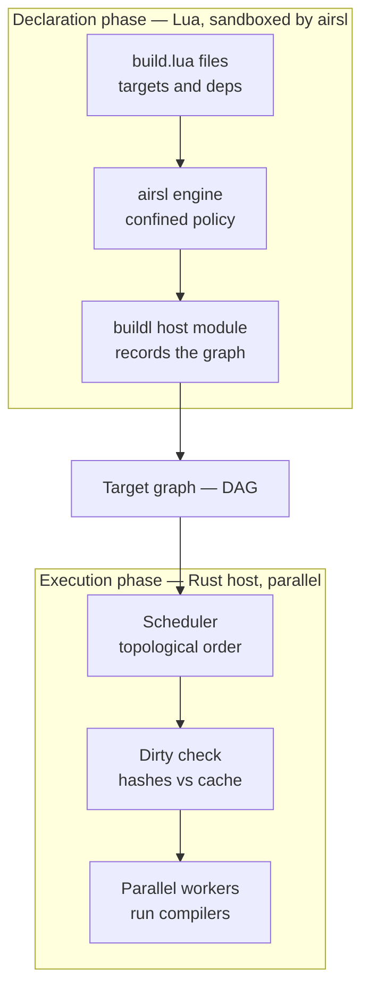
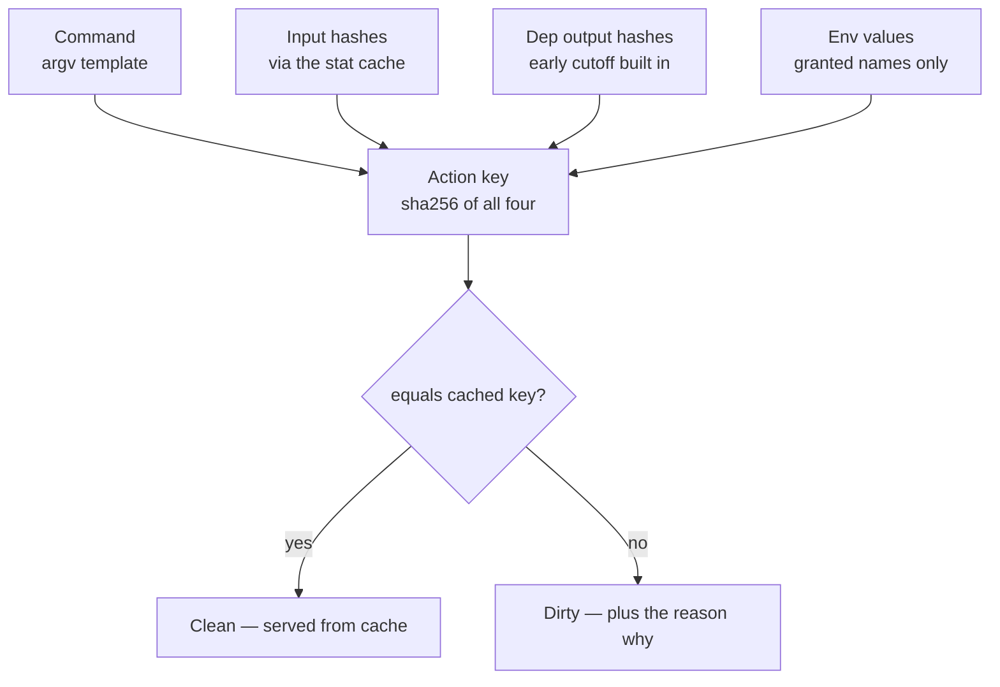
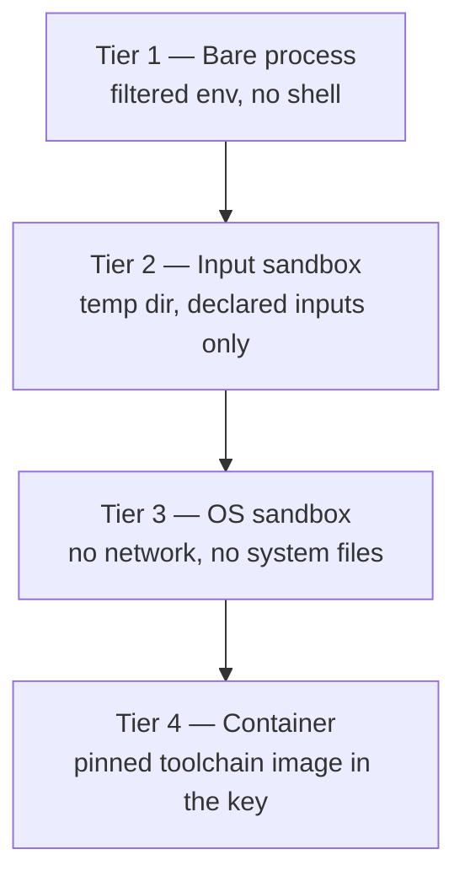

# buildl

**A sandboxed, deterministic build system whose build files are written in Lua and evaluated on the [airsl](https://github.com/airsstack/airsl) embedded runtime.**

The positioning in one sentence: Lua where Starlark sits in Bazel [5], ninja's execution discipline underneath [4], and airsl's capability model as the trust layer neither of them has.

> **Status: the core pipeline is built.** The `buildl` binary runs `check`, `graph`, `query`, `plan`, `build`, `test`, `log`, `clean` and `gc` on a real workspace: it evaluates build files on airsl, keys every target, runs what is dirty in parallel with its output captured, and keeps results in a local content-addressed store and action cache, so a second build runs nothing and a build repeated in another directory is byte-identical. Actions run at isolation tier 1, a plain process holding only its declared environment. That is the first item of the [roadmap](#roadmap), with `query`, `test`, `log`, `clean` and `gc` from the second; the input sandbox, grant negotiation, plugins, the remote cache and watch mode are designed and not built. The design and internal architecture are specified in [`design.md`](./docs/design.md) and [`architecture.md`](./docs/architecture.md). The one open correctness question — dynamic input discovery — is resolved: the mechanism is the discovery target ([design §10](./docs/design.md)), with fine-grained per-file C/C++ compilation out of scope for v1.

---

## Why buildl

buildl's founding constraint is inherited from airsl: **nothing is ambient**. A build file cannot read a file, spawn a process, or see an environment variable unless that authority was declared and granted. Where other build systems retrofitted hermeticity onto tools that assumed ambient authority [5], buildl starts from declared authority and adds capability.

Three properties follow from that constraint, and they are the product:

1. **Sandboxed build files.** A cloned repository's build files can be evaluated safely *before* any trust decision is made, because evaluation grants them nothing.
2. **Deterministic, explainable incrementality.** Dirtiness is decided by content hashes over declared inputs, so `buildl plan` can always answer *what* would rebuild and *why*.
3. **Visible authority.** The set of programs, paths, and environment variables a build may touch is derived from the build graph and checked against a workspace ceiling before anything executes.

Configuration languages for builds sit on a spectrum: inert data (YAML, TOML) cannot express repetition or conditionals; full scripting can express anything, including things a build file should never do. Lua-with-a-sandbox sits at the useful midpoint — real loops and functions, but a capability surface the host decides. xmake demonstrates the demand for Lua build configuration [9]; buildl differs by making the sandbox, not the convenience, the organizing principle.

## Architecture: declare, then execute

The single most important decision. Build files **declare**; the host **executes**. Lua never runs a compiler and never writes an artifact — it produces a description of the build, and the Rust host schedules, sandboxes, parallelises, and caches. This is the Bazel/ninja separation of concerns [4][5], with airsl's boundary enforcing it rather than convention.



The line between the two subgraphs is airsl's boundary. Declaration is safe on untrusted input (its engine holds no grant at all, and `b.sources()` reads the declaring directory host-side); parallelism lives in the Rust worker pool, where it works; and a build file that loops forever is stopped by airsl's instruction ceiling before it wastes anyone's time.

## A taste of `build.lua`

```lua
local b = buildl

b.subdir("lib")                          -- host evaluates lib/build.lua in its own scope

b.rule("cc", {
  run  = { "cc", "-c", "$in", "-o", "$out" },
  desc = "compile $in",
})

for _, src in ipairs(b.sources("src/**/*.c")) do
  b.target(airsstack.path.stem(src) .. ".o", { rule = "cc", inputs = { src } })
end

b.target("app", {
  deps = { "main.o", "util.o", "//lib:text" },   -- label syntax for cross-directory refs
  run  = { "cc", "$deps", "-o", "$out" },
})

b.alias("default", "app")
```

Design decisions visible in those lines: cross-directory references are graph **labels** (`//lib:text`) resolved in Rust, never `require` — build files reference each other's *targets*, not each other's code. Placeholders (`$in`, `$out`, `$deps`) expand host-side, each to a list of workspace-relative paths, the ninja model [4]; Lua never holds a real artifact path. And `b.sources()` is the declaration phase's only filesystem read, returning sorted results so declaration is deterministic regardless of filesystem order, and never entering the workspace's output or state directory, so a build file does not list what the build wrote. A rule's `desc` is the line shown for its actions: expanded like the command, and display text only, outside the action key.

Authority lives in `buildl.toml`, parsed by the host before any Lua runs — the workspace owner's statement of maximum authority, the **ceiling**:

```toml
[ceiling]
proc.run = ["cc", "ld", "go", "cargo", "bun", "docker", "protoc"]
env.read = ["HOME", "PATH", "GOCACHE", "CARGO_HOME"]
fs.read  = ["."]
fs.write = ["out", ".buildl", "target"]
```

There is no per-file capability manifest, because the build's authority is **derived, not requested**: after Resolve, the host walks the DAG, computes the wanted set (every program in every `run`, written out or named through a build setting, every env name, every output root), intersects it with the ceiling, and hands the result to an approver. A wanted program outside the ceiling refuses the plan at plan time, naming both sets — it never silently degrades the build.

## Incrementality: the action key

The core incremental mechanism, deliberately aligned with the Remote Execution API's action model [6][7]:



A key folds what each dependency *produced*, not the dependency's own key, so a dependency rebuilt to the same bytes leaves everything downstream clean, and a target downstream of a dirty one is *conditional*: it runs only if that output changes. The mismatching component is retained per dirty target — that is the entire implementation of `buildl plan`'s explanations. An output is a regular file or a directory of regular files, and has one digest either way: the digest of a small manifest naming each file's bytes, path and executable bit, so a built program is still runnable when a cache hit puts it back and a directory is put back whole or not at all. Outputs land in a content-addressed store before the cache row is written, so an interrupted build simply continues on the next run: no "corrupt cache, run clean" state is representable, and failures are never cached.

Execution isolation is a ladder, set in `buildl.toml` with per-target overrides. The tier, like the worker count and the per-action timeout beside it in `[execution]`, is no part of an action key — it decides how an action is run, never which action it is — so machines on different tiers share cache entries:



Tier 2 is Bazel's execroot discipline — undeclared inputs are simply absent, so hidden dependencies fail loudly [8]. The governing principle across all tiers: **every behavioral difference between two builds must be traceable to a difference in a declared input.**

## Commands

Each CLI command is the Load → Resolve → Plan → Execute → Record pipeline truncated at a different point:

| Command | Stops after | Purpose | Built |
|---|---|---|---|
| `buildl check` | Load | syntax-check every build file, run nothing | yes |
| `buildl graph` | Resolve | emit the DAG (`--json`, the default, or `--dot`) | yes |
| `buildl plan [target]...` | Plan | dry run: what would rebuild, and why | yes |
| `buildl build [target]...` | Record | the full pipeline | yes |
| `buildl watch [target]` | loops | persistent process, re-plans on file change | not yet |
| `buildl query <expr>` | Resolve | graph queries: `deps()`, `rdeps()` | yes |
| `buildl test [target]...` | Record | run test targets and what they need | yes |
| `buildl clean` / `gc` | `out/`; rows + cas | remove outputs; drop rows of undeclared targets and blobs nothing needs | yes |
| `buildl log <target> [--stdout \| --stderr]` | log + cas | show what a target printed when it last ran | yes |
| `buildl doctor` | — | print the effective ceiling, grants, workers | not yet |

`plan`, `build` and `test` take any number of targets and `--set name=value`; `build` adds `--keep-going` and `--stream`; with no targets `plan` and `build` take every target but the tests, while `test` takes every test, keeps going after a failure and adds `--stop`, `--stream`, `--rerun` and `--verbose`, and naming a target that is not a test is a usage error; `log` takes one target and at most one of `--stdout` and `--stderr`, and takes no lock, so it answers while a build runs; `clean` and `gc` take no arguments and take the lock. A command finds its workspace at the nearest `buildl.toml` at or above the current directory. The exit code says what kind of end it was, so CI need not read text: `0` done, `1` an action failed, `2` a wrong command line, `3` a sick builder, `4` the build wants more than the ceiling, `5` a mistake in a build file or in `buildl.toml`, `6` a state file that is not what buildl writes, `7` a fault in buildl.

## Running it

buildl builds and runs on Linux and macOS. From a checkout:

```sh
cargo make install            # installs the buildl binary from crates/buildl-cli
```

Then, in a directory that holds a `buildl.toml`, or below one:

```sh
buildl check                  # evaluate every build file, run nothing
buildl graph --dot            # the target graph; canonical JSON without the flag
buildl plan                   # what would run, and why
buildl build                  # build every target
buildl build //lib:text -k    # one target and what it needs, carrying on past a failure
buildl log //lib:text         # what that target printed when it last ran
```

Only the first isolation tier is built, and a manifest has to say so:

```toml
[execution]
strategy = "bare"
```

Without that line `build` refuses to run, rather than run actions under a weaker tier than the default asks for; `check`, `graph`, `query`, `plan`, `log`, `clean` and `gc` work either way.

## Repository layout

A Cargo workspace of four crates, dependency-inverted so every flow of a build is testable without Lua, a filesystem, or a process:

```text
buildl/
  crates/
    buildl-core/                      # domain data, ports (traits), pure logic: no I/O, no Lua
    buildl-lua/                       # evaluates build.lua through airsl
    buildl/                           # adapters + composition root: the complete framework
    buildl-cli/                       # the `buildl` binary: thin clap shell
  docs/
    design.md                         # what buildl is and why
    architecture.md                   # how each part works in Rust
    architecture-building-blocks.md   # how the parts fit: C4 views, crates, ports
    fundamental-walkthrough.md        # the design mapped onto build-system theory
```

Workspace policy is inherited verbatim from airsl [1]: `unsafe_code = "forbid"`, `unwrap_used` and `panic` denied, pedantic + nursery clippy at warn, every dependency commented with its reason.

## Roadmap

Dependency-ordered, from [`design.md` §13](./docs/design.md); progress is tracked as claudestacks-sdlc chains grouped by the milestones of [`.claudestacks/sdlc/roadmaps/buildl/`](./.claudestacks/sdlc/roadmaps/buildl/). buildl is a **build system first** — the defining capability is answering *"does this need to run at all?"*; task-runner use is a degenerate case the model yields for free.

1. **Core pipeline** — Load/Resolve/Plan/Execute/Record, `check`/`graph`/`plan`/`build`, local cache and cas
2. **`query` (`deps()`, `rdeps()`)** — small work, transforms CI for large repos; with it the `test`, `log`, `clean` and `gc` commands, and demand-driven and parallel loading of build files
3. **Local input sandbox (tier 2)** — the correctness discipline everything remote depends on; with it `verify`
4. **Grant negotiation UX** — wanted set, ceiling intersection, approver, and the `doctor` command; per-target grant narrowing is settled here
5. **Plugins** — manifest, attribution, `b.use()`; with them discovery targets
6. **Remote cache via REAPI** [7] — most of the remote value at a fraction of the complexity
7. **Watch mode** — full-reload variant first
8. **Remote execution, toolchain containers** — when a repo has genuinely outgrown one machine

## Part of airsstack

buildl is a project of the [airsstack](https://github.com/airsstack) ecosystem and is the first consumer of airsl's policy model, host-module seam, and (proposed) extension system. Design feedback is welcome — open an issue against `docs/design.md` or `docs/architecture.md`.

## License

Apache-2.0, following airsstack convention.

## References

1. airsstack. *airsl — Embeddable Lua runtime with a host standard library*. GitHub, 2026. URL: <https://github.com/airsstack/airsl>
2. airsstack. *airsl crate*. crates.io, 2026. URL: <https://crates.io/crates/airsl>
3. Reproducible Builds project. *SOURCE_DATE_EPOCH specification*. reproducible-builds.org. URL: <https://reproducible-builds.org/specs/source-date-epoch/>
4. Evan Martin et al. *The Ninja build system — manual*. ninja-build.org. URL: <https://ninja-build.org/manual.html>
5. Google / Bazel authors. *Hermeticity*. bazel.build. URL: <https://bazel.build/basics/hermeticity>
6. BuildBuddy. *Bazel's Remote Caching and Remote Execution Explained*. buildbuddy.io. URL: <https://www.buildbuddy.io/blog/bazels-remote-caching-and-remote-execution-explained/>
7. Bazel authors. *remote-apis — An API for caching and execution of actions on a remote system*. GitHub. URL: <https://github.com/bazelbuild/remote-apis>
8. Google / Bazel authors. *Sandboxing*. bazel.build. URL: <https://bazel.build/docs/sandboxing>
9. xmake-io. *Xmake — a cross-platform build utility based on Lua*. xmake.io. URL: <https://xmake.io/>
