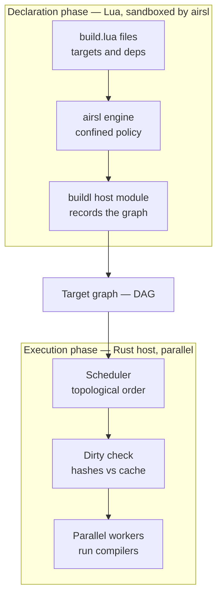
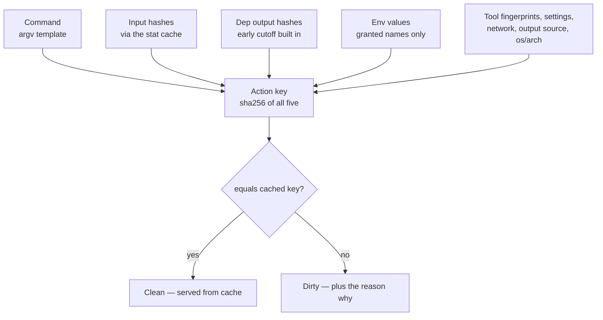
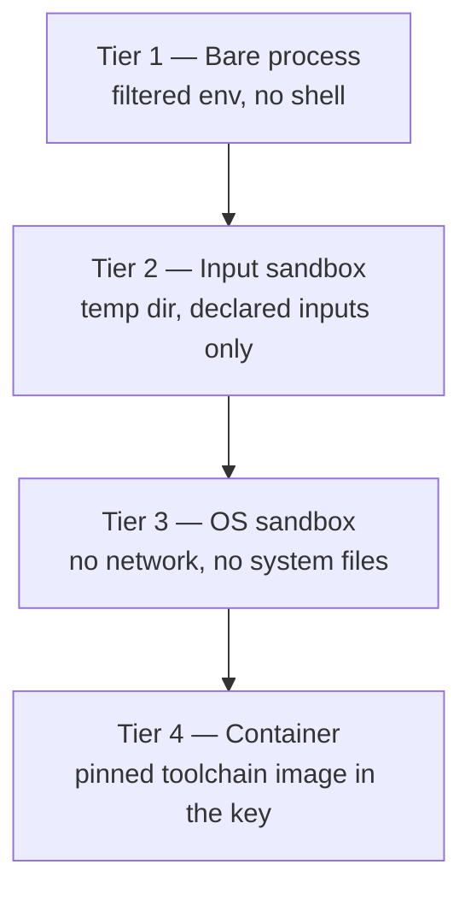

# buildl

**A sandboxed, deterministic build system whose build files are written in Lua and evaluated on the [airsl](https://github.com/airsstack/airsl) embedded runtime.**

The positioning in one sentence: Lua where Starlark sits in Bazel [5], ninja's execution discipline underneath [4], and airsl's capability model as the trust layer neither of them has.

> **Status: the core pipeline is built.** The `buildl` binary runs `check`, `graph`, `query`, `plan`, `build`, `test`, `verify`, `log`, `clean`, `gc`, `doctor`, `plugins fetch` and `watch` on a real workspace: it evaluates build files on airsl, in parallel, keys every target, runs what is dirty in parallel with its output captured, and keeps results in a local content-addressed store and action cache, so a second build runs nothing and a build repeated in another directory is byte-identical. Actions run by default at isolation tier 2, the input sandbox: each in a directory of its own outside the workspace, holding copies of its declared inputs and nothing else of the workspace, with `TZ`, `LC_ALL` and `SOURCE_DATE_EPOCH` fixed; tier 1, a plain process holding only its declared environment, runs on request. That is the first item of the [roadmap](#roadmap), with `query`, `test`, `log`, `clean`, `gc` and parallel loading from the second, the input sandbox and `verify` from the third, grant negotiation — the approver and `doctor` — from the fourth, plugins with discovery targets from the fifth, the remote cache from the sixth, watch mode from the seventh: `buildl watch` builds, then builds again when a file the build reads changes, reading the workspace anew each cycle, and remote execution from the eighth: with `execute` on, a target that neither the local cache nor the remote cache can serve is run by the server, and its result is checked and stored as a fetched one is and reported `remote`. The design and internal architecture are specified in [`design.md`](./docs/design.md) and [`architecture.md`](./docs/architecture.md). The one open correctness question — dynamic input discovery — is resolved: the mechanism is the discovery target ([design §10](./docs/design.md)), with fine-grained per-file C/C++ compilation out of scope for v1.

---

## Why buildl

buildl's founding constraint is inherited from airsl: **nothing is ambient**. A build file cannot read a file, spawn a process, or see an environment variable unless that authority was declared and granted. Where other build systems retrofitted hermeticity onto tools that assumed ambient authority [5], buildl starts from declared authority and adds capability.

Three properties follow from that constraint, and they are the product:

1. **Sandboxed build files.** A cloned repository's build files can be evaluated safely *before* any trust decision is made, because evaluation grants them nothing.
2. **Deterministic, explainable incrementality.** Dirtiness is decided by content hashes over declared inputs, so `buildl plan` can always answer *what* would rebuild and *why*.
3. **Visible authority.** The set of programs, paths, and environment variables a build may touch is derived from the build graph and checked against a workspace ceiling before anything executes.

Configuration languages for builds sit on a spectrum: inert data (YAML, TOML) cannot express repetition or conditionals; full scripting can express anything, including things a build file should never do. Lua-with-a-sandbox sits at the useful midpoint — real loops and functions, but a capability surface the host decides. xmake demonstrates the demand for Lua build configuration [9]; buildl differs by making the sandbox, not the convenience, the organizing principle.

## Architecture: declare, then execute

The single most important decision. Build files **declare**; the host **executes**. Lua never runs a compiler and never writes an artifact — it produces a description of the build, and the Rust host schedules, sandboxes, parallelises, and caches. This is the Bazel/ninja separation of concerns [4][5], with airsl's boundary enforcing it rather than convention.



The line between the two subgraphs is airsl's boundary. Declaration is safe on untrusted input (its engine holds no grant at all, and `b.sources()` reads the declaring directory host-side); parallelism lives in the Rust worker pool, where it works; and a build file that loops forever is stopped by airsl's instruction ceiling before it wastes anyone's time.

## A taste of `build.lua`

```lua
local b = buildl

b.subdir("lib")                          -- host evaluates lib/build.lua in its own scope

b.rule("cc", {
  run  = { "cc", "-c", "$in", "-o", "$out" },
  desc = "compile $in",
})

for _, src in ipairs(b.sources("src/**/*.c")) do
  b.target(airsstack.path.stem(src) .. ".o", { rule = "cc", inputs = { src } })
end

b.target("app", {
  deps = { "main.o", "util.o", "//lib:text" },   -- label syntax for cross-directory refs
  run  = { "cc", "$deps", "-o", "$out" },
})

b.alias("default", "app")
```

Design decisions visible in those lines: cross-directory references are graph **labels** (`//lib:text`) resolved in Rust, never `require` — build files reference each other's *targets*, not each other's code. Placeholders (`$in`, `$out`, `$deps`) expand host-side, each to a list of workspace-relative paths, the ninja model [4]; Lua never holds a real artifact path. And `b.sources()` is the declaration phase's only filesystem read, returning sorted results so declaration is deterministic regardless of filesystem order, and never entering the workspace's output or state directory, so a build file does not list what the build wrote. A rule's `desc` is the line shown for its actions: expanded like the command, and display text only, outside the action key.

Authority lives in `buildl.toml`, parsed by the host before any Lua runs — the workspace owner's statement of maximum authority, the **ceiling**:

```toml
[ceiling]
proc.run = ["cc", "ld", "go", "cargo", "bun", "docker", "protoc"]
env.read = ["HOME", "PATH", "GOCACHE", "CARGO_HOME"]
fs.read  = ["."]
fs.write = ["out", ".buildl", "target"]

[approver]
default = "interactive"   # manifest (when absent) | interactive | deny
```

There is no per-file capability manifest, because the build's authority is **derived, not requested**: after Resolve, the host places every output, expands every command, and computes the wanted set (the program of every command — written out, named through a build setting, or through `$in`, `$out` or `$deps` — every env name, every output root). A program a dependency built is no want and needs no `proc.run` entry: declaring the dependency is the permission. A want outside the ceiling refuses the plan at plan time, naming the want, the target and the ceiling — it never silently degrades the build. A wanted set inside the ceiling then goes to the approver `[approver]` names before `build`, `test` or `verify` runs anything: `manifest` says yes, `deny` says no, and `interactive` asks once on the terminal, remembers a yes outside the workspace, and asks again only about new wants; with no terminal it refuses. `buildl doctor` prints the ceiling, the approver and every want, allowed or refused, approved or not.

## Plugins and discovery targets

A plugin is Lua kept in the workspace or in a git repository on any host. A build file calls `buildl.use("go")` and gets the plugin's functions; what a plugin declares is the same primitives a build file uses, so `buildl graph` shows exactly what it generated. `buildl.toml` names the plugins beside the ceiling and says how much each may want:

```toml
[plugins.go]
git      = "https://github.com/acme/buildl-go"   # any git URL; or github = "acme/buildl-go"
rev      = "v1.2.0"                              # a tag or a full commit, never a branch
proc.run = ["go"]                                # the workspace's cap for this plugin
env.read = ["HOME", "GOCACHE"]
network  = false                                 # the default

[plugins.ourgo]
path = "plugins/ourgo"                           # a workspace-relative directory
```

A plugin's manifest is `extension.toml`, the airsl extension format: `[extension]` with `name`, `version`, `entry` and `api`, and `[capabilities]` with `proc.run` and `env.read`. Its `name` must match `[plugins.<name>]`. A plugin runs in the build file's engine under an environment of its own: a `buildl` table that stamps what it declares, copies of the curated modules and language tables, and a `require` that reads only the plugin's directory. It declares; it cannot run anything.

| | |
|---|---|
| `buildl.lock` | committed beside `buildl.toml`: for each git plugin its URL, its `rev`, the full commit `rev` resolved to, and the SHA-256 of its files |
| `.buildl/plugins/` | the store: each git plugin's files, one directory per commit, outside git |
| `buildl plugins fetch` | the only command that uses the network. It runs the `git` on the `PATH` for a plugin the lock does not pin, or whose stored files are missing or damaged, then writes `buildl.lock` and the store |
| every command that loads build files | checks each plugin once, before any build file is evaluated, against the lock and the store: a plugin that is not fetched, or whose files changed since, is refused |

**Narrowing and attribution.** What a plugin's targets may want is the request intersected with the plugin's manifest, with the workspace's cap for it, and then with the ceiling. A want outside a plugin's manifest or cap is refused at plan time, naming the plugin, so an update that starts wanting `curl` is caught. `plan`, `doctor` and the approver's prompt print each want with the plugins whose targets want it (`declared by plugin go@1.2.0 for //services/api:server`), and `buildl graph --json` gives every node's origin. Where a target came from is display and policy only: it is no part of an action key.

**Discovery targets.** Some inputs can be known only by running a tool, such as the packages `go list` finds. A discovery target is an ordinary cached action, run in the sandbox and held to the ceiling and to its plugin, with one output, `<name>.json`, that the build files read on a second pass:

```lua
buildl.discover("pkgs", { run = { "go", "list", "-json", "./..." }, inputs = { "go.mod" } })

local text = buildl.discovered("//svc:pkgs")     -- the output's bytes, or nil if it has not run
local pkgs = text and airsstack.json.decode(text) or {}
```

`build` and `test` run the discovery targets first, then evaluate the build files again with what they produced. Every other command that loads build files runs nothing: it declares from the last result this checkout recorded, and `check`, `graph`, `query` and `doctor` say so when a discovery target has not run, while `plan` lists each one that is not up to date. The second pass may not declare different discovery targets than the first, or the command is refused. A discovery target's output must be a file.

## Incrementality: the action key

The core incremental mechanism, deliberately aligned with the Remote Execution API's action model [6][7]:



A key folds what each dependency *produced*, not the dependency's own key, so a dependency rebuilt to the same bytes leaves everything downstream clean, and a target downstream of a dirty one is *conditional*: it runs only if that output changes. The mismatching component is retained per dirty target — that is the entire implementation of `buildl plan`'s explanations. An output is a regular file or a directory of regular files, and has one digest either way: the digest of a small manifest naming each file's bytes, path and executable bit, so a built program is still runnable when a cache hit puts it back and a directory is put back whole or not at all. Outputs land in a content-addressed store before the cache row is written, so an interrupted build simply continues on the next run: no "corrupt cache, run clean" state is representable, and failures are never cached.

Execution isolation is a ladder, set in `buildl.toml` with per-target overrides. The tier, like the worker count and the per-action timeout beside it in `[execution]`, is no part of an action key — it decides how an action is run, never which action it is — so machines on different tiers share cache entries:



Tier 2 is Bazel's execroot discipline — undeclared inputs are simply absent, so hidden dependencies fail loudly [8]. The governing principle across all tiers: **every behavioral difference between two builds must be traceable to a difference in a declared input.**

## The remote cache

`build` and `test` can share results with other machines through a server that speaks the Remote Execution API v2 over gRPC [7], as a client only; buildl ships no server. It has been run against bazel-remote 2.6.4; other servers that follow the protocol are expected to work, and have not been tried. The workspace names the server in `buildl.toml`, and the secret stays out of it:

```toml
[remote]
url      = "grpcs://cache.example.com:443"   # grpc:// or grpcs://
instance = "ci"                              # optional
ca       = "certs/ca.pem"                    # optional, added to the system roots
token    = { env = "BUILDL_REMOTE_TOKEN" }   # or { file = "/run/secrets/cache" }; never with grpc://
header   = "authorization"                   # optional; the token is sent as `Bearer <token>` there
timeout  = "30s"                             # optional
```

A target the local cache cannot serve is looked up on the server under the digest of an REAPI `Action` that holds its command, its inputs and its dependencies' outputs, with the target's action key as the salt, so two targets whose keys differ never share an entry. A hit is downloaded, every blob is checked against its digest, and the files are stored locally before the cache row is written; the target is reported `fetched` and nothing ran. A miss runs the action as before. Reading is the default; uploading and strict failure handling are turned on per machine or per run:

|Switch|Per machine|Per run|
|---|---|---|
|upload what this run built|`BUILDL_REMOTE_UPLOAD=1`|`build --remote-upload`, `test --remote-upload`|
|fail the run when a remote call fails|`BUILDL_REMOTE_STRICT=1`|`--remote-strict`|
|run a target no cache serves on the server|`BUILDL_REMOTE_EXECUTE=1`, or `execute = true` in `[remote]`|`--remote-execute`|
|run it here, keeping the cache|`BUILDL_REMOTE_EXECUTE=0`|`--no-remote-execute`|
|leave the remote out of this run|—|`--no-remote`, which overrides the others|

Only an action that ran and succeeded is uploaded, never a failure or a target restored from the local cache, and never under `strategy = "bare"`, where an action can read what it did not declare: that is refused. Without `--remote-strict` a failed call — unreachable server, timeout, an unusable result or a digest that does not match — prints one warning, the build carries on locally and the remote is left alone for the rest of the command; with it the run fails. A variable is `1` or `0`; a flag turns its switch on whatever the variable says; a switch flag in a workspace with no `[remote]` table, or `--no-remote` beside `--remote-upload`, `--remote-strict`, `--remote-execute` or `--remote-jobs`, is a usage error. A token that is named and missing is an error before anything runs, and the token never appears in output or in the log. `plan`, `verify`, `query`, `graph`, `check`, `log`, `clean` and `gc` never connect. `buildl doctor` prints `remote: none` without a `[remote]` table, and otherwise a `remote` section: the `url`, `instance`, `ca`, `header` and `timeout`, whether the `token` is set, `upload` and `strict` as this machine's variables read, `execute` as `buildl.toml` holds it and as `BUILDL_REMOTE_EXECUTE` sets it, with a note that the flags change them for one run, then `jobs`, `queue_timeout`, `retries` and each property. It connects to nothing and never shows the token.

With `execute` on, a target that the local cache and the server's cache both miss is sent to the server's Execution service instead of being run here. buildl uploads the inputs the server lacks, asks it to run the command, waits for the answer, then checks it, downloads it and stores it as it does a fetched result. The target is reported `remote` and the summary counts it after `fetched`. A job may wait on the server for at most `queue_timeout` (default `"1h"`) beyond the action's own `[execution] timeout`. `jobs` (default 128, up to 1024; `--remote-jobs N` for one run) is how many targets may be with the server at once, while `[execution] workers` still bounds the actions that run here. `retries` (default 5, up to 10) is how often a call that failed with `UNAVAILABLE`, `RESOURCE_EXHAUSTED`, `ABORTED` or `CANCELLED` is made again, after 100 ms and then doubling pauses of at most 5 s. `properties` adds platform properties to `OSFamily` and `ISA`, which the server matches its workers on. An action that exits non-zero or times out on the server fails its target, as it would here; any other failed call is handled as a failed lookup is, so without `--remote-strict` the run goes on locally. buildl does not upload what the server ran; the server is expected to keep it. Executing under `strategy = "bare"` is refused, as uploading is. A CI job runs the binary against NativeLink.

## Commands

Each CLI command is the Load → Resolve → Plan → Execute → Record pipeline truncated at a different point:

| Command | Stops after | Purpose | Built |
|---|---|---|---|
| `buildl check` | Load | syntax-check every build file, run nothing | yes |
| `buildl graph` | Resolve | emit the DAG (`--json`, the default, or `--dot`) | yes |
| `buildl plan [target]...` | Plan | dry run: what would rebuild, and why | yes |
| `buildl build [target]...` | Record | the full pipeline | yes |
| `buildl watch [target]...` | loops | persistent process, re-builds when a file the build reads changes or a build file now declares a different graph | yes |
| `buildl query <expr>` | Resolve | graph queries: `deps()`, `rdeps()` | yes |
| `buildl test [target]...` | Record | run test targets and what they need | yes |
| `buildl verify [target]... [--sample N]` | Execute | re-run cached actions in the sandbox and name those whose outputs differ | yes |
| `buildl clean` / `gc` | `out/`; rows + cas | remove outputs; drop rows of undeclared targets and blobs nothing needs | yes |
| `buildl log <target> [--stdout \| --stderr]` | log + cas | show what a target printed when it last ran | yes |
| `buildl doctor` | Resolve | print the ceiling, the approver, the execution settings, the remote cache, and each want: allowed or refused, approved or not, and the plugins that want it | yes |
| `buildl plugins fetch` | — | pin every git plugin `buildl.toml` names in `buildl.lock` and store its files; the only command that uses the network | yes |

`plan`, `build` and `test` take any number of targets and `--set name=value`; `build` and `test` add `--remote-upload`, `--remote-strict`, `--remote-execute`, `--no-remote-execute`, `--remote-jobs` and `--no-remote` (see [the remote cache](#the-remote-cache)); `build` adds `--keep-going` and `--stream`; with no targets `plan` and `build` take every target but the tests, while `test` takes every test, keeps going after a failure and adds `--stop`, `--stream`, `--rerun` and `--verbose`, and naming a target that is not a test is a usage error; `verify` takes the targets and `--set` as `build` does, writes no cache row and no log event, and never leaves a re-run's bytes in `out/`; it runs only under `strategy = "sandbox"`; `log` takes one target and at most one of `--stdout` and `--stderr`, and takes no lock, so it answers while a build runs; `clean` and `gc` take no arguments and take the lock; `plugins fetch` takes no arguments, takes the lock and reads no build file. A command finds its workspace at the nearest `buildl.toml` at or above the current directory. The exit code says what kind of end it was, so CI need not read text: `0` done, `1` an action failed or a `verify` re-run differed, `2` a wrong command line, which includes a remote switch variable that is neither `1` nor `0`, remote flags that conflict, a remote token that is named and not supplied, and an upload or remote execution asked for under `strategy = "bare"`, `3` a sick builder (a `git` that is missing or fails included, a remote cache that fails under `--remote-strict` or cannot be set up), or a `verify` target skipped or not put back, `4` the build wants more than the ceiling, than a plugin's manifest or cap, or than was approved, `5` a mistake in a build file or in `buildl.toml`, a plugin that is not fetched, or discovery targets that changed between the two passes, `6` a state file that is not what buildl writes, or a plugin changed since it was fetched, `7` a fault in buildl.

## Running it

buildl builds and runs on Linux and macOS. From a checkout:

```sh
cargo make install            # installs the buildl binary from crates/buildl-cli
```

Then, in a directory that holds a `buildl.toml`, or below one:

```sh
buildl check                  # evaluate every build file, run nothing
buildl graph --dot            # the target graph; canonical JSON without the flag
buildl plan                   # what would run, and why
buildl build                  # build every target
buildl build //lib:text -k    # one target and what it needs, carrying on past a failure
buildl log //lib:text         # what that target printed when it last ran
buildl verify                 # re-run every cached target in the sandbox, name those that differ
buildl verify --sample 5      # the same for five targets, the same five while their keys stay the same
buildl plugins fetch          # pin and store the plugins buildl.toml takes from git; commit buildl.lock
```

The manifest needs no `strategy` line: `build` and `test` run each action in the input sandbox by default. An action that reads a file it did not declare then fails with the tool's own message. Where the tools read files they cannot be made to declare, run as before, at tier 1:

```toml
[execution]
strategy = "bare"
```

`os-sandbox` and `container` are not built: `build`, `test` and `verify` refuse them, and the error says to write `strategy = "sandbox"`. `verify` also refuses `bare`, because a re-run at tier 1 would write into `out/`. `check`, `graph`, `query`, `plan`, `log`, `clean` and `gc` work under any strategy.

## Repository layout

A Cargo workspace of four crates, dependency-inverted so every flow of a build is testable without Lua, a filesystem, or a process:

```text
buildl/
  crates/
    buildl-core/                      # domain data, ports (traits), pure logic: no I/O, no Lua
    buildl-lua/                       # evaluates build.lua through airsl
    buildl/                           # adapters + composition root: the complete framework
    buildl-cli/                       # the `buildl` binary: thin clap shell
  docs/
    design.md                         # what buildl is and why
    architecture.md                   # how each part works in Rust
    architecture-building-blocks.md   # how the parts fit: C4 views, crates, ports
    fundamental-walkthrough.md        # the design mapped onto build-system theory
```

Workspace policy is inherited verbatim from airsl [1]: `unsafe_code = "forbid"`, `unwrap_used` and `panic` denied, pedantic + nursery clippy at warn, every dependency commented with its reason.

## Roadmap

Dependency-ordered, from [`design.md` §13](./docs/design.md); progress is tracked as claudestacks-sdlc chains grouped by the milestones of [`.claudestacks/sdlc/roadmaps/buildl/`](./.claudestacks/sdlc/roadmaps/buildl/). buildl is a **build system first** — the defining capability is answering *"does this need to run at all?"*; task-runner use is a degenerate case the model yields for free.

1. **Core pipeline** — Load/Resolve/Plan/Execute/Record, `check`/`graph`/`plan`/`build`, local cache and cas; built
2. **`query` (`deps()`, `rdeps()`)** — small work, transforms CI for large repos; with it the `test`, `log`, `clean` and `gc` commands, and parallel loading of build files; built
3. **Local input sandbox (tier 2)** — the correctness discipline everything remote depends on; with it `verify`, which re-runs cached actions and names those that differ; built
4. **Grant negotiation UX** — wanted set, ceiling intersection, approver, and the `doctor` command; per-target grant narrowing is settled here, as declined; built
5. **Plugins** — the `extension.toml` manifest, attribution, `buildl.use`; with them discovery targets; built
6. **Remote cache via REAPI** [7] — most of the remote value at a fraction of the complexity; built
7. **Watch mode** — full-reload variant first; built
8. **Remote execution** — when a repo has genuinely outgrown one machine; built

## Part of airsstack

buildl is a project of the [airsstack](https://github.com/airsstack) ecosystem and is the first consumer of airsl's policy model, host-module seam, and (proposed) extension system. Design feedback is welcome — open an issue against `docs/design.md` or `docs/architecture.md`.

## License

Apache-2.0, following airsstack convention.

## References

1. airsstack. *airsl — Embeddable Lua runtime with a host standard library*. GitHub, 2026. URL: <https://github.com/airsstack/airsl>
2. airsstack. *airsl crate*. crates.io, 2026. URL: <https://crates.io/crates/airsl>
3. Reproducible Builds project. *SOURCE_DATE_EPOCH specification*. reproducible-builds.org. URL: <https://reproducible-builds.org/specs/source-date-epoch/>
4. Evan Martin et al. *The Ninja build system — manual*. ninja-build.org. URL: <https://ninja-build.org/manual.html>
5. Google / Bazel authors. *Hermeticity*. bazel.build. URL: <https://bazel.build/basics/hermeticity>
6. BuildBuddy. *Bazel's Remote Caching and Remote Execution Explained*. buildbuddy.io. URL: <https://www.buildbuddy.io/blog/bazels-remote-caching-and-remote-execution-explained/>
7. Bazel authors. *remote-apis — An API for caching and execution of actions on a remote system*. GitHub. URL: <https://github.com/bazelbuild/remote-apis>
8. Google / Bazel authors. *Sandboxing*. bazel.build. URL: <https://bazel.build/docs/sandboxing>
9. xmake-io. *Xmake — a cross-platform build utility based on Lua*. xmake.io. URL: <https://xmake.io/>
