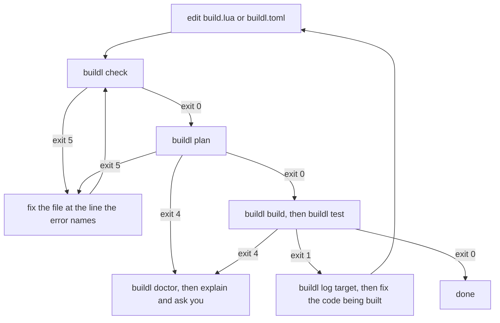
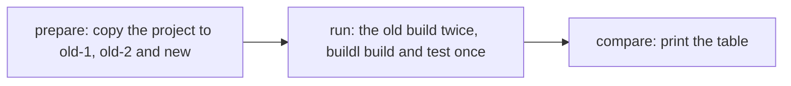

# With an AI Agent

An AI coding agent can write `build.lua`, run `buildl` and read what it says. To do that well it
needs to know how `buildl` works: that nothing is allowed unless `buildl.toml` allows it, what each
exit code means, and which questions are the user's to answer. The repository ships two *skills*
that tell it.

| Skill | What it is for |
|---|---|
| `buildl` | writing, editing and debugging `build.lua` and `buildl.toml`, and reading what `buildl` reports |
| `buildl-migrate` | moving a Makefile, justfile, shell scripts or npm scripts to `buildl`, and proving the new build matches the old |

A skill is a folder holding a `SKILL.md` file, and sometimes scripts and reference pages the agent
reads when it needs them. Both skills follow the
[Agent Skills format](https://agentskills.io/specification), so any agent that
reads that format can use them. Claude Code installs them as a plugin; other agents read them from
a skills folder.

## Installing the skills

The skills come with an installer, `skills/install.sh`. It installs the `buildl` and `airsl` programs
if they are missing, then the skills. A program already on your `PATH` is left alone, so the script
never upgrades a `buildl` you installed on purpose. It prints each command before it runs it, and
needs no `sudo`.

For Claude Code, download the script, read it, then run it:

```console
$ curl -fsSLO https://raw.githubusercontent.com/airsstack/buildl/main/skills/install.sh
$ sh install.sh --claude
```

For another agent, give `--dir` the folder that agent reads skills from. If you have cloned the
repository, run the script from the clone:

```console
$ sh skills/install.sh --dir ~/.codex/skills
```

`--dir` copies `buildl` and `buildl-migrate` into that folder and replaces only those two, so your
other skills there stay. Running it again gives the same result.

| Option | Meaning | Default |
|---|---|---|
| `--claude` | install the skills as a Claude Code plugin, `buildl@buildl` | |
| `--dir PATH` | copy the two skills into `PATH` | |
| `--ref BRANCH` | the git branch to install from. `--dir` from a clone ignores it | `main` |
| `--dry-run` | print every command and run none | off |

Give exactly one of `--claude` and `--dir`. `--dry-run` shows what would happen before you let it.

**It takes a while.** When `buildl` is missing, the script builds it with Cargo, and on a machine
with nothing cached that takes several minutes, as [Installation](ch01-01-installation.md) says.
It runs `cargo install --locked --git https://github.com/airsstack/buildl --branch BRANCH
buildl-cli`, where `BRANCH` is `--ref` (`main` by default). With `--dir` from a clone it builds the
`buildl` in that clone instead, so the program and the skills come from the same source. `airsl`
comes from crates.io with `cargo install --locked airsl-cli`. If `buildl` and `airsl` are already
installed, only the skills are installed and it finishes quickly.

The script needs Rust (from <https://rustup.rs>) only when it has to build something. For
`--claude` it also needs the `claude` command, and for `--dir` from GitHub it needs `curl` and
`tar`. When one is missing it says so and stops.

## What the agent does with the `buildl` skill

With the `buildl` skill loaded, the agent works in a loop and lets the exit code of each command say
where to go next:



`check` only reads declarations, so it passes even when a build would be refused. `plan` is where
a missing permission first shows, before anything runs.

### A refusal is answered by asking you

When a build is refused (exit code 4), the agent does not make the refusal go away. Whether a build
may run a program or touch a folder is your decision, so the agent runs `buildl doctor`, quotes the
error line `buildl` printed, says which key in `buildl.toml` would allow it, and asks along these
lines:

```text
buildl refused the build:
  //:x.txt: program sh is outside the ceiling (proc.run allows: python3)
To allow it, buildl.toml's [ceiling] proc.run needs "sh". Should I add it?
```

On a yes it makes exactly that change. Without one it changes nothing. A refusal has three causes,
and the agent tells you which: the [ceiling](ch04-02-the-ceiling.md), a plugin's own limits
([How buildl Decides](ch08-03-how-buildl-decides.md)), or the [approver](ch04-03-approvers.md). The
skill forbids two changes outright, even if they would get a build to run:

- changing `[approver]` to get past a refusal
- setting `strategy = "bare"` to get past a sandbox failure, since that drops the sandbox when the
  real fix is a missing declared input

Two more need you first:

- widening the ceiling, a plugin's cap, or a plugin's `extension.toml` happens only on your yes to
  that exact change
- deleting an old build, `out` or `.buildl` happens only after the agent asks

## Moving a build to `buildl`

Ask the agent to migrate a project and the `buildl-migrate` skill takes over. It reads the old build,
writes `build.lua` and `buildl.toml`, and then proves the new build matches the old one. It never
edits or deletes the old build files.

The proof is a *parity check* in three steps. The agent writes `parity.json` first. That file maps
every old recipe to the `buildl` target that replaces it (or says why it was dropped), lists the
output files to compare, and lists what the old build uses: programs, environment variables and
whether it touches the network.



| Step | What happens |
|---|---|
| prepare | copies the project three times into a work folder outside the project: `old-1`, `old-2` and `new`. It runs nothing |
| run | runs the old build in `old-1` and `old-2`, the old tests in `old-1` when the project has them, and `buildl build`, `buildl test`, `buildl graph` and `buildl doctor` in `new`, saving each exit status and output. This is the agent's own shell, not the script |
| compare | reads the results and prints a table. It runs nothing and writes nothing, and exits non-zero if any row is `FAIL` |

The old build runs twice so the check can tell a build that is not repeatable from one that
is. If `old-1` and `old-2` disagree about a file, the new build cannot be blamed for differing from
it.

The table ends with `parity: PASS` or `parity: FAIL (n rows)`. A row's verdict is one of these:

| Verdict | What it means |
|---|---|
| `PASS` | the check holds |
| `FAIL` | the check does not hold. The row says which check. The agent fixes the new build, or the mistake in `parity.json` about the old one, and tells you when nothing can judge the file or the old build itself failed |
| `NOT REPEATABLE` | the old build gives different bytes for this file on two runs, so the tests decide it instead |
| `JUDGED BY TESTS` | the file is marked to be decided by the tests, with its reason shown |
| `NO TESTS` | the project has no test command, so there are no test results to compare |

A `FAIL` is fixed in the new build. The agent never edits `parity.json` to make a row pass, for
example by dropping a recipe that does build. When it finishes, the old build files, `parity.json`
and the work folder stay where they are, and it tells you their paths. Deleting them is up to you.

With `[approver] default = "interactive"`, `buildl build` in the work folder's `new` copy is refused,
since nobody approved that new place and the agent's shell has no terminal. The agent then asks you
to run the `new` lines of the run step in your own terminal, and compares afterwards. With `deny`,
nothing runs anywhere, so the parity check cannot run and the agent says so.

### C and C++, compiled one file at a time

Many C projects compile each `.c` file to its own `.o` file and link them (`%.o: %.c` in a
Makefile). The agent moves that to [the `c` plugin](ch08-04-the-c-plugin.md), which compiles each
source to its own object, so a change to one source or header rebuilds only the objects that read
it. It adds a `[plugins.c]` table to `buildl.toml`, runs `buildl plugins fetch`, and declares the
program with one call:

```lua
local c = buildl.use("c")

c.binary("app", {
  srcs    = { "src/main.c", "src/util.c" },
  headers = { "src/util.h" },
})
```

The plugin's programs, and the `PATH` it reads, must be allowed by the ceiling and by the
`[plugins.c]` table. If they are not,
the agent asks you first, as it does for any refusal.

In `parity.json`, the old per-file recipes map to the plugin's object targets, and the old link to
the call's own target, `app`. When the old build compiles with `-g`, the compiler records the folder
it ran in, and `buildl` compiles in another one. The binary then differs from the old build's, byte
for byte, so the check marks that output *judged by tests*: the old tests and the `buildl` tests
decide it. A project with no test command cannot pass parity this way. Without `-g` an object does
not record the folder it was compiled in, so an object from `buildl` can match the old build's when
the compiler, the flags and the source match, and the output is compared as any other.
