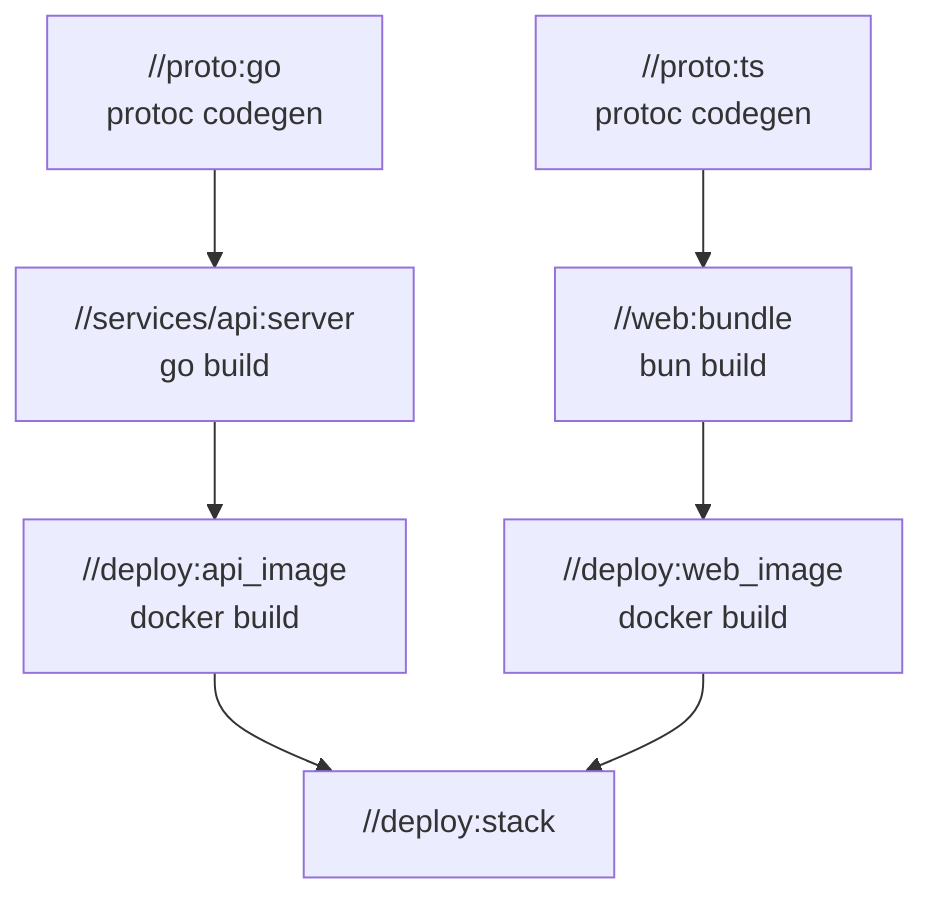

# Many Directories

A real project has more than one directory, and each directory knows best how to build itself.
buildl gives each one its own `build.lua`, and joins them with labels. This page walks through
`examples/polyglot` in the buildl repository: one schema, and a Go, a Rust and a Python program
built from it.

```text
polyglot/
  buildl.toml
  build.lua
  schema/   build.lua  generate.py  schema.json
  go/       build.lua  go.mod  main.go
  rust/     build.lua  Cargo.toml  Cargo.lock  src/main.rs
  python/   build.lua  pack.py  tool/__main__.py
```

## `buildl.subdir`

The root build file declares no targets. It names the four directories:

```lua
-- build.lua
local b = buildl

-- Each directory declares its own targets; they reach each other by label.
b.subdir("schema")
b.subdir("go")
b.subdir("rust")
b.subdir("python")
```

`buildl.subdir("go")` asks buildl to evaluate `go/build.lua`, on its own, with `go/` as its
directory. Its targets are labelled `//go:…`, its inputs are read from `go/`, and its outputs land
in `out/go/`.

This is the only way a build file gets read. buildl does not search the workspace for `build.lua`
files: it reads the root one, then each one a build file it read has named, and nothing else. A
`build.lua` that nobody names is never evaluated. Here `extra/build.lua` sits in the `hello`
workspace from [Targets and Labels](ch03-01-targets-and-labels.md), unnamed:

```console
$ buildl check
ok: 5 declarations in 2 build files
$ buildl query 'deps(//extra:unseen)'
error: target //extra:unseen was asked for but is not declared
```

So what is in the build is exactly what the build files say is in it, never what happens to be on
disk.

## Labels across directories

The schema directory holds one target that writes all four generated files:

```lua
-- schema/build.lua
local b = buildl

b.target("gen", {
  inputs = { "generate.py", "schema.json" },
  outputs = { "gogen/gen.go", "gogen/go.mod", "gen.rs", "gen.py" },
  run = { "python3", "$in", "$out" },
})
```

Each program lists it by its full label. The Go one:

```lua
-- go/build.lua
local b = buildl

b.target("service", {
  inputs = { "go.mod", b.sources("*.go") },
  deps = { "//schema:gen" },
  run = { "go", "build", "-C", "go", "-o", "../$out", "." },
  env = { "HOME" },
})
```

`rust/build.lua` and `python/build.lua` do the same with `cargo` and `python3`. A command runs from
the workspace root, so the Go target builds with `go build -C go`, and each language finds the
generated files under `out/schema/`.

The graph has one target in the middle and three around it:

```console
$ buildl graph --dot
digraph buildl {
  "//go:service";
  "//python:tool.pyz";
  "//rust:cli";
  "//schema:gen";
  "//go:service" -> "//schema:gen";
  "//python:tool.pyz" -> "//schema:gen";
  "//rust:cli" -> "//schema:gen";
}
$ buildl query 'rdeps(//schema:gen)'
//go:service
//python:tool.pyz
//rust:cli
```

`rdeps` names one target per language: an edit to the schema can affect all three programs, and
nothing else.

```console
$ buildl build
--- //rust:cli
  Installing cli v0.1.0 (/private/tmp/buildl-book/tmp/buildl-510c2c2d7c9d4afaeb5c7353b92c9838/709bb78cafdc4445f4217a9db757a876/rust)
   Compiling cli v0.1.0 (/private/tmp/buildl-book/tmp/buildl-510c2c2d7c9d4afaeb5c7353b92c9838/709bb78cafdc4445f4217a9db757a876/rust)
    Finished `release` profile [optimized] target(s) in 1.18s
  Installing /private/tmp/buildl-book/tmp/buildl-510c2c2d7c9d4afaeb5c7353b92c9838/709bb78cafdc4445f4217a9db757a876/out/rust/cli/bin/cli
   Installed package `cli v0.1.0 (/private/tmp/buildl-book/tmp/buildl-510c2c2d7c9d4afaeb5c7353b92c9838/709bb78cafdc4445f4217a9db757a876/rust)` (executable `cli`)
warning: be sure to add `/private/tmp/buildl-book/tmp/buildl-510c2c2d7c9d4afaeb5c7353b92c9838/709bb78cafdc4445f4217a9db757a876/out/rust/cli/bin` to your PATH to be able to run the installed binaries
4 built
$ ./out/go/service
go service 1.0: hello from the schema
$ ./out/rust/cli/bin/cli
rust cli 1.0: hello from the schema
$ python3 out/python/tool.pyz
python tool 1.0: hello from the schema
```

The paths `cargo` printed are the sandbox: a directory outside the workspace, laid out like it,
where the command ran ([The Sandbox](ch06-00-sandbox.md)). The schema ran first because all three
programs depend on it; the three programs then ran side by side.

## The same shape, bigger

A larger monorepo looks the same: code generators in the middle, each language's build around
them, and packaging steps on top.



An arrow here points from what is built first to what uses it. One `.proto` edit rebuilds both
columns in the right order, side by side. A web-only edit leaves the Go column alone, and `go` is
never started. Every box is an ordinary `buildl.target` with `inputs`, `deps` and `run`.
