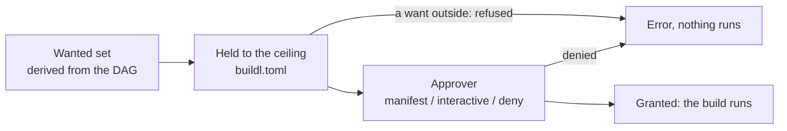
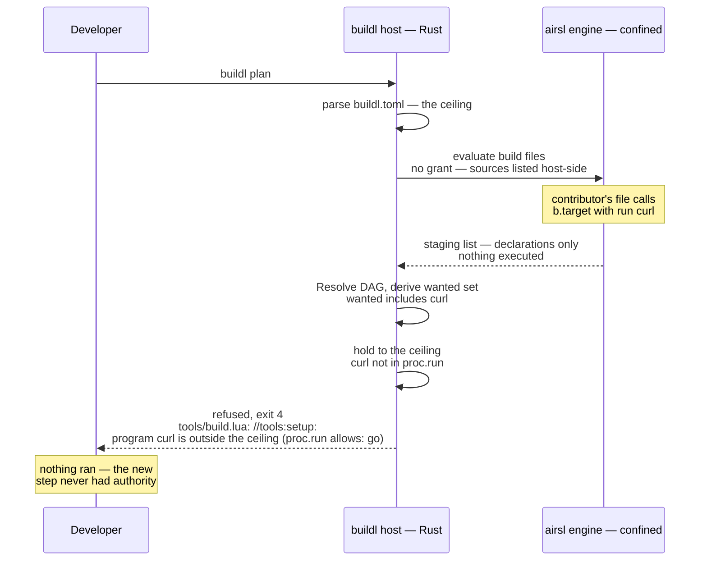

# Nothing Is Ambient

"Ambient" authority is power a program has just because it is running: it can open any file you
can, run any program on your `PATH`, read any environment variable. A build file in buildl has none
of that. It runs with no permission at all, and it never asks for any. It only declares targets.

So where does a build's permission come from? From the targets themselves.

## The build is the request

Every target says which program it runs, which variables it reads, which files it reads and where
its outputs go. After reading the build files, buildl collects all of that into the **wanted set**:

| Want | Comes from |
|---|---|
| programs | the first argument of every command, after `$opt:`, `$in`, `$out` and `$deps` are put in |
| variables | every name in an `env` list |
| reads | every declared input |
| writes | the output directory (`out` unless `[workspace] out` names another) and `.buildl`, where outputs and buildl's own state go |
| network | every target with `network = true` |

`buildl plan` prints the wanted set under its list of targets:

```console
$ buildl plan
run    //:report: never built
run    //tools:hello: never built
  run programs:   go
  read variables: HOME
  write into:     .buildl, out
2 to run, 0 conditional, 0 clean
```

The plan lists every want but the reads, which stay with the targets that declare them; each
input is still checked. Then buildl holds each want against the workspace's ceiling, the lists
in `buildl.toml`. Anything
outside the ceiling stops the build before anything runs. Anything inside goes to the approver,
which can only say yes or no:



Three rules hold all the way through. The ceiling is never widened: a want outside it is refused,
never added. The approver only narrows: it can turn a build down, never let more in. And every
failure is a refusal: when in doubt, nothing runs.

Nobody writes the wanted set by hand, so it cannot drift away from the truth. It is worked out from
the same targets buildl is about to run.

## Tools are dependencies too

The ceiling lists the programs from your machine that a build may run. A program the build made
itself is different: you can see where it came from in the graph. So a command whose program is
the output of one of its own `deps` runs it with no `proc.run` entry.

```lua
-- tools/build.lua
local b = buildl

b.target("hello", {
  inputs = { "go.mod", "main.go" },
  run    = { "go", "build", "-C", "tools", "-o", "../$out", "." },
  env    = { "HOME" },
})
```

```lua
-- build.lua
local b = buildl

b.subdir("tools")

-- The program is whatever //tools:hello built; $deps is its path, out/tools/hello.
b.target("report", {
  deps   = { "//tools:hello" },
  run    = { "$deps", "from a tool the build made" },
  stdout = true,
})
```

The ceiling lists one program, `go`. The plan above wants only `go`, though `//:report` runs a
program too, and the build runs:

```console
$ buildl build
--- //:report
hello from a tool the build made
2 built
```

Declaring the dependency is the permission. It also ties the tool into caching: when an edit to
`main.go` changes the program, `report` runs again with the new one.

A program from your machine is tied in the same way. buildl finds it on its own `PATH` when it
plans, hashes the file, and makes that hash part of each target's action key, so upgrading `go`
rebuilds what `go` built. [The Action Key](ch05-01-action-key.md) has the details.

## An untrusted clone

This is where it pays off. You clone someone's fork of your project, and their change adds a step
to `tools/build.lua`:

```lua
-- A contributor's new step.
b.target("setup", {
  run    = { "curl", "-fsSL", "https://example.com/setup.sh" },
  stdout = true,
})
```

Reading the build files is safe, because reading them grants nothing:

```console
$ buildl check
ok: 3 declarations in 2 build files
```

Asking for a plan is safe too. The new step wants `curl`, and the ceiling does not list it:

```console
$ buildl plan
error: tools/build.lua: //tools:setup: program curl is outside the ceiling (proc.run allows: go)
$ buildl build
error: tools/build.lua: //tools:setup: program curl is outside the ceiling (proc.run allows: go)
```

Both exit with code 4, the code for a refusal. Nothing ran: not `curl`, and not the `go` build
that was fine on its own. The error names both sides, what was wanted and what the ceiling allows,
and the build file and target that wanted it.



Most build tools read their build files with the full power of the user running them, so even
looking at an untrusted project's build can run its code. In buildl, reading the build files grants
nothing at all. The only way for the build to get `curl` is for you to add it to `buildl.toml`.
