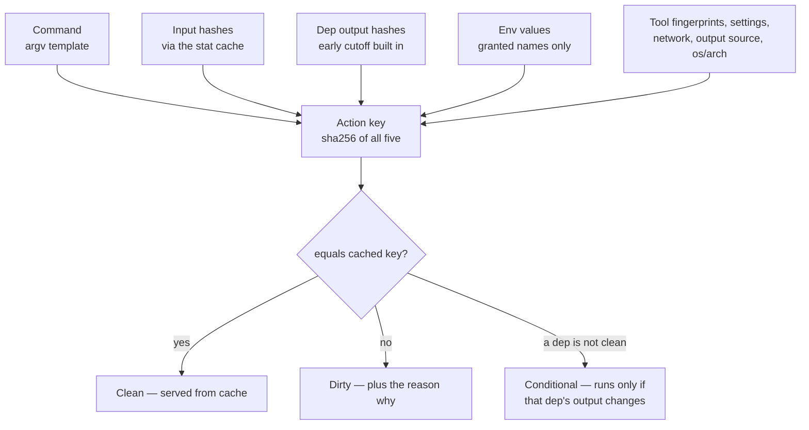
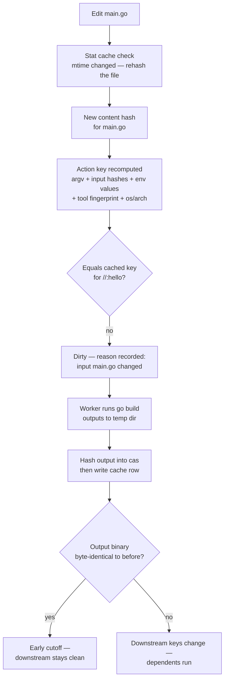

# The Action Key

Every target that runs something has an *action key*: one SHA-256 digest of everything that could
change what its action produces. `buildl` keeps the key of each action it has run next to the
outputs it made. When a build comes to a target, it works out the key again. Same key, and the old
outputs are put back. A different key, and the action runs.



## Why does it have to run?

`buildl` keeps the pieces of each key, not only the digest. So when a key changes, it can compare
the old pieces with the new ones and tell you which one moved. Here is the Go project from
[A First Project](ch02-00-first-project.md), with an edit to `main.go`. The edits in this chapter
use `sed -i ''`, the macOS form; on Linux, drop the `''`:

```console
$ buildl plan
clean  //:hello
  run programs:   go
  read variables: HOME
  write into:     .buildl, out
0 to run, 0 conditional, 1 clean
$ sed -i '' 's/hello from go/hello again from go/' main.go
$ buildl plan
run    //:hello: input main.go changed
  run programs:   go
  read variables: HOME
  write into:     .buildl, out
1 to run, 0 conditional, 0 clean
$ buildl build
1 built
$ buildl plan
clean  //:hello
  run programs:   go
  read variables: HOME
  write into:     .buildl, out
0 to run, 0 conditional, 1 clean
```

## What goes in

`buildl plan --json` prints the plan as JSON, with every piece of every key spelled out. One more
edit, and a look:

```console
$ echo '// a comment' >> main.go
$ buildl plan --json | python3 -m json.tool
{
    "attribution": {
        "env": {},
        "network": {},
        "programs": {}
    },
    "settings": {},
    "stale_discovery": [],
    "targets": {
        "//:hello": {
            "key": {
                "components": {
                    "deps": [],
                    "own": {
                        "command": [
                            "go",
                            "build",
                            "-o",
                            "$out",
                            "."
                        ],
                        "env": {
                            "HOME": "/tmp/buildl-book/home"
                        },
                        "inputs": [
                            {
                                "digest": "d38681ddfea2335850882acc2698e6d7774a756145aa33b2a609a7e017557758",
                                "path": "go.mod"
                            },
                            {
                                "digest": "ad15ae8cfe78c99215787abf757440d2fabff96c116a6f0c93730308833dd9f9",
                                "path": "main.go"
                            },
                            {
                                "digest": "5d3a28044a10bc204ee388b2d16bc160f4c723b69e0a8bb80b1d0c1532f80a25",
                                "path": "main_test.go"
                            }
                        ],
                        "network": "Sealed",
                        "output_source": "Command",
                        "outputs": [
                            "hello"
                        ],
                        "platform": "macos/aarch64",
                        "settings": {},
                        "tool": {
                            "fingerprint": "45bd4639e304aed73901b60255c0eaffbf35ef0b2f23775fbb0a415a3618cfb6",
                            "program": "go"
                        }
                    }
                },
                "digest": "c78ccfa8b689322380fbf639ec7ae072b574353dd5157f6907661670350eda22"
            },
            "reason": {
                "Changed": [
                    {
                        "Input": "main.go"
                    }
                ]
            },
            "unfinished": null,
            "verdict": "Dirty"
        }
    },
    "wanted": {
        "env": [
            "HOME"
        ],
        "network": [],
        "programs": [
            "go"
        ],
        "write": [
            ".buildl",
            "out"
        ]
    }
}
```

`components` is what the key is made of, `digest` is the key itself, and `reason` is the piece that
differs from the last build: the words `input main.go changed` come from it. The digests, the
`HOME` value and the platform will be your own.

| Component | What it holds |
|---|---|
| `command` | the command as written, before `$out` and the others are filled in |
| `inputs` | the path and a SHA-256 of the contents of every input file |
| `deps` | for each dependency, a digest of each output it produced: its name, a hash of its bytes and whether it is executable |
| `env` | the value of each variable the target declared, and nothing of the rest of the environment |
| `tool` | the program the command runs, and a fingerprint of that program's file |
| `settings` | the [build settings](ch03-05-build-settings.md) the target uses, with their values for this run |
| `network`, `output_source`, `outputs` | whether it may reach the network, whether its output is a file it writes or what it prints, and the names of its outputs |
| `platform` | the operating system and the processor |

So a new Go toolchain is a new `tool` fingerprint and rebuilds everything that runs `go`, and a
cache filled on a Mac is never used on Linux. Some things are left out on purpose. How many actions
run at once, the timeout, and whether actions run in [the sandbox](ch06-00-sandbox.md) change how a
build runs, not what an action is given, so none of them is part of the key.

## What a dependency produced, not its key

The `deps` list above is empty, because `//:hello` depends on nothing. In the polyglot workspace
from [Many Directories](ch03-04-many-directories.md), `//go:service` depends on `//schema:gen`, and
its key holds a digest of each file `//schema:gen` wrote. That digest covers the file's name, a
hash of its bytes and whether it is executable, so it is not the same number `shasum` prints:

```console
$ buildl plan --json //go:service | python3 -c 'import json,sys; t=json.load(sys.stdin)["targets"]["//go:service"]; print(json.dumps(t["key"]["components"]["deps"], indent=2))'
[
  {
    "label": "//schema:gen",
    "outputs": [
      {
        "digest": "48497628d8cd57a7717a79ccd4d81becd7b149564ec060ebb5e99fd9f2588e2b",
        "name": "gogen/gen.go"
      },
      {
        "digest": "088cae078ec9a96c4f9b03ab629306aa133d69aa685092d0b99dd8a08f0cb12a",
        "name": "gogen/go.mod"
      },
      {
        "digest": "9d1e8a75aa2175d3e82a7b96fd399b975d0af6d42da73298186453978d49edd3",
        "name": "gen.rs"
      },
      {
        "digest": "343fea850093120344f9469cccb363ec52a8690d84e651d8faa0e3dfa8d85e94",
        "name": "gen.py"
      }
    ]
  }
]
```

It holds what the dependency *made*, not the dependency's own key. That one choice is what the
next page, [Early Cutoff](ch05-02-early-cutoff.md), is about.

## One edit, start to finish

Put together, this is everything that happens between saving `main.go` and the build finishing:



The *stat cache* is how `buildl` avoids reading every input on every run: when a file's size and
modification time are what they were last time, the hash recorded then is used again. The *cas* is
the store under `.buildl/` that holds every output by the hash of its contents. The output goes
into the cas first and the cache row is written after it, so a build stopped half way never leaves
a row that points at nothing; [Crash Safety and the Store](ch11-02-crash-safety.md) has the rest.
