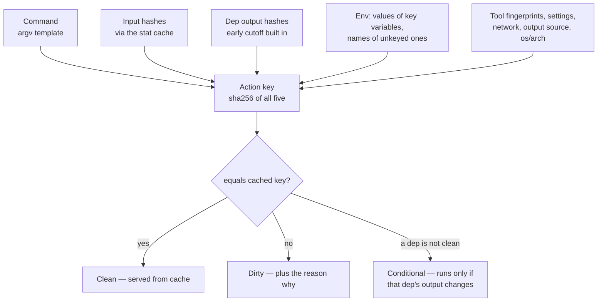
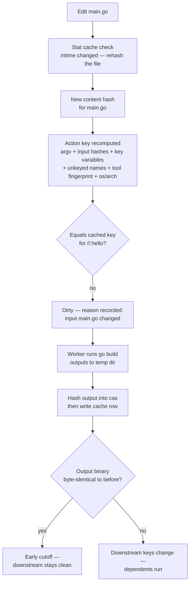

# The Action Key

Every target that runs something has an *action key*: one SHA-256 digest of everything that could
change what its action produces. `buildl` keeps the key of each action it has run next to the
outputs it made. When a build comes to a target, it works out the key again. Same key, and the old
outputs are put back. A different key, and the action runs.



## Why does it have to run?

`buildl` keeps the pieces of each key, not only the digest. So when a key changes, it can compare
the old pieces with the new ones and tell you which one moved. Here is the Go project from
[A First Project](ch02-00-first-project.md), with an edit to `main.go`. The edits in this chapter
use `sed -i ''`, the macOS form; on Linux, drop the `''`:

```console
$ buildl plan
clean  //:hello
  run programs:      go
  unkeyed variables: HOME
  write into:        .buildl, out
0 to run, 0 conditional, 1 clean
$ sed -i '' 's/hello from go/hello again from go/' main.go
$ buildl plan
run    //:hello: input main.go changed
  run programs:      go
  unkeyed variables: HOME
  write into:        .buildl, out
1 to run, 0 conditional, 0 clean
$ buildl build
1 built
$ buildl plan
clean  //:hello
  run programs:      go
  unkeyed variables: HOME
  write into:        .buildl, out
0 to run, 0 conditional, 1 clean
```

## What goes in

`buildl plan --json` prints the plan as JSON, with every piece of every key spelled out. One more
edit, and a look:

```console
$ echo '// a comment' >> main.go
$ buildl plan --json | python3 -m json.tool
{
    "attribution": {
        "env": {},
        "network": {},
        "programs": {},
        "unkeyed": {}
    },
    "settings": {},
    "stale_discovery": [],
    "targets": {
        "//:hello": {
            "key": {
                "components": {
                    "deps": [],
                    "own": {
                        "command": [
                            "go",
                            "build",
                            "-o",
                            "$out",
                            "."
                        ],
                        "env": {},
                        "inputs": [
                            {
                                "digest": "d38681ddfea2335850882acc2698e6d7774a756145aa33b2a609a7e017557758",
                                "path": "go.mod"
                            },
                            {
                                "digest": "ad15ae8cfe78c99215787abf757440d2fabff96c116a6f0c93730308833dd9f9",
                                "path": "main.go"
                            },
                            {
                                "digest": "5d3a28044a10bc204ee388b2d16bc160f4c723b69e0a8bb80b1d0c1532f80a25",
                                "path": "main_test.go"
                            }
                        ],
                        "network": "Sealed",
                        "output_source": "Command",
                        "outputs": [
                            "hello"
                        ],
                        "platform": "macos/aarch64",
                        "settings": {},
                        "tool": {
                            "fingerprint": "45bd4639e304aed73901b60255c0eaffbf35ef0b2f23775fbb0a415a3618cfb6",
                            "program": "go"
                        },
                        "unkeyed": [
                            "HOME"
                        ]
                    }
                },
                "digest": "3ce0dd2ff689ab3da2a054836c76a059102e470fd56ed3c6fa2a47cd6253d5d7"
            },
            "reason": {
                "Changed": [
                    {
                        "Input": "main.go"
                    }
                ]
            },
            "unfinished": null,
            "verdict": "Dirty"
        }
    },
    "wanted": {
        "env": [],
        "network": [],
        "programs": [
            "go"
        ],
        "unkeyed": [
            "HOME"
        ],
        "write": [
            ".buildl",
            "out"
        ]
    }
}
```

`components` is what the key is made of, `digest` is the key itself, and `reason` is the piece that
differs from the last build: the words `input main.go changed` come from it. The digests and the
platform will be your own. `env` is empty and `unkeyed` holds `HOME`: more on that [below](#variables-that-only-find-files).

| Component | What it holds |
|---|---|
| `command` | the command as written, before `$out` and the others are filled in |
| `inputs` | the path and a SHA-256 of the contents of every input file |
| `deps` | for each dependency, a digest of each output it produced: its name, a hash of its bytes and whether it is executable |
| `env` | the name and value of each variable the target marked `key`, and nothing of the rest of the environment |
| `unkeyed` | the name, and only the name, of each variable the target marked `unkeyed` |
| `tool` | the program the command runs, and a fingerprint of that program's file |
| `settings` | the [build settings](ch03-05-build-settings.md) the target uses, with their values for this run |
| `network`, `output_source`, `outputs` | whether it may reach the network, whether its output is a file it writes or what it prints, and the names of its outputs |
| `platform` | the operating system and the processor |

So a new Go toolchain is a new `tool` fingerprint and rebuilds everything that runs `go`, and a
cache filled on a Mac is never used on Linux. Some things are left out on purpose. How many actions
run at once, the timeout, and whether actions run in [the sandbox](ch06-00-sandbox.md) change how a
build runs, not what an action is given, so none of them is part of this key. The timeout is part of
the name a [remote server](ch09-00-remote.md#who-should-upload) knows an action by, which is a
different thing from this key.

## Variables that only find files

A command is given only the variables its target names, and `env` marks each one:

| Mark | The command gets | The key holds | Sent to a remote server |
|---|---|---|---|
| `"key"` | its value | its name and value | name and value |
| `"unkeyed"` | its value | its name | no |

`go` needs `HOME` to find its build cache, but the value is a folder on one machine. Keyed, the same
target would have another key for every user and every machine, and nothing one made could be used
by another. Marked `unkeyed`, `HOME` still reaches `go`, and the key holds the word `HOME` and no
more. Use `unkeyed` for a variable that only finds programs or files: `HOME`, `PATH`, a cache
folder. Use `key` for one that changes what the action makes, such as a compiler flag.

`unkeyed` is something the workspace has to allow, as reading a variable is. The ceiling lists the
names that may be marked so in `env.unkeyed`, and every name in it has to be in `env.read` too (the
[`buildl.toml` appendix](appendix-02-buildl-toml.md) has the table).

Mark `GOCACHE` `key`, point it at a folder, build, then point it at another folder:

```console
$ GOCACHE=/tmp/buildl-book/keys/cache-a buildl build
1 built
$ GOCACHE=/tmp/buildl-book/keys/cache-b buildl plan
run    //:hello: environment variable GOCACHE changed
  run programs:      go
  read variables:    GOCACHE
  unkeyed variables: HOME
  write into:        .buildl, out
1 to run, 0 conditional, 0 clean
```

The folder is in the key, so the target runs again for nothing. Change the mark to `unkeyed`, and add
`GOCACHE` to `env.unkeyed` in `buildl.toml`. The change is in the key, so `plan` says so once, and a
build stores the new key:

```console
$ GOCACHE=/tmp/buildl-book/keys/cache-b buildl plan
run    //:hello: variable GOCACHE is now unkeyed
  run programs:      go
  unkeyed variables: GOCACHE, HOME
  write into:        .buildl, out
1 to run, 0 conditional, 0 clean
$ GOCACHE=/tmp/buildl-book/keys/cache-b buildl build
1 built
$ GOCACHE=/tmp/buildl-book/keys/cache-a buildl plan
clean  //:hello
  run programs:      go
  unkeyed variables: GOCACHE, HOME
  write into:        .buildl, out
0 to run, 0 conditional, 1 clean
```

Now a different folder is no change at all. What `plan` says when the set of variables or a mark
changes:

| Change | `plan` prints |
|---|---|
| a `key` variable's value, added or removed | `environment variable X changed` |
| an `unkeyed` variable added | `unkeyed variable X added` |
| an `unkeyed` variable removed | `unkeyed variable X removed` |
| `key` to `unkeyed` | `variable X is now unkeyed` |
| `unkeyed` to `key` | `variable X is now keyed` |
| an `unkeyed` variable's value | nothing: the key does not change |

The other way a machine gets into a key is a folder written into a command, a `key` variable's value,
a setting's value or a discovery output. `buildl` refuses those with exit code 5 instead of letting
the key split. [What buildl Promises](ch11-09-what-it-promises.md) lists what is checked, and [Discovery
Targets](ch07-00-discovery-targets.md#a-folder-in-the-output) shows one refusal.

## What a dependency produced, not its key

The `deps` list above is empty, because `//:hello` depends on nothing. In the polyglot workspace
from [Many Directories](ch03-04-many-directories.md), `//go:service` depends on `//schema:gen`, and
its key holds a digest of each file `//schema:gen` wrote. That digest covers the file's name, a
hash of its bytes and whether it is executable, so it is not the same number `shasum` prints:

```console
$ buildl plan --json //go:service | python3 -c 'import json,sys; t=json.load(sys.stdin)["targets"]["//go:service"]; print(json.dumps(t["key"]["components"]["deps"], indent=2))'
[
  {
    "label": "//schema:gen",
    "outputs": [
      {
        "digest": "48497628d8cd57a7717a79ccd4d81becd7b149564ec060ebb5e99fd9f2588e2b",
        "name": "gogen/gen.go"
      },
      {
        "digest": "088cae078ec9a96c4f9b03ab629306aa133d69aa685092d0b99dd8a08f0cb12a",
        "name": "gogen/go.mod"
      },
      {
        "digest": "9d1e8a75aa2175d3e82a7b96fd399b975d0af6d42da73298186453978d49edd3",
        "name": "gen.rs"
      },
      {
        "digest": "343fea850093120344f9469cccb363ec52a8690d84e651d8faa0e3dfa8d85e94",
        "name": "gen.py"
      }
    ]
  }
]
```

It holds what the dependency *made*, not the dependency's own key. That one choice is what the
next page, [Early Cutoff](ch05-02-early-cutoff.md), is about.

The same choice has a cost when a dependency is built somewhere else. If it is built on another
machine or in another workspace and comes out with other bytes, its output digests change, and so
do the keys of the targets that use it. Above those, the change goes on only as far as their rebuilt
outputs differ too. A tool that writes the folder it ran in into its output is one cause, because
[the folder an action runs in](ch06-00-sandbox.md#where-the-folder-is) is named for the workspace's
path and the temporary directory. The result is still correct, only not shared. [Who should
upload](ch09-00-remote.md#who-should-upload) says how a team keeps those bytes the same for everyone.

## One edit, start to finish

Put together, this is everything that happens between saving `main.go` and the build finishing:



The *stat cache* is how `buildl` avoids reading every input on every run: when a file's size and
modification time are what they were last time, the hash recorded then is used again. The *cas* is
the store under `.buildl/` that holds every output by the hash of its contents. The output goes
into the cas first and the cache row is written after it, so a build stopped half way never leaves
a row that points at nothing; [Crash Safety and the Store](ch11-02-crash-safety.md) has the rest.
