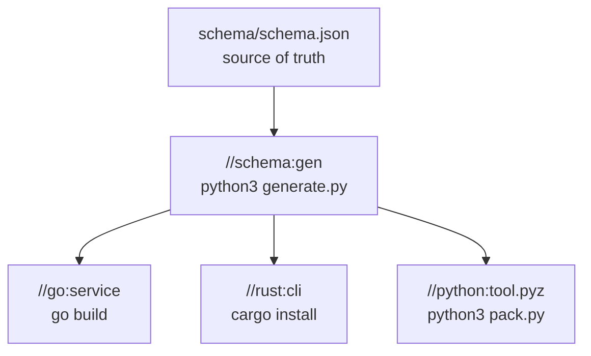

# Early Cutoff

A target's key holds what its dependencies *produced*, not their keys. So when a dependency runs
again and writes exactly the bytes it wrote last time, nothing downstream of it has a new key, and
nothing downstream runs. This is called *early cutoff*: the ripple of an edit stops at the first
target whose output did not change.

## The polyglot workspace

`examples/polyglot` builds a Go service, a Rust program and a Python tool, all from one generated
file. `//schema:gen` runs `generate.py` over `schema.json` and writes a source file for each
language; the three programs depend on it.



`schema.json` has a `comment` field, and the generator never copies it into what it writes:

```json
{
  "comment": "The values every program prints. The generator ignores this line.",
  "version": "1.0",
  "greeting": "hello from the schema"
}
```

## Editing the comment

Build once, then edit only the comment. (The first build's `cargo` lines are left out here; you
will see them in full below.)

```console
$ buildl build
4 built
$ sed -i '' 's/ignores this line\./ignores this line. Edited./' schema/schema.json
$ buildl plan
maybe  //go:service: runs only if //schema:gen produces something else
maybe  //python:tool.pyz: runs only if //schema:gen produces something else
maybe  //rust:cli: runs only if //schema:gen produces something else
run    //schema:gen: input schema/schema.json changed
  run programs:   cargo, go, python3
  read variables: HOME, PATH
  write into:     .buildl, out
1 to run, 3 conditional, 0 clean
```

`//schema:gen` has to run: one of its inputs changed. The three programs are neither clean nor to
run. Their keys hold `//schema:gen`'s outputs, and those do not exist yet, so `plan` cannot know
their keys. It calls them *conditional* and prints them as `maybe`. In `buildl plan --json` they
have the verdict `Conditional`, no key, and an `unfinished` entry that names the target they are
waiting on.

Now build:

```console
$ buildl build
--- //rust:cli (cached)
  Installing cli v0.1.0 (/private/tmp/buildl-book/tmp/buildl-a86dd71bd5c414e596a687f4d70e5ec8/709bb78cafdc4445f4217a9db757a876/rust)
   Compiling cli v0.1.0 (/private/tmp/buildl-book/tmp/buildl-a86dd71bd5c414e596a687f4d70e5ec8/709bb78cafdc4445f4217a9db757a876/rust)
    Finished `release` profile [optimized] target(s) in 1.18s
  Installing /private/tmp/buildl-book/tmp/buildl-a86dd71bd5c414e596a687f4d70e5ec8/709bb78cafdc4445f4217a9db757a876/out/rust/cli/bin/cli
   Installed package `cli v0.1.0 (/private/tmp/buildl-book/tmp/buildl-a86dd71bd5c414e596a687f4d70e5ec8/709bb78cafdc4445f4217a9db757a876/rust)` (executable `cli`)
warning: be sure to add `/private/tmp/buildl-book/tmp/buildl-a86dd71bd5c414e596a687f4d70e5ec8/709bb78cafdc4445f4217a9db757a876/out/rust/cli/bin` to your PATH to be able to run the installed binaries
1 built, 3 cached
$ buildl plan
clean  //go:service
clean  //python:tool.pyz
clean  //rust:cli
clean  //schema:gen
  run programs:   cargo, go, python3
  read variables: HOME, PATH
  write into:     .buildl, out
0 to run, 0 conditional, 4 clean
```

`1 built, 3 cached`. The generator ran and wrote the same four files, so the three programs had the
keys they had before and came from the cache. `go`, `cargo` and the Python packer never started.

The `cargo` lines are not a run. A target served from the cache shows what it printed when it last
ran, marked `(cached)`, so a warning does not vanish just because the build was fast the second
time. The long folder names are the [sandbox](ch06-00-sandbox.md) directory where `cargo` ran; on
your machine they will differ, and so will the time.

## Editing a value

Change a value the generator does copy, and the ripple goes all the way:

```console
$ sed -i '' 's/hello from the schema/hello again from the schema/' schema/schema.json
$ buildl plan
maybe  //go:service: runs only if //schema:gen produces something else
maybe  //python:tool.pyz: runs only if //schema:gen produces something else
maybe  //rust:cli: runs only if //schema:gen produces something else
run    //schema:gen: input schema/schema.json changed
  run programs:   cargo, go, python3
  read variables: HOME, PATH
  write into:     .buildl, out
1 to run, 3 conditional, 0 clean
$ buildl build
--- //rust:cli
  Installing cli v0.1.0 (/private/tmp/buildl-book/tmp/buildl-a86dd71bd5c414e596a687f4d70e5ec8/709bb78cafdc4445f4217a9db757a876/rust)
   Compiling cli v0.1.0 (/private/tmp/buildl-book/tmp/buildl-a86dd71bd5c414e596a687f4d70e5ec8/709bb78cafdc4445f4217a9db757a876/rust)
    Finished `release` profile [optimized] target(s) in 1.08s
  Installing /private/tmp/buildl-book/tmp/buildl-a86dd71bd5c414e596a687f4d70e5ec8/709bb78cafdc4445f4217a9db757a876/out/rust/cli/bin/cli
   Installed package `cli v0.1.0 (/private/tmp/buildl-book/tmp/buildl-a86dd71bd5c414e596a687f4d70e5ec8/709bb78cafdc4445f4217a9db757a876/rust)` (executable `cli`)
warning: be sure to add `/private/tmp/buildl-book/tmp/buildl-a86dd71bd5c414e596a687f4d70e5ec8/709bb78cafdc4445f4217a9db757a876/out/rust/cli/bin` to your PATH to be able to run the installed binaries
4 built
```

The `plan` is the same as before, because before the generator runs nobody can tell the two edits
apart. Only its output decides.

## Edits that never reach a tool

The three edits this workspace can see, side by side:

| You edit | What runs | Why |
|---|---|---|
| the comment in `schema.json` | `//schema:gen` only | its outputs are byte-for-byte the same, so the programs' keys are too |
| the greeting in `schema.json` | all four | the generated files differ, so every program's key changes |
| `go/main.go` | `//go:service` only | the other columns do not depend on it; `cargo` and the packer are never started |

Early cutoff is why it pays for a generator to write only what it was asked for: anything it
copies blindly, such as a comment or a time stamp, turns every edit into a full rebuild.
