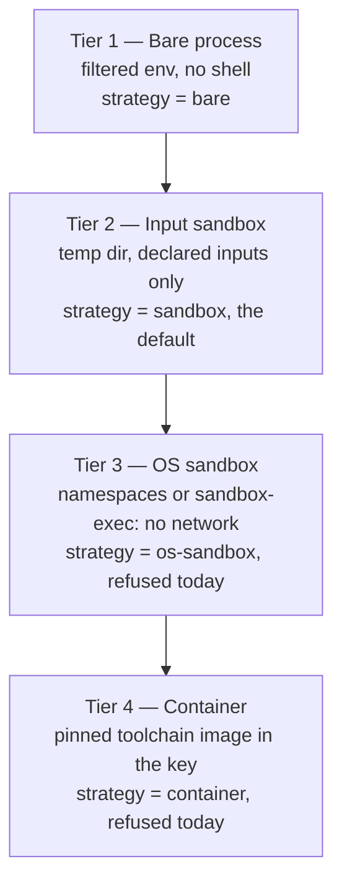

# The Sandbox

The action key folds in every input a target *declares*. A tool that quietly reads a file nobody
declared breaks that: edit the file, and the key does not change, so `buildl` serves the old output
as if nothing happened. The sandbox is there so such a target fails loudly instead.

## The isolation ladder

How much an action can reach is a ladder of four steps, set by `strategy` under `[execution]` in
`buildl.toml`:



This version of `buildl` runs the first two. Tier 2, `sandbox`, is what you get when `buildl.toml`
says nothing.

## Tier 2: the input sandbox

Each action runs in a directory of its own, outside the workspace, made fresh for it. Into it
`buildl` copies the action's declared inputs and the outputs of its dependencies, each at its path
in the workspace, and makes the folders its outputs go in. Nothing else of the workspace is there.
The environment holds the variables the target declared and three that the sandbox sets itself:

| Variable | Value | Why |
|---|---|---|
| `TZ` | `UTC` | local time is the same everywhere |
| `LC_ALL` | `C` | sorting, messages and number formats do not follow the machine's language |
| `SOURCE_DATE_EPOCH` | `315532800` | the time a tool stamps into what it writes: 1980-01-01, the earliest a ZIP file can hold |

Every file and folder copied in carries that same time, 1980-01-01, as the time it was last
changed. A tool that records file times, such as a ZIP packer, then writes the same times on every
run and every system.

When the action is done, `buildl` reads its outputs into the store and removes the directory.

The directory is outside the workspace on purpose. Tools such as `go`, `cargo` and `node` search
upward for a `go.mod`, a `Cargo.toml` or a `node_modules`; from inside the workspace they would
find the real ones and read what the action never declared.

## An input nobody declared

This target runs `copy.py notes.txt`, but declares only `copy.py`:

```lua
b.target("report.txt", {
  inputs = { "copy.py" },
  run = { "python3", "copy.py", "notes.txt", "$out" },
})
```

In the sandbox, `notes.txt` is simply not there:

```console
$ buildl build report.txt
--- //:report.txt
Traceback (most recent call last):
  File "/private/tmp/buildl-book/tmp/buildl-da4d7d2517e4eb80af55e5b005ab65a7/94e5f4daefe263b293863d95170ab5bc/copy.py", line 4, in <module>
    with open(src) as f, open(dst, "w") as g:
         ^^^^^^^^^
FileNotFoundError: [Errno 2] No such file or directory: 'notes.txt'
FAILED //:report.txt: action failure (exit status 1)
    declared in build.lua
    command: python3 copy.py notes.txt out/report.txt
1 failed
```

The error is the tool's own. `buildl` cannot know which file the tool went looking for, only that
the action failed. The temporary folder in the traceback will have another name on your machine.
The fix is to add `notes.txt` to `inputs`.

## Tier 1: `bare`

Some tools read files they have no way to declare. For those, `buildl.toml` can step down a rung:

```toml
[execution]
strategy = "bare"
```

Now the action runs as a plain process in the workspace itself, and it finds `notes.txt`:

```console
$ buildl build report.txt
1 built
$ cat out/report.txt
some notes
```

`bare` still starts the command without a shell, gives it only the variables the target declared,
and stops it at the timeout. But it confines nothing: the action can read and write anything you
can, and an undeclared input is a silent mistake again.

## The strategy is not in the key

Switching `strategy` does not rebuild anything, because it changes where an action runs, not what
it is given. So `report.txt`, built under `bare` with its hidden input, is still a cache hit after
switching back to `sandbox`:

```console
$ buildl build report.txt
1 cached
```

The sandbox never ran it, so the sandbox never caught it. That is what
[`buildl verify`](ch05-04-clean-gc-verify.md) is for. It runs cached actions again in the sandbox:

```console
$ buildl verify report.txt
--- //:report.txt
FAILED //:report.txt: action failure (exit status 1)
Traceback (most recent call last):
  File "/private/tmp/buildl-book/tmp/buildl-da4d7d2517e4eb80af55e5b005ab65a7/94e5f4daefe263b293863d95170ab5bc/copy.py", line 4, in <module>
    with open(src) as f, open(dst, "w") as g:
         ^^^^^^^^^
FileNotFoundError: [Errno 2] No such file or directory: 'notes.txt'
0 verified, 0 mismatched, 1 failed, 0 skipped, 0 not cached, 0 not sampled
```

`verify` itself runs only in the sandbox. Under `bare` it is refused, with exit code 5:

```console
$ buildl verify report.txt
error: manifest: buildl.toml: [execution] strategy is "bare", and verify re-runs actions in the input sandbox only: write strategy = "sandbox" under [execution]
```

## What an action sees

You can watch the difference from inside an action. This target writes down the files in the
folder it runs in, and its whole environment:

```lua
b.target("where.txt", {
  inputs = { "where.py" },
  run = { "python3", "$in", "$out" },
})
```

```python
# where.py
import os, sys

with open(sys.argv[1], "w") as f:
    f.write(f"files: {sorted(os.listdir('.'))}\n")
    for name in sorted(os.environ):
        f.write(f"{name}={os.environ[name]}\n")
```

Under `bare` it sees the whole workspace:

```console
$ buildl build where.txt
1 built
$ cat out/where.txt
files: ['.buildl', 'build.lua', 'buildl.toml', 'copy.py', 'notes.txt', 'out', 'where.py']
LC_CTYPE=C.UTF-8
__CF_USER_TEXT_ENCODING=0x1F5:0x0:0x0
```

Now switch to `sandbox`. Because the strategy is not in the key, a plain build would serve the
`bare` result from the cache, so start from an empty state first:

```console
$ rm -rf out .buildl
$ buildl build where.txt
1 built
$ cat out/where.txt
files: ['out', 'where.py']
LC_ALL=C
SOURCE_DATE_EPOCH=315532800
TZ=UTC
__CF_USER_TEXT_ENCODING=0x1F5:0x0:0x0
```

Only its one input and the folder for its output, and the three pinned variables. `LC_CTYPE` and
`__CF_USER_TEXT_ENCODING` are not from `buildl`: Python and macOS set them as the process starts,
and on Linux you will not see the second. Neither run got anything of your own environment, not
even `PATH` or `HOME`, because the target declared no variables.

## Tiers that are not built yet

`os-sandbox` and `container` are accepted names, but this version cannot run them. Rather than run
your actions with less isolation than you asked for, `build`, `test` and `verify` refuse, with exit
code 5:

```console
$ buildl build
error: manifest: buildl.toml: [execution] strategy is "container", and this version of buildl runs "bare" and "sandbox" only: write strategy = "sandbox" under [execution]
$ buildl plan
run    //:report.txt: never built
clean  //:where.txt
  run programs: python3
  write into:   .buildl, out
1 to run, 0 conditional, 1 clean
```

Commands that run no action, like `plan`, `check` and `graph`, work under any strategy.

## Guarantee, mitigate, verify

Tier 2 stops an action reading a workspace file it did not declare, and nothing more. An action
can still name a file by its full path, climb out with `..`, read `/usr` or your home folder, reach
the network, and leave processes running after it ends. Closing those is tier 3's job. What each
part of `buildl` can promise:

| Property | Status |
|---|---|
| same declared inputs, same action | **guaranteed** by the action key |
| an action sees only its declared inputs | **enforced** from tier 2, for the files of the workspace |
| time zone, language and clock differ between machines | **mitigated** from tier 2 by the three pinned variables |
| the network as a hidden input | **removed** at tier 3, not built yet |
| the same action gives the same bytes | **up to the tool**: not promised, but checked by `verify` |

`buildl` cannot make a compiler reproducible. It can pin every input the compiler sees, and then
`verify` turns whatever is left into a named target with a named output, instead of a wrong file
quietly shared from the cache.
