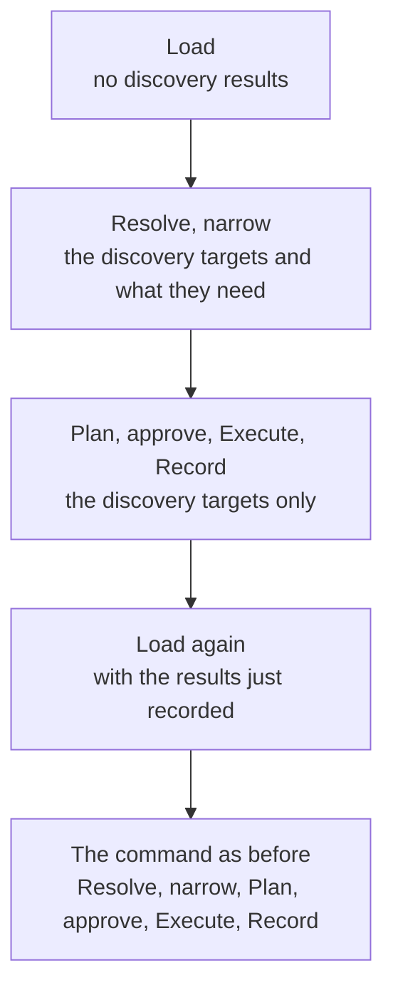
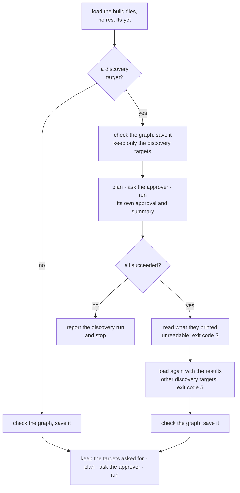
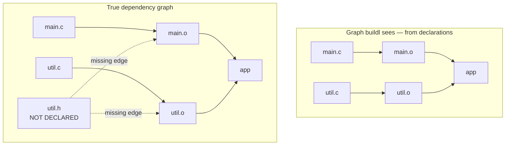
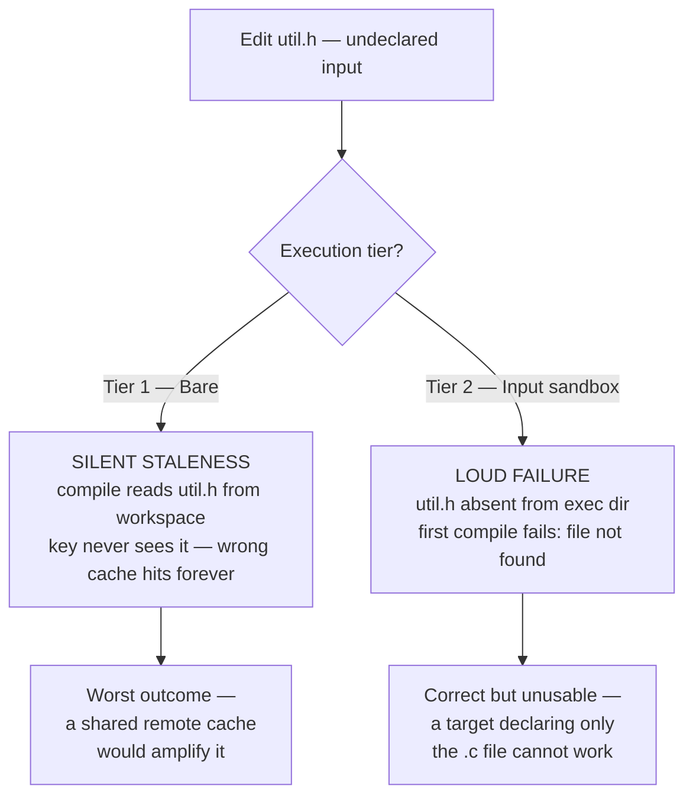

# Discovery Targets

Sometimes the build files cannot know their targets until a tool has looked at the sources. A Go
module wants one test target per package, and the packages are whatever `go list` says they are.
You could write the list out by hand, and keep it up to date by hand.

Or the build file could ask `go list`. But a build file cannot run anything. Lua only declares
targets; `buildl` runs them later, after it has planned the whole build and the approver has seen
everything the build wants. A build file that ran `go list` while it was being read would run a
program before any of that, and the same door would let it run anything else. So it cannot.

What it can do is declare a *discovery target*: an ordinary action, keyed, cached, sandboxed and
approved like any other, whose output the build files read back the next time they are evaluated.

## Three functions

| Function | What it does |
|---|---|
| `buildl.discover(name, { ... })` | declares a discovery target. It takes the same table as `buildl.target`, without `outputs` and `always`. Its one output is `<name>.json`, which must be a file |
| `buildl.discovered(label)` | the output of that target's last successful run, as a string, or `nil` if it has never run |
| `buildl.decode_all(text)` | reads text holding several JSON values back to back, and returns them as a list |

## The example

`examples/go-discovery` is a Go module with three packages and no list of them anywhere:

```console
$ find . -name '*.go' | sort
./greet/greet_test.go
./greet/greet.go
./mathx/mathx_test.go
./mathx/mathx.go
./text/words/words_test.go
./text/words/words.go
```

Its build file:

```lua
local b = buildl

-- The module line of go.mod.
local module = "example.com/discovery"

b.discover("pkgs", {
  run = { "go", "list", "-json=ImportPath", "./..." },
  inputs = { "go.mod", b.sources("**/*.go") },
  env = { "HOME" },
  stdout = true,
})

local listed = b.discovered(":pkgs")
if listed == nil then
  return
end

for _, pkg in ipairs(b.decode_all(listed)) do
  local dir = pkg.ImportPath:sub(#module + 2)
  b.test((dir:gsub("/", ".")), {
    inputs = { "go.mod", b.sources(dir .. "/*.go") },
    run = { "go", "test", "./" .. dir },
    env = { "HOME" },
  })
end
```

Three details make it work:

- **`stdout = true`.** `go list` prints what it finds and has no flag to write it to a file. With
  `stdout = true`, what the command prints *is* the target's output.
- **`decode_all`.** `go list -json` prints one JSON object per package, one after the other. That
  is not one JSON value, so `airsstack.json.decode` would refuse it; `decode_all` returns the list.
- **`-json=ImportPath`.** The full objects also hold absolute paths, which name the folder the
  action ran in and so differ between machines. Asking for one field keeps the output the same
  everywhere.

A target name cannot hold `/`, so the package `text/words` becomes the test `//:text.words`.

## Two passes

Before anything has run, `discovered` returns `nil`, and the build file declares only `//:pkgs`.
Commands that run nothing say so:

```console
$ buildl graph
//:pkgs has not run; run buildl build
{"aliases":{},"settings":{},"targets":{"//:pkgs":{"deps":[],"description":null,"env":["HOME"],"freshness":"Cached","inputs":["go.mod","greet/greet.go","greet/greet_test.go","mathx/mathx.go","mathx/mathx_test.go","text/words/words.go","text/words/words_test.go"],"network":"Sealed","origin":"BuildFile","output_source":"Stdout","outputs":["pkgs.json"],"provenance":{"directory":"","file":"build.lua"},"role":"Discovery","run":["go","list","-json=ImportPath","./..."]}}}
$ buildl plan
  write into: .buildl, out
//:pkgs is not up to date; targets declared from it may change
0 to run, 0 conditional, 0 clean
```

`build` and `test` are the only commands that run discovery targets. They read the build files,
run the discovery targets, then read the build files a second time with the results:



```console
$ buildl build
--- //:pkgs
{
	"ImportPath": "example.com/discovery/greet"
}
{
	"ImportPath": "example.com/discovery/mathx"
}
{
	"ImportPath": "example.com/discovery/text/words"
}
1 built
nothing to build
```

There are two summaries because there were two runs. `1 built` is the discovery run. `nothing to
build` is the build proper: this workspace's only other targets are tests, which `build` leaves
out. The output is in `out/pkgs.json`, and now the graph holds a test per package:

```console
$ buildl graph | python3 -c 'import json,sys; [print(l, t["role"]) for l,t in sorted(json.load(sys.stdin)["targets"].items())]'
//:greet Test
//:mathx Test
//:pkgs Discovery
//:text.words Test
```

```console
$ buildl test
--- //:pkgs (cached)
{
	"ImportPath": "example.com/discovery/greet"
}
{
	"ImportPath": "example.com/discovery/mathx"
}
{
	"ImportPath": "example.com/discovery/text/words"
}
1 cached
tests: 3 passed
$ buildl test
--- //:pkgs (cached)
{
	"ImportPath": "example.com/discovery/greet"
}
{
	"ImportPath": "example.com/discovery/mathx"
}
{
	"ImportPath": "example.com/discovery/text/words"
}
1 cached
tests: 3 passed (3 cached)
```

Each run shows what `//:pkgs` printed, marked `(cached)` because nothing it reads had changed.

## Adding a package

Add a fourth package, `shout`, with a `.go` file and a test. No build file changes:

```console
$ ls shout
shout_test.go
shout.go
$ buildl plan
  write into: .buildl, out
//:pkgs is not up to date; targets declared from it may change
0 to run, 0 conditional, 0 clean
$ buildl test
--- //:pkgs
{
	"ImportPath": "example.com/discovery/greet"
}
{
	"ImportPath": "example.com/discovery/mathx"
}
{
	"ImportPath": "example.com/discovery/shout"
}
{
	"ImportPath": "example.com/discovery/text/words"
}
1 built
tests: 4 passed (3 cached)
```

`//:pkgs` reads every `.go` file, so the new files changed its key and `go list` ran again. The
second pass declared `//:shout`, which ran, and the three old tests came from the cache.

## The rules

| Rule | Detail |
|---|---|
| a target like any other | keyed, cached, run in [the sandbox](ch06-00-sandbox.md), held to the ceiling and approved, and logged. `buildl verify //:pkgs` re-runs it |
| default scope | `build` and `test` leave discovery targets out of what they run by default; `buildl build //:pkgs` builds just that one |
| two approvals | the discovery run and the build proper are each put to the approver. `interactive` asks the second time only about what the first yes did not cover |
| a failure stops it | a discovery target that fails ends the command, and nothing is declared from it |
| other commands | `plan`, `graph`, `check`, `query`, `doctor`, `verify` and `gc` never run a discovery target to get the targets it declares. They read the last result this checkout recorded |
| no discovery from discovery | the second pass must declare exactly the discovery targets the first did. One added, removed or changed is refused, with exit code 5 |

The second load, and what each step does when something goes wrong, in more detail:



## The depfile gap

Many build systems learn some inputs only while an action runs. A C compiler is the classic case:
`main.c` includes `util.h`, and nobody wrote that down. Ninja and Make let the compiler write a
*depfile* listing the headers it actually read. A build file that compiles one `.c` file per target
and declares only the `.c` file has a hole in its graph:



Edit `util.h`, and no declared input changed. What happens next depends on the strategy:



The sandbox turns the wrong answer into a loud one, which is its job, but that only proves the
pattern cannot be written, not that it works. `buildl` reads no depfiles, so it closes the gap
another way: a discovery target runs the compiler with `-MM` before the compile, one per source,
and prints the project headers that source reads. The second pass reads that output and declares
each object with the source and those headers as its inputs. The headers are declared once for the
call, and discovery gives each object only those it read: edit `util.h` and only the objects that
read it rebuild.

The `c` plugin writes this for you, one object per source. [The C and C++
Plugin](ch08-04-the-c-plugin.md) shows it.

The gap is narrower than it looks. Go, Cargo, Bun and the rest track their own sources, so a target
that hands a whole toolchain all of its sources, as the Go, Rust and Python examples do, has no
hole.
And where a build does need a tool to tell it what exists, the discovery target is the answer: not
a file a compiler happened to drop, but a target with its own key, its own approval and its own
line in the plan, like everything else `buildl` runs.

What a discovery target cannot do is feed an action *while it runs*; its output reaches the next
declaration pass. If that is ever needed, it will be an extension of discovery targets, not a
depfile side door.
