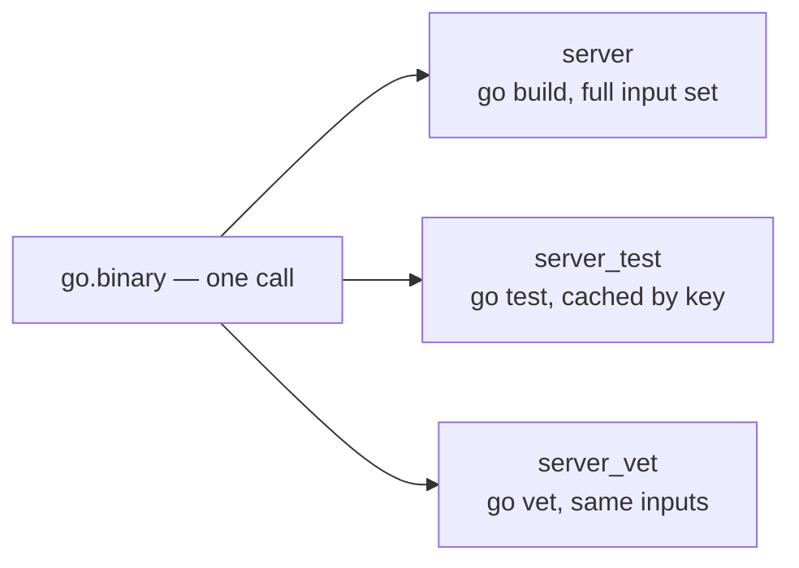

# Writing a Plugin

A plugin is a folder with two things in it: a manifest called `extension.toml`, and a Lua entry
script. The `examples/plugins` workspace keeps one, `gobin`, beside a Go module with two programs:

```text
plugins/
├── buildl.toml
├── build.lua
├── go.mod
├── hello/main.go
├── bye/main.go
└── plugins/gobin/
    ├── extension.toml
    └── main.lua
```

## The entry script

```lua
-- plugins/gobin/main.lua
local module = {}

-- Declares a target building the Go program in directory `dir` of the module
-- whose go.mod sits beside the calling build file. The Go toolchain keeps its
-- build cache under $HOME, so the target reads HOME.
function module.binary(name, dir)
  buildl.target(name, {
    inputs = { "go.mod", buildl.sources(dir .. "/*.go") },
    run    = { "go", "build", "-o", "$out", "./" .. dir },
    env    = { "HOME" },
  })
end

return module
```

It is an ordinary Lua module. It returns a table of functions, and each function calls
`buildl.target`, the same one a build file calls. A plugin has no other way to make a target, and
no way to run anything: the work happens later, when buildl runs the targets.

## The manifest

```toml
# plugins/gobin/extension.toml
[extension]
name    = "gobin"
version = "0.1.0"
entry   = "main.lua"
api     = 1

# The most the plugin's targets may want; the workspace can narrow it further.
[capabilities]
proc.run = ["go"]
env.read = ["HOME"]
```

The format is airsl's, so buildl has no manifest grammar of its own. buildl reads these keys:

| Key | Says |
|---|---|
| `name` | the plugin's name; it must be the name `buildl.toml` gives it |
| `version` | text to show, such as `0.1.0`; never compared |
| `entry` | the file `buildl.use` runs, inside the plugin's folder |
| `api` | which version of the plugin API it was written for |
| `proc.run` | the programs its targets may run |
| `env.read` | the variables its targets may read |

airsl's manifest can say more than that: `fs.read`, `fs.write`, a module flag, a
`[capabilities.optional]` block, a `[limits]` value. buildl refuses a manifest that holds any of
them, naming the file. A request that is quietly ignored reads like a request that was granted.

## The workspace names it

A build file cannot load whatever plugin it likes. `buildl.toml` names each one:

```toml
[ceiling]
proc.run = ["go"]
env.read = ["HOME"]
fs.read  = ["."]
fs.write = ["out", ".buildl"]

# A plugin kept in the workspace. Its targets may want at most what this table
# allows, and what its own extension.toml allows, and what the ceiling allows.
[plugins.gobin]
path     = "plugins/gobin"
proc.run = ["go"]
env.read = ["HOME"]
```

`path` is a folder of the workspace. The `proc.run` and `env.read` beside it are the workspace's
own limit for this plugin, its **cap**. [How buildl Decides](ch08-03-how-buildl-decides.md) shows
the manifest, the cap and the ceiling at work.

## Using it

```lua
-- build.lua
local gobin = buildl.use("gobin")

-- Each call declares one target building a Go program of this module.
gobin.binary("hello", "hello")
gobin.binary("bye", "bye")
```

`buildl.use` runs the entry script and hands back what it returned. From there it is two function
calls:

```console
$ buildl plan
run    //:bye: never built
run    //:hello: never built
  run programs:   go
  read variables: HOME
  write into:     .buildl, out
  go: declared by plugin gobin@0.1.0 for //:bye
  HOME: declared by plugin gobin@0.1.0 for //:bye
2 to run, 0 conditional, 0 clean
$ buildl build
2 built
$ ./out/hello
hello from a plugin
$ ./out/bye
bye from a plugin
```

The two `declared by` lines are the plugin's name on its wants. A build file cannot hide a program
behind a plugin: you see which plugin wanted it, and for which target.

## What a plugin sees

Each use of a plugin runs in a fresh set of globals, not the build file's:

| Name | Holds |
|---|---|
| `buildl` | a new table of the declaration functions; what is declared through it carries the plugin's name |
| `airsstack` | copies of the toolbox modules (`json`, `path`, `regex`, `hash`, `glob`), and this same `buildl` |
| `require` | loads `a/b.lua` of the plugin's folder for `require("a.b")`, and nothing outside it |
| `string`, `table`, `math` and the rest | copies, so a plugin that changes `string` changes only its own |

A plugin could otherwise reach the build file's own `buildl` table and declare targets with no
name on them. Its Lua counts toward the build file's limits, and an error in it names the plugin's
file and line.

## One call, many targets

`gobin.binary` makes one target per call. A richer plugin makes several. Here is a sketch of a
`go` plugin whose one call declares a build, a test and a vet target:



Whatever a plugin declares, `buildl graph` shows the plain targets, so you can always read what a
plugin did.

## Three places for your own logic

A plugin is a convenience, not the only way to say something. Custom logic has three homes, each
more your own than the last:

| Layer | What you write |
|---|---|
| **Options on a plugin call** | `go.test("auth_test", { run = "TestLogin" })`: the plugin turns options into the command, and since the command is in the [action key](ch05-01-action-key.md), each variation is cached apart |
| **Plain targets beside it** | a `buildl.target` next to the generated ones, for a case the plugin never thought of. Same graph, same cache, same permissions. Nobody waits for a plugin release |
| **A plugin of your own on top** | a plugin in your repository that calls `buildl.use("go")` and adds your house rules. What it declares is held to both plugins |

```lua
-- plugins/ourgo/main.lua, the entry its extension.toml names
local go = buildl.use("go")
local M = {}
function M.service(name)
  go.binary(name, { main = "./cmd/" .. name })
  go.test(name .. "_unit", { packages = { "./internal/..." }, short = true })
end
return M
```

## What a stack plugin knows

A plugin for one toolchain is mostly the know-how of wrapping that toolchain. buildl ships no stack
plugins today; the design sketches a set (`go`, `bun`, `rust`, `docker`, `proto`, `python`), and
the same few habits turn up in every one:

| Habit | go | bun | rust | docker | python |
|---|---|---|---|---|---|
| a lock file pins the environment | `go.sum` | `bun.lock` | `Cargo.lock` | base image digest | `uv.lock` |
| a stamp file stands for a tree its lock file pins | — | `node_modules` | — | — | `.venv` |
| a digest file as the output | — | — | — | `--iidfile` | — |
| a filter as a [build setting](ch03-05-build-settings.md) | `-run` | `--test-name-pattern` | `--test` | — | `-k` |
| one target per unit | per package | per workspace package | per crate | per Dockerfile | per module |

A new stack plugin is these five habits for one more toolchain. That is why the plugin API can
stay small, and why buildl itself never needs to know a language exists.

## Versions

`api` is airsl's key, and airsl checks it before any of the plugin's code runs:

```console
$ buildl check
error: build.lua: operation refused: line 1: buildl.use 'gobin': plugins/gobin/extension.toml: manifest declares api 2; this runtime supports api 1
```

That exits with code 5, a build definition to fix. Within `api = 1` the `buildl` table a plugin
sees only ever gains names, never loses or changes one. buildl has no second version number for
plugins.
