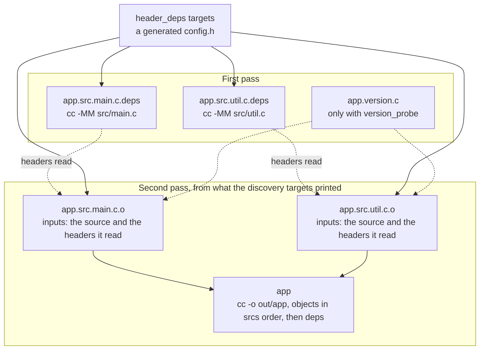
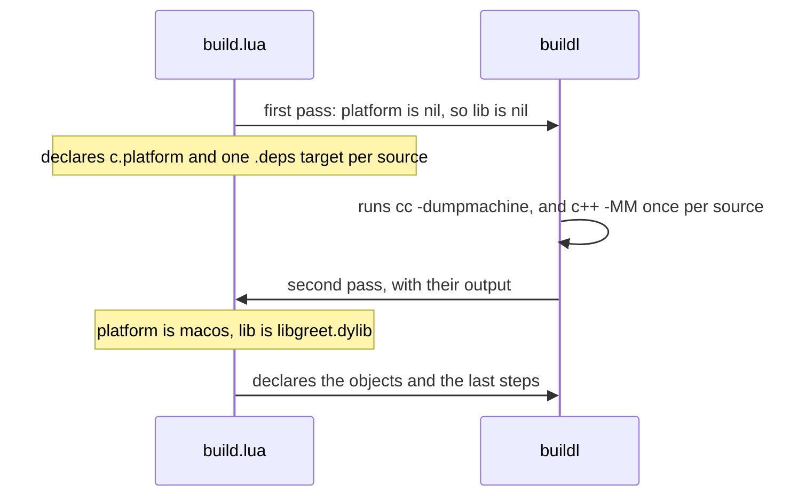
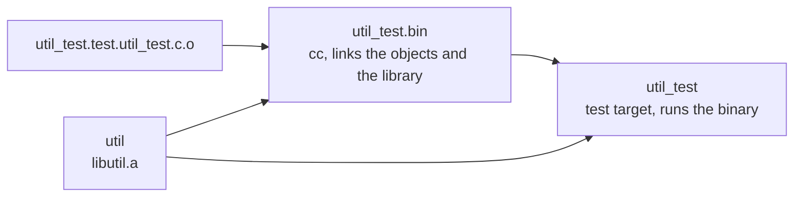

# The C and C++ Plugin

A C compiler learns which headers a source reads only while it compiles it, so a build file that
lists a `.c` file and nothing else has a hole in its graph (see [The depfile
gap](ch07-00-discovery-targets.md#the-depfile-gap)). The `c` plugin closes it. It compiles each
source to its own object, finds that source's headers with a [discovery
target](ch07-00-discovery-targets.md), and links, archives or tests the result. Edit one header
and only the objects that read it rebuild; edit one source and only its object does.

It builds programs, static libraries, shared libraries and tests on Linux and macOS, with gcc or
clang and `ar`. It is a plugin like the one in [Writing a Plugin](ch08-01-writing-a-plugin.md):
Lua, held to its manifest and your cap, adding nothing a build file could not declare itself.

Every command and output on this page was taken from a real run on macOS with Apple clang. The
first program and the case without `sh` come from a small two-source project made for this page;
the error and version-probe outputs come from edited copies of `examples/c` and `examples/cpp` in
the buildl repository; the rest come from those examples as they are. Two things in the outputs are
test details. The plugin was
fetched from a local git repository instead of GitHub, so the commit in `fetched c <commit>` is
that repository's; and the compiler messages are clang's. The tables in `buildl.toml` are the ones
you would write.

## Setting it up

The plugin lives in the buildl repository, in the folder `plugins/c`, and is fetched by git tag
(see [Plugins from Git](ch08-02-plugins-from-git.md)). Name it in `buildl.toml`, give it the
program and the variable it may use, and let the ceiling allow them too:

```toml
[ceiling]
proc.run = ["cc"]
env.read = ["PATH"]
fs.read  = ["."]
fs.write = ["out", ".buildl"]

[plugins.c]
github   = "airsstack/buildl"
rev      = "plugin-c-v0.1.0"
dir      = "plugins/c"
proc.run = ["cc"]
env.read = ["PATH"]
```

`PATH` is there because a compiler driver finds the linker through it. `sh` is on neither list
yet: a workspace needs it only for `c.library`, whose archive step runs through it, and for a
`c.test` with `deps` (see [Libraries and tests](#libraries-and-tests)). Allowing `sh` lets a target
run any program through `sh -c`, so the ceiling's program list then limits less. Start from `cc`
and add `sh` when you declare one of those two.

Fetch the plugin once. A build does not fetch:

```console
$ buildl plugins fetch
fetched c 1ae7ecf0cbe0e36162ae849b8d882f0444f5ccdf
```

## A first binary

A project with two sources and a header:

```text
buildl.toml
build.lua
include/util.h
src/main.c
src/util.c
```

`include/util.h` declares `int util_add(int a, int b);`, `src/util.c` defines it, and `src/main.c`
prints `2 + 3 = ` followed by `util_add(2, 3)`; both sources include `util.h`.

`build.lua` loads the plugin with `buildl.use` and declares one binary:

```lua
local c = buildl.use("c")

c.binary("app", {
  srcs    = { "src/main.c", "src/util.c" },
  headers = { "include/util.h" },
  cflags  = c.includes({ "include" }),
})
```

`srcs` and `headers` are written relative to the build file. `headers` lists every header a source
may include; the plugin does not search for them. `cflags` are compiler arguments, and
`c.includes` writes `-Iinclude` for you.

`check` reads the build file once and tells you the targets that wait on a discovery:

```console
$ buildl check
ok: 2 declarations in 1 build file
//:app.src.main.c.deps has not run; run buildl build
//:app.src.util.c.deps has not run; run buildl build
```

`build` runs those two first, shows what they printed, and then builds:

```console
$ buildl build
--- //:app.src.util.c.deps
obj: src/util.c include/util.h
--- //:app.src.main.c.deps
obj: src/main.c include/util.h
2 built
3 built
$ ./out/app
2 + 3 = 5
```

The first summary is the two discovery targets; the second is the two objects and the link. Each
discovery line is a Make rule from the compiler's `-MM` flag: the source, then the headers it reads
and nothing the system provides.

Edit a header and look at the plan:

```console
$ echo '/* edited */' >> include/util.h
$ buildl plan
maybe  //:app: runs only if //:app.src.main.c.o, //:app.src.util.c.o produces something else
run    //:app.src.main.c.o: input include/util.h changed
run    //:app.src.util.c.o: input include/util.h changed
  run programs:   cc
  read variables: PATH
  write into:     .buildl, out
  cc: declared by plugin c@0.1.0 for //:app
  PATH: declared by plugin c@0.1.0 for //:app
//:app.src.main.c.deps is not up to date; targets declared from it may change
//:app.src.util.c.deps is not up to date; targets declared from it may change
2 to run, 1 conditional, 0 clean
```

Both sources include `util.h`, so both objects run. The link is conditional: if the objects come
out the same, it is not run. A comment changes no object code, so:

```console
$ buildl build
--- //:app.src.util.c.deps
obj: src/util.c include/util.h
--- //:app.src.main.c.deps
obj: src/main.c include/util.h
2 built
2 built, 1 cached
```

Now change only `src/util.c`:

```console
$ buildl plan
maybe  //:app: runs only if //:app.src.util.c.o produces something else
clean  //:app.src.main.c.o
run    //:app.src.util.c.o: input src/util.c changed
  run programs:   cc
  read variables: PATH
  write into:     .buildl, out
  cc: declared by plugin c@0.1.0 for //:app
  PATH: declared by plugin c@0.1.0 for //:app
//:app.src.util.c.deps is not up to date; targets declared from it may change
1 to run, 1 conditional, 1 clean
```

One object runs. That is what the plugin is for; with one target for the whole program, every
edit would rerun every compile.

## What one call declares

A call declares targets in two passes, as [Discovery Targets](ch07-00-discovery-targets.md)
describes. The first pass cannot name the objects' inputs, because the headers are not known yet.



| Target | What it is | Runs |
|---|---|---|
| `<name>.<source>.deps` | a discovery target; `<source>` is the source's path with `/` turned into `.`, extension kept | the compiler with `-MM`, its output is the headers |
| `<name>.<source>.o` | the object; inputs are the source and the headers it read | the compiler with `-c` |
| `<name>` | the last step: the binary, archive or library; for `c.test`, the test target, whose binary is `<name>.bin` | the linker, or `sh` running `ar` |
| `<name>.version.c`, `<name>.version.cpp` | only with `version_probe`, see [below](#the-compiler-and-its-version) | the compiler with `--version` |

The names keep the extension, so `main.c` and `main.cc` in one folder do not collide. `buildl
graph` shows all of them as plain targets, with the plugin as their origin.

A `.c` source is C. `.cc`, `.cpp` and `.cxx` are C++: they use `cxx` and `cxxflags`, both for the
compile and for the discovery. A call can hold both, and its link uses `cxx`. Every other
extension is refused.

### Options

Each function takes `(name, options)` and returns nothing. An option it does not know is refused,
and the message names it.

| Option | Type | Meaning | Default |
|---|---|---|---|
| `srcs` | list of strings | the sources | required, not empty |
| `headers` | list of strings | the headers a source may include | `{}` |
| `header_deps` | list of labels | targets whose outputs the compiles read, such as a generated `config.h` | `{}` |
| `cflags` | list of strings | arguments of C compiles and of the discovery of C sources | `{}` |
| `cxxflags` | list of strings | arguments of C++ compiles and of the discovery of C++ sources | `{}` |
| `ldflags` | list of strings | link arguments before the objects | `{}` |
| `ldlibs` | list of strings | link arguments after the objects, such as `-lm` | `{}` |
| `deps` | list of labels | targets linked in, after the objects; for a test, also present when it runs | `{}` |
| `cc` | string | the C compiler | `"cc"` |
| `cxx` | string | the C++ compiler | `"c++"` |
| `linker` | string | the program that links | `cxx` when a source is C++, else `cc` |
| `output` | string | the file the last step writes | `name` (`c.test`: `name .. ".bin"`) |
| `version_probe` | boolean | see [below](#the-compiler-and-its-version) | `false` |

Paths in `cflags`, `cxxflags`, `ldflags` and `ldlibs` are written from the workspace root, as every
command's paths are (see [Many Directories](ch03-04-many-directories.md)); `c.includes` writes
include folders that way for you. The libraries go in `ldlibs`, after the objects, since the
linker reads in command order.

## Headers

Every header in `headers` is an input of every discovery target, so a header that a source reads
must be listed, or the discovery cannot see it. Leave one out and the sandbox shows it at once:

```console
$ buildl build
--- //:hello.src.main.c.deps
src/main.c:3:10: fatal error: 'banner.h' file not found
#include "banner.h"
         ^~~~~~~~~~
1 error generated.
FAILED //:hello.src.main.c.deps: action failure (exit status 1)
    declared in build.lua
    command: cc -Iinclude -Iout -MM -MT obj src/main.c
1 failed
```

(The build file here listed only `include/util.h` for a source that includes `banner.h` too.)
`buildl.sources("include/*.h")` lists a folder's headers in one call and is what the examples use.

Once the discovery has run, each header the compiler names is placed by these rules, in order:

| The header | Becomes |
|---|---|
| an absolute path | an error naming it: a header outside the workspace belongs in an `-isystem` folder, whose headers `-MM` leaves out |
| inside the build file's folder and in `headers` | an input of the object |
| anything else, when the call has `header_deps` | nothing: it is an output of one of those targets, and the compile depends on them already |
| anything else | an error naming it: a header outside the build file's folder cannot be declared, and one inside it is refused when it is missing from `headers` |

A path is tidied first: `.` parts go and each `..` removes the part before it. One that climbs
above the workspace root is an error naming it.

### A generated header

A header another target writes belongs in `header_deps`, not in `headers`. From `examples/c`:

```lua
buildl.target("config.h", {
  run = { "sh", "-c", [[printf '#define GREETING "hello from buildl"\n' > "$0"]], "$out" },
})

c.binary("hello", {
  srcs = { "src/main.c" },
  headers = headers,
  header_deps = { ":config.h" },
  cflags = cflags,           -- includes -Iout, where config.h is written
  deps = { ":util", ":blob.o" },
})
```

The compile of `src/main.c` reads `out/config.h`; `-MM` names it that way, and with `header_deps`
that is not an error. The `header_deps` targets are dependencies of the discovery and the compile,
so the header exists when either runs.

### One build file per project

An input cannot name a file outside its build file's folder, so a header another folder's build file
holds cannot be declared. A call reads the headers of its own build file's folder, and so a C or C++
project is declared in one build file. The build files of other languages in the same workspace are
not affected.

## Platforms and the two passes

A shared library has a different file name on Linux and macOS, and a different way to say where it
can be found. The plugin's helpers answer from the compiler's target triple. This is
`examples/cpp`, a shared library, a program that loads it and a test:

```lua
local c = buildl.use("c")

local platform = c.platform() -- nil on the first pass
local lib = c.shared_name("greet", platform) -- nil on the first pass

local headers = buildl.sources("include/*.h")

local cxxflags = c.includes({ "include" })
cxxflags[#cxxflags + 1] = "-fPIC"

c.shared_library("greet", {
  srcs = { "lib/greet.cc" },
  headers = headers,
  cxxflags = cxxflags,
  ldflags = c.soname(lib, platform),
  output = lib,
})

c.binary("hello", {
  srcs = { "src/main.cc" },
  headers = headers,
  cxxflags = cxxflags,
  ldflags = c.rpath(platform),
  deps = { ":greet" },
})

c.test("greet_test", {
  srcs = { "test/greet_test.cc" },
  headers = headers,
  cxxflags = cxxflags,
  ldflags = c.rpath(platform),
  deps = { ":greet" },
})
```

The first `c.platform()` call declares a discovery target, `:c.platform`, which runs
`cc -dumpmachine`. Its result is not known on the first pass, so the call returns `nil` there, and
the helpers that take it give `nil` or `{}`:



```console
$ buildl check
ok: 4 declarations in 1 build file
//:c.platform has not run; run buildl build
//:greet.lib.greet.cc.deps has not run; run buildl build
//:greet_test.test.greet_test.cc.deps has not run; run buildl build
//:hello.src.main.cc.deps has not run; run buildl build
$ buildl build
--- //:c.platform
arm64-apple-darwin25.3.0
--- //:greet.lib.greet.cc.deps
obj: lib/greet.cc include/greet.h
--- //:hello.src.main.cc.deps
obj: src/main.cc include/banner.h include/greet.h
--- //:greet_test.test.greet_test.cc.deps
obj: test/greet_test.cc include/greet.h
4 built
6 built
$ ls out
c.platform.json
greet_test.bin
greet_test.test.greet_test.cc.deps.json
greet_test.test.greet_test.cc.o
greet.lib.greet.cc.deps.json
greet.lib.greet.cc.o
hello
hello.src.main.cc.deps.json
hello.src.main.cc.o
libgreet.dylib
$ ./out/hello
== greet ==
hello, buildl
```

On Linux the same build file writes `libgreet.so`.

The first pass's discovery targets must be the same as the second's, so what they hold must not
depend on anything discovered. `name`, `srcs`, `headers`, `header_deps`, `cflags`, `cxxflags`, `cc`
and `cxx` feed them; `ldflags`, `ldlibs`, `deps`, `output` and `linker` reach only the last step
and may use the platform. Put a platform in `cxxflags` and buildl stops, with exit code 5:

```console
$ buildl build
--- //:c.platform (cached)
arm64-apple-darwin25.3.0
--- //:greet.lib.greet.cc.deps (cached)
obj: lib/greet.cc include/greet.h
--- //:greet_test.test.greet_test.cc.deps (cached)
obj: test/greet_test.cc include/greet.h
--- //:hello.src.main.cc.deps (cached)
obj: src/main.cc include/banner.h include/greet.h
4 cached
error: build.lua: discovery target //:greet.lib.greet.cc.deps differs once discovery results are read; a discovery target may not depend on a discovery result
```

### The helpers

Each returns a value and declares nothing, except `c.platform`. Put the value where you want it.

| Helper | Returns |
|---|---|
| `c.includes(dirs)` | `-I<folder>/<dir>` for each directory, `folder` being the build file's folder; `-I<dir>` at the root |
| `c.defines(map)` | sorted by key: `-D<key>` for `true`, nothing for `false`, `-D<key>=<value>` for a string or a number |
| `c.platform(options?)` | `"linux"` or `"macos"`, or `nil` before the discovery has run |
| `c.shared_name(name, platform)` | `lib<name>.so` or `lib<name>.dylib`; `nil` when `platform` is `nil` |
| `c.soname(file, platform)` | the flags that give a shared library its runtime name: `-Wl,-soname,<file>` on Linux, `-install_name @rpath/<file>` on macOS; `{}` when `platform` is `nil` |
| `c.rpath(platform)` | the flags that make a binary look for shared libraries in its own folder: `-Wl,-rpath,$ORIGIN` on Linux, `-Wl,-rpath,@loader_path` on macOS; `{}` when `platform` is `nil` |
| `c.depfile.parse(text)` | the rules of Make-style output, for a discovery target of your own |

`c.platform` takes `{ cc = "clang" }` to ask another compiler; a later call whose `cc` differs from
the first is an error. A triple that is neither Linux nor macOS is an error naming it.

`examples/c` uses `c.depfile.parse` for a data-only assembly file, `src/blob.S`, which the plugin
does not compile: a discovery target of the build file runs `cc -MM` over it, and the object's
inputs are the headers the rules name.

## Libraries and tests

| Function | Declares |
|---|---|
| `c.binary(name, o)` | an executable |
| `c.library(name, o)` | a static library, `ar rcs` over the objects, run through `sh` |
| `c.shared_library(name, o)` | a shared library; `-shared` is the one flag the plugin adds, and `-fPIC`, the file name and the soname are yours |
| `c.test(name, o)` | a test binary `<name>.bin`, then a test target `name` that runs it |

`c.library` refuses `ldflags`, `ldlibs`, `linker` and `deps`: an archive is not linked, and a library
another library needs is given to the binary that links them both.

The archive step is `sh -c 'ZERO_AR_DATE=1 exec ar rcs "$0" "$@"' $out $deps`, because macOS `ar`
writes the time it ran into the archive, and the archive would differ on every run. With
`ZERO_AR_DATE` set it does not; GNU `ar` gives the same bytes either way. `ar` runs inside `sh`, so
it needs no `proc.run` entry of its own, but `sh` does. Without it:

```console
$ buildl build
--- //:util.src.util.c.deps
obj: src/util.c include/util.h
1 built
error: build.lua: //:util (plugin c@0.1.0): program sh is outside plugin c@0.1.0 (proc.run allows: cc)
```

That is exit code 4, and the fix is `sh` in the ceiling and in the plugin's `proc.run`, as
`examples/c` has it:

```toml
[ceiling]
proc.run = ["cc", "sh"]
env.read = ["PATH"]
fs.read  = ["."]
fs.write = ["out", ".buildl"]

[plugins.c]
github   = "airsstack/buildl"
rev      = "plugin-c-v0.1.0"
dir      = "plugins/c"
proc.run = ["cc", "sh"]
env.read = ["PATH"]
```



A test is two targets: a binary, and a test target that runs it. The sandbox holds only the outputs
of the targets a step names, so a test lists in `deps` every library its binary loads. With `deps`,
the test runs through `sh -c 'exec "$0"'`, so the binary runs alone and not with the libraries as
arguments; that is the second reason a workspace allows `sh`. The binary is a program a dependency
built, so it needs no `proc.run` entry of its own.

In `examples/c`:

```console
$ buildl test
--- //:blob.deps (cached)
obj: src/blob.S include/blob.h
--- //:util.lib.util.c.deps (cached)
obj: lib/util.c include/util.h
--- //:util_test.test.util_test.c.deps (cached)
obj: test/util_test.c include/util.h
--- //:hello.src.main.c.deps (cached)
obj: src/main.c include/banner.h out/config.h include/util.h
5 cached
tests: 1 passed
```

With a shared library, as in `examples/cpp`, the test lists it in `deps` and uses `c.rpath` so the
binary finds the library beside itself.

## The compiler and its version

An [action key](ch05-01-action-key.md) records the program file, and `/usr/bin/cc` is one launcher
file that stays the same when the compiler behind it changes. Update the compiler and the key does
not move, so objects built by the old one are served from the cache.

`version_probe = true` closes that. The call declares `<name>.version.c`, the call's `cc` with
`--version`, for its C sources, and `<name>.version.cpp`, its `cxx` with `--version`, for its C++
sources. Each is an always-run target, and every object of that language depends on its probe: a
new compiler prints a new version, and the objects rebuild. In `examples/c`, after a build
without the probe, turn on `version_probe = true` for `hello`. The first build then has two things
to run, the probe and `hello`'s object, which now depends on it:

```console
$ buildl build
--- //:blob.deps (cached)
obj: src/blob.S include/blob.h
--- //:util.lib.util.c.deps (cached)
obj: lib/util.c include/util.h
--- //:util_test.test.util_test.c.deps (cached)
obj: test/util_test.c include/util.h
--- //:hello.src.main.c.deps (cached)
obj: src/main.c include/banner.h out/config.h include/util.h
5 cached
--- //:hello.version.c
Apple clang version 15.0.0 (clang-1500.3.9.4)
Target: arm64-apple-darwin25.3.0
Thread model: posix
InstalledDir: /Library/Developer/CommandLineTools/usr/bin
2 built, 7 cached
```

Built again with nothing changed, the probe runs and the rest is cached; it prints the same
version, so the object is served from the cache:

```console
$ buildl build
--- //:blob.deps (cached)
obj: src/blob.S include/blob.h
--- //:util.lib.util.c.deps (cached)
obj: lib/util.c include/util.h
--- //:util_test.test.util_test.c.deps (cached)
obj: test/util_test.c include/util.h
--- //:hello.src.main.c.deps (cached)
obj: src/main.c include/banner.h out/config.h include/util.h
5 cached
--- //:hello.version.c
Apple clang version 15.0.0 (clang-1500.3.9.4)
Target: arm64-apple-darwin25.3.0
Thread model: posix
InstalledDir: /Library/Developer/CommandLineTools/usr/bin
1 built, 8 cached
```

It is off by default for a reason that shows in `plan`. An always-run target leaves every compile
that depends on it conditional, and the `plan` of a tree with nothing changed is no longer all
clean:

```console
$ buildl plan
clean  //:blob.o
clean  //:config.h
maybe  //:hello: runs only if //:hello.src.main.c.o produces something else
maybe  //:hello.src.main.c.o: runs only if //:hello.version.c produces something else
run    //:hello.version.c: declared to run on every build
clean  //:util
clean  //:util.lib.util.c.o
clean  //:util_test.bin
clean  //:util_test.test.util_test.c.o
  run programs:   cc, sh
  read variables: PATH
  write into:     .buildl, out
  cc: declared by plugin c@0.1.0 for //:hello
  sh: declared by plugin c@0.1.0 for //:util
  PATH: declared by plugin c@0.1.0 for //:hello
1 to run, 2 conditional, 6 clean
```

A build still takes those objects from the cache when the probe prints what it printed before, as
the second build above shows. Turn the probe on where a stale compiler would cost you.

## What it may run

The plugin's manifest lists the programs its targets may run: `cc`, `c++`, `gcc`, `g++`, `clang`,
`clang++` and `sh`. A program outside the list is refused even when your workspace allows it, and
your cap and ceiling narrow the list further (see [How buildl Decides](ch08-03-how-buildl-decides.md)).
`ar` is not on it, because `c.library` runs it through `sh`. A versioned name, such as `gcc-13` or
`clang-18`, is not on it either.

For one of those, keep a copy of `plugins/c` in your workspace, add the program to the `proc.run` of
its `extension.toml`, and name it as a `path` plugin; the calls name the program in their `cc`
option:

```toml
[plugins.c]
path     = "plugins/c"
proc.run = ["gcc-13"]
env.read = ["PATH"]
```

Every link step and every archive step declares `env = { "PATH" }`, so `PATH`'s value is part of
their keys. Compiles and discovery declare no variable. The archiver is fixed to `ar`; another
one, such as `llvm-ar`, means editing `graph.lua` in the copied folder.

## When it goes wrong

A message names the function and the target, and carries the file and line of your call:

```console
$ buildl check
error: build.lua: runtime error: lua error in build.lua: runtime error: build.lua:3: c.binary(hello): the option bogus is not known
```

The plugin's own frames follow in a traceback, with `build.lua:3` last. The build file fails to load,
with exit code 5. The other messages that name a function are:

| The call | Refused when |
|---|---|
| `c.binary`, `c.library`, `c.shared_library`, `c.test` | `srcs` is missing or empty; an option has the wrong type, is unknown, or is one `c.library` refuses; a source has another extension (`.C` counts as another) |
| the same four | a header is absolute, climbs above the root, or is outside `headers` with no `header_deps` |
| `c.includes`, `c.defines` | a value that is not what they take |
| `c.platform`, `c.shared_name`, `c.soname`, `c.rpath` | a triple that is neither Linux nor macOS, or a `platform` that is neither |
| `c.platform` | the options are not a table, an option other than `cc` is given, or `cc` is not a string |
| a discovery target of the call | its output holds no rule for `obj` |

A compiler outside the plugin's manifest, your cap or your ceiling is refused with exit code 4, as
the `sh` case above is. A discovery target that differs between the two passes is refused with exit
code 5.

## Limits

| The plugin | Because |
|---|---|
| builds on Linux and macOS | `c.platform` and the helpers know only Linux and macOS target triples |
| uses gcc or clang | the program list is fixed in the manifest |
| needs one build file per project | an input cannot leave its build file's folder |
| does not cross-compile | not supported |
| wraps no other build system | CMake, autotools and meson are a plain target's job |
| reads no depfile in the executor | the discovery target is the one mechanism, and its output is a target's own |

A byte-for-byte match with an older `make` build is not promised. An object compiled with `-g`
records the folder the compile ran in, and buildl compiles in its own, so it differs from the old
build's; without `-g` the bytes match. Test the program, not the object.

## Try it

`examples/c` and `examples/cpp` in the buildl repository are the two builds above, each with a
README. From `examples/`, `sh check.sh c` and `sh check.sh cpp` run `check`, `build`, `test`,
`verify` and the example's own assertions on a copy:

```console
$ buildl verify
verified //:blob.o
verified //:config.h
verified //:hello
verified //:hello.src.main.c.o
verified //:util
verified //:util.lib.util.c.o
verified //:util_test.bin
verified //:util_test.test.util_test.c.o
8 verified, 0 mismatched, 0 failed, 0 skipped, 0 not cached, 0 not sampled
```

That is `examples/c`; the archive is the same bytes on a second run because of `ZERO_AR_DATE`.
