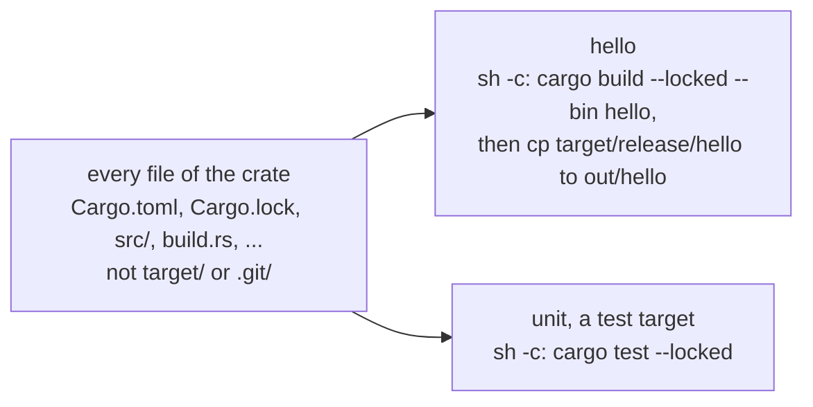

# The Rust Plugin

Cargo already tracks its own sources, so a Rust crate has no hole in its graph to close, the way
a C project does. What a plain target needs is the plumbing around `cargo`: every file under the
crate as an input, `HOME` and `PATH` as unkeyed variables, `network = true` for the crates cargo
has to download, and a command that copies the file cargo wrote under `target/` to the place
`buildl` looks for an output. The `rust` plugin writes that for you. `rust.binary("hello")` is one
call, and what runs is plain `cargo`.

It builds binaries, `staticlib` and `cdylib` libraries and tests, on Linux and macOS. It is a plugin
like the one in [Writing a Plugin](ch08-01-writing-a-plugin.md): Lua, held to its manifest and your
cap, adding nothing a build file could not declare itself. It is also as thin as `c` is: it changes
nothing about how Rust builds, and features, profiles and workspace members stay in `Cargo.toml`.

In a Cargo project, `cargo buildl init` writes a `buildl.toml` with the tables below and a
`build.lua` with one call per artifact, and `cargo buildl sync` keeps the calls in line with `Cargo.toml`: see [cargo
buildl](ch08-06-cargo-buildl.md).

Every command and output on this page was taken from a real run on macOS, in a copy of
`examples/rust` in the buildl repository; the errors come from edited copies of it. Two things in
the outputs are test details. The plugin was fetched from a local git repository instead of GitHub,
so the commit in `fetched rust <commit>` is that repository's; and the folder in cargo's
`Compiling` line is the [sandbox](ch06-00-sandbox.md) directory the build ran in, which is
different on your machine. The tables in `buildl.toml` are the ones you would write.

## Setting it up

The plugin lives in the buildl repository, in the folder `plugins/rust`, and is fetched by git tag
(see [Plugins from Git](ch08-02-plugins-from-git.md)). Name it in `buildl.toml`, give it the
programs and variables it may use, and let the ceiling allow them too:

```toml
[ceiling]
proc.run    = ["sh", "rustc"]
env.read    = ["HOME", "PATH"]
env.unkeyed = ["HOME", "PATH"]
fs.read     = ["."]
fs.write    = ["out", ".buildl"]

[plugins.rust]
github      = "airsstack/buildl"
rev         = "plugin-rust-v0.2.0"
dir         = "plugins/rust"
proc.run    = ["sh", "rustc"]
env.read    = ["HOME", "PATH"]
env.unkeyed = ["HOME", "PATH"]
network     = true
```

| Entry | Why |
|---|---|
| `sh` | each target is `sh -c 'cargo …'`, so `cargo` needs no entry of its own, and the binary's target copies cargo's file in the same script |
| `rustc` | what the plugin runs for `version_probe` and `rust.platform`; cargo itself finds `rustc` through `PATH` |
| `HOME`, `PATH` | cargo keeps its registry and toolchains under `HOME` and finds the linker through `PATH`; both are `unkeyed` |
| `network = true` | cargo downloads the crates it does not have yet; the ceiling has no network list, and the plugin's table says it |

Both variables are read as `"unkeyed"`: the build is given the value, but only the name is in the
action key, so the same build has the same key on every machine (see [The Action
Key](ch05-01-action-key.md#variables-that-only-find-files)). That is why `env.unkeyed` lists them
beside `env.read`, in the ceiling and in the plugin's table, as the plugin's manifest does.
Allowing `sh` lets a target run any program through `sh -c`, so the ceiling's program list then
limits less.

Fetch the plugin once. A build does not fetch:

```console
$ buildl plugins fetch
fetched rust c97eb8836fddb2a1ed42248bee4315020957e2d2
```

## A first binary

`examples/rust` is a crate with one binary and one test:

```text
buildl.toml
build.lua
Cargo.toml
Cargo.lock
src/main.rs
```

`src/main.rs` has a `greeting()` function that returns `hello from rust`, a `main` that prints it,
and a test that checks it. `Cargo.toml` holds an empty `[workspace]` table so cargo treats the
folder as a workspace of its own wherever it is copied. `build.lua` loads the plugin with
`buildl.use` and declares the two targets:

```lua
local rust = buildl.use("rust")

-- The default profile, dev, keeps the absolute path of the folder it was built in as debug
-- info, so `buildl verify` would find the binary differing each time. release holds no path.
rust.binary("hello", { profile = "release" })
rust.test("unit")
```

The build file sits in the crate's folder, beside `Cargo.toml` and `Cargo.lock`. `check` reads it
once, and `build` runs the binary's target:

```console
$ buildl check
ok: 2 declarations in 1 build file
$ buildl build
--- //:hello
   Compiling hello v0.1.0 (/private/var/folders/8w/4ccj7cw90nx4d32s72tqf5nw0000gn/T/buildl-9c120668758364b5e50f553c0b89ad6e/fe4f9260c378e04a18415e3a241c26a7)
    Finished `release` profile [optimized] target(s) in 1.14s
1 built
$ ./out/hello
hello from rust
```

`build` leaves the test out, as it does every test; `buildl test` runs it:

```console
$ buildl test
tests: 1 passed
```

What cargo printed is shown with the target, as any program's output is. `plan` after the build
shows what the plugin declared. Everything is clean, and its `declared by plugin rust@0.1.0` lines
say who wanted what:

```console
$ buildl plan
clean  //:hello
  run programs:      sh
  unkeyed variables: HOME, PATH
  write into:        .buildl, out
  reach the network: //:hello
  sh: declared by plugin rust@0.1.0 for //:hello
  HOME (unkeyed): declared by plugin rust@0.1.0 for //:hello
  PATH (unkeyed): declared by plugin rust@0.1.0 for //:hello
  //:hello: declared by plugin rust@0.1.0 for //:hello
0 to run, 0 conditional, 1 clean
```

Every file of the crate is an input of both targets, so an edit to `src/main.rs` runs both:

```console
$ echo "// an edit" >> src/main.rs
$ buildl plan //:hello //:unit
run    //:hello: input src/main.rs changed
run    //:unit: input src/main.rs changed
  run programs:      sh
  unkeyed variables: HOME, PATH
  write into:        .buildl, out
  reach the network: //:hello, //:unit
  sh: declared by plugin rust@0.1.0 for //:hello
  HOME (unkeyed): declared by plugin rust@0.1.0 for //:hello
  PATH (unkeyed): declared by plugin rust@0.1.0 for //:hello
  //:hello: declared by plugin rust@0.1.0 for //:hello
  //:unit: declared by plugin rust@0.1.0 for //:unit
2 to run, 0 conditional, 0 clean
```

## What one call declares



A call declares one target, with no discovery pass: cargo finds what a crate reads. Each runs
through `sh -c`, and an action starts at the sandbox root. So in a folder other than the workspace
root the script runs cargo as `(cd <folder> && cargo …)`, in a subshell, and nothing is added at
the root:

```text
cargo <build or test> --locked … --profile <profile> --target-dir target <args>
```

For `rust.binary`, the same script then copies the binary cargo wrote under
`<folder>/target/<profile folder>/` to the output, and for `rust.library` every file cargo wrote
for the crate types `kind` lists, under the names cargo gave them. The `cd` sits in the subshell so that the copy,
which comes after it, still reads the path from the root. `rust.test` copies nothing. `--locked` is why a
folder with a `Cargo.toml` and no `Cargo.lock` is refused.

| Function | Declares |
|---|---|
| `rust.binary(name, o)` | a target that runs `cargo build --locked --bin <name>` and copies the binary to the output |
| `rust.library(name, o)` | a target that runs `cargo build --locked --lib` and copies each file it wrote for `kind` to the outputs |
| `rust.test(name, o)` | a test target `name` that runs `cargo test --locked` |

What every target gets, so a build file writes none of it:

| Setting | Value |
|---|---|
| inputs | every file below the build file's folder (`buildl.sources("**/*")`), except a `target/` folder a plain `cargo build` left there and a `.git/` folder, and any path a `.buildlignore` leaves out: sources, manifests, `build.rs`, toolchain files, and files read by `include_str!` or a build script |
| env | `{ HOME = "unkeyed", PATH = "unkeyed" }` |
| network | `network = true` |

### Options

Each function takes `(name, options)` and returns nothing; `options` may be left out. An option it
does not know is refused, and the message names it.

| Option | Type | Meaning | Default |
|---|---|---|---|
| `args` | list of strings | arguments to `cargo`, after the plugin's own, as written on its command line | `{}` |
| `profile` | string | `--profile`; it also names the folder the output is copied from: `debug` for `dev` and `test`, `release` for `release` and `bench`, else the profile's own name | `"dev"` |
| `deps` | list of labels | targets whose outputs the build reads, such as a generated file | `{}` |
| `output` | string | `rust.binary` only: the file the step writes | `name` |
| `kind` | list of strings | `rust.library` only, required: the crate types to copy, as `crate-type` in `Cargo.toml` lists them: `"staticlib"`, `"cdylib"` or both | none |
| `version_probe` | boolean | see [below](#the-toolchain-and-its-version) | `false` |

`output` given to `rust.library` or `rust.test` is refused, and so is `kind` given to `rust.binary`
or `rust.test`. `args` go
where you would write them on the command line, so a flag cargo takes is passed as it is:
`args = { "--no-default-features" }`. A library's `name` is the name of the file cargo writes, so
it is the crate's library name: `my-lib` becomes `my_lib`.

### Profiles

The profile is an option, not an argument, because it names the folder the output is copied from.
The default, `dev`, builds with debug info, and cargo records in it the absolute path of the folder
it compiled in. [`buildl verify`](ch05-04-clean-gc-verify.md#buildl-verify) runs each action again in a folder of its
own, so it finds a `dev` binary different from the cached one:

```console
$ buildl verify
MISMATCH //:hello: output hello differs: bytes
0 verified, 1 mismatched, 0 failed, 0 skipped, 0 not cached, 0 not sampled
```

With `profile = "release"`, which holds no path, the same crate verifies:

```console
$ buildl verify
verified //:hello
1 verified, 0 mismatched, 0 failed, 0 skipped, 0 not cached, 0 not sampled
```

That is why both examples say `profile = "release"`. A build that does not run `verify` can leave
`dev` as it is.

## The helpers

Each returns a value and declares nothing, except `rust.platform`. Put the value where you want it.

| Helper | Returns |
|---|---|
| `rust.package(name)` | `{ "-p", name }` |
| `rust.features(list)` | `{ "--features", "<the list joined with commas>" }`; `{}` for an empty list |
| `rust.platform()` | `"linux"` or `"macos"`, or `nil` before the discovery has run (see [below](#a-shared-library-and-the-two-passes)) |
| `rust.shared_name(name, platform)` | `lib<name>.so` or `lib<name>.dylib`; `nil` when `platform` is `nil` |

The helpers compose into `args`, the way `c.includes` composes into `cflags`:

```lua
local rust = buildl.use("rust")

local args = rust.package("server")
for _, a in ipairs(rust.features({ "tls" })) do args[#args + 1] = a end
args[#args + 1] = "--no-default-features"

rust.binary("server", { args = args, profile = "release" })
```

No helper tries to cover every case: a flag cargo takes that none of them writes goes into the list
as a string.

## A Cargo workspace

A Cargo workspace has one build file at its root, beside `Cargo.lock`, and one call per artifact,
each naming its package with `rust.package`. Cargo reads `Cargo.toml` as always: members, profile
settings and feature definitions stay there.

```lua
local rust = buildl.use("rust")

rust.binary("server", { args = rust.package("server"), profile = "release" })
rust.binary("cli",    { args = rust.package("cli") })
rust.library("codec", { kind = { "staticlib" }, args = rust.package("codec") })

rust.test("server-test", { args = rust.package("server") })
rust.test("codec-test",  { args = rust.package("codec") })
```

The inputs are every file below the root, so a change in any member runs every target.

A crate in a folder of a workspace that is not the repository's root, like `rust/` in
`examples/polyglot`, has its own build file there, and its own `Cargo.toml` and `Cargo.lock`. The
plugin runs cargo in that folder.

## Crate types

`rust.library` gives the two crate types other languages use, `staticlib` and `cdylib`. An `rlib`
(the default `lib`), a Rust `dylib` and a `proc-macro` are read only by rustc. Cargo builds them
itself for any `rust.binary` or `rust.test` that depends on them, as a plain `cargo build` does, so
they have no function of their own. `examples/rust-workspace` builds a binary from an rlib and a
proc-macro this way, and copies only the binary to `out/`. To test one, use `rust.test`:

```lua
rust.test("codec-test", { args = rust.package("codec") })
```

### A shared library and the two passes

A shared library has a different file name on Linux and macOS. The helpers answer from the target
triple `rustc` reports, as `c.platform` does from the compiler's:

```lua
local rust = buildl.use("rust")

rust.library("ffi", { kind = { "cdylib", "staticlib" } })
```

`kind` is the `crate-type` list of `Cargo.toml`. One `cargo build --lib` builds every crate type
it lists, as it does without buildl, and the target copies each file under the name cargo gave it:
`libffi.so` or `libffi.dylib`, and `libffi.a`. A library whose `kind` lists `cdylib` calls
`rust.platform()` itself for the shared library's name.

The first `rust.platform()` call declares a discovery target, `:rust.platform`, which runs `rustc
-vV`; later calls return the same value and declare nothing. The `host:` line of its output holds
the triple, and a triple holding `apple-darwin` gives `"macos"` and one holding `linux` gives
`"linux"`. A call returns `nil` until the discovery has run, which is on the first of the two passes
a build file is declared in (see [Discovery Targets](ch07-00-discovery-targets.md)). So the
shared library's name waits too: on the first pass its output is named `ffi`, and the second pass has
`libffi.dylib` or `libffi.so`. The plugin copies a `cdylib` from
`lib<name>.so` when cargo wrote that file, else from `lib<name>.dylib`.

The discovery target is the same on both passes, because `rust.platform()` takes no option, so
the platform may go anywhere in a call's options.

A C program that links the library finds it at run time by the name the library carries. Left
alone, rustc names a `cdylib` by the path it was linked at, inside the sandbox, and the program
fails to start once that folder is gone. The crate names itself in a `build.rs`, which is cargo's
business and not the plugin's:

```rust
// greeter/build.rs, in examples/rust-ffi
fn main() {
    match std::env::var("CARGO_CFG_TARGET_OS").as_deref() {
        Ok("linux") => println!("cargo:rustc-cdylib-link-arg=-Wl,-soname,libgreeter.so"),
        Ok("macos") => {
            println!("cargo:rustc-cdylib-link-arg=-Wl,-install_name,@rpath/libgreeter.dylib");
        }
        _ => {}
    }
}
```

`examples/rust-ffi` builds a static and a shared library from one Cargo workspace and links each
into a C program through the [c plugin](ch08-04-the-c-plugin.md): `c.binary`'s `deps` names
`//rust:mathlib` or `//rust:greeter`, and `c.rpath` points the program at `out/rust/`. It goes the
other way too: `c.library` builds `out/c/libclamp.a`, and `rust.binary("calc", { deps = {
"//c:clamp" } })` puts it in the sandbox, where the crate's `build.rs` tells rustc to link it with
`cargo:rustc-link-search` and `cargo:rustc-link-lib=static=clamp`. The c plugin declares its
library on the second pass, once its compiler discovery has run, so `calc` is declared on the
second pass as well. The Rust
crates and the C sources sit in folders of their own, since the plugin takes every file of its
folder as an input and a C header beside the crates would rerun cargo.

## A target a build reads from another

`deps` lists targets whose outputs the build reads, so they are in the sandbox when cargo runs.
`examples/polyglot` has a Rust program that includes a file another target generates:

```lua
-- rust/build.lua, in examples/polyglot
local rust = buildl.use("rust")

rust.binary("cli", { deps = { "//schema:gen" }, profile = "release" })
rust.test("cli_test", { deps = { "//schema:gen" } })
```

The binary and its test each list `//schema:gen`, because the test compiles the same sources and
the sandbox holds only the outputs of the targets an action names. [Many
Directories](ch03-04-many-directories.md) walks through the workspace.

## The toolchain and its version

Each target runs `sh`, so its [action key](ch05-01-action-key.md) records the `sh` program file and
neither `cargo` nor `rustc`, whether or not they are links to the `rustup` launcher. A toolchain
change moves no key: a target built by the old toolchain would be served from the cache.

`version_probe = true` closes that. The call declares `<name>.version`, `rustc -vV` as an always-run
target, and makes its target depend on it, so a new toolchain prints a new version and the target
rebuilds. It is off by default for a reason that shows in `plan`: an always-run target leaves every
target that depends on it listed as conditional, even right after a full build, because `plan` never
runs the probe. A build still takes the target from the cache when the probe prints what it printed
before.

## What it may run

The plugin's manifest lists `sh` and `rustc`. `cargo` runs inside `sh`, as `ar` runs inside `sh` in
[the `c` plugin](ch08-04-the-c-plugin.md), so it is not on the list; `rustc` is for `version_probe`
and `rust.platform`. A program outside the list is refused even when the workspace allows it, and
your cap and ceiling narrow the list further (see [How buildl
Decides](ch08-03-how-buildl-decides.md)). Take `sh` out of the plugin's `proc.run`, and the build
stops with exit code 4:

```console
$ buildl build
error: build.lua: //:hello (plugin rust@0.1.0): program sh is outside plugin rust@0.1.0 (proc.run allows: rustc)
```

Programs cargo starts itself, that is `rustc`, the linker and build scripts, are not seen by the
ceiling: cargo runs them as its own children, and the approver sees the `sh` that started cargo.

## When it goes wrong

A message names the function and the target, and carries the file and line of your call:

```console
$ buildl check
error: build.lua: runtime error: lua error in build.lua: runtime error: build.lua:3: rust.binary(hello): the option bogus is not known
stack traceback:
	[C]: in ?
	[C]: in function 'error'
	...ns/rust/d6dce47e11479c6b66f8ec41fa6a73691822d46b/api.lua:23: in upvalue 'relocate'
	...ns/rust/d6dce47e11479c6b66f8ec41fa6a73691822d46b/api.lua:45: in field 'binary'
	build.lua:3: in main chunk
```

The plugin's own frames come first in the traceback, with `build.lua:3` last. The build file fails
to load, with exit code 5. The same goes for a crate with no lock file:

```console
$ buildl check
error: build.lua: runtime error: lua error in build.lua: runtime error: build.lua:5: rust.binary(hello): no Cargo.lock beside Cargo.toml; run cargo generate-lockfile
```

The other messages:

| Case | Message |
|---|---|
| no `Cargo.toml` in the build file's folder | `rust.binary(hello): no Cargo.toml in <folder>` (`.` at the root) |
| options that are not a table | `rust.binary(hello): the options must be a table` |
| `kind` given to `rust.binary` or `rust.test` | `rust.binary(hello): the option kind is refused` |
| `output` given to `rust.test` | `rust.test(unit): the option output is refused` |
| a wrong type | `rust.binary(hello): the option args must be a list of strings` |
| `rust.library` without `kind`, or a `kind` listing another value | `rust.library(mylib): kind must list "staticlib", "cdylib" or both` |
| a `kind` listing a crate type twice | `rust.library(mylib): kind lists cdylib twice` |
| `output` given to `rust.library` | `rust.library(mylib): the option output is refused` |
| `rust.platform` on a host that is neither | `rust.platform: the target triple <triple> is neither macos nor linux` |
| `rustc -vV` without a `host:` line | `rust.platform: the output of rustc -vV has no host line` |
| `rust.package` without a string | `rust.package: the name must be a string` |
| `rust.shared_name` without a string | `rust.shared_name: the name must be a string` |
| `rust.features` without a list of strings | `rust.features: the features must be a list of strings` |

What cargo itself refuses (a bad `Cargo.toml`, a path dependency outside the folder, a failed
download) fails the action with cargo's own message, as a build failure. A program outside the
plugin's manifest, your cap or your ceiling is refused with exit code 4, as the `sh` case above is.

## Limits

| The plugin | Because |
|---|---|
| builds on Linux and macOS | `rust.platform` and the helpers know only Linux and macOS target triples |
| compiles the dependencies again when an input changes | each build runs in a fresh sandbox, with a `target/` of its own; plain `cargo` keeps its `target/` and is faster for an edit loop on one crate |
| keeps crates in cargo's cache, outside buildl's store | cargo finds them under `HOME` (`~/.cargo`), which is `unkeyed` |
| does not see the programs cargo starts | the ceiling sees the `sh` that started cargo, not the `rustc`, linker or build scripts under it |
| builds `staticlib` and `cdylib` only as libraries | the other crate types are read only by rustc, and cargo builds them for the binary that needs them |
| does not cross-compile | cargo would need `--target`, and the plugin copies the file from `target/<profile folder>/`, where cargo writes only without it |
| wraps no registry, vendoring or lock-file tool | cargo does its own; the plugin changes nothing about how Rust builds |

See [What buildl Can and Cannot Promise](ch11-09-what-it-promises.md#rust-goes-through-the-plugin-too)
for what the first three mean for a build's repeatability.

## Try it

`examples/rust`, `examples/rust-workspace`, `examples/rust-ffi` and `examples/polyglot` in the
buildl repository are the builds above, each with a README. From `examples/`, `sh check.sh rust`
(or `rust-workspace`, `rust-ffi`, `polyglot`) runs `check`, `build`,
`test`, `verify` and the example's own assertions on a copy. The copy first runs `prepare.sh`,
which commits this checkout's `plugins/rust` to a temporary git repository, tags it
`plugin-rust-v0.2.0` and points the copy's `buildl.toml` at it, so the check runs the plugin as the
checkout holds it instead of the published tag.
