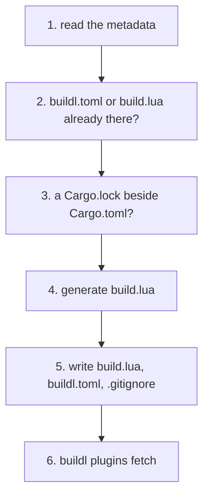

# cargo buildl

A Cargo project that uses the [`rust` plugin](ch08-05-the-rust-plugin.md) needs a `buildl.toml` with
the plugin's table, a `build.lua` with one call per artifact, and a `.gitignore` that keeps `out/`
and `.buildl/` out of git. `cargo buildl` writes those, and keeps the calls in line with
`Cargo.toml` as packages and binaries come and go. It is a second program, `cargo-buildl`, from the
crate `buildl-cargo`. Cargo runs any `cargo-<name>` program it finds on `PATH` for `cargo <name>`
(see [References](appendix-05-references.md), 29), so it needs no setup beyond installing it.

It adds two commands, `init` and `sync`, and passes every other command to the `buildl` command
line, so `cargo buildl build` is `buildl build`.

## Install

`buildl-cargo` is published to crates.io. It depends on the `buildl` library, so `cargo install`
builds it from source; no prebuilt `cargo-buildl` is shipped. It does not need the `buildl`
program: the commands it passes on run in `cargo-buildl` itself.

```sh
cargo install --locked buildl-cargo
```

## Starting a project: `cargo buildl init`

In a Cargo project that has a `Cargo.lock`:

```console
$ cargo buildl init
```

`init` reads the project from `cargo metadata --no-deps`, which writes no `Cargo.lock` and fetches
nothing. It runs every check first and writes only when all of them pass:



| Step | On failure |
|---|---|
| 1. read the metadata | cargo cannot be started: exit code 3. Cargo exits non-zero, a bad `Cargo.toml` for one: its stderr is shown, exit code 5 |
| 2. `buildl.toml` or `build.lua` is in the workspace root already | exit code 5, nothing written: `init: <file> already exists; this folder is set up already, or remove <file> to start over` |
| 3. no `Cargo.lock` in the workspace root | exit code 5, nothing written: `init: no Cargo.lock beside Cargo.toml; run cargo generate-lockfile`. The plugin builds with `--locked` and would fail without it |
| 4. generate `build.lua` | exit code 5, nothing written, if a target name is refused (see below) |
| 5. write the three files | an I/O error is exit code 3, and the files this run created are removed, so the folder is as it was |
| 6. fetch the plugin | the exit code of `buildl plugins fetch`, 3 when `git` is missing. The files stay, and the message says to run `cargo buildl plugins fetch` |

Step 6 runs buildl's `plugins fetch` inside `cargo-buildl`, with no `buildl` program needed, so its output and exit code are that command's own (see
[Plugins from Git](ch08-02-plugins-from-git.md)). On success, `init` prints this before the fetch
lines:

```console
init: wrote build.lua, buildl.toml, .gitignore
```

Every message of `init` and `sync` goes to standard error. Run from a member's folder, `init` still
writes in the workspace root, the folder of the `Cargo.toml` that holds `[workspace]`, and every
buildl command finds that workspace from any folder below it.

### `buildl.toml`

`init` writes the tables the [rust plugin page](ch08-05-the-rust-plugin.md#setting-it-up) shows:
the ceiling, and `[plugins.rust]` pinned to the plugin tag this release of `cargo-buildl` was
tested with. `[workspace]`'s `name` is the last component of the workspace root's path; `entry` and
`out` are the defaults, and `config = 1`.

```toml
[workspace]
name   = "my-project"
entry  = "build.lua"
out    = "out"
config = 1

[ceiling]
proc.run    = ["sh", "rustc"]
env.read    = ["HOME", "PATH"]
env.unkeyed = ["HOME", "PATH"]
fs.read     = ["."]
fs.write    = ["out", ".buildl"]

[plugins.rust]
github      = "airsstack/buildl"
rev         = "plugin-rust-v0.2.0"
dir         = "plugins/rust"
proc.run    = ["sh", "rustc"]
env.read    = ["HOME", "PATH"]
env.unkeyed = ["HOME", "PATH"]
network     = true
```

`.gitignore` gets the lines `/out/` and `/.buildl/`, each added only when that exact line is
missing, and the file is created when there is none. `sync` never touches `buildl.toml`: from then
on it is yours.

## The generated section of `build.lua`

`build.lua` has two parts, split by two comment lines. Lua ignores them, so the file is an
ordinary build file.

```lua
-- cargo-buildl: begin generated. `cargo buildl sync` rewrites this part from Cargo.toml.
local rust = buildl.use("rust")

rust.test("answer-test", { args = rust.package("answer") })
rust.binary("cli", { args = rust.package("cli") })
rust.test("cli-test", { args = rust.package("cli") })
rust.test("greeting-test", { args = rust.package("greeting") })
-- cargo-buildl: end generated

-- Your own targets go below. `cargo buildl sync` never changes them.
```

That is what `init` writes for `examples/rust-workspace`, a Cargo workspace of three packages: the
library `greeting`, the proc-macro `answer` and the binary `cli`. The section follows from
`Cargo.toml` alone, so the same manifest always gives the same bytes. Everything outside the two
marker lines belongs to you: add your own targets, a `release` binary, C code, whatever the build
needs, below the end marker.

| In the Cargo metadata | Generated |
|---|---|
| a library target that builds `cdylib`, `staticlib` or both | `rust.library("<target name>", { kind = { <those it builds, in Cargo's order> }, args = rust.package("<package>") })` |
| a `bin` target with no `required-features` | `rust.binary("<target name>", { args = rust.package("<package>") })` |
| every package | `rust.test("<package>-test", { args = rust.package("<package>") })` |
| `lib` (rlib), `dylib`, `proc-macro`, `example`, `test`, `bench`, `custom-build`, and a `bin` with `required-features` | no call: cargo builds them itself, or a plain `cargo build` skips them |

Packages are sorted by name; within a package the library comes first, then the binaries sorted by
name, then the test. No `profile` is written, so the plugin's default, `dev`, applies. Add
`profile = "release"` in a target of your own when [`buildl verify`](ch05-04-clean-gc-verify.md)
must match, as the [rust plugin page](ch08-05-the-rust-plugin.md#profiles) explains.

A target name outside buildl's rule (1 to 256 ASCII letters, digits, `.`, `-` and `_`, and neither
`.` nor `..`), or two generated targets with the same name, is refused with exit code 5. The
message names the target and its package or packages, and nothing is written.

## Keeping it in line: `cargo buildl sync`

Add a package or a binary, and `sync` brings the section up to date:

```console
$ cargo buildl sync
sync: build.lua updated
```

It reads the project as `init` does, then replaces the lines from the begin marker to the end
marker and keeps every other byte of `build.lua`. When the section is already right it writes
nothing:

```console
$ cargo buildl sync
sync: build.lua is up to date
```

A begin marker is any line that starts with `-- cargo-buildl: begin generated`, and an end marker
any line that starts with `-- cargo-buildl: end generated`; the rest of the line is free. Both
lines are kept as they are. To put the generated section in a `build.lua` you wrote by hand, add the
two lines where it should go and run `sync`.

| Case | Message, exit code 5 |
|---|---|
| no `build.lua` | `sync: no build.lua; run cargo buildl init` |
| no markers | `sync: build.lua has no generated section; add the lines "-- cargo-buildl: begin generated" and "-- cargo-buildl: end generated" where it goes` |
| more than one of either marker, a begin with no end, an end with no begin, or the end before the begin | `sync: build.lua must hold one begin line and, after it, one end line` |

### In CI

`sync --check` writes nothing. It exits 0 when `build.lua` is up to date, and 5 when it is not:

```console
$ cargo buildl sync --check
sync: build.lua is out of date with Cargo.toml; run cargo buildl sync
```

Run it before `cargo buildl build` in CI, and a `Cargo.toml` that moved without its `build.lua`
fails the job, where the build alone would pass and leave a target out.

## Every other command

`cargo buildl build -k`, `cargo buildl test --stop`, `cargo buildl plan`, `cargo buildl watch` and
the rest take buildl's own flags and give its output and exit codes, because the same code runs
them: the command line lives in the `buildl` library, and both programs call it. The `BUILDL_REMOTE_*`
variables and `NO_COLOR` are read as `buildl` reads them. An error raised while a buildl command
runs, such as a target that is not a label, keeps buildl's text and names `buildl`.

`cargo buildl --version` prints `buildl-cargo`'s version, and `cargo help buildl` shows the help. A
usage error is clap's, exit code 2, and names `cargo buildl`.

## Exit codes

`cargo buildl` uses buildl's [exit codes](appendix-04-exit-codes.md) and adds none:

| Code | `init` and `sync` |
|---|---|
| 0 | done; `sync --check` found `build.lua` up to date |
| 2 | a usage error |
| 3 | cargo cannot be started, its output cannot be read as metadata, the current directory cannot be read, `build.lua` cannot be read (`sync`), a file cannot be read or written, or the plugin fetch failed |
| 5 | cargo refused the manifest; files exist already (`init`); no `Cargo.lock`; a name refused or claimed twice; no `build.lua` or broken markers (`sync`); out of date (`sync --check`) |

## What it does not do

| It does not | Because |
|---|---|
| change `buildl.toml` after `init` | the ceiling is yours to set; `sync` rewrites only the generated lines of `build.lua` |
| build anything itself | it writes build files and hands the rest to buildl, so a build is the `rust` plugin's, with its [limits](ch08-05-the-rust-plugin.md#limits) |
| declare non-Rust targets | what a Cargo project needs besides cargo goes below the end marker |
| ship as a prebuilt binary | it is installed with `cargo install --locked buildl-cargo` |

## Try it

`examples/rust-workspace` in the buildl repository is the Cargo workspace above, with a build file
of its own. Copy the folder, remove its `buildl.toml` and `build.lua`, and `cargo buildl init`
writes new ones, with the generated `build.lua` and a `.gitignore`, not the example's hand-written files.
