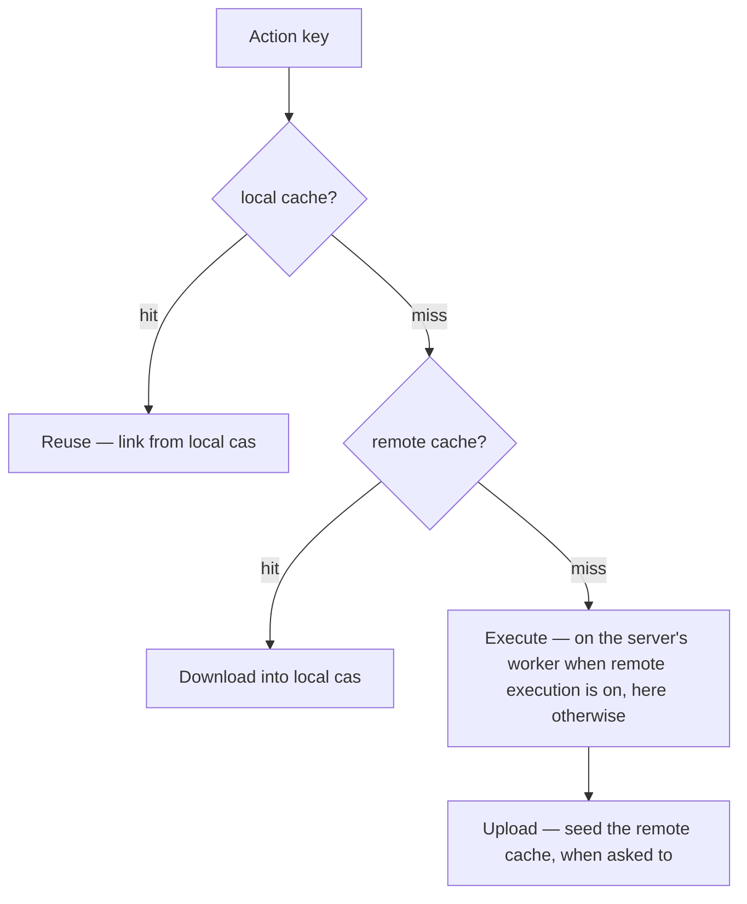
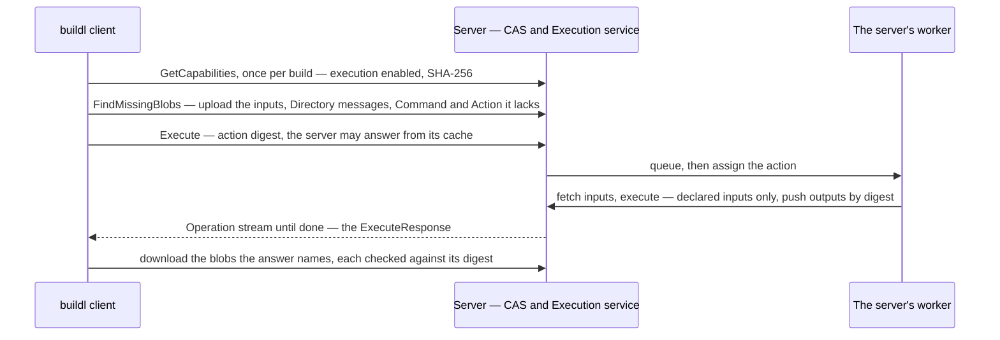
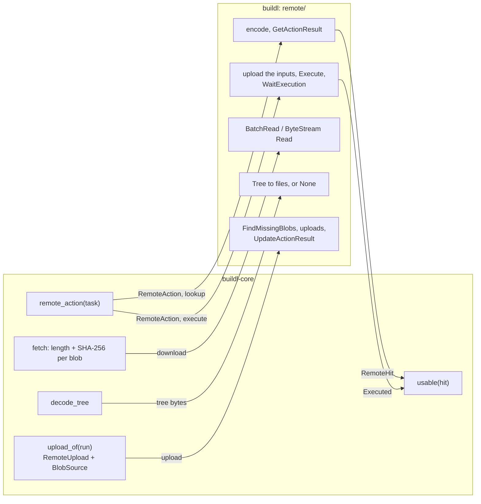
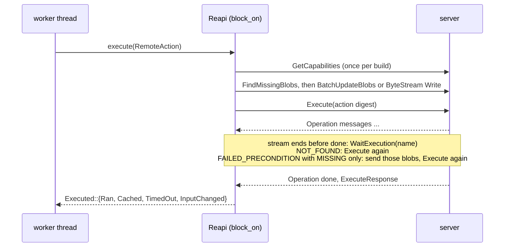

# Remote Cache and Execution

Your cache only knows what your machine built. A **remote cache** is one a whole team shares: CI
builds `main` and stores its results there, and everyone's first build of the day is mostly
downloads. **Remote execution** goes a step further and runs the work on the server's machines.

buildl is a client of both. It speaks the Remote Execution API over gRPC, the protocol servers such
as NativeLink, BuildBarn, Buildfarm and BuildBuddy speak. buildl does not ship a server.

Sharing results is only safe if every result depends on nothing but its declared inputs. That is
what [the sandbox](ch06-00-sandbox.md) is for, and why some of what follows is refused under
`strategy = "bare"`.

## Where a result comes from



## Naming the server

A `[remote]` table in `buildl.toml` names it. `examples/remote` points at a server on this machine:

```toml
[remote]
url = "grpc://127.0.0.1:50051"
```

`url` is the one key you must give. `grpc://` is plain, `grpcs://` is TLS. The others:

| Key | Says | When left out |
|---|---|---|
| `instance` | the server's instance name, such as `ci` | the server's default |
| `ca` | a PEM file of certificate authorities to trust as well as the system's | none |
| `token` | `{ env = "NAME" }` or `{ file = "path" }`: where the secret is read from, never the secret itself | no login |
| `header` | the request header the token travels in | `authorization` |
| `timeout` | how long to wait to connect, for one call, or for one piece of a large transfer | `30s` |
| `execute` | `true` runs on the server what no cache holds | `false` |
| `jobs` | how many targets may be with the server at once, 1 to 1024 | `128` |
| `queue_timeout` | how long a job may wait to start on the server | `1h` |
| `retries` | how many times a failed call is tried again, 0 to 10 | `5` |
| `properties` | names and values sent with every action, so the server can pick a worker | none |

None of these is in the [action key](ch05-01-action-key.md): where a result is stored or run never
changes what it is. `buildl doctor` prints them without connecting:

```console
$ buildl doctor | sed -n '/^remote/,/^ceiling/p'
remote
  url            grpc://127.0.0.1:50051
  instance       -
  ca             -
  header         authorization
  timeout        30s
  token          -
  upload         off
  strict         off
  execute        off in buildl.toml, BUILDL_REMOTE_EXECUTE not set
  jobs           128
  queue_timeout  1h
  retries        5
  properties: none
  --remote-upload and --remote-strict turn either on for one run
  --remote-execute and --no-remote-execute change execute, and --remote-jobs changes jobs, for one run
ceiling
```

Only `build` and `test` (and `watch`, which runs builds) talk to the server.

## When the server is not there

With a `[remote]` table, a build looks up there every target its own cache cannot serve. With no
server running, the lookup fails, and the build goes on without it:

```console
$ buildl build
warning: remote cache lookup failed: grpc://127.0.0.1:50051: ActionCache.GetActionResult: cannot connect: transport error: tcp connect error: tcp connect error: Connection refused (os error 61) (after 6 calls); the build goes on without it
1 built
```

One warning, and the remote is off for the rest of the command. `after 6 calls` is the first call
and five retries (below). A remote that is down never stops you working.

If you would rather it did, as CI might, `--remote-strict` or `BUILDL_REMOTE_STRICT=1` makes a
failed call fail the run:

```console
$ buildl build --remote-strict
error: remote cache: lookup: grpc://127.0.0.1:50051: ActionCache.GetActionResult: cannot connect: transport error: tcp connect error: tcp connect error: Connection refused (os error 61) (after 6 calls)
```

That exits with code 3: the trouble is the machine or the network, not your build, and running
again may help. `BUILDL_REMOTE_STRICT=1 buildl build` prints the same and exits 3 too.

`--no-remote` leaves the remote out of one run entirely, whatever `buildl.toml` and the variables
say:

```console
$ buildl build --no-remote
1 built
```

## Sharing a result

The upload and the fetch, captured against `examples/remote`'s server (`docker compose up -d
--build`) in two fresh copies of the workspace. Copy 1 builds, and with `--remote-upload` sends what
it ran:

```console
$ buildl build --remote-strict --remote-upload
1 built
$ buildl test --remote-strict --remote-upload
tests: 1 passed
```

Copy 2 has an empty cache of its own. It finds both results on the server:

```console
$ buildl build --remote-strict
1 fetched
$ buildl test --remote-strict
tests: 1 passed (1 fetched)
$ python3 out/app.pyz
hello from python
$ buildl build --remote-strict
1 cached
```

`out/app.pyz` in copy 2 is byte for byte the one copy 1 built. The last build is `cached`: once
fetched, a result is in the local cache like any other.

buildl trusts a server for bytes and nothing else. Every blob it downloads is checked against the
length and SHA-256 it was named by, and one that fails is never stored. A result is used only when
its command exited 0 and it names each declared output exactly once, with no symbolic link. What
passes goes into the local store first and the cache row is written after, so a crash in between
leaves nothing half-recorded: the next build simply downloads again.

### How a target is described

The server does not know buildl's action key. buildl describes each target in the API's own terms,
an `Action` holding its command, its environment with the sandbox's pinned variables, its sorted
outputs, a tree of its inputs, its timeout and its platform. buildl's key goes along as the
`Action`'s salt. So two targets with different keys never share an entry, and nothing is shared
with Bazel or any other client of the same server.

### Uploading

Uploading is off unless `--remote-upload` or `BUILDL_REMOTE_UPLOAD=1` turns it on. Only an action
that ran here and succeeded is uploaded: never a failure, a result from the local cache, or one
fetched. Each variable is `1` or `0`, and anything else is a usage error:

```console
$ BUILDL_REMOTE_UPLOAD=yes buildl build
error: BUILDL_REMOTE_UPLOAD is "yes", and must be 1 or 0
```

Under `strategy = "bare"` an action can read files it never declared, so its result could depend on
more than its key. Sending that to every other machine is exactly the poisoning
[`verify`](ch05-04-clean-gc-verify.md) exists to find, so it is refused, before anything runs:

```console
$ buildl build --remote-upload
error: uploading to the remote cache needs actions to run in the input sandbox, but strategy is "bare"; set strategy to "sandbox", or stop uploading by unsetting BUILDL_REMOTE_UPLOAD or dropping --remote-upload
```

That exits with code 2. Reading from the cache works under any strategy.

## Running on the server

With execution on, a target neither cache can serve is sent to the server and run on one of its
workers. The lookup still comes first, so a result someone else stored is fetched and nothing runs.
Whether a run executes remotely comes from the first of these that says:

| Order | Source |
|---|---|
| 1 | `--no-remote`: the whole remote off, execution included |
| 2 | `--remote-execute` on, or `--no-remote-execute` off (the cache is still used) |
| 3 | `BUILDL_REMOTE_EXECUTE=1` or `=0` |
| 4 | `execute = true` in `[remote]` |



The answer is checked and stored exactly as a fetched result is. How it ends the target:

| The server answers | The target |
|---|---|
| it ran the action, exit 0, every output there | `remote` |
| the result was already in its own cache | `fetched` |
| it ran, exit not 0 | fails as a local run with that exit would; nothing is cached |
| it gave up at the action's timeout | fails as a local timeout would, and is not run here |
| a retried status (below) | tried again |
| anything else, or a blob that fails its check | a failed call: a warning, or exit 3 under `--remote-strict` |

Execution is refused under `strategy = "bare"` for the same reason uploading is:

```console
$ buildl build --remote-execute
error: executing on the remote needs actions to run in the input sandbox, but strategy is "bare"; set strategy to "sandbox", or stop executing by setting execute to false in [remote], unsetting BUILDL_REMOTE_EXECUTE or dropping --remote-execute
```

Exit code 2 again.

### What it looks like

Remote execution could not be captured for this book: `examples/remote`'s server only runs actions
for a Linux x86-64 client, and on a Mac the action waits in the server's queue until
`queue_timeout`. The example's README has the [table of where it runs][where]. The repository's CI
runs it on Linux against NativeLink. In run 40633614431, job "Remote example on NativeLink", the
example's `assert.sh` printed:

```text
remote: a: the server runs the target
remote: a: the server runs the test
remote: b: a fresh copy fetches what the server ran
remote: c: an edited copy builds here and uploads
remote: d: a fresh copy with the same edit fetches what was uploaded
remote: ok
```

`assert.sh` does not print buildl's own lines. It checks that the last line of each is exactly what
it expects, and stops on the first that is not:

| Step | Command | Last line |
|---|---|---|
| a | `buildl build --remote-strict --remote-execute` | `1 remote` |
| a | `buildl test --remote-strict --remote-execute` | `tests: 1 passed (1 remote)` |
| b | `buildl build --remote-strict`, in a fresh copy | `1 fetched` |
| c | an edit, then `buildl build --remote-strict --remote-upload` | `1 built` |
| d | the same edit in a fresh copy, `buildl build --remote-strict` | `1 fetched` |

buildl does not upload what the server ran, even under `--remote-upload`. Step b fetched because
NativeLink stored the result itself.

The workers need the tools an action runs. buildl does not put them there: a toolchain declared as
a dependency reaches a worker as any input does, and anything else is the server's to provide.

### How many at once

`[remote] jobs`, or `--remote-jobs N` for one run, bounds how many targets are with the server at
once. `[execution] workers` still bounds how many actions run here, so a build that falls back to
local runs never runs more of them than it would without the remote. `--remote-jobs` means nothing
with execution off, and says so:

```console
$ buildl build --remote-jobs 4
error: --remote-jobs needs remote execution, and it is off in this run
```

## Retries

Every call to the server, the cache's and execution's alike, is tried again when it fails with
`UNAVAILABLE`, `RESOURCE_EXHAUSTED`, `ABORTED` or `CANCELLED`, and with no other code. A connection
that cannot be made, or a call that passes `[remote] timeout`, counts as `UNAVAILABLE`, which is why
the build above made six calls before giving up:

```text
 retries = 5 (default): the first call, then up to 5 retries
 call ─✗─► 100 ms ─► retry 1 ─✗─► 200 ms ─► retry 2 ─✗─► 400 ms ─► ... ─✗─► failed call
            (each pause doubles, at most 5 s, plus 0–50 ms at random)
 retries = 0: the first call only
```

A job on the server that keeps reporting progress is never given up: a stream that delivered
messages and then broke starts the count over, and buildl picks the job up again with
`WaitExecution` rather than running it twice.

## Inside the client

The judging is done by buildl's core, which has no network; the remote adapter only moves bytes
and encodes messages. Every check above can therefore be tested against a fake server:



One execution, from a worker thread's call to the answer the core judges:



The rest of buildl uses plain threads. The remote adapter alone owns an async runtime, and worker
threads reach it by blocking on it; see [Under the Hood](ch11-00-under-the-hood.md).

[where]: https://github.com/airsstack/buildl/tree/main/examples/remote#where-it-runs
