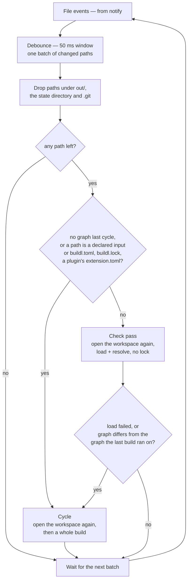
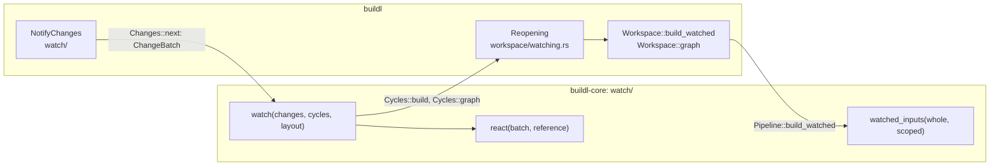

# Watch Mode

`buildl watch` builds, then waits, and builds again each time you change something the build
reads. Leave it running in a terminal while you edit.

```text
buildl watch [target]...
```

It takes the same targets and flags as `buildl build`: `--set`, `--keep-going`, `--stream` and the
remote flags of [the last chapter](ch09-00-remote.md). Each time it builds, it is the `buildl
build` you would have typed: it reads `buildl.toml` and the build files again, plans, asks the
approver, runs and records exactly as `build` does. An edit to `buildl.toml`, or to a plugin's
`extension.toml`, counts from the next build.

## A session

In a copy of `examples/python`, `buildl watch` builds at once and waits. The lines starting with
`#` are what was done in another terminal; everything else is what `watch` printed:

```console
$ buildl watch
watch: building
1 built
watch: waiting for changes
# echo '# an edit' >> app/greet.py
watch: app/greet.py changed
1 built
watch: waiting for changes
watch: app/greet.py changed
1 cached
watch: waiting for changes
# echo 'more' >> README.md
# echo 'x' > out/scratch.txt
# echo 'X = 1' > app/extra.py
watch: app/extra.py changed
1 built
watch: waiting for changes
watch: app/extra.py and 1 more changed
1 cached
watch: waiting for changes
# echo 'b.target(' >> build.lua
watch: build.lua changed
error: build.lua: syntax error: lua error in build.lua: syntax error: build.lua:16: unexpected symbol near <eof>
watch: waiting for changes
# the line removed from build.lua again
watch: build.lua changed
1 cached
watch: waiting for changes
# Ctrl-C
```

What happened at each step:

| Change | Why `watch` did what it did |
|---|---|
| `app/greet.py` | a declared input of the last build: build again |
| `app/greet.py`, a second time | the system reported the same save again; the build found nothing to do |
| `README.md` | no target reads it, and the build files still declare the same graph: nothing at all is printed |
| `out/scratch.txt` | the build's own output folder is never watched |
| `app/extra.py`, a new file | `b.sources("app/*.py")` now matches one more file, so the graph is different: build |
| `app/extra.py` and one more, again | events the system repeated; nothing to do |
| `build.lua` broken | the build fails and prints what `build` prints; the watch goes on waiting |
| `build.lua` fixed | build again; nothing had changed since the last good build, so it is all cached |

Timings vary, and so does how often the operating system repeats an event. `watch` can build once
too often; it never misses a change.

## What starts a build



Changes arrive in batches: after the first, `watch` collects until 50 ms pass with no more. Then:

- Paths under `out/` (or whatever `[workspace] out` names), under `.buildl` and under `.git` are
  dropped. They are the build's own writes, or hold no source. A batch with nothing left does
  nothing and prints nothing.
- A declared input of the last build, `buildl.toml`, `buildl.lock` or the `extension.toml` of a
  plugin kept in the workspace starts a build. So does any change after a build that failed before
  it had a graph.
- Any other path, a README, an editor's swap file, a new source file, a build file, starts a
  **check**: the build files are read again, which runs nothing and writes nothing. If they declare
  the same graph as the last build ran on, nothing happens. If they fail to load or declare a
  different one, a build runs.

There is no list of file names to ignore. A new file can only reach a build through
`b.sources`, and the check is exactly a reading of the build files, so a new file that a pattern
now matches is built, and a comment edited in a build file is not.

`watch: <path> changed` names the first path of the batch in path order, and `and N more` counts
the others that were kept.

## Between builds

`watch` holds the state lock only while it builds. While it waits, `plan`, `log`, `graph` and
`doctor` work in another terminal.

## How it ends

| What happens | Exit code |
|---|---|
| Ctrl-C | ends `watch` as it ends `buildl build`; the shell reports 130 |
| a usage error, found before the first build | 2 |
| `buildl.toml` cannot be read before the first build | 5, as `buildl build` ends |
| the file watcher cannot be set up or kept, or the system says it dropped events | 3 |

A wrong flag is caught before anything starts:

```console
$ buildl watch --remote-upload
error: --remote-upload and --remote-strict need a [remote] table in buildl.toml, and this workspace has none
```

That exits with code 2. A build that fails, though, does not end the watch, not even one that asks
for a target nothing declares:

```console
$ buildl watch nosuch
watch: building
error: target //:nosuch was asked for but is not declared
watch: waiting for changes
```

You may be about to declare it. Exit code 3 is for a gap in the file events: rather than go on
with changes it may have missed, `watch` stops and prints `watch: ` and the error.

## Inside `watch`

Deciding between builds is buildl's core, which reads no files and no clock; noticing files and
opening the workspace again are the adapters':



`react` takes a batch and what the last build left behind (its graph and its inputs) and answers
build, check or ignore. File events come from the `notify` crate: FSEvents on macOS, inotify on
Linux. Each build is a full reload of the workspace. That is fast enough that `watch` needs no
long-lived Lua engine.
