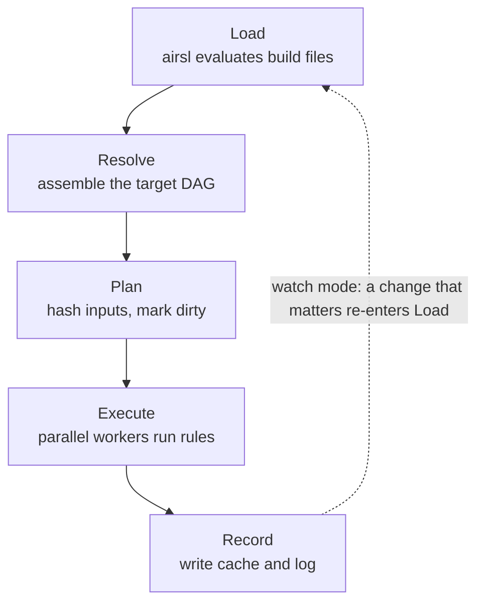
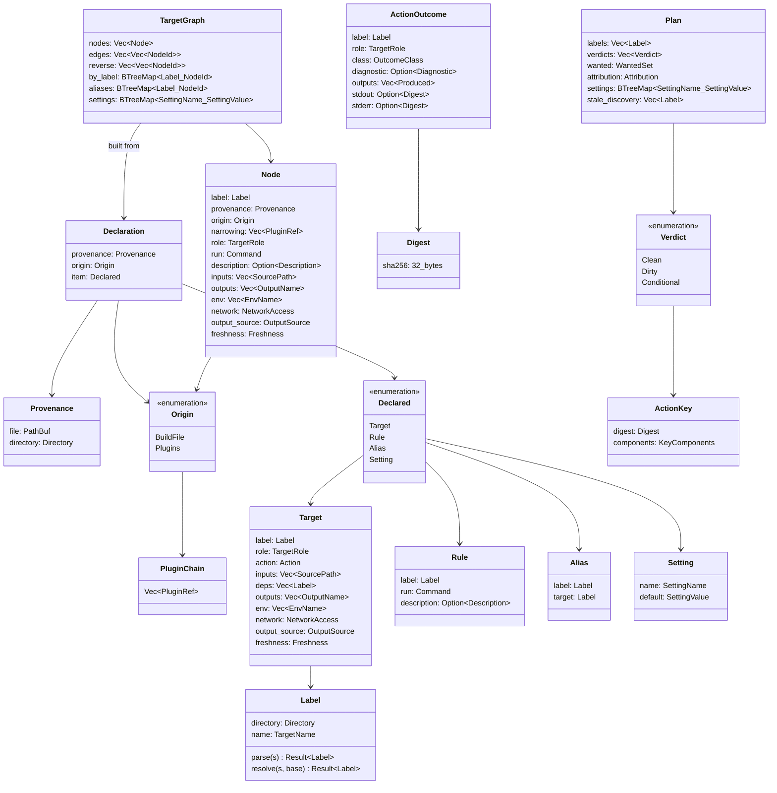
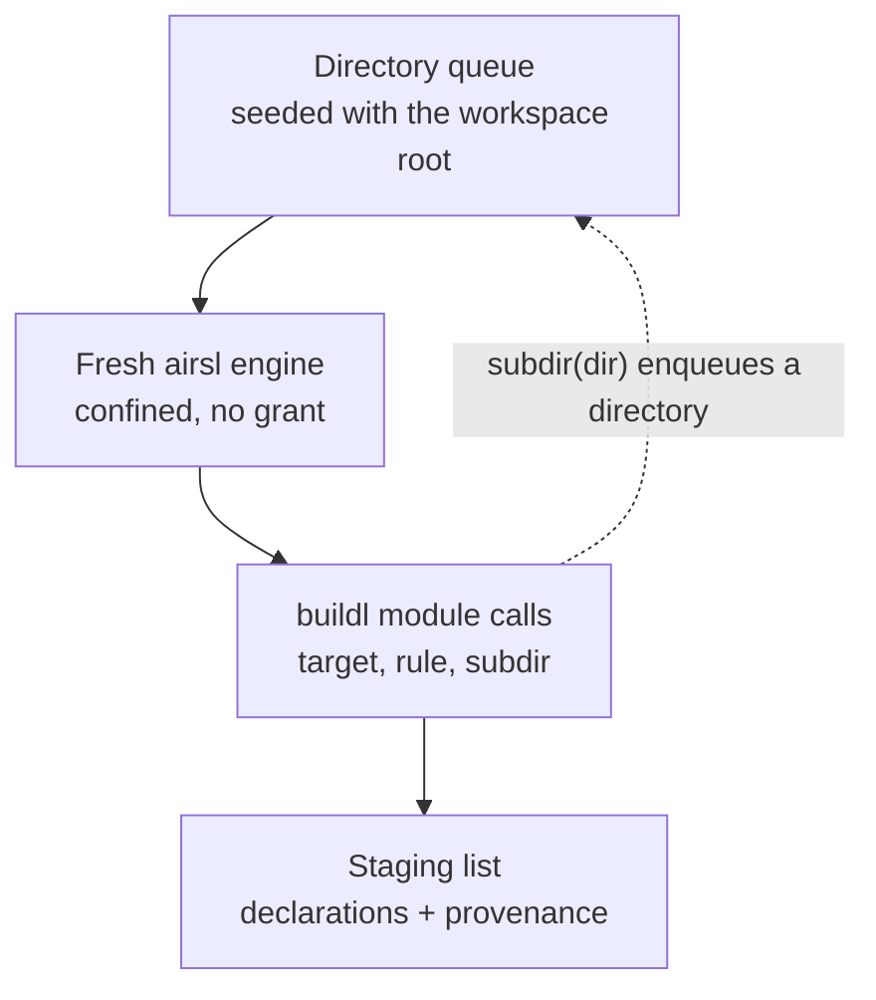
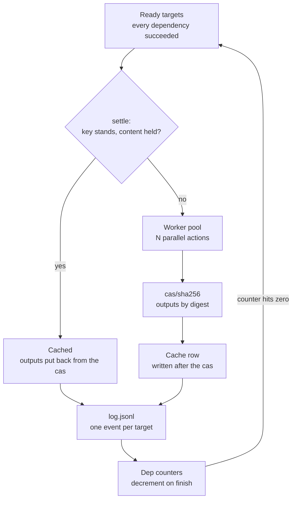
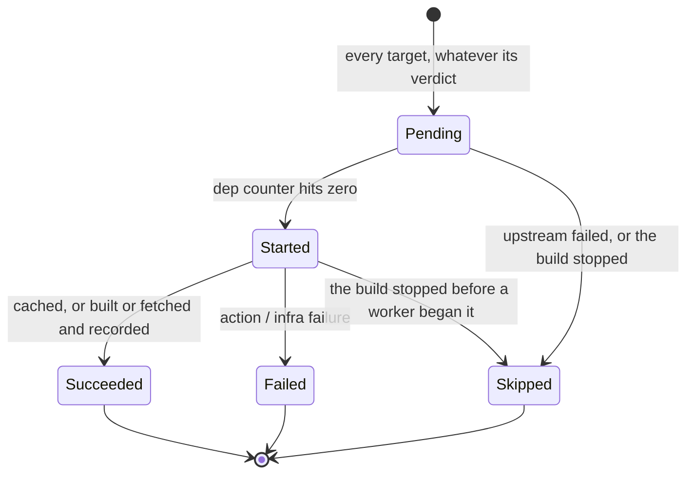

# Declare, Then Execute

The most important decision in `buildl` is the split you met in the
[Introduction](introduction.md): build files *declare*, and the host *executes*. Lua never runs a
compiler and never writes an artifact. It produces a description of the build, and the Rust side
schedules, sandboxes, runs in parallel and caches. The line between the two is airsl's boundary,
so the split is enforced, not just agreed on.

Three things follow from it:

- **Declaring is safe on code you do not trust.** The engine a build file runs in holds no grant
  at all. Its one look at the filesystem, `buildl.sources`, is done by the host and kept inside the
  declaring directory.
- **Parallelism lives where it works.** One Lua state cannot run in parallel, but a pool of Rust
  workers can. Each build file gets an engine of its own, so even loading runs on the pool.
- **Limits become a feature.** A build file that loops forever is stopped by airsl's instruction
  limit while it declares, before it has wasted anyone's time.

## Five phases

A build is five phases in a row, each with a clear edge:

The phases do not call each other. Each one hands the next a plain value, and the `Pipeline` in
`buildl-core` (`crates/buildl-core/src/pipeline/driver.rs`) owns the order:

| Phase | Takes | Hands on | Defined in `crates/buildl-core/src/` |
|---|---|---|---|
| Load | the workspace's build files | `Vec<Declaration>` | `types/declaration.rs` |
| Resolve | `Vec<Declaration>` | `TargetGraph` | `types/target_graph.rs` |
| Plan | `TargetGraph` | `Plan` | `types/plan.rs` |
| Execute | `TargetGraph` and `Plan` | `Vec<ActionOutcome>` | `types/outcome.rs` |
| Record | each `ActionOutcome` as it comes | cas blobs, a cache row, a log line | `execute/record.rs` |

Because every handoff is a value that can be written out, each phase can be tested alone, and
`buildl graph` and `buildl plan` are nothing more than a handoff printed.

## Each command is the pipeline cut short

Every command runs the same pipeline and stops at one of those handoffs:

| Command | Stops after | What it shows |
|---|---|---|
| `buildl check` | Load | that every build file evaluates; nothing runs |
| `buildl graph` | Resolve | the target graph, as JSON or as DOT |
| `buildl query` | Resolve | `deps()` or `rdeps()` of one target |
| `buildl doctor` | Resolve | the wants of the whole graph, held up to the ceiling |
| `buildl plan` | Plan | what would run, and why |
| `buildl build`, `buildl test` | Record | the whole pipeline |
| `buildl verify` | Plan, then a re-run with no Record | whether cached actions still give the same bytes |
| `buildl watch` | Record, then waits | a build, then another each time something that matters changes |
| `buildl log` | no phase | what a target printed when it last ran, read from the log and the cas |

`clean`, `gc` and `plugins fetch` are housekeeping around the pipeline rather than cuts of it.
[Appendix A](appendix-01-cli.md) has every command and flag.

Not every module of `buildl-core` is a phase. A few hold what several phases need and may not
copy from one another: `placement` (where each output lives and what a command's `$in` and `$out`
stand for), `grants` (the wanted set, and which programs a dependency built), `history` (reading
the log back), `discovery` (loading the build files twice), `suggest` (the nearest name to one that
names nothing) and `verify`.

## The core types

Every value that crosses a phase lives in `buildl-core`, and almost every one is a small type that
is checked when it is made, so an invalid one cannot exist. A `Label` is never a loose string, and
a path is never just a `String`. Here are the main ones and how they connect:

A few choices in that picture carry a lot of weight:

- **`Label` is the one name for a target**, `//dir:name`. Every name a build file writes, whether
  `//lib:text`, `:text` or `text`, becomes an absolute `Label` during Load. From Resolve on, a
  target is a `NodeId`, a `u32` index into the graph. Strings appear only at the edges: when a
  label is parsed and when it is printed.
- **`ActionKey` keeps its pieces.** The key is the digest of a `KeyComponents` value, and the
  components are kept beside the digest. That is why `buildl plan` can say *which* piece changed,
  as [The Action Key](ch05-01-action-key.md) showed: it compares two structs instead of guessing.
- **`Digest` is SHA-256 everywhere**: files, outputs, keys and log blobs. It is the digest the
  Remote Execution API uses too, so a [remote cache](ch09-00-remote.md) is a transport, not a
  second way of naming things.
- **`Provenance` travels, it is never worked out again.** It is attached when a declaration is
  made and carried into the graph, so every error can name the build file behind it.
- **`Origin` travels the same way, and is never part of a key.** It says whether a build file or a
  chain of [plugins](ch08-00-plugins.md) made the declaration. The same declaration built the same
  way has one key whoever wrote it, but an error names the plugin, because whoever reads it needs
  to know whose code to look at.
- **`Attribution` explains the wanted set and is never part of it.** For each want it names the
  plugins whose targets want it, for the approver to show. What an approval remembers is the
  wanted set alone.

## Load

Load turns build files into declarations. A queue of directories drives it, and each build file
gets a fresh engine of its own, which is thrown away afterwards, so one file's stray globals can
never leak into the next. An engine costs about 128 microseconds to make.

The `buildl` module in `buildl-lua` stages what a build file declares: each call checks the shape
of its option table straight away, so an unknown field fails on the line that wrote it, and the
values are recorded exactly as written. `buildl.subdir` stages a request for another directory.
The adapter hands all of it back as one `StagedFile`. It is `buildl-core` that attaches the
provenance, checks every value, refuses a directory that escapes the workspace and queues the
rest. Lua never recurses into another directory, and the adapter never sees the queue.

A plugin a build file loads with `buildl.use` runs inside the same evaluation, in a table of its
own, and the declarations it makes carry its plugin chain as their origin. The results of
[discovery targets](ch07-00-discovery-targets.md) reach every evaluation as one shared
`Discovered` value.

### Loading in parallel

In a big monorepo the build files are many. Ten thousand of them at about 136 microseconds each is
about 1.4 seconds on one thread, so Load spreads them across the same worker pool that runs
actions, up to `[execution] workers` at once, each worker with an engine of its own. A directory
is handed out as soon as a result names it, so workers stay busy.

Results come back in whatever order the workers finish in, and that order must never show. So
Load does not take its answer from arrival order:

1. A *serial replay* walks the directories in the order a one-thread load would, reading each
   result when the walk reaches it. It alone decides the declarations and the error.
2. The error, if there is one, is the one a serial load would have met first. A shared flag stops
   new evaluations once the replay meets it.
3. The declarations are sorted by directory, then declared name, then the whole declaration, so
   parallel and serial loads give exactly the same list.
4. If the worker pool says it finished, the replay met no error, and a build file is still without
   a result, the load fails with `Error::LostBuildFiles` and declares nothing.

Load is eager: it reads every build file the `subdir` calls reach, even when you asked for one
target. A label names its own directory, so loading only what a target needs looks like a small
change, but build settings are global, `graph.json` and the output-collision check cover the whole
graph, and a build file is read only because some `subdir` named it. Each of those would have to
change first.

## Resolve

Resolve is plain Rust over memory. It turns the declarations into a `TargetGraph`, after three
checks, each of which names the build file at fault:

- **duplicates**: two declarations of one label, with both places named (`Error::DuplicateLabel`);
- **unknown references**: a dependency, rule or `$opt:` setting that nothing declares, with the
  nearest name offered (`Error::UnknownReference`, `Error::UnknownSetting`);
- **cycles**: the whole cycle path, not just the fact of one (`Error::DependencyCycle`). The search
  keeps its own stack instead of recursing, so a very deep graph cannot overflow the call stack.

The graph is a set of arrays indexed by `NodeId`: `nodes`, `edges` (each target's dependencies, in
the order written), `reverse` (who depends on each target) and `by_label`. A `Node` is a target
with its rule filled in, so it holds the command it runs. `buildl query` walks `edges` for
`deps()` and `reverse` for `rdeps()`. `graph.json` is written with labels, never `NodeId`s, so
adding one target changes only that target's entry in the file.

## Plan

Plan decides what each target needs. In order, it:

1. fixes the value of every build setting for this run, its default or its `--set`, and keeps
   those values on the `Plan` so Execute expands commands from exactly what was planned;
2. places every output and expands every command, so two outputs at one path fail here as
   `Error::OutputConflict`;
3. holds each plugin's targets to that plugin's caps (`Error::PluginRefused`), then every want to
   [the ceiling](ch04-02-the-ceiling.md) (`Error::Refused`). A program a dependency built is no
   want;
4. refuses a target that declares a variable the sandbox sets itself (`Error::PinnedEnv`);
5. works out each key: one fingerprint per program, one digest per input through the stat cache,
   one value per variable, and the platform;
6. gives each target a `Verdict`.

Verdicts are worked out from the bottom of the graph up. A target whose dependencies are all clean
has a finished key, and it is `Clean` when that key equals the one its last build recorded, or
`Dirty` with the pieces that differ. A target with a dependency that is not clean cannot finish its
key, because that dependency's output does not exist yet. It is `Dirty` if something already known
has changed, and `Conditional` otherwise: it runs only if the dependency produces something new.
That is [early cutoff](ch05-02-early-cutoff.md) at plan time.

A plan that wants more than the ceiling or a plugin allows is an error, not a plan. Nothing has run
yet.

## Execute: the scheduler loop

Execute is a ready queue, a pool of workers and one counter per target:

Every target in the build goes through that loop, clean ones included. When a target's
dependencies have all succeeded, it is *settled*: its key is finished from what its dependencies'
rows now hold, and if nothing forces it to run, the key equals the recorded one, and the cas still
holds everything needed to put it back, it succeeds as cached without reaching a worker. So a
conditional target gets its answer here, and a clean one whose content left the store runs again.
A build of cached targets starts no thread at all.

The bookkeeping is one small state machine per target, `Schedule` in
`crates/buildl-core/src/execute/schedule.rs`:

`Succeeded` covers cached, built, fetched and run on the remote; the outcome's class tells them
apart. Cached and skipped are the two results a plain task runner has no word for, and they are
why the summary can say `1 failed, 2 skipped, 2 built, 9 cached`.

The scheduling thread is the only one that writes the counters, so they are plain integers, with
no locks to reason about. The threads themselves sit behind the `Dispatcher` port, which has one
method, `dispatch(work, step)`:

- `work` runs one task, on any thread, and can send messages back while it runs;
- `step` runs on the calling thread, first with `Turn::Begin`, then with each message
  (`Turn::Told`) and each result (`Turn::Done`), and returns the tasks that became ready.

The port knows nothing about builds. Its adapter in `buildl`, `ThreadPool`, is plain threads and a
`std::sync::mpsc` channel, started only as tasks need them. Tests drive the same two closures on
one thread.

Some rules of the loop:

- **Everything that can refuse a build is decided before the first task goes out.** The last
  guard holds every expanded command's program to the ceiling once more, and refuses a command that
  names no program (`Error::NoProgram`).
- **Workers never touch the terminal.** One reporter on the scheduling thread prints everything,
  and a log event is written before anything is read for display.
- **On failure**, `build` stops handing out new work by default, and `--keep-going` builds
  everything that does not depend on the failure. `test` keeps going by default and stops with
  `--stop`. Actions already running are never cancelled, and what they produce is kept.
- **No target goes missing.** A dispatcher that says it finished while some target has no outcome
  fails the build with `Error::DispatcherFault`, naming every such target. What finished before
  that keeps its blobs, its row and its log line.
- **Scheduling order cannot leak into results.** An action's inputs are declared and in place
  before it starts, so where it fell in the schedule is invisible to it.

What happens inside one worker, and the order in which it is written down, is the subject of
[Crash Safety and the Store](ch11-02-crash-safety.md).

## A second Load

A workspace with a [discovery target](ch07-00-discovery-targets.md) runs Load twice. The first
load evaluates every build file with no results. `build` and `test` then run the discovery targets
as a small build of their own, with their own plan, approval and summary, read back what each
printed, and load every build file again with those results. The second load may not declare
different discovery targets than the first (`Error::DiscoveryChanged`).

Commands that run nothing, such as `graph`, `query` and `plan`, read the last results straight from
the log and the cas instead of running anything. The two passes are drawn out in the
[Discovery Targets](ch07-00-discovery-targets.md) chapter.
