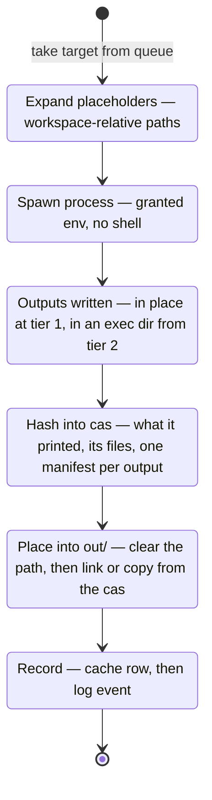

# Crash Safety and the Store

Builds get interrupted. Someone presses Ctrl-C, a laptop lid closes, a CI job hits its time limit.
Many build systems answer that with a ritual: "the cache looks corrupt, run a clean build." In
`buildl` there is no corrupt-cache state to get into, and no clean build to run. This page shows
why, by following one action from start to finish.

## One action's life

Step by step:

1. **Expand.** The command's `$in`, `$out` and `$deps` become workspace-relative paths, such as
   `lib/a.c` or `out/lib/text`. They read the same at every isolation tier, so a command is one
   text whichever tier runs it, and each tier makes those paths true where the action runs.
2. **Spawn.** The program starts directly, never through a shell, with only the variables the
   target declared. At tier 2, [the sandbox](ch06-00-sandbox.md), it starts in a directory of its
   own outside the workspace, holding copies of its declared inputs.
3. **Outputs written.** Before the command starts, the folder each output goes in exists and
   nothing stands at the output's own path. The command makes what it produces there: a file or a
   directory.
4. **Hash into the cas.** The worker stores what the action printed, then every regular file it
   left at each output path, then one *manifest* per output that lists those files.
5. **Place into `out/`.** Back on the scheduling thread, each output's path under `out/` is cleared
   and its files are put there from the cas.
6. **Record.** The cache row is written, and then the log event. Only after that are the targets
   that depend on this one released.

## Cas first, row after, log always

The order of those last steps is the whole story:

| Write | When | Why there |
|---|---|---|
| cas | first | the content must exist before anything points at it |
| cache row | after the cas | a row is a promise that its content is held, so it is never written early |
| log event | always, last | every outcome is logged, failures and skips included, so the log tells the truth even about a broken build |

The code keeps that order in one file, `crates/buildl-core/src/execute/record.rs`: `store` places
the outputs and only then records the row, `forget_contradicted` removes a row a failure
contradicts, and `append` writes the log event for every outcome, whatever it is.

So when a build is stopped, at any moment, some finished work is remembered and the unfinished
work is not. The next run plans again and carries on. A row never points at content the store does
not hold, because the row is written second.

Two more things make that hold on disk:

- **Every write is whole.** Each blob and each state file is written to a temporary file and
  renamed into place. A reader finds the old file whole or the new file whole, never half of one.
- **Nothing is synced to disk.** A rename is enough when the *process* dies. It is not enough when
  the *machine* dies mid-build, with writes still in memory. The remedy then is to remove `.buildl/`
  and `out/` and build again. This is a choice, written up in
  [Decision Records](ch11-06-decision-records.md).

The same order runs the other way when things are removed. `buildl gc` forgets rows before it
removes any blob, so a `gc` that is stopped part way leaves extra blobs, never a row that names a
missing one. And a result fetched from a [remote cache](ch09-00-remote.md) takes the same road as
one built here: its blobs are checked and stored in the cas, and only then is its row written.

Storing outputs by content does one more job. A rebuilt output with the same bytes has the same
digest, so the keys of everything downstream stay the same, and those targets stay clean. That is
[early cutoff](ch05-02-early-cutoff.md), and it comes free with the cas.

## Failures are never cached

A cache row is written only after a success, so a failed action leaves no row, and the next run
simply tries it again. There is one more case. When a target already has a row under the very key
it just failed under, which happens to a test run again with `--rerun` and to a target declared
`always`, the failure *forgets* that row, and the forgetting is on disk before the failure's log
line is written. A failed rerun never leaves an old pass behind.

So there is no "cached failure" to get stuck on. This is a deliberate break from build systems that
remember failures: with declared inputs, a retry costs one action, and a flaky failure is exactly
the thing that should be run again rather than remembered.

## The store

Everything under `.buildl/` follows the rule above. Here is what it holds:

| File | What it holds |
|---|---|
| `cas/ab/cdef…` | every blob by its SHA-256, in folders named by its first two characters |
| `cache.json`, `cache.journal` | the cache rows: one per target, with its whole key, one digest per output and the digests of what it printed |
| `log.jsonl` | one JSON line per outcome, append-only, with what was printed referred to by digest |
| `statcache.json` | each input's size, modification time and digest, so an unchanged file is not read again |
| `graph.json` | the graph the last build resolved |

A few details of the cas matter for safety:

- **Blobs are read-only**, mode `0444`. A blob that was ever placed as an executable has a twin
  beside it, `cdef….x`, holding the same bytes with mode `0555`, because a file's mode belongs to
  the file itself and a hard link shares it.
- **A read checks its digest.** Content that no longer has the digest it is stored under is removed
  and reported as not held, so a damaged blob is never put back as an output.
- **An output is a manifest.** It is described by an `OutputManifest`: either one file, with its
  digest and whether it may be run, or a tree, a directory's files in path order. The manifest is
  itself a blob, and *its* digest is the output's digest. That is how the executable bit and every
  file of a directory reach a dependent's key.
- **Outputs are put back whole or not at all.** Placing an output starts by clearing its path, so
  nothing an earlier build left there survives. If a file cannot be placed, the path is cleared
  again and the target fails, so `out/` holds an output whole or not at all.
- **`out/` holds hard links into the cas** where that protects the store, and copies everywhere
  else. On a filesystem where a read-only file can still be written through, as root for example,
  every placement is a copy.

The action cache writes one line to `cache.journal` for each row, because rewriting the whole of
`cache.json` for every target would grow with the square of the build. The journal is folded into
`cache.json` once a build returns. A journal an interrupted run left behind is folded the next time
the cache is opened, with a cut-off last line left out. So `cache.json` holds the same bytes
whatever order the workers finished in.

## Output capture

Each action's standard output and standard error are captured through pipes, separately. Two reader
threads per action pass what they read to the worker, which alone touches the process. The worker
also enforces the timeout: it watches a deadline on the monotonic clock and kills the process when
the deadline passes. Once the process is gone, anything it started that still holds a pipe gets one
more second (`DRAIN` in `crates/buildl/src/exec/capture.rs`), and the action ends with what arrived.

What was printed goes into the cas, and the log event refers to it by digest. That keeps large
output out of the JSON, and it means a cache hit can show the warnings from when the action really
ran, instead of losing them on every incremental build. It is also what
[`buildl log`](ch01-03-what-did-it-do.md) reads back.

On screen, each action's output is printed as one block under a header naming the target, when it
finishes, never mixed with another action's. A terminal gets a live status line; a pipe or CI gets
plain blocks in order. With `--stream`, one running action at a time is shown as it prints, and
what is stored is exactly what a quiet build stores. Everything a build says about itself goes to
standard error; standard output carries only what a command was asked for, such as the graph from
`graph` or the plan from `plan`.

## Failure semantics

Every failure falls into one of three classes, told apart by structure (an exit status, a timeout,
where a refusal came from), never by reading message text:

| Class | Means | Examples |
|---|---|---|
| Action failure | the build did its job by revealing a problem | a compile error, a failing test, a command killed by a signal, an output left missing or as something that cannot be kept |
| Infrastructure failure | the builder is sick | a missing tool, a sandbox error, a timeout |
| Policy refusal | the build wants more than it may have | a program outside the ceiling, a want a plugin does not allow, an approver's no |

A policy refusal always comes before anything runs: it is an error of the whole build, never the
result of one action. Each class has its own exit code, so CI can tell "fix your code" from "fix
your builder" without parsing text; [Appendix D](appendix-04-exit-codes.md) lists them, and
[Errors](ch11-04-errors.md) shows how they are built.

An action that exits zero has still failed when an output it declares is missing, or is something
`buildl` cannot keep. An output holds regular files only, because only those can be put back
exactly. Four things are refused:

| Refused | Where |
|---|---|
| a symbolic link | at the output's path, or anywhere below it |
| a device, a socket or a named pipe | at the output's path, or anywhere below it |
| an empty directory | the output itself, or a directory inside it |
| a name that is not valid Unicode | anywhere below the output's path |

Such an output is refused, not stored as something close to it, and no row is written. A tool that
must leave a tree like that can be given a stamp file to declare instead. A target whose output is
its standard output (`stdout = true`) turns the check around: it fails when anything at all stands
at its output path, because the command was meant to print the output, not write it.

A failure never cancels actions that are already running; their results land in the cas and are
kept. Targets downstream of a failure are *skipped*, and counted apart from failed ones, since they
were never tried: `1 failed, 2 skipped, 2 built`. The failure report names the target, the build
file that declared it, the command as it ran, what it printed on standard error, and its class, and
the same is written to `log.jsonl` for tools to read.
