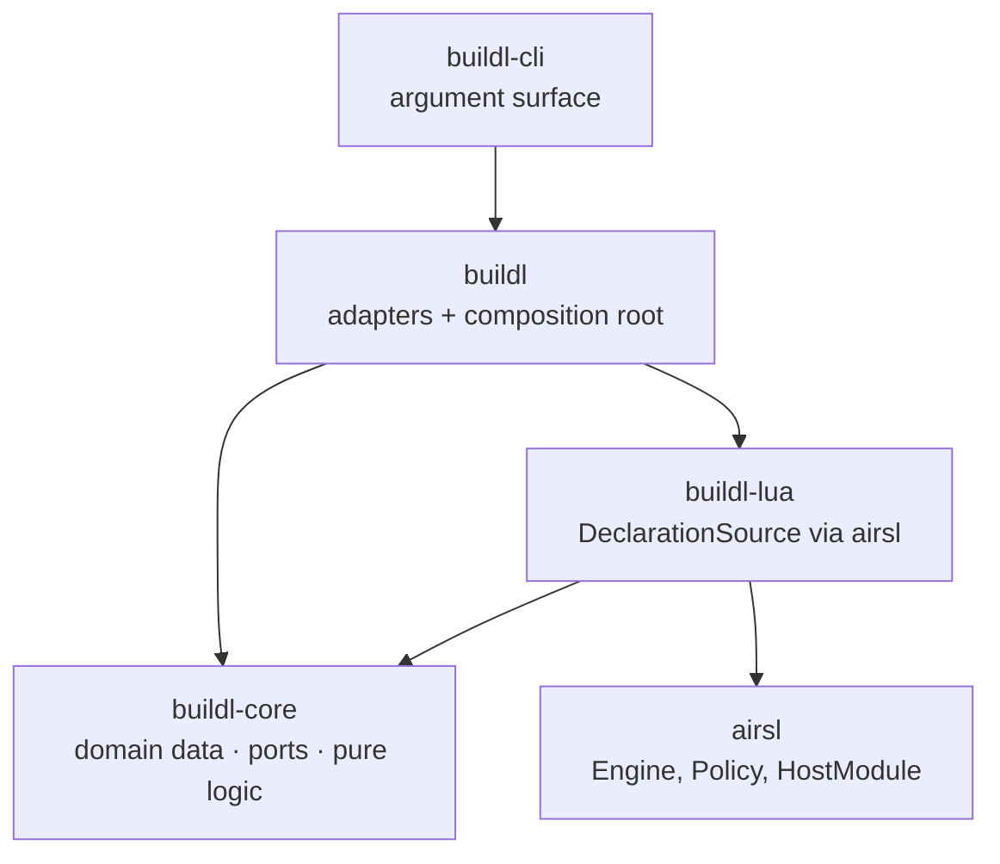
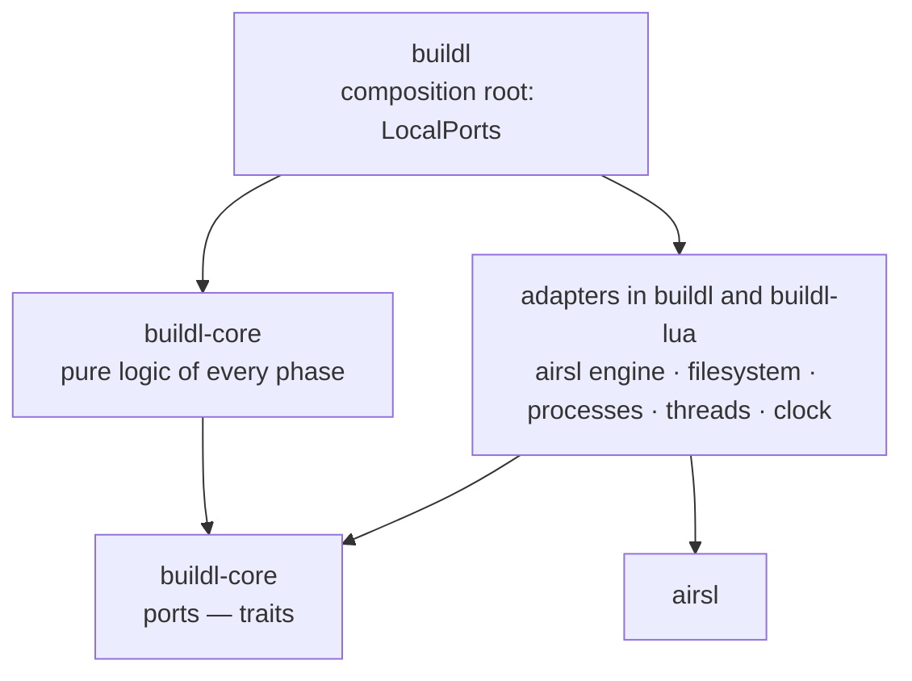
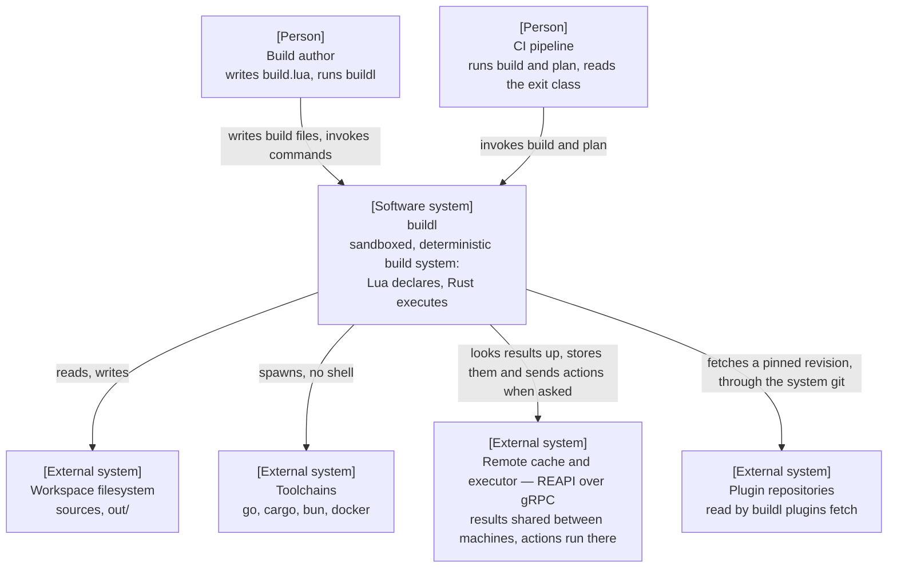
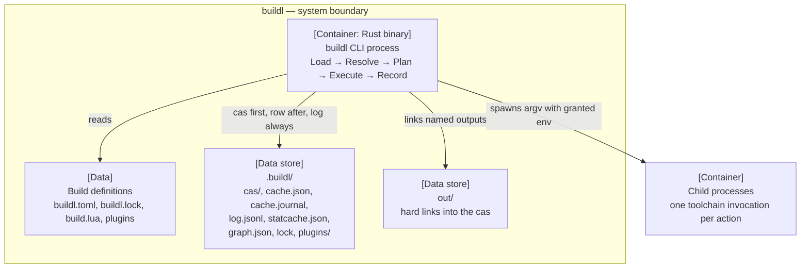
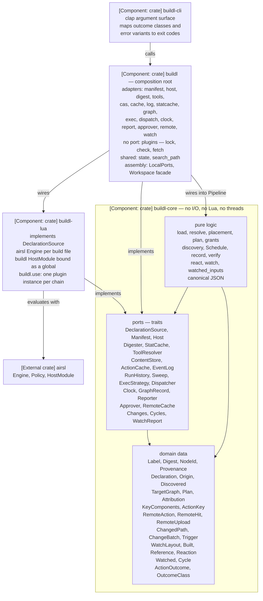
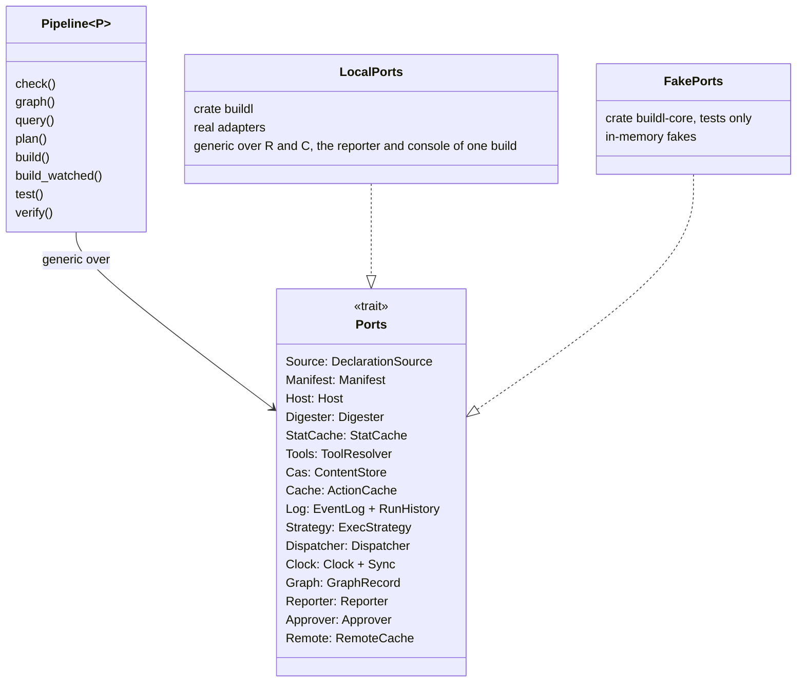
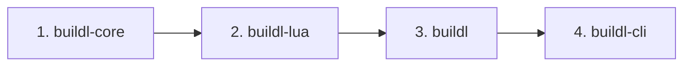

# Four Crates, Ports and Adapters

`buildl` is four Rust crates, split so that the logic of a build depends only on abstractions it
owns. Everything that touches the outside world, the airsl engine, the filesystem, child
processes, threads, the clock, plugs into that logic from the outside.

```text
buildl/
  Cargo.toml        # workspace: resolver 3, shared lints (airsl's lint set)
  crates/
    buildl-core/    # domain data, ports (traits), pure logic of every phase: no I/O, no Lua
    buildl-lua/     # DeclarationSource over airsl: engine per file, the buildl HostModule
    buildl/         # every other adapter + LocalPorts: the composition root
    buildl-cli/     # the `buildl` binary: clap argument surface, exit codes
```

The workspace shares airsl's policy: `unsafe_code = "forbid"`, `unwrap_used` and `panic` denied,
Clippy's pedantic and nursery groups at warn, and a comment in the workspace `Cargo.toml` giving
the reason for every dependency.

## The four crates

Every dependency points at `buildl-core`, and `buildl` is the one crate that names concrete
adapters together:



Two rules are built into that picture:

- **airsl is a dependency of `buildl-lua` only.** No other crate knows Lua exists, and
  `buildl-core` cannot name airsl at all, because airsl is not among its dependencies. The whole
  boundary with the runtime is one crate deep. That keeps the execution side testable without a Lua
  state, and keeps an airsl upgrade from spreading.
- **Phases talk through values, not calls.** Load hands on `Vec<Declaration>`, Resolve a
  `TargetGraph`, Plan a `Plan`, Execute `Vec<ActionOutcome>`, as
  [Declare, Then Execute](ch11-01-declare-then-execute.md) showed. The pipeline in `buildl-core`
  owns the order, and no phase calls the next.

## Dependency inversion

The logic of a build, loading, resolving, planning, scheduling and recording, depends only on
abstractions it defines itself. The concrete implementations depend on those abstractions, and
exactly one place picks which implementations run together. This is Robert C. Martin's
[Dependency Inversion Principle](https://en.wikipedia.org/wiki/Dependency_inversion_principle).
The abstractions are *ports* and the implementations are *adapters*, in Alistair Cockburn's
[hexagonal architecture](https://alistair.cockburn.us/hexagonal-architecture/):



The structure exists for one result: **every flow of the pipeline runs in `buildl-core`'s tests
against fake ports**, with no Lua state, no filesystem, no process and no thread.
[Testing Layers](ch11-07-testing-layers.md) shows how.

## What `buildl-core` may depend on

Dependency inversion is aimed at I/O and at parts that change often. A stable library doing pure
computation is not the implementation of a port, so the core may use one directly:

| `buildl-core` may depend on | `buildl-core` must not depend on |
|---|---|
| `std`, excluding its I/O, process, thread, environment, and clock APIs | `airsl`, `mlua`, `toml`, `clap` |
| `serde`, `serde_json` | `std::fs`, `std::process`, `std::thread`, `std::env`, `SystemTime` |
| `thiserror` | `rayon`, `tempfile`, `walkdir`, `globset` |
| `sha2` | any other buildl crate |

The table is the rule. `crates/buildl-core/clippy.toml` spells it out: 130 entries across
`disallowed-methods`, `disallowed-types` and `disallowed-macros`, split into nine families:

| Family | Entries | Note |
|---|---|---|
| the filesystem | 41 | counting the nine `Path` methods that reach it |
| the environment | 23 | including the compile-time reads and the two `PATH`-format helpers |
| threads | 20 | |
| processes | 15 | |
| the platform filesystem extensions | 13 | |
| the standard streams | 10 | including the print macros |
| the clock | 3 | |
| the network | 3 | |
| floating-point numbers | 2 | not an I/O surface at all |

The nine counts add up to the 130, so the families cover the whole file. A float is banned
because a non-finite one is written to JSON as `null`, so a value could reach an action key that
differs from the value it was computed from ([Determinism Rules](ch11-05-determinism-rules.md),
rule 2). `cargo make guard-core-purity` checks that every entry still names something real, that
no source file switches the lints off, and that the file itself is not switched off.

## The name `buildl`

Three different things are called `buildl`, and the crates keep them apart:

| Name | What it is | Lives in |
|---|---|---|
| `buildl` binary | the command users run | `buildl-cli` (`[[bin]] name = "buildl"`) |
| `buildl` Lua global | the declaration framework build authors call | `buildl-lua` (the `buildl` `HostModule`) |
| `buildl` Rust crate | the complete framework: every real adapter wired onto `buildl-core` | `crates/buildl` |

## The C4 views

The rest of the structure is drawn as the four levels of Simon Brown's
[C4 model](https://c4model.com/): the system in its surroundings, then its running parts, then
the components inside the process, then the code.

### Level 1: system context



### Level 2: containers

A C4 container is a separately running process or a place data is kept. The crates are not
containers: they compile into one process, and appear at level 3.



### Level 3: components

Inside the process, every adapter depends on `buildl-core`, and the one edge between adapter
crates is `buildl → buildl-lua`, which only the composition root may hold:



| Crate | Role | Depends on | Must not depend on |
|---|---|---|---|
| `buildl-core` | domain data, ports, the pure logic of every phase | `serde`, `serde_json`, `thiserror`, `sha2` | any buildl crate, `airsl`, any I/O API |
| `buildl-lua` | the `DeclarationSource` adapter: evaluates one build file through airsl, and loads the plugins it uses | `buildl-core`, `airsl`, `globset`, `walkdir`, `serde`, `serde_json` | `buildl` |
| `buildl` | every other adapter; the `plugins` module; `LocalPorts`; the `Workspace` facade; re-exports `buildl-core` as `buildl::buildl_core` | `buildl-core`, `buildl-lua`, `toml`, `toml_edit`, `rayon`, `serde`, `thiserror`, `tempfile`, `tonic`, `tonic-prost`, `prost`, `prost-types`, `tokio`, `uuid`, `notify` | nothing: it is the composition root |
| `buildl-cli` | argument surface and exit codes | `buildl`, `clap` | `buildl-core` and `buildl-lua` directly |

`crates/expected-edges.txt` holds that list as the gate checks it. Each adapter dependency has a
reason: `toml` reads `buildl.toml`, and `toml_edit` points at the place in it where a `[remote]`
table is refused, since `toml` keeps no positions; `rayon` hashes files, in the `Digester` adapter
and nowhere else; `tempfile` gives the write-then-rename every state file and blob goes through.
The remote cache's gRPC client is `tonic`, with `tonic-prost`, `prost` and `prost-types` for its
messages, `tokio` for the runtime the client needs, and `uuid` to name uploads. Only the `remote`
module names them. `notify` reports the operating system's file events to the `watch` module and
to no other.

Inside `buildl` there is one module per adapter, plus `plugins`, which serves no port but is kept
apart as an adapter is, two shared modules and two that put everything together:

| Module | Holds | Implements |
|---|---|---|
| `manifest` | `buildl.toml`, finding the workspace root, and the `[plugins.<name>]` tables | `Manifest` |
| `host` | the operating system, the processor, environment values | `Host` |
| `digest` | what stands at an input's path, and file hashing on rayon | `Digester` |
| `tools` | a program's lookup and its fingerprint | `ToolResolver` |
| `cas` | `.buildl/cas`, and the files placed under `out/`; listed and pruned through `Sweep` | `ContentStore` and `Sweep` |
| `cache` | `cache.json` and `cache.journal` | `ActionCache` |
| `log` | `log.jsonl`, appended to and read back | `EventLog` and `RunHistory` |
| `statcache` | `statcache.json` | `StatCache` |
| `graph` | `graph.json` | `GraphRecord` |
| `exec` | tier 1, `Bare`; tier 2, `InputSandbox`; and `Local`, which picks between them from the manifest | `ExecStrategy` |
| `dispatch` | worker threads for Load and Execute | `Dispatcher` |
| `clock` | the system clock | `Clock` |
| `report` | terminal output, and every rendering of a value into text | `Reporter` and `WatchReport` |
| `approver` | the three approvers a manifest can name, `LocalApprover`, which picks one, and the approvals it remembers outside the workspace | `Approver` |
| `remote` | the Remote Execution API client: its tokio runtime, the gRPC channel, blob transfer, `Execute` and `WaitExecution`, the retry rule; behind the `test-server` feature, an in-memory server for tests | `RemoteCache` |
| `watch` | the workspace's file events through `notify`, gathered into batches by a 50 ms window | `Changes` |
| `plugins` | `buildl.lock`, the digest of a plugin's files, the check that every plugin is there and unchanged, and fetching git plugins | none |
| `state` | shared: where each state file is, the state lock, writing a file whole, clearing a path, the sandbox's scratch directory | none |
| `search_path` | shared: the lookup of a program name | none |
| `local_ports` | composition: the `Ports` bundle and its wiring | none |
| `workspace` | composition: the `Workspace` facade, and the `Cycles` of `buildl watch` | none |

The `DeclarationSource` adapter is `buildl_lua::LuaSource`. `buildl` and `buildl-cli` build on Unix
only; Linux and macOS are the supported platforms, the two the CI matrix runs.

### Level 4: the code of `buildl-core`

#### Domain data

Every value is a checked newtype or a handoff that can be written out:

| Kind | Types |
|---|---|
| Names and identity | `Directory`, `TargetName`, `Label`, `NodeId`, `Provenance` |
| Content | `Digest`, the single SHA-256 type for files, outputs, keys and log blobs; `Hasher`, the same digest over bytes handed over in pieces |
| Outputs | `OutputManifest`, with `StoredFile` and `FileMode`, `Tree`, `TreeEntry` and `TreePath`; `Found`, `FoundEntry` and `FoundKind`, what a strategy reports at an output path |
| Time | `Timestamp`, nanoseconds since the Unix epoch, read only through the `Clock` port |
| Phase handoffs | `Declaration`, `TargetGraph`, `Plan`, `ActionOutcome` |
| Execution handoffs | `OutputPath`, `ReadyAction` with its `ExpandedDescription`, `RawOutcome` and `Exit`, `OutcomeEvent`, `OnFailure`, `Summary` |
| Incrementality | `KeyComponents`, `ActionKey` |
| Authority | `Ceiling`, `WantedSet`, `Want`, `Workspace`, `Approval`, `DenialReason`, `ApproverMode`, `Attribution`, `Checkup` |
| Plugins | `PluginName`, `PluginVersion`, `PluginRef`, `PluginChain`, `Origin`, `PluginCap`, `PluginNetwork`, `PluginViolation`, `PluginSource`, `GitUrl`, `Rev`, `TagName`, `CommitId` |
| Discovery | `Discovered`, `Loaded`, `TargetRole::Discovery` |
| Remote cache | `RemoteSettings`, `RemoteAction`, `RemoteHit`, `RemoteUpload`, `Uploaded`, `Blob`, `RemotePolicy`, `RemoteUse`, `RemoteFailure`, `RemoteExecution`, `Executed`, `RemoteSwitch`, `RemoteCall`, `RemoteNotice`, and the smaller values they are made of |
| Watch mode | `ChangedPath`, `ChangeBatch`, `Trigger`, `WatchLayout`, `Built`, `Reference`, `Reaction`, `Watched`, `Cycle` |
| Execution settings | `Execution`, with `Workers`, `Timeout` and `Isolation`; none of them is part of a key |
| A run and what it shows | `Scope`, `Purpose`, `Rerun`, `LiveOutput`, `Channel`, `LiveSink`, `Captured`, `Turn` |
| Inputs | `InputStat` and `InputKind`: nothing, a regular file, or something else at an input's path |
| The log, read back | `LogLine`, `LoggedRun` |
| A verify and what it found | `Sample`, `Check`, `OutputDifference`, `FileChange`, `EntryChange`, `Verification` |
| Classification | `OutcomeClass`, `InfraKind`, `OutputRefusal`, `TreeFault` |

#### Ports

A port is a trait in `crates/buildl-core/src/ports/`. Every fallible method returns the crate's one
`Result`, whose error is the single `buildl_core::Error` enum described in
[Errors](ch11-04-errors.md). Two of them show the shape:

```rust
/// Evaluates one build file. The directory queue, `subdir` handling, and the
/// sorted merge across files are Load logic in `buildl-core`, not the adapter's.
pub trait DeclarationSource: Sync {
    fn evaluate(&self, file: &BuildFile, discovered: &Discovered) -> Result<Evaluated>;
}

/// The scheduler side is the single writer. A row is durable once `record` returns
/// `Ok`; after `Err` the cache holds what it held before the call.
pub trait ActionCache {
    fn row(&self, label: &Label) -> Option<&CacheRow>;
    fn labels(&self) -> Vec<Label>;
    fn record(&mut self, label: Label, row: CacheRow) -> Result<()>;
    fn forget(&mut self, label: &Label) -> Result<()>;
}
```

The full list is the port catalog below.

#### `Pipeline` and the `Ports` bundle

`buildl` uses static dispatch throughout. One trait of associated types carries every port, so
`Pipeline` takes a single type parameter instead of one per port. The trait lives in
`crates/buildl-core/src/ports/bundle.rs`, beside the traits it names:

```rust
pub trait Ports {
    type Source: DeclarationSource;
    type Manifest: Manifest;
    type Host: Host;
    type Digester: Digester;
    type StatCache: StatCache;
    type Tools: ToolResolver;
    type Cache: ActionCache;
    type Cas: ContentStore;
    type Log: EventLog + RunHistory;   // plan, verify and build read discovery results from it
    type Strategy: ExecStrategy;
    type Dispatcher: Dispatcher;
    type Clock: Clock + Sync;          // a worker reads the clock
    type Graph: GraphRecord;
    type Reporter: Reporter;
    type Approver: Approver;
    type Remote: RemoteCache;          // NoRemote when there is none
}

pub struct PortSet<P: Ports> { pub source: P::Source, pub manifest: P::Manifest, /* ... */ }

pub struct Pipeline<P: Ports> { /* ports: PortSet<P> */ }

// in `buildl`: generic over the reporter and the console a build is lent
pub struct LocalPorts<R, C>(PhantomData<fn() -> (R, C)>);
pub type LocalPipeline<R, C> = Pipeline<LocalPorts<R, C>>;
```



`Ports::Remote` is called only by `build` and `test`. Every other command, a workspace with no
`[remote]` table and a run with the remote turned off hold a cache that is never asked: `NoRemote`
in the core's tests, `Remote::Off` in `LocalPorts`. `Ports::Log` is bound by both `EventLog` and
`RunHistory`, because `plan`, `verify`, `build` and `test` read the last result of each discovery
target from the log they append to. The two stay separate traits, since a writer and a reader never
share a method.

Commands that need only a few ports are free functions instead of `Pipeline` methods, so they need
no state directory and take no lock: `pipeline::check`, `pipeline::graph` and `pipeline::query`
over a `DeclarationSource`, a `Dispatcher`, a `RunHistory` and a `ContentStore`; `pipeline::doctor`
with a `Manifest` as well; `pipeline::log` over just `RunHistory` and `ContentStore`; and
`pipeline::gc`, which adds an `ActionCache` and a `Sweep`.

#### Pure logic

| Logic | Input → output | Ports used |
|---|---|---|
| load | workspace root and a `Discovered` → `Vec<Declaration>` | `DeclarationSource`, `Dispatcher` |
| discovery | the build files, the log and the cas → declarations loaded twice, the second time with the discovery results | `DeclarationSource`, `Dispatcher`, `RunHistory`, `ContentStore` |
| resolve | `Vec<Declaration>` → `TargetGraph` | none |
| narrow | `TargetGraph`, a `Scope` and a `Purpose` → the graph of what a run asked for | none |
| reach | `TargetGraph` and a `Query` → the targets `deps()` or `rdeps()` reaches | none |
| plan | `TargetGraph`, setting overrides and a `Rerun` → `Plan` | `Manifest`, `Host`, `Digester`, `StatCache`, `ToolResolver`, `ActionCache` |
| grants | a plan's `WantedSet` and `Attribution` → go on, or `Error::NotApproved`; also what plugins do not allow, and which programs a dependency built | `Approver` |
| execute | the graph, the narrowed graph, its `Plan` and the run's choices → `Vec<ActionOutcome>` | `Manifest`, `Dispatcher`, `ExecStrategy`, `ContentStore`, `ActionCache`, `EventLog`, `Clock`, `Reporter`, `RemoteCache` |
| last_run | the log's lines and a `Label` → the newest run of that label that stored its output | none |
| verify | the graph, the narrowed graph, its `Plan` and a `Sample` → `Verification` | `Manifest`, `ActionCache`, `ContentStore`, `ExecStrategy`, `Dispatcher`, `Clock` |
| react | a `ChangeBatch` and a `Reference` → a `Reaction`: build, check the build files, or nothing | none |
| watched_inputs | the graph and the narrowed graph → the files a build reads | none |
| watch | a `WatchLayout` → the error that ended it | `Changes`, `Cycles`, `WatchReport` |
| canonical JSON | value → sorted-key bytes, and those bytes, and no others, → the value | none |

## The port catalog

"Milestone" is the step of the roadmap the adapter arrived with: 1 is the core build, 2 the rest of
the everyday commands, 3 the sandbox, 4 approvers, 6 the remote cache and 7 watch mode. Plugins and
discovery targets (5) and remote execution (8) added no port of their own.

| Port | `buildl-core` uses it for | Adapter | Crate | Milestone |
|---|---|---|---|---|
| `DeclarationSource` | Load: one build file per call, several calls at once, each with the discovery results | `LuaSource`: an airsl engine per file, with the plugins it uses loaded into the same evaluation | `buildl-lua` | 1 |
| `Manifest` | the ceiling, the output and state directories, the execution settings and each plugin's cap | the `buildl.toml` reader | `buildl` | 1 |
| `Host` | the platform in every key, and the values of the variables targets read | the running machine | `buildl` | 1 |
| `Digester` | what stands at each input's path, and its content hash | the filesystem, with rayon, each file streamed in pieces | `buildl` | 1 |
| `StatCache` | reusing a digest when size and modification time are unchanged | `.buildl/statcache.json`; keeps only files changed more than 2 s before the run began | `buildl` | 1 |
| `ToolResolver` | the fingerprint of each program, in the key | a `PATH` lookup and a content hash | `buildl` | 1 |
| `ContentStore` | the cas: storing a blob, asking for one, reading one back, clearing an output's path and placing a blob there | `LocalCas`: `.buildl/cas/ab/…`, read-only blobs, hard links or copies into `out/` | `buildl` | 1 |
| `ActionCache` | reading, listing, recording and forgetting cache rows, each durable on return | `.buildl/cache.json` and `.buildl/cache.journal` | `buildl` | 1 |
| `EventLog` | one event per outcome | `.buildl/log.jsonl`, appended to | `buildl` | 1 |
| `RunHistory` | the log's lines, oldest first, each an event or a damaged line | `.buildl/log.jsonl`, read only | `buildl` | 2 |
| `Sweep` | listing what the cas holds and removing a blob; kept out of `Ports`, so a build cannot remove what it stored | the same `.buildl/cas` | `buildl` | 2 |
| `ExecStrategy` | running one action and reporting, and storing, what it left at each output path | `Bare`, tier 1 | `buildl` | 1 |
| `ExecStrategy` | the same, in a directory of its own outside the workspace, with `TZ`, `LC_ALL` and `SOURCE_DATE_EPOCH` pinned | `InputSandbox`, tier 2, the default; `Local` picks `Bare`, `InputSandbox` or a refusal | `buildl` | 3 |
| `Dispatcher` | evaluating build files and running actions in parallel, and carrying a running action's messages back | `ThreadPool`: scoped threads and `mpsc`, up to `[execution] workers` | `buildl` | 1 |
| `Approver` | whether a build whose wants are inside the ceiling may run | `LocalApprover`: `ManifestApprover`, `DenyApprover` or `InteractiveApprover` | `buildl` | 4 |
| `RemoteCache` | results shared between machines, and actions the server runs; every answer checked by the core, never trusted | `Remote`: a gRPC client over the Remote Execution API, its tokio runtime reached through `block_on` | `buildl` | 6 |
| `Clock` | log timestamps and durations | the system clock | `buildl` | 1 |
| `GraphRecord` | keeping the graph a build resolved | `.buildl/graph.json`, written whole | `buildl` | 1 |
| `Reporter` | output blocks, the status line, the summary and notices about the remote | the terminal reporter, with a live and a plain mode | `buildl` | 1 |
| `Changes` | waiting for files of the workspace to change | `NotifyChanges`: `notify`, relative paths, a 50 ms window | `buildl` | 7 |
| `Cycles` | one watch cycle: the workspace opened again and built, or loaded | `Reopening`, in `workspace/watching.rs` | `buildl` | 7 |
| `WatchReport` | what a watch says about itself | the terminal reporter's `watch: ` lines | `buildl` | 7 |

One more trait sits beside them: `BlobSource`, which an upload to the remote reads blobs through,
because the remote adapter may not import the local content store.

The `Clock` port is how the wall clock is kept out of the core
([Determinism Rules](ch11-05-determinism-rules.md), rule 4). The crate boundary alone does not
enforce it, since `std::time` is open to every crate, so `crates/buildl-core/clippy.toml` bans
`Instant`, `SystemTime` and `SystemTimeError` by name.

## Dependency rules

1. **`buildl-core` depends on no buildl crate, no airsl, and no I/O API** (see
   [What `buildl-core` may depend on](#what-buildl-core-may-depend-on)).
2. **Adapters depend on `buildl-core`.** `buildl-lua` never depends on `buildl`; inside `buildl`,
   adapter modules never import each other. What several adapters need lives in two shared
   modules, `state` and `search_path`, which implement no port and name no module of the crate;
   adapters meet only in the two composition modules, `local_ports` and `workspace`. `plugins`,
   which implements no port, is held to the same rule: it names `state` and `search_path`,
   `local_ports` calls its `check` and `workspace` its `fetch`, and the `manifest` adapter, which
   reads which plugins a workspace names, shares with it values in `buildl-core` and no code.
3. **`buildl` is the single composition root**: the only adapter crate that depends on another
   adapter crate (`buildl-lua`), and the only code that names more than one concrete adapter,
   through `LocalPorts`. This is dependency inversion applied, not broken: the principle
   constrains the logic, and a composition root is where concrete choices are made.
4. **`buildl-cli` reaches core types through `buildl`'s re-exports**, so the binary has one library
   dependency.
5. **The remote cache's gRPC client, its protobuf messages and its async runtime are the `remote`
   module's, in `buildl`.** `tonic`, `prost` and `uuid` have `buildl` as the one crate that may
   depend on them, beside their own companion crates; `tokio` is not banned by name, and
   `guard-crate-edges` keeps every other member off it. Nothing outside the module names tokio,
   and the runtime is reached through `block_on`, so `buildl-core`, the `Dispatcher` and every
   other adapter stay synchronous ([Decision Records](ch11-06-decision-records.md)). `deny.toml`
   holds the crate edge; that no other module of `buildl` names them is the module layout's doing,
   as it is for `rayon` in `digest`.

| Rule | Enforced by |
|---|---|
| the dependency half of 1, rules 4 and 5, and the cross-crate half of 2 | `deny.toml`'s `[bans]` lists, which name the only direct parents a crate may have, plus `cargo make guard-crate-edges`, which compares every member's direct dependencies with `crates/expected-edges.txt`. The compiler alone stops a crate using what its `[dependencies]` leave out, but not a dependency being added or removed |
| the "no I/O API" half of 1 | `crates/buildl-core/clippy.toml`, the enumerated ban on the filesystem, process, thread, network, environment, standard-stream and clock APIs, checked by `cargo make guard-core-purity` |
| no phase module of `buildl-core` names another | `crates/expected-module-edges.txt`, the committed list of `buildl-core`'s module-to-module imports, compared by `cargo make guard-module-edges`. Import forms the list cannot read, such as a grouped `crate::{…}`, are refused outright |
| adapter isolation inside `buildl` | `cargo make guard-adapter-isolation`, which reads every file under `crates/buildl/src` but `lib.rs`, test code included: an adapter module may name `crate::state` and `crate::search_path` and no other module, the two shared modules name none, and only `local_ports` and `workspace` name any module they like |

## Publishing

`buildl-cli` is published to crates.io, and crates.io takes a crate only when its dependencies are
published too, so all four crates are published, the one depended on first:



| Requirement | Form |
|---|---|
| internal dependencies | `buildl-core = { version = "…", path = "crates/buildl-core" }` in `[workspace.dependencies]`; packaging keeps the version and drops the path |
| version sync | each workspace dependency's version matches the crate's own version |
| metadata | `description` and `readme` per crate; `license` and `repository` from the workspace |
| crate `README.md` | written for crates.io readers of that crate |

Four rules keep publishing possible, and every change to the workspace follows them:

1. Every dependency between members is `{ workspace = true }`, and no member depends, dev
   dependencies included, on a member later in the publish order: `cargo package` fails on one,
   and a dev dependency given by path alone is silently dropped from the packaged manifest.
2. The workspace has no fifth member (the generator of the Remote Execution API types,
   `tools/reapi-codegen`, sits outside it), and `buildl` gains no `[[bin]]` or `[[example]]` for
   the sake of tests. Its one feature, `test-server`, builds the in-memory server the remote
   cache's tests talk to. It is off by default and turned on by `buildl-cli` only as a dev
   dependency, so the shipped binary does not hold the server.
3. Fixtures and golden files live inside the package whose tests read them, reached through
   `CARGO_MANIFEST_DIR` or `include_str!`; no test reads another package's directory.
4. No fixture path holds a component named `target` or `debug`.

Once published, the ports are a promise to anyone who writes an adapter:

| Concern | Rule |
|---|---|
| sealed or open | **open**: adapters live in other crates, and a sealed trait cannot be implemented outside its own crate |
| growing a port | new methods get default bodies; a required method breaks every implementor |
| growing data | `#[non_exhaustive]` on enums and structs expected to gain variants or fields |
| version line | `0.x` until the port surface settles |
