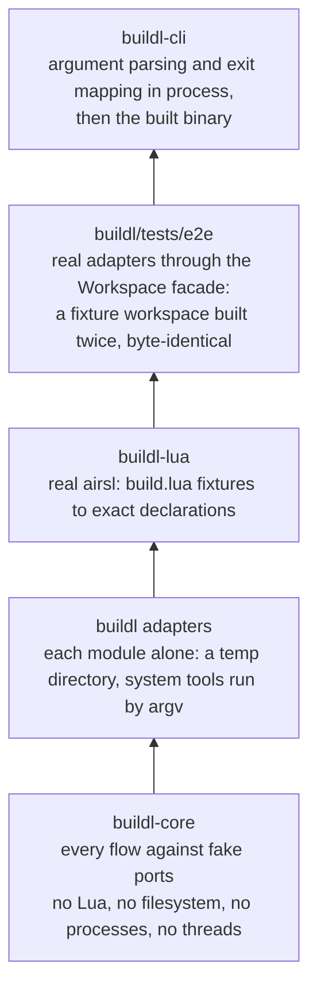

# Testing Layers

The phases of `buildl` talk to each other through plain values, and to the outside world through
ports. That makes the narrow places between them the natural place to test. Every flow is tested
first in `buildl-core`, against fake ports, with no Lua, no file system, no processes and no
threads. Then it is tested again against the real adapters, in the crate that owns them.

The widest coverage is at the bottom, where tests are fastest and need nothing.

| Layer | Lives in | May touch | Must not |
|---|---|---|---|
| Core flows | `crates/buildl-core/tests/flows`, with the fakes in `common.rs` | `buildl-core`'s public API and the fakes | Lua, the file system, a process, a thread |
| Lua | `crates/buildl-lua/tests/flows`, with fixtures in `crates/buildl-lua/tests/fixtures`, and unit tests beside the code | real airsl; fixture build files, or files written into a temp workspace, turned into exact `StagedFile`s | anything of `buildl` |
| Adapter unit | `crates/buildl/src/<module>/`, beside the code | its own module, `state`, `search_path`, `buildl-core`, one temp directory; `exec` starts system tools | another adapter module; the process's current directory; setting an environment variable |
| End to end | `crates/buildl/tests/e2e`, with fixtures in `crates/buildl/tests/fixtures` | `buildl`'s public API; a temp copy of a fixture | a private item; a path outside the package |
| CLI unit | `crates/buildl-cli/src`, beside the code | argument parsing, the exit mapping, terminal detection, a command's flow over byte buffers and a temp workspace | a process; a terminal |
| CLI binary | `crates/buildl-cli/tests/cli` | the built binary, with a chosen working directory and environment, its output piped | `buildl` internals; a terminal |

`buildl-core` forbids threads even in its tests: `crates/buildl-core/clippy.toml` bans
`std::thread::spawn` and its kin for the whole crate, test code included. A test that needs real
workers belongs to `buildl`.

## The tools the tests run

Tests that run actions run system tools, `sh`, `cp`, `sort`, `true`, `false`, `sleep` and their
like, by argv. `sh -c` appears in tests only, never in `buildl`. There is no compiled helper
program and no shared kit of fakes; [Decision Records](ch11-06-decision-records.md#tests) says why.

The one thing the layers share is a server. The remote cache adapter's tests, `buildl`'s
end-to-end tests and `buildl-cli`'s binary tests all talk to the in-memory Remote Execution API
server that `buildl`'s `test-server` feature builds, on loopback. No test reaches the internet,
and the shipped binary does not hold the server.

## The fakes

The fakes live in `buildl-core`'s integration tests, `crates/buildl-core/tests/flows/common.rs`, not
under `#[cfg(test)]`. They implement the public traits through the public API alone, so whatever a
fake can do, an adapter in another crate can do too, and the compiler checks that on every test
build.

| Port | Fake | What the test no longer needs |
|---|---|---|
| `DeclarationSource` | `FakeSource`: a fixed build file, missing file or failed evaluation per directory; other files once the root is evaluated again or handed a discovery result | airsl, Lua |
| `Manifest` | `FakeManifest`: one fixed workspace and ceiling | a `buildl.toml` |
| `Host` | `FakeHost`: a fixed platform and fixed variables, some of which it can be told to fail on | the real environment |
| `Digester` | `FakeDigester`: files held as bytes with their metadata, counting every call | a file system |
| `StatCache` | `FakeStatCache`: in memory, counting commits | a file system |
| `ToolResolver` | `FakeTools`: fixed fingerprints, recording every lookup | a `PATH` |
| `ContentStore` and `Sweep` | `FakeCas`: blobs and placed paths in memory, each with its mode; digests it can be told to forget, paths it can be told to fail on, reads it can be told to lose | a file system |
| `ActionCache` | `FakeCache`: rows in memory, labels it can be told to fail on, and the labels it forgot | a file system |
| `EventLog` and `RunHistory` | `FakeLog`, and `FakeHistory` for history alone: what was appended, and whether to fail | a file system |
| `ExecStrategy` | `FakeStrategy`: scripted per label, how the action exits, what it prints, and what is left at each output: a file, an executable, a directory, a symbolic link, something special, or nothing | starting processes |
| `Dispatcher` | `FakeDispatcher`: runs tasks inline on the test thread, oldest or newest first; it can be told to lose a task, or run one and drop its result | threads; results are deterministic |
| `Clock` | `FakeClock`: a counter, one tick per read | the wall clock |
| `GraphRecord` | `FakeGraphRecord`: the graphs recorded, and whether to fail | a file system |
| `Reporter` | `FakeReporter`: every call kept, in order | a terminal |
| `Approver` | `FakeApprover`: one answer, given every time, and every set it was asked about with its attribution | a terminal, a data directory |
| `RemoteCache` | `FakeRemote`: results in memory, every call kept in order; it can be told to fail any call, serve tampered bytes, or answer that an input changed | a network, a server |

The watch loop's own ports, `Changes`, `Cycles` and `WatchReport`, have unit-test fakes beside the
loop, in `crates/buildl-core/src/watch/run.rs`, and a scripted `Changes` in `buildl`'s end-to-end
watch tests.

## What runs where

A sample of what each layer proves. The core flows check the decisions; the end-to-end tests check
the same promises against real files and processes.

| In `buildl-core`, against fakes | Proves |
|---|---|
| `//:a` fails under `--keep-going` | the summary is `1 failed, 2 skipped, 2 built` |
| the cas write succeeds, the cache write fails | there is no row for the target: [crash safety](ch11-02-crash-safety.md) |
| a rebuilt output is byte-identical | downstream targets stay clean: [early cutoff](ch05-02-early-cutoff.md) |
| one input changed | the reason the target is dirty is the difference between its old and new `KeyComponents` |
| the `[execution]` settings all change after a build | every target stays clean: none is part of a key |
| a wanted program outside the ceiling | `Error::Refused` before any strategy runs |
| a plugin's target wants what its plugin may not have | `Error::PluginRefused`, naming the plugin, before the ceiling is asked |
| the dispatcher loses a task | `Error::DispatcherFault`, naming every target left without an outcome |
| a build with a discovery target | the discovery target runs first, then what it declared; a second build is all cached |
| a target the fake remote holds | it ends `Fetched`, no strategy is called, and its row is written after its content |
| a remote call fails | lenient: one warning and the target runs; strict: the build fails |

| In `crates/buildl/tests/e2e`, against real adapters | Proves |
|---|---|
| a fixture built in two directories, with four workers and with one | `out/`, `cache.json`, `graph.json` and the cas are byte-identical |
| a second build | every target cached; `cache.json` and `graph.json` unchanged |
| `out/` removed | every output put back without running, the executable bit kept |
| the states an interrupted build leaves | the next build finishes, trusts no blob without a row, and clears what was half done |
| a corrupt `cache.json` | `Error::CorruptState` naming the file; `check`, `graph` and `query` still work |
| a target that reads a file it did not declare | it fails under `sandbox` and builds under `bare` |
| the same chain under `bare` and under `sandbox` | `out/` is byte-identical across the two |
| `verify` over a target that writes its process id | that target is reported as mismatched, naming its output |
| a second checkout against the server a first build uploaded to | every target fetched, no action run, outputs byte-identical |

## A real server, once per CI run

The in-memory server answers as the protocol says, but it is still `buildl`'s own. One CI job,
`remote-execution`, runs `crates/buildl-cli/tests/real_remote.rs` against NativeLink v1.4.0, built
from `ci/nativelink.Dockerfile`. The file's tests run only when `BUILDL_TEST_REAPI_URL` names a
server, which the job sets, and skip otherwise. A workspace built with `--remote-execute` ends with
every target `remote`, and a second build in a fresh checkout ends with every target `fetched` and
byte-identical outputs.

The last layer is an aim rather than a test: `buildl`'s own gate running under `buildl`.
