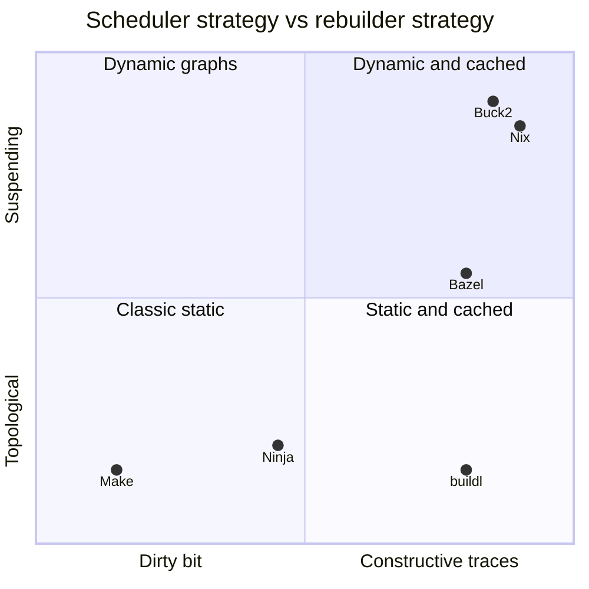
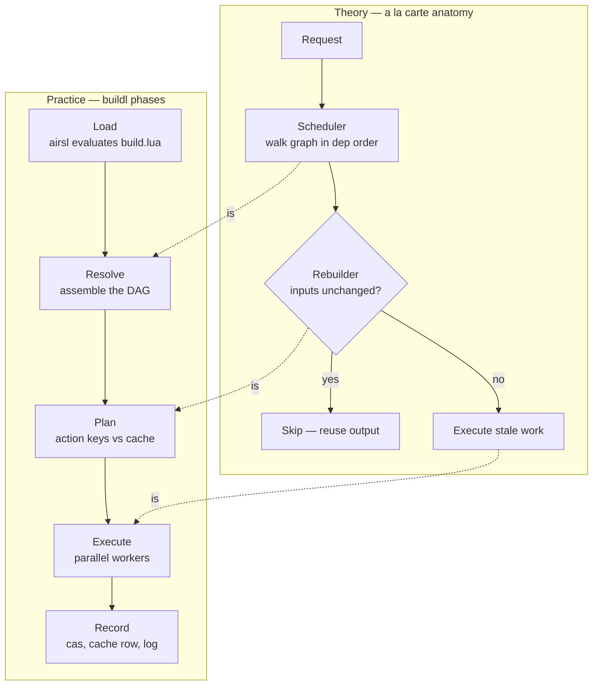
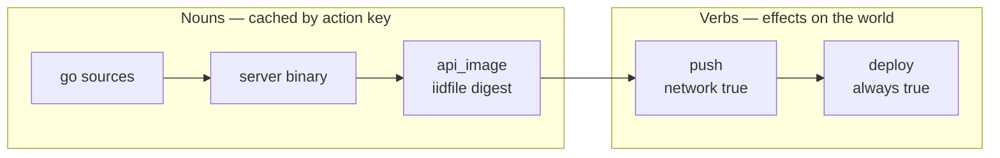
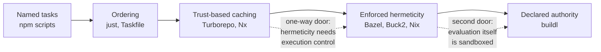
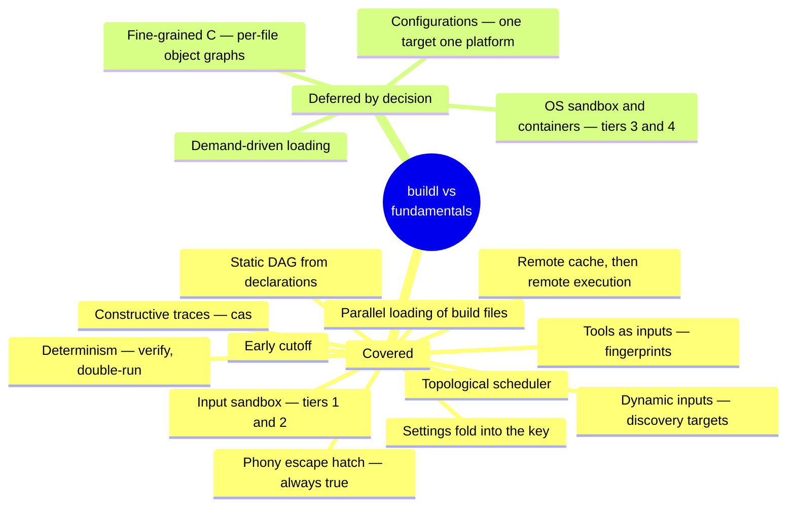

# Where buildl Sits

Build systems are an old subject with a good theory behind them. This page places `buildl` in
that theory: what kind of build system it is, which ideas it takes from others, and what it adds
that the theory has no word for.

The map used here is *Build Systems à la Carte*, by Andrey Mokhov, Neil Mitchell and Simon Peyton
Jones (ICFP 2018). Its central idea is that every build system is two parts:

- a **scheduler**, which decides the order work is done in, and
- a **rebuilder**, which decides whether a piece of work needs doing at all.

## The grid

Each part comes in a few kinds. A scheduler can be *topological*: work out the whole graph first,
then walk it from the leaves up. Or it can be *suspending*: start a task, and pause it when it
turns out to need something not built yet. A rebuilder can use a *dirty bit*, as Make does by
comparing file times, or *traces*: a record of what each task read and made, the strongest form
being *constructive traces*, which keep the outputs themselves, stored by the hash of what made
them.



`buildl` is a **topological scheduler with constructive traces**. The graph is fully known once the
build files are read and resolved, it is walked from the bottom up, and every action's outputs are
kept in a content-addressed store, the cas, under its [action key](ch05-01-action-key.md). That is
Bazel's rebuilder with the simpler scheduler of Make and Ninja. The pairing is deliberate: the
declaration phase produces a complete static graph, so a scheduler that can suspend and restart
tasks would buy nothing.

The theory also predicts the one thing such a design cannot do. A purely topological scheduler
cannot handle a dependency found *while* an action runs, such as the header a C compiler happens to
read. [What buildl Can and Cannot Promise](ch11-09-what-it-promises.md) says how `buildl` handles
that.

What the grid cannot show is `buildl`'s real signature: **authority comes from the graph, not from
the host**. None of the tools on the grid has that axis.

## The scheduler and the rebuilder, made literal

The theory draws a build system as a pipeline: a request, a scheduler, a rebuilder, and then run or
skip. `buildl`'s five phases are that pipeline, with each boundary between phases turned into a
value you can print.



Resolve builds what the scheduler walks. Plan *is* the rebuilder: it compares action keys with the
cache. Execute runs only what Plan found dirty. What `buildl` adds is that every arrow between
phases is a value, `Vec<Declaration>`, then `TargetGraph`, then `Plan`, then `Vec<ActionOutcome>`.
That is why `buildl graph` and `buildl plan` come for free: each command is the pipeline stopped at
one of those values. [Declare, Then Execute](ch11-01-declare-then-execute.md) walks through them.

## A build system first

`buildl` is a build system first. The question it exists to answer is *"does this need to run at
all?"*, and the action key, the cas and the dirty check are how it answers. Using it as a task
runner, for chores, for graphs of aliases, or in place of `cargo make`, is a special case the model
gives for free. It is not what the design was shaped around: nothing was designed *for* it, and
nothing needs removing to allow it later.

Here is what that special case looks like. A build system contains a task runner, reachable
through an escape hatch, and `buildl`'s hatch is `always = true`:

```lua
b.target("push", {
  deps = { "api_image" },
  run = { "docker", "push", "registry.example.com/api" },
  network = true,           -- declared, shown by plan and the approver
})
b.target("deploy", { deps = { "push" }, run = { "kubectl", "apply", "-f", "k8s/" },
  always = true })          -- a verb: never cached, never skipped
```



The interesting node is `push`. It is a *cached side effect*, and that is right here: an unchanged
image digest means the registry already has these bytes, so skipping the push is what you want.
`deploy` is the true verb, and carries `always = true`. A simple test sorts every node: ask the tool
to do the same thing twice. The nouns do nothing the second time, `push` does nothing while the
digest matches, and `deploy` runs every time.

This is also why the summary line has the words it has. `1 failed, 2 skipped, 2 built, 9 cached`, from
[Declare, Then Execute](ch11-01-declare-then-execute.md#execute-the-scheduler-loop), names states a pure task runner has no use for: *cached* and
*skipped* are the rebuilder's words.

## The capability gradient

Tools that run tasks sit along a line, each step adding something: named tasks, then ordering, then
caching you have to trust, then hermeticity that is enforced. `buildl` adds one more step at the
end.



Turborepo's cache is only as correct as your declarations. Bazel enforces the declarations by
sandboxing actions as they run. `buildl` adds a step the line did not have: the build files
themselves run inside the sandbox, and the build's whole authority is worked out from the graph
and checked against a ceiling before anything runs. Each step to the right costs effort to adopt.
`buildl`'s bet is that starting from declared authority, inherited from airsl, makes the last step
cheaper than adding it to a tool that began without it.

## The summary card



Everything the theory calls load-bearing exists in `buildl` as a concrete mechanism. The one
correctness question the grid predicted, dependencies found while an action runs, is answered by
[discovery targets](ch07-00-discovery-targets.md), with fine-grained C left out behind them. And
each deferred item has a named way in, which is what makes leaving it out a choice that can be
undone.
