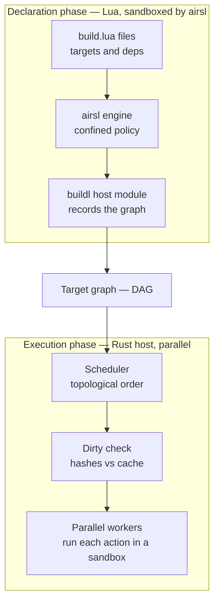

# Introduction

Most build tools trust their build files completely. A `Makefile` can run any program. A build
script in a general-purpose language can read your SSH keys, call out to the network, or delete
your home directory. Usually none of them do, but nothing stops them, and nothing tells you what a
build will touch before it runs.

`buildl` is a build system that starts from the other end. Its build files are written in Lua and
run inside [airsl](https://github.com/airsstack/airsl), an embedded Lua runtime that decides what a
script may reach. The rule `buildl` takes from airsl is short: **nothing is ambient**. A build
cannot run a program, read a file or see an environment variable unless that was declared, and the
workspace allowed it.

Three things follow from that rule, and they are what `buildl` is for:

1. **Build files are safe to read.** You can clone a repository and let `buildl` evaluate its build
   files before you trust it, because evaluating them grants them nothing.
2. **Rebuilds you can explain.** Whether a target is out of date is decided by hashing what it
   declared it reads, so `buildl plan` can always tell you what would rebuild, and why.
3. **Authority you can see.** The programs, paths and environment variables a build may touch are
   worked out from the build itself, and checked against a limit the workspace sets, before
   anything runs.

## Declare, then execute

The most important idea in `buildl` is a split between two phases. Build files only **declare**:
they say which targets exist, what each one reads, and what command makes it. They never run a
compiler and never write an artifact. The `buildl` program, written in Rust, then **executes**: it
works out what is out of date, runs those commands in parallel, each in a sandbox, and caches what
they produce.

The line between the two boxes is airsl's boundary. A build file that loops forever is stopped
there, by a limit on how many instructions it may run. Everything that can do harm, such as
running a program or writing a file, happens on the Rust side, where `buildl` controls it.

## Why Lua, and why airsl

Build configuration sits somewhere between plain data and a full programming language. Data, such
as YAML or TOML, cannot say "do this for every source file". A full language can say that, and
also anything else, including things a build file should never do. Lua in a sandbox sits in the
middle: you get real loops and functions, and the host decides what they can reach.

airsl gives `buildl` that sandbox. Lua is built into the `buildl` binary, so there is nothing else
to install. airsl's permission model is what `buildl` uses to decide what a build may do, and its
host-module seam is how the `buildl` functions your build files call are added to Lua. Starting a
fresh Lua engine is cheap enough that every build file gets its own.

## Who this book is for

You are an engineer who has used a build tool before, such as `make`, `cargo` or `go build`. You do
not need to know Lua. Build files use very little of it, and this book explains what they use as
it goes.

## How this book is organised

| Chapter | What you will do |
|---|---|
| [1. Getting Started](ch01-00-getting-started.md) | Install `buildl` and build a one-target workspace |
| [2. A First Project](ch02-00-first-project.md) | Build and test a small Go program |
| [3. Build Files](ch03-00-build-files.md) | Declare targets, inputs, dependencies and settings |
| [4. Asking Permission](ch04-00-asking-permission.md) | Set the workspace's limits and choose who approves a build |
| [5. Caching](ch05-00-caching.md) | See how `buildl` decides what to rebuild, and tidy up after it |
| [6. The Sandbox](ch06-00-sandbox.md) | See where each command runs, and what it can see |
| [7. Discovery Targets](ch07-00-discovery-targets.md) | Let a build ask a tool what it needs |
| [8. Plugins](ch08-00-plugins.md) | Load shared build logic, from the workspace or from git |
| [9. Remote Cache and Execution](ch09-00-remote.md) | Share results through a server, and run actions on it |
| [10. Watch Mode](ch10-00-watch.md) | Rebuild whenever a file changes |
| [11. Under the Hood](ch11-00-under-the-hood.md) | How `buildl` is built, and what it can and cannot promise |

Chapters 1 to 5 are enough to use `buildl` on your own projects. Chapters 6 to 10 cover the parts
you reach for as a project grows. Chapter 11 is optional reading, for the curious: how `buildl` is
put together, and why. The [appendix](appendix-00.md) collects the reference material: every
command and flag, every `buildl.toml` key, every build-file function and every exit code.
