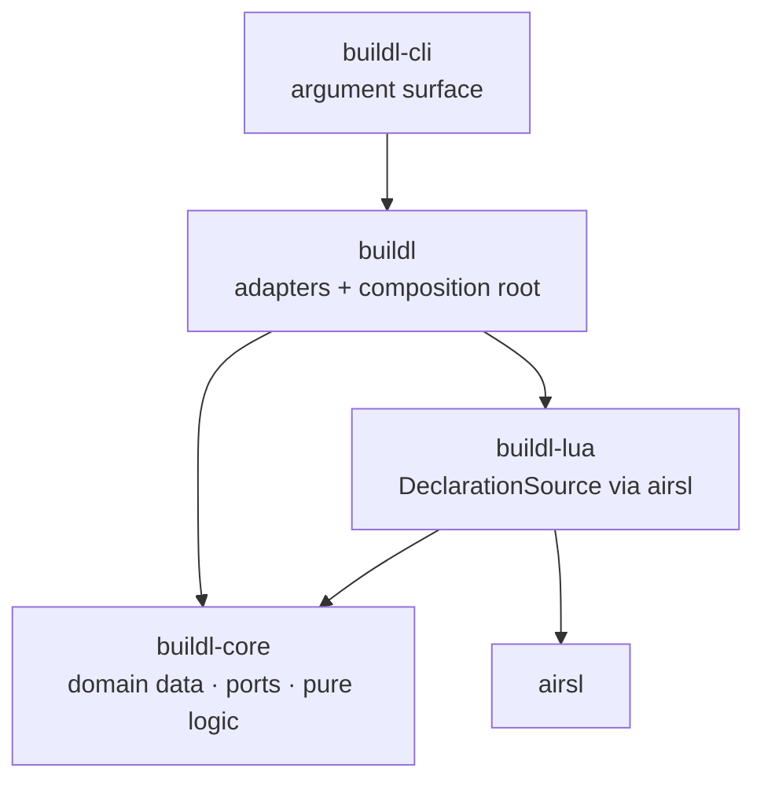
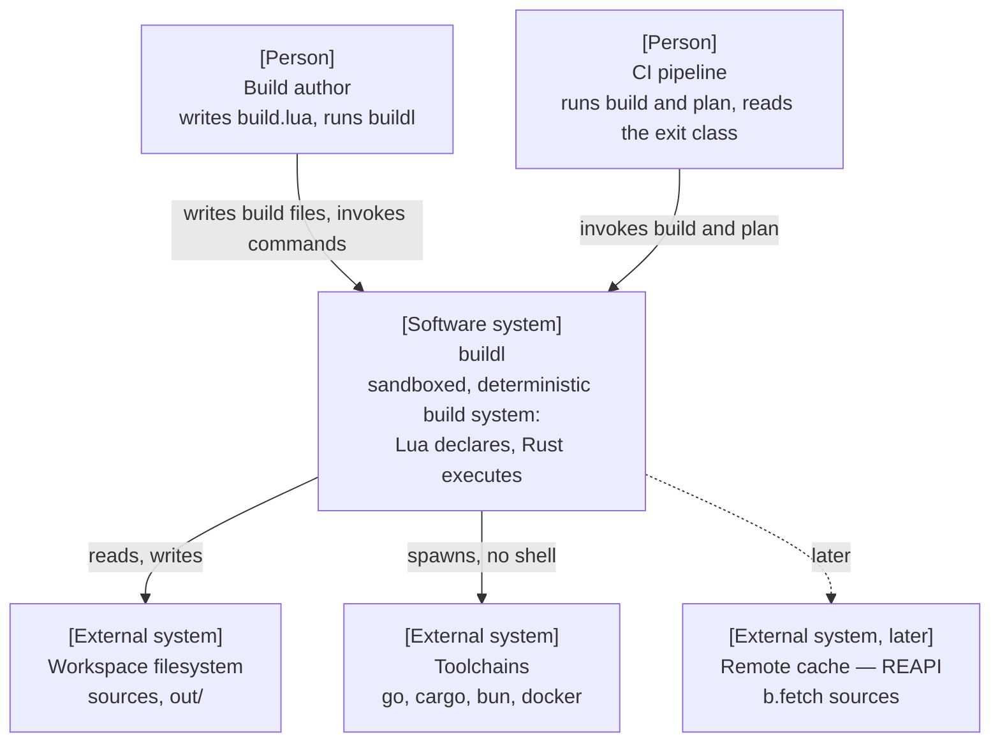
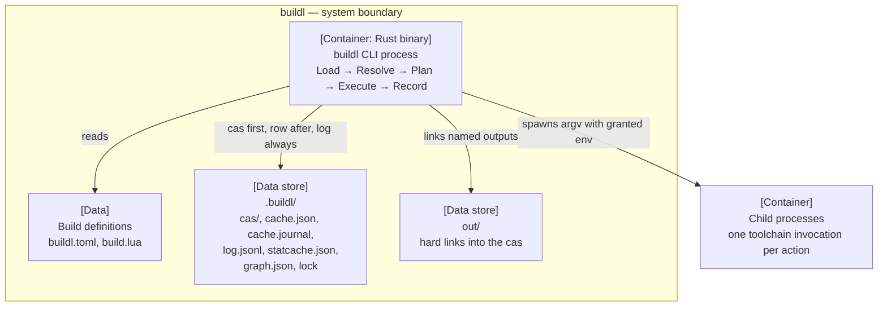
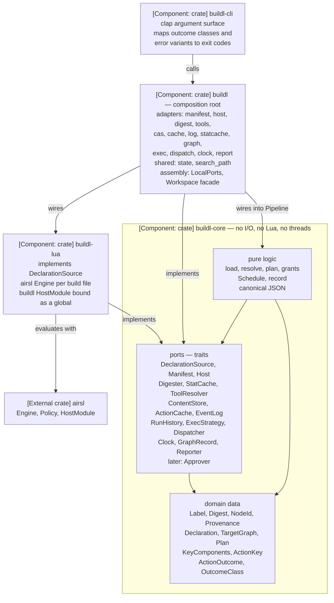
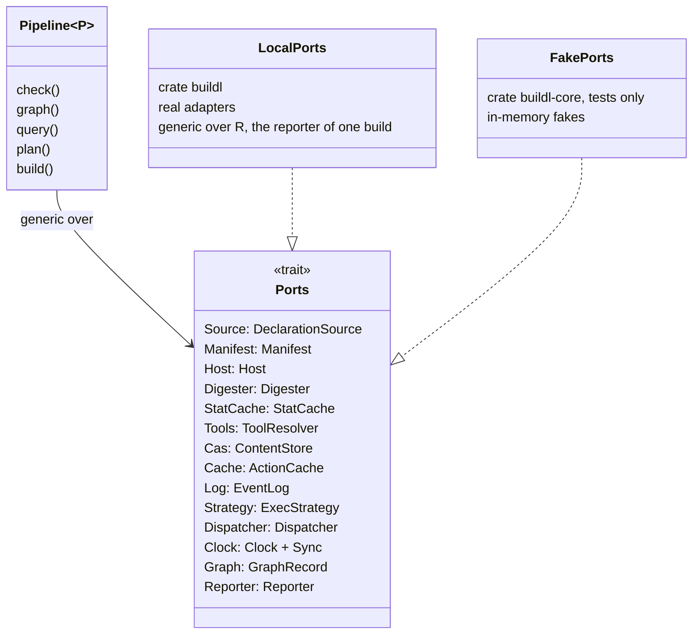
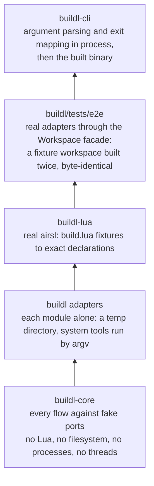
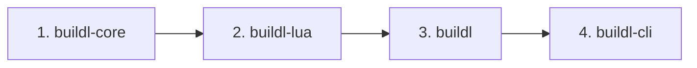

# buildl — architecture building blocks

**Status: built for the core pipeline.** What this document describes exists, except what arrives with a later item of design §13: for grant negotiation the `Approver` port, the `Grants` value and the `grants` logic, and for the input sandbox the `InputSandbox` strategy. Companion to [`design.md`](./design.md) and [`architecture.md`](./architecture.md): `design.md` says _what buildl is and why_, `architecture.md` says _how each part works_ — algorithms, types, determinism rules, runtime decision records — and this document says _how the parts are put together_: the C4 views of the system [2], the four crates, the ports between them, and the dependency rules that keep the logic of a build testable without any concrete implementation. It is the building block view of the architecture [8] and owns the workspace layout; `architecture.md` §1 defers to it.

**Author:** rstlix0x0 · **Date:** 2026-09-13 · **Reviewers:** —

---

## 1. Principles

### 1.1 Dependency inversion

The logic of a build — loading, resolving, planning, scheduling, recording — depends only on abstractions it defines itself. Concrete implementations (the airsl engine, the filesystem, child processes, threads, the system clock) depend on those abstractions, and exactly one place chooses which implementations run together [3]. The abstractions are _ports_ and the implementations are _adapters_ [4].



The consequence the structure exists for: **every flow of the pipeline runs in `buildl-core`'s tests against fake ports** — no Lua state, no filesystem, no process spawn, no thread (§8).

### 1.2 What `buildl-core` may depend on

Dependency inversion targets I/O and volatile subsystems. A stable library doing pure computation is not the implementation of a port, so the core may use one directly.

|`buildl-core` may depend on|`buildl-core` must not depend on|
|---|---|
|`std`, excluding its I/O, process, thread, environment, and clock APIs|`airsl`, `mlua`, `toml`, `clap`|
|`serde`, `serde_json`|`std::fs`, `std::process`, `std::thread`, `std::env`, `SystemTime`|
|`thiserror`|`rayon`, `tempfile`, `walkdir`, `globset`|
|`sha2`|any other buildl crate|

The table is the dependency rule. `crates/buildl-core/clippy.toml` is its enumeration: 130 entries
across `disallowed-methods`, `disallowed-types` and `disallowed-macros`, partitioned into nine
families — the filesystem (41, counting the nine `Path` methods that reach it), the environment
(23, including the compile-time reads and the two `PATH`-format helpers), threads (20), processes
(15), the platform filesystem extensions (13), the standard streams (10, including the print
macros), the clock (3), the network (3) — and floating-point numbers (2), which are not an I/O
surface at all. The nine counts sum to the 130, so the partition is the whole config. A float is
banned because a non-finite one serializes as JSON `null`, so a value could reach an action key
differing from the value it was computed from (`architecture.md` §5 rule 2). `cargo make
guard-core-purity` asserts that every entry still resolves, that no source file suppresses the
lints, and that the config is not switched off.

### 1.3 The name `buildl`

Three different things carry the name, and the crate structure keeps them apart:

|Name|What it is|Lives in|
|---|---|---|
|`buildl` binary|the command users run|`buildl-cli` (`[[bin]] name = "buildl"`)|
|`buildl` Lua global|the declaration framework build authors call (design §5)|`buildl-lua` (the `buildl` `HostModule`)|
|`buildl` Rust crate|the complete framework: every real adapter wired onto `buildl-core`|`crates/buildl`|

## 2. System context — C4 level 1



## 3. Containers — C4 level 2

A C4 container is a separately running process or a data store [2]. The crates are not containers: they compile into one process and appear at level 3.



## 4. Components — C4 level 3

Inside the CLI process. Arrows point at the dependency: every adapter depends on `buildl-core`, and the one edge between adapter crates is `buildl → buildl-lua`, which the composition root alone may hold.



|Crate|Role|Depends on|Must not depend on|
|---|---|---|---|
|`buildl-core`|domain data, ports, the pure logic of every phase|`serde`, `serde_json`, `thiserror`, `sha2`|any buildl crate, `airsl`, any I/O API|
|`buildl-lua`|the `DeclarationSource` adapter: evaluates one build file through airsl|`buildl-core`, `airsl`|`buildl`|
|`buildl`|every other adapter; `LocalPorts`; the `Workspace` facade; re-exports `buildl-core` as `buildl::buildl_core`|`buildl-core`, `buildl-lua`, `toml`, `rayon`, `serde`, `thiserror`, `tempfile`|— (composition root, §7)|
|`buildl-cli`|argument surface and exit codes|`buildl`, `clap`|`buildl-core` and `buildl-lua` directly|

Each adapter dependency has its reason recorded in the workspace `Cargo.toml`: `toml` reads `buildl.toml`; `rayon` hashes files, in the `Digester` adapter and nowhere else; `serde` derives the manifest's tables and the two lines the state adapters write; `thiserror` derives the state lock's error; and `tempfile` gives the temp-file-then-rename that every state file and blob is written by.

Inside `buildl` there is one module per adapter, two shared modules that implement no port, and two composition modules (§7 rule 2):

|Module|Holds|Implements|
|---|---|---|
|`manifest`|`buildl.toml`, and finding the workspace root|`Manifest`|
|`host`|the OS, the architecture, environment values|`Host`|
|`digest`|what stands at an input's path, and file hashing on rayon|`Digester`|
|`tools`|a program's lookup and its fingerprint|`ToolResolver`|
|`cas`|`.buildl/cas`, and the files placed under `out/`|`ContentStore`|
|`cache`|`cache.json` and `cache.journal`|`ActionCache`|
|`log`|`log.jsonl`, appended to and read back|`EventLog` and `RunHistory`|
|`statcache`|`statcache.json`|`StatCache`|
|`graph`|`graph.json`|`GraphRecord`|
|`exec`|tier 1, `bare`|`ExecStrategy`|
|`dispatch`|worker threads|`Dispatcher`|
|`clock`|the system clock|`Clock`|
|`report`|terminal output, and every rendering of a value into text|`Reporter`|
|`state`|shared: where each state file is, the state lock, writing a file whole, clearing a path|—|
|`search_path`|shared: the lookup of a program name|—|
|`local_ports`|composition: the `Ports` bundle and its wiring|—|
|`workspace`|composition: the `Workspace` facade|—|

`DeclarationSource` is `buildl_lua::LuaSource`. An `approver` module arrives with the `Approver` port (design §13 item 4); neither exists yet.

`buildl` and `buildl-cli` build on Unix targets only, and the supported platforms are Linux and macOS, the two the CI matrix runs. `buildl` uses `std::os::unix` for file modes and for the signal that ended a process.

## 5. Code — C4 level 4: `buildl-core`

The signatures below are the shape, not the final API.

### 5.1 Domain data

Every value is a validated newtype or a serializable handoff; field-level detail is in `architecture.md` §2.

|Kind|Types|
|---|---|
|Names and identity|`Directory`, `TargetName`, `Label`, `NodeId`, `Provenance`|
|Content|`Digest` — the single SHA-256 type for files, outputs, keys, and log blobs|
|Outputs|`OutputManifest` — what one output is, a file or a directory of files, and the value an output's digest is taken of — with `StoredFile` and `FileMode` (a file's digest and whether it may be run), `Tree`, `TreeEntry` and `TreePath` (a directory's files, in path order); `Found`, `FoundEntry` and `FoundKind` — what a strategy reports at an output path|
|Time|`Timestamp` — nanoseconds since the Unix epoch, the current one obtained only through the `Clock` port|
|Phase handoffs|`Declaration`, `TargetGraph`, `Plan`, `ActionOutcome`|
|Execution handoffs|`OutputPath` — where one output lives under `out/` — `ReadyAction` — one action with its command expanded, and its rule's description expanded with it as an `ExpandedDescription` — `RawOutcome` and `Exit` — how a run ended and what it printed — `OutcomeEvent` — one line of the log — `OnFailure`, `Summary`|
|Incrementality|`KeyComponents`, `ActionKey`|
|Authority|`Ceiling`, `WantedSet`, `Want`, `Workspace`, `Grants`|
|Execution settings|`Execution` — the manifest's `[execution]` table, held in `Workspace` — with `Workers`, `Timeout` and `Isolation`, each validated at construction; none is a key component (`architecture.md` §6)|
|A run and what it shows|`Scope` — what a run was asked for: the workspace, or named targets — `Purpose` — whether the run builds or tests — `Rerun` — whether a run runs its tests again whatever their keys say — `LiveOutput` — whether one action is shown as it prints — `Channel`, `LiveSink` and `Captured` — which stream an action wrote to, where its bytes go as they are read, and what it printed — `Turn` — what a dispatcher hands the scheduling thread|
|Inputs|`InputStat` and `InputKind` — what stands at an input's path: nothing, a regular file, or a link, a directory or a special file; `Hasher` — `Digest::of` for bytes handed over in pieces|
|Log, read back|`LogLine` — one line of the log, an event or a damaged line by its number — `LoggedRun` — one event as it reads back, the twelve keys `OutcomeEvent` writes|
|Classification|`OutcomeClass`, `InfraKind` and `OutputRefusal` (`#[non_exhaustive]`, `architecture.md` §4); `TreeFault` — why a list of files is not a tree|

### 5.2 Ports

```rust
/// Evaluates one build file. The directory queue, `subdir` handling, and the
/// sorted merge across files are Load logic in `buildl-core`, not the adapter's.
/// A directory with no build file is `Evaluated::Absent`; whether that is an
/// error is Load's decision.
pub trait DeclarationSource {
    fn evaluate(&self, file: &BuildFile) -> Result<Evaluated>;
}

/// What the workspace's manifest says: its output and state directories, its ceiling,
/// and its execution settings. The phases read the directories and the ceiling; the
/// execution settings are for whoever assembles the dispatcher and the strategy.
pub trait Manifest {
    fn workspace(&self) -> Result<Workspace>;
}

/// The machine actions run on. `Ok(None)` is an unset variable.
pub trait Host {
    fn platform(&self) -> Platform;
    fn env(&self, name: &EnvName) -> Result<Option<EnvValue>>;
}

/// What stands at its path is asked of every input, following no symbolic link:
/// nothing, a regular file with its metadata, or something that is not a regular
/// file. Digests are asked only of files whose metadata changed, all in one call so
/// an adapter may hash in parallel.
pub trait Digester {
    fn stat(&self, path: &SourcePath) -> Result<InputStat>;
    fn digest(&self, paths: &[SourcePath]) -> Result<Vec<Digest>>;
}

/// Stores entries. Whether one may be reused is Plan's decision, not the cache's.
pub trait StatCache {
    fn entry(&self, path: &SourcePath) -> Option<StatEntry>;
    fn record(&mut self, path: SourcePath, entry: StatEntry);
    fn commit(&mut self) -> Result<()>;
}

/// `Ok(None)` is a program that cannot be found.
pub trait ToolResolver {
    fn fingerprint(&self, program: &Program) -> Result<Option<Digest>>;
}

/// Workers write output blobs concurrently. What is held is bytes, by their digest
/// alone: whether a file may be run is said each time it is placed.
pub trait ContentStore: Send + Sync {
    fn put(&self, bytes: &[u8]) -> Result<Digest>;
    fn contains(&self, digest: &Digest) -> bool;
    /// The held content; `Ok(None)` when it is not held.
    fn get(&self, digest: &Digest) -> Result<Option<Vec<u8>>>;
    /// Removes whatever is at `at`, a file or a directory with everything below it.
    /// Called before an output is placed, and again when it could not be placed whole.
    fn clear(&self, at: &OutputPath) -> Result<()>;
    /// Makes a stored blob the file at `at`, runnable or not as `mode` says, making
    /// every missing directory above it and replacing a file already there.
    fn place(&self, digest: &Digest, mode: FileMode, at: &OutputPath) -> Result<()>;
}

/// The scheduler side is the single writer. A row is durable once `record` returns
/// `Ok`; after `Err` the cache holds what it held before the call.
pub trait ActionCache {
    fn row(&self, label: &Label) -> Option<&CacheRow>;
    fn record(&mut self, label: Label, row: CacheRow) -> Result<()>;
}

pub trait EventLog {
    fn append(&mut self, event: &OutcomeEvent) -> Result<()>;
}

/// The reading side of the log: its lines, oldest first, each an event or a damaged line.
pub trait RunHistory {
    fn lines(&self) -> Result<Vec<LogLine>>;
}

/// When the command starts, the directory that will contain each declared output
/// exists and nothing exists at an output path itself.
pub trait ExecStrategy: Send + Sync {
    /// Each isolation tier materialises a differently shaped exec dir.
    type Dir;
    fn prepare(&self, action: &ReadyAction) -> Result<Self::Dir>;
    /// With `live`, every run of bytes the command writes is also handed to it as it
    /// is read, with its channel. The outcome is the same with or without it.
    fn run(
        &self,
        dir: &Self::Dir,
        action: &ReadyAction,
        live: Option<LiveSink<'_>>,
    ) -> Result<RawOutcome>;
    /// One entry per declared output, in order: what the action left there — nothing,
    /// a file, a directory with everything below it, or something that is neither.
    /// Stores the bytes of every regular file it reports, and follows no symbolic link.
    fn collect<C: ContentStore>(
        &self,
        dir: &Self::Dir,
        action: &ReadyAction,
        cas: &C,
    ) -> Result<Vec<Found>>;
}

/// `work` runs one task, on any thread, and may send messages through its second
/// argument while it runs. `step` runs on the calling thread: once with `Turn::Begin`,
/// then with each message (`Turn::Told`) and each result (`Turn::Done`), a task's
/// messages in the order sent and all before its result. It returns the tasks that
/// became ready. Every task `step` returns is run, and every message and every result
/// reaches `step`; a build over a dispatcher that loses a task or a result fails with
/// `Error::DispatcherFault` instead of reporting success.
pub trait Dispatcher {
    fn dispatch<T, M, R, W, S>(&mut self, work: W, step: S) -> Result<()>
    where
        T: Send,
        M: Send,
        R: Send,
        W: Fn(T, &(dyn Fn(M) + Sync)) -> R + Sync,
        S: FnMut(Turn<M, R>) -> Vec<T>;
}

pub trait Clock {
    fn now(&self) -> Timestamp;
}

/// Keeps the graph a build resolved. `record` replaces what is kept with `graph`, and
/// a reader finds the old record whole or the new one whole.
pub trait GraphRecord {
    fn record(&mut self, graph: &TargetGraph) -> Result<()>;
}

/// Shows a build as it runs. Every call is made on the thread that called `build`, and
/// none can fail: `begun` once, first; then `started`, `printed` and `finished`;
/// `summary` once, last, and never after an error.
pub trait Reporter {
    /// Every refusal check has passed, and `targets` targets are about to be built.
    fn begun(&mut self, targets: usize);
    /// A worker began `action`. Never called for a cached or a skipped target.
    fn started(&mut self, action: &ReadyAction);
    /// The action shown live wrote `bytes`.
    fn printed(&mut self, label: &Label, channel: Channel, bytes: &[u8]);
    /// A target has its outcome. `printed` is what it wrote that was not shown live:
    /// for a cached target, what it wrote when it last ran.
    fn finished(&mut self, event: &OutcomeEvent, printed: Captured<'_>);
    /// Every target has its outcome.
    fn summary(&mut self, summary: Summary);
}
```

Every fallible port method returns the crate's one `Result`, not an error type of its own:
`architecture.md` §4 settles the error model as a single structured enum, so `Result<Evaluated>`
above is `core::result::Result<Evaluated, buildl_core::Error>`. The enum is `#[non_exhaustive]`,
and each phase adds the variants it earns.

### 5.3 `Pipeline` and the `Ports` bundle

Static dispatch throughout [7]. One trait of associated types carries every port, so `Pipeline` takes a single type parameter instead of one per port. The bundle is declared in `buildl-core`'s `ports` module, beside the traits it names, so every trait of the crate lives in one module; a composition root implements it.

```rust
pub trait Ports {
    type Source: DeclarationSource;
    type Manifest: Manifest;
    type Host: Host;
    type Digester: Digester;
    type StatCache: StatCache;
    type Tools: ToolResolver;
    type Cache: ActionCache;
    type Cas: ContentStore;
    type Log: EventLog;
    type Strategy: ExecStrategy;
    type Dispatcher: Dispatcher;
    type Clock: Clock + Sync;   // a worker reads the clock
    type Graph: GraphRecord;
    type Reporter: Reporter;
    // `Approver` joins with grant negotiation (design §13 item 4)
}

/// One instance of each port the bundle names, with a public field per port: `source`,
/// `manifest`, `host`, `digester`, `stat_cache`, `tools`, `cache`, `cas`, `log`, `strategy`,
/// `dispatcher`, `clock`, `graph` and `reporter`.
pub struct PortSet<P: Ports> { pub source: P::Source, pub manifest: P::Manifest, /* ... */ }

pub struct Pipeline<P: Ports> { /* ports: PortSet<P> */ }

// in `buildl`: the bundle is generic over the reporter a build is lent
pub struct LocalPorts<R>(PhantomData<fn() -> R>);
pub type LocalPipeline<R> = Pipeline<LocalPorts<R>>;
```



### 5.4 Pure logic

|Logic|Input → output|Ports used|
|---|---|---|
|load|workspace root → `Vec<Declaration>` (queue, `subdir`, sorted merge)|`DeclarationSource`|
|resolve|`Vec<Declaration>` → `TargetGraph` (validations, cycle detection)|—|
|narrow|`TargetGraph`, a `Scope` and a `Purpose` → the graph of the targets a run was asked for and everything they depend on; for `Scope::Workspace` that is every target but tests for a build and every test for a test run; a label nothing declares is `Error::UnknownTarget`, and a test run naming a target that is not a test is `Error::NotATest`|—|
|reach|`TargetGraph` and a `Query` → the targets the query reaches from its target, following dependencies or the reverse edges any number of steps, without that target and without aliases, as a `BTreeSet<Label>`; a label nothing declares is `Error::UnknownTarget`|—|
|plan|`TargetGraph`, setting overrides and the run's `Rerun` → `Plan` (the settings in force, ceiling check, key assembly, a verdict per target; the plan carries the settings it was made with, as `Plan::settings()`)|`Manifest`, `Host`, `Digester`, `StatCache`, `ToolResolver`, `ActionCache`|
|grants — not built; arrives with design §13 item 4|wanted set ∩ ceiling → grants or refusal. Today the ceiling check is Plan's, and a want outside the ceiling refuses the plan|`Manifest`, and `Approver` once it exists|
|execute|the whole `TargetGraph`, the narrowed one, its `Plan`, the failure policy, `LiveOutput` and the run's `Rerun` → `Vec<ActionOutcome>` (output layout, checked over the whole graph and used for the narrowed one; placeholder expansion of commands and descriptions under the plan's settings, the program check, the `Schedule` state machine, cached or run, what an action left judged into one manifest per output, then cas, row, log, with each step shown through the reporter; an outcome per target of the narrowed graph, or `Error::DispatcherFault`)|`Manifest`, `Dispatcher`, `ExecStrategy`, `ContentStore`, `ActionCache`, `EventLog`, `Clock`, `Reporter`|
|last_run|`[LogLine]` and a `Label` → the newest run of the label that stored both its output digests, the class of each newer line that stored none, and the damaged lines; or `Error::NoRun`, suggesting the nearest label that has a run|—|
|canonical JSON|value → sorted-key bytes; those bytes, and no others, → the value|—|

`Pipeline` strings these together, one method per command. `plan` and `build` take a `Scope` and narrow between Resolve and Plan, with `Purpose::Build`; `test` does the same with `Purpose::Test` and takes a `Rerun` too. `build` and `test` also record the whole graph through `GraphRecord` before they narrow. `check`, `graph` and `query` read only the source of build files, so each also exists as a free function, `pipeline::check`, `pipeline::graph` and `pipeline::query`, for a caller that holds a `DeclarationSource` and nothing else: a command that reads only build files then needs no state directory, takes no lock and is not stopped by a state file. `log` is a free function over its own two ports, `pipeline::log` over `RunHistory` and `ContentStore`: it runs `last_run` over the log's lines, reads the run's two blobs, and takes no lock and no `DeclarationSource`, so it reads no build file.

## 6. Port catalog

"Since" is the item of design §13 an adapter arrives with; item 1 is built, and so is each item-2 row listed here (today `RunHistory`); a row with a later item describes what is designed.

|Port|`buildl-core` uses it for|v1 adapter|Crate|Since|
|---|---|---|---|---|
|`DeclarationSource`|Load — one build file at a time|airsl engine per file, `buildl` module table|`buildl-lua`|1|
|`Manifest`|the ceiling and the workspace's output and state directories; the `[execution]` settings, which no phase reads and the composition root hands to the dispatcher and the strategy|`buildl.toml` reader. The entry file's name and the declaration limits do not go through the port: the adapter hands them to the composition root, which makes the declaration source from them|`buildl`|1|
|`Host`|the platform in every key, and the values of the env names targets read|the running machine's OS, architecture and environment|`buildl`|1|
|`Digester`|what stands at each input's path, and input content hashes|filesystem + rayon, each file streamed in pieces|`buildl`|1|
|`StatCache`|reusing digests on unchanged mtime + size|`.buildl/statcache.json`, keyed by path; keeps an entry only for a file modified more than 2 s before the run began, and discards a file it cannot read back|`buildl`|1|
|`ToolResolver`|tool fingerprints in the key|`PATH` lookup + content hash|`buildl`|1|
|`ContentStore`|the cas: storing a blob, asking whether one is held, reading a held one back (an output's manifest), clearing an output's path under `out/` — before the output is placed, and again when it cannot be placed whole — and making a stored blob a file there, runnable or not|`.buildl/cas/ab/…`, temp file then rename, nothing synced; read-only blobs, with an executable twin `….x` beside a blob that was placed executable; hard links into `out/` where a write through a read-only file is refused, copies elsewhere|`buildl`|1|
|`ActionCache`|cache rows: reading the last build's, recording one durably for each target that was built, and forgetting one durably when a failure under its key contradicts it|`.buildl/cache.json`, written by the canonical serializer and read back by the canonical reader, with `.buildl/cache.journal`: one appended line per recorded row, or per forgotten one, folded into the snapshot once per build|`buildl`|1|
|`EventLog`|one event per outcome|`.buildl/log.jsonl`, appended to across builds|`buildl`|1|
|`RunHistory`|the log's lines, oldest first, each an event or a damaged line|`.buildl/log.jsonl`, read only: never created, cut or written; a last line without a newline is left out|`buildl`|2|
|`ExecStrategy`|running one action, started with each output's containing directory in place and nothing at the output's own path, handing over what it prints as it prints when asked to, then reporting what the action left at each output path — a file, a directory with everything below it, or neither — and storing every regular file of it|`Bare` (tier 1)|`buildl`|1|
|`ExecStrategy`|the same, with undeclared inputs absent|`InputSandbox` (tier 2)|`buildl`|3|
|`Dispatcher`|running ready actions in parallel, and carrying what a running action says to the scheduling thread|std scoped threads + `mpsc`, started as tasks need them|`buildl`|1|
|`Approver`|turning the wanted set into grants|interactive, manifest|`buildl`|4|
|`Clock`|log timestamps and durations|system clock|`buildl`|1|
|`GraphRecord`|keeping the graph a build resolved|`.buildl/graph.json`: the canonical bytes, written whole by every build|`buildl`|1|
|`Reporter`|output blocks and the status line|one terminal reporter with a live and a plain mode|`buildl`|1|

The `Clock` port is `architecture.md` §5 rule 4's quarantine of the wall clock. The crate boundary does not enforce it — `std::time` is in scope for every crate — so `crates/buildl-core/clippy.toml` bans `Instant`, `SystemTime` and `SystemTimeError` by name, and `cargo make guard-core-purity` fails the gate when one is used, when a ban stops resolving, when a source file suppresses the lint, and on three further ways the bans can be switched off that the task itself enumerates.

## 7. Dependency rules

1. **`buildl-core` depends on no buildl crate, no airsl, and no I/O API** (§1.2).
2. **Adapters depend on `buildl-core`.** `buildl-lua` never depends on `buildl`; inside `buildl`, adapter modules never import each other. What several adapters need lives in two shared modules, `state` and `search_path`, which implement no port and name no module of the crate; adapters meet only in the two composition modules, `local_ports` and `workspace`.
3. **`buildl` is the single composition root** — the only adapter crate that depends on another adapter crate (`buildl-lua`), and the only code that names more than one concrete adapter, through `LocalPorts`. This is dependency inversion applied, not violated: the principle constrains the logic, and a composition root is where concrete choices are made [3].
4. **`buildl-cli` reaches core types through `buildl`'s re-exports**, so the binary has one library dependency.

|Rule|Enforced by|
|---|---|
|the dependency half of 1, rule 4, and the cross-crate half of 2|`deny.toml`'s `[bans].deny` wrapper lists, which name the only direct parents a crate may have, plus `cargo make guard-crate-edges`, which diffs every member's direct dependencies against `crates/expected-edges.txt`. The compiler covers only imports: it stops a crate using what its `[dependencies]` omits, but not a dependency being added, and not one being removed.|
|the "no I/O API" half of 1|`crates/buildl-core/clippy.toml`, an enumerated ban on the filesystem, process, thread, network, environment, standard-stream and clock APIs, asserted by `cargo make guard-core-purity`|
|"no phase module names another" (`architecture.md` §1.1)|`crates/expected-module-edges.txt`, a committed list of `buildl-core`'s module-to-module imports, which also holds the edges of `history` and `suggest`, two modules that are not phases, diffed by `cargo make guard-module-edges`. A grouped `crate::{…}` import, a `super::` that climbs to the crate root and an item named through the crate root's re-export (`crate::<Item>`) are refused outright, because the listing cannot read them|
|adapter isolation inside `buildl`|`cargo make guard-adapter-isolation`, which reads every file under `crates/buildl/src` but `lib.rs`, test code included: an adapter module may name `crate::state` and `crate::search_path` and no other module of the crate, the two shared modules name none, and only `local_ports` and `workspace` name any module they like. A grouped `crate::{…}` import, `super::super`, a `super::` in a `mod.rs` or in a module that is one file, and an item named through the crate root (`crate::<Item>`) are refused outright, because each would hide an edge|

## 8. Testing layers



The four layers that touch real I/O, in `buildl` and `buildl-cli`:

|Layer|Lives in|May touch|Must not|
|---|---|---|---|
|Adapter unit|`crates/buildl/src/<module>/`, beside the code|its own module, `state`, `search_path`, `buildl-core`, one temp directory; `exec` starts system tools|name another adapter module; read the process's current directory; set an environment variable|
|End to end|`crates/buildl/tests/e2e`, with fixtures in `crates/buildl/tests/fixtures`|`buildl`'s public API; a temp copy of a fixture|a private item; a path outside the package|
|CLI unit|`crates/buildl-cli/src`, beside the code|argument parsing, the exit mapping, terminal detection, a command's flow over byte buffers and a temp workspace|a process; a terminal|
|CLI binary|`crates/buildl-cli/tests/cli`|the built binary, with a chosen working directory and environment and its output piped|`buildl` internals; a terminal|

The tools these tests run are system tools — `sh`, `cp`, `sort`, `true`, `false`, `sleep` and their like — run by argv; `sh -c` appears in tests only, never in buildl. There is no compiled helper program and no shared kit of fakes (§10, §11).

The fakes live in `buildl-core`'s integration tests (`crates/buildl-core/tests/flows/common.rs`), not under `#[cfg(test)]`. They implement the public traits through the public API alone, so whatever a fake does an adapter crate can do too, and the compiler checks that on every test build. A port no flow reaches yet keeps a unit-test fake beside its trait; `Clock` still has the one it had before a build read it:

|Port|Fake|What the test no longer needs|
|---|---|---|
|`DeclarationSource`|a fixed staged file, absence or evaluation failure per directory|airsl, Lua|
|`Manifest`|one fixed workspace and ceiling|a `buildl.toml`|
|`Host`|a fixed platform and fixed variables, some of which it can be told to fail on|the real environment|
|`Digester`|files held as bytes with their metadata, counting every call|a filesystem|
|`StatCache`|in-memory, counting commits|a filesystem|
|`ToolResolver`|fixed fingerprints, recording every lookup|a `PATH`|
|`ContentStore`|blobs and placed paths held in memory, each placed path with its mode; digests it can be told to forget, paths and content it can be told to fail on|a filesystem|
|`ActionCache`|rows held in memory, with labels it can be told to fail on; it also keeps the labels it forgot, and can be told to fail a forget|a filesystem|
|`EventLog`|the events appended, and whether to fail|a filesystem|
|`RunHistory`|the lines it was handed, and whether to fail|a filesystem|
|`ExecStrategy`|scripted per label: how the action exits, what it prints, and what is at each output — a file, one that may be run, a directory of files and of things that are not, a symbolic link, something special, or nothing|process spawning|
|`Dispatcher`|inline, on the test thread, taking the oldest or the newest waiting task first; tasks it can be told to lose, unrun or run with the result dropped|threads; results are deterministic|
|`Clock`|a counter, one tick per read|wall-clock time|
|`GraphRecord`|the graphs recorded, and whether to fail|a filesystem|
|`Reporter`|every call kept as an owned value, in order|a terminal|

Flows that run entirely in `buildl-core`'s tests:

|Scenario|Assertion|
|---|---|
|`//:a` fails under `--keep-going`|summary `1 failed, 2 skipped, 2 built`|
|a test run over a workspace of builds and tests|only the tests and what they depend on run; no other target does|
|a cached test run with `--rerun`|the test runs again and its dependency, whose key is unchanged, does not|
|a test fails with `--rerun`|its row is forgotten, so the next run runs it again and a failure records no pass|
|cas write succeeds, cache write fails|no row for the target — the crash-safety invariant (design §8.5)|
|rebuilt output byte-identical|downstream targets stay `Clean` — early cutoff|
|an action leaves a directory at an output|stored file by file under one manifest; the next build puts it back whole without running|
|a directory rebuilt to the same files, then with one file changed|its dependent is cached, then runs|
|one file of a recorded directory has left the cas|the target is built again, never half put back|
|one file of a directory cannot be placed, on a build or on a cache hit|the target fails and nothing of the directory is left at its path|
|wanted program outside the ceiling|an `Error::Refused` before any strategy runs — an error of the build, not an outcome class|
|one input changed|dirty reason is the `KeyComponents` diff|
|a tool named through a build setting is replaced|the target is dirty for the tool, and runs again|
|the `[execution]` settings all change after a build|every target stays `Clean`: none of them is in a key|
|only a rule's `desc` is edited|every target is cached, and no action runs|
|the dispatcher loses a task|`Error::DispatcherFault` naming every target left without an outcome; what ended before keeps its content, row and event|
|a build file enqueues subdirectories out of order|merged declarations sorted by directory, then declared name|

The same promises against the real adapters, through the `Workspace` facade (`crates/buildl/tests/e2e`):

|Scenario|Assertion|
|---|---|
|a fixture built in two directories, with four workers and with one|`out/`, `cache.json`, `graph.json` and the cas are byte-identical; no journal and no staging file is left|
|three targets produce the same bytes, one of them placed executable|one blob and its executable twin, in both copies|
|a second build|every target cached; `cache.json` and `graph.json` unchanged; the log grew|
|`out/` removed|every output put back without running, the executable bit kept|
|one input edited|its dependents rebuilt and nothing else|
|an edit that leaves an output's bytes unchanged|the rebuild stops there — early cutoff|
|a named target, or an alias|that target and what it needs, nothing else; `graph.json` is still the whole graph|
|a test that declares no outputs|it passes and is cached; the next `test` serves it from the cache|
|a build of the whole workspace|no test runs|
|a failure, without and with `--keep-going`|`1 failed, 4 skipped`, then `1 failed, 2 skipped, 2 built`; no row for the failed target, which runs again next time|
|the states an interrupted build leaves: blobs with no row, rows in the journal, staging files, a partial output|the next build finishes: it trusts no blob without a row, folds the journal, sweeps the staging and clears the partial output|
|a corrupt `cache.json`|`Error::CorruptState` naming the file, the file untouched, no action run; `check`, `graph` and `query` still work|
|a workspace another buildl holds|`plan` and `build` refused; `check`, `graph` and `query` succeed|
|a strategy other than `bare`; a state directory outside `fs.write`|`build` refused and `plan` not; `plan` refused before `.buildl/` is made|

## 9. Publishing

`buildl-cli` is published to crates.io, and crates.io accepts a crate only when its dependencies are published too [6], so all four crates publish, dependency first:



|Requirement|Form|
|---|---|
|internal dependencies|`buildl-core = { version = "…", path = "crates/buildl-core" }` in `[workspace.dependencies]`; packaging keeps the version and drops the path|
|version sync|each workspace dependency version matches the crate's own version|
|metadata|`description` and `readme` per crate; `license` and `repository` inherited from the workspace|
|crate `README.md`|written for crates.io readers of that crate|

Nothing is published yet. Four rules keep publishing possible, and every change to the workspace follows them:

1. Every dependency between members is `{ workspace = true }`, and no member depends, dev-dependencies included, on a member later in the publish order: `cargo package` fails on one, and a dev-dependency given by path alone is silently dropped from the packaged manifest.
2. The workspace has no fifth member, and `buildl` gains no `[[bin]]`, `[[example]]` or `[features]` for the sake of tests.
3. Fixtures and golden files live inside the package whose tests read them, reached through `CARGO_MANIFEST_DIR` or `include_str!`; no test reads another package's directory.
4. No fixture path holds a component named `target` or `debug`.

All four names were unclaimed on crates.io on 2026-09-13; a name is claimed only by its first publish.

Once published, the ports are a semver contract:

|Concern|Rule|
|---|---|
|sealed or open|**open** — adapters live in other crates, and a sealed trait cannot be implemented outside its own crate [5]|
|growing a port|new methods get default bodies; a required method breaks every implementor|
|growing data|`#[non_exhaustive]` on enums and structs expected to gain variants or fields|
|version line|`0.x` until the port surface settles|

## 10. Decision records

|Decision|Choice|Because|
|---|---|---|
|Where the core lives|**A crate, `buildl-core`** — not a `core` module|A crate-root `mod core` shadows Rust's built-in `core` crate: `use core::fmt::Debug;` fails with `error[E0432]: unresolved import core::fmt` — "could not find `fmt` in `core`" (rustc 1.91.1). A crate boundary also turns the dependency rules into compiler errors.|
|Crate cut|**Four crates**|Only airsl brings a C build and a distinct upgrade risk, so only the Lua adapter earns its own crate; the other adapters share `buildl` until a concrete reason to split appears (§11). `cargo test -p buildl-core` never compiles Lua.|
|Composition root|**`buildl`, not `buildl-cli`**|Embedders — watch mode, editors, other tools — get a wired `Workspace` without copying the CLI's wiring; end-to-end tests live beside the real adapters; the scaffold's crate descriptions already call the CLI a thin shell over the library.|
|Port dispatch|**Generics with one `Ports` bundle**|Static dispatch [7] without a type parameter per port on `Pipeline`.|
|Port openness|**Open, unsealed traits**|Adapters are implemented in other crates [5]; ports grow through default methods.|
|Scheduler|**Pure `Schedule` + `Dispatcher` port**|Keep-going and skip semantics are testable without threads; the scheduler was already the single writer (`architecture.md` §3.4), so counters need no atomics.|
|Load granularity|**`DeclarationSource` evaluates one file**|The directory queue and the sorted merge are determinism-bearing logic, so they stay in `buildl-core` where fakes can test them.|
|Source globbing|**Host-side in `buildl-lua`**|`b.sources()` walks with `globset` and `walkdir`, so the declaration engine holds no grant and `airsstack.glob.walk` is refused; sorting, symlink policy and the containment check are buildl's, in one place. The directories the walk stays out of are a required argument of `LuaSource::new`, so a source cannot be built without them, and the composition root gives it the manifest's output and state directories: the skip list is the adapter's configuration, not part of the port, so `buildl-lua` reads no manifest.|
|Diagram notation|**Mermaid `graph` with C4 element labels**|Renders wherever the other documents' Mermaid renders; Mermaid's dedicated C4 syntax is marked experimental.|
|Re-exporting the core|**`pub use buildl_core;` — the crate under its own name, `buildl::buildl_core`**|`pub use buildl_core as core` is unusable: in a crate root that also names `core::fmt` it is `error[E0432]: unresolved import core::fmt`, and a downstream crate that glob-imports the re-export and names `core::fmt` gets `error[E0659]: core is ambiguous`. A third name would invent vocabulary. The facade `buildl::Workspace` and the manifest value `buildl::buildl_core::Workspace` stay apart.|
|When ports are wired|**Per `plan`, `build` or `test` call; a source of build files alone for `check`, `graph` and `query`**|`Pipeline` needs every port, and a command that reads only build files must not need, lock or be stopped by a state file: a corrupt `cache.json` does not stop `check`. The state lock is held for one call, so an embedder that keeps a `Workspace` open does not hold the directory while idle.|
|Who owns the reporter|**The caller: `Workspace::build` is lent `&mut R` for one build**|Only `build` reports, and an embedder supplies its own reporter. `LocalPorts<R>` is generic over it, and `&mut R` is a `Reporter` when `R` is, so the bundle needs no bound beyond that.|
|Tools in tests|**System tools by argv; no compiled helper, no published kit of fakes**|Cargo sets `CARGO_BIN_EXE_<name>` only for integration tests of the package that owns the binary, so a helper would cost the published `buildl` crate a `[[bin]]` or a feature, or the workspace a fifth member (§9).|
|Adapter isolation|**Checked by `cargo make guard-adapter-isolation`**|Thirteen adapter modules in one crate is where a cross-import slips in. What they share lives in `state` and `search_path`, which implement no port (§7 rule 2).|

## 11. Open questions

- Settled: no test kit of fake ports is published, and none is shared between crates. `buildl`'s adapter tests need another port in one place only — collecting an action's outputs into a content store — and write a small in-memory store there (§8).
- When an adapter inside `buildl` earns its own crate: an independent consumer, a heavy dependency, or a platform-specific build.

## References

1. airsstack. _airsl — Embeddable Lua runtime with a host standard library_ (source and docs). GitHub, 2026. URL: [https://github.com/airsstack/airsl](https://github.com/airsstack/airsl)
2. Simon Brown. _The C4 model for visualising software architecture_. c4model.com. URL: [https://c4model.com/](https://c4model.com/)
3. Robert C. Martin. _The Dependency Inversion Principle_. C++ Report, 1996.
4. Alistair Cockburn. _Hexagonal architecture (ports and adapters)_. URL: [https://alistair.cockburn.us/hexagonal-architecture/](https://alistair.cockburn.us/hexagonal-architecture/)
5. Rust library team. _Rust API Guidelines — Future proofing (C-SEALED)_. URL: [https://rust-lang.github.io/api-guidelines/future-proofing.html](https://rust-lang.github.io/api-guidelines/future-proofing.html)
6. The Cargo team. _The Cargo Book — Publishing on crates.io_. URL: [https://doc.rust-lang.org/cargo/reference/publishing.html](https://doc.rust-lang.org/cargo/reference/publishing.html)
7. Microsoft. _Pragmatic Rust Guidelines_. URL: [https://microsoft.github.io/rust-guidelines/](https://microsoft.github.io/rust-guidelines/)
8. arc42. _Building block view_. URL: [https://docs.arc42.org/section-5/](https://docs.arc42.org/section-5/)
