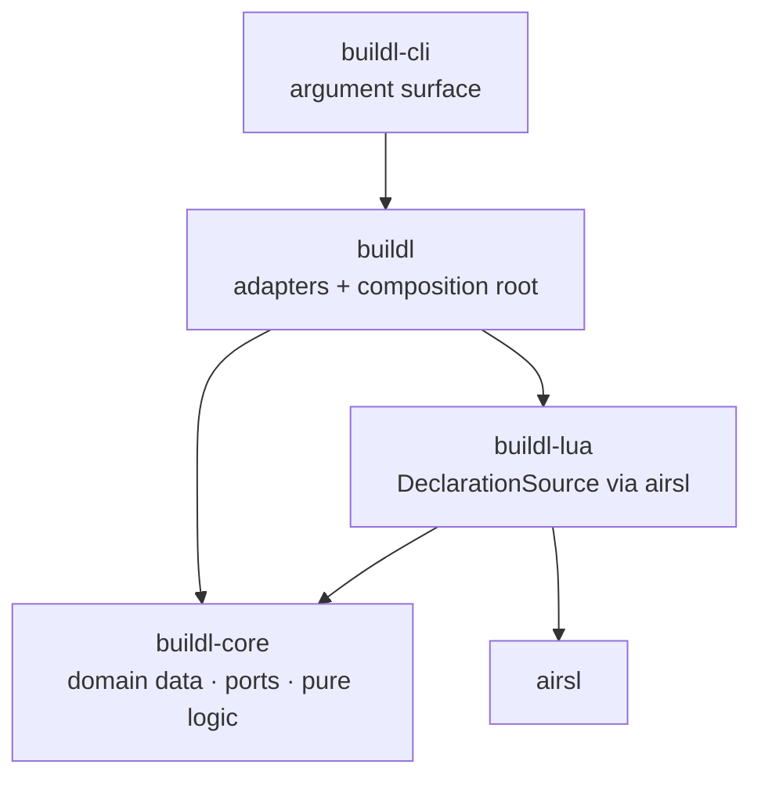
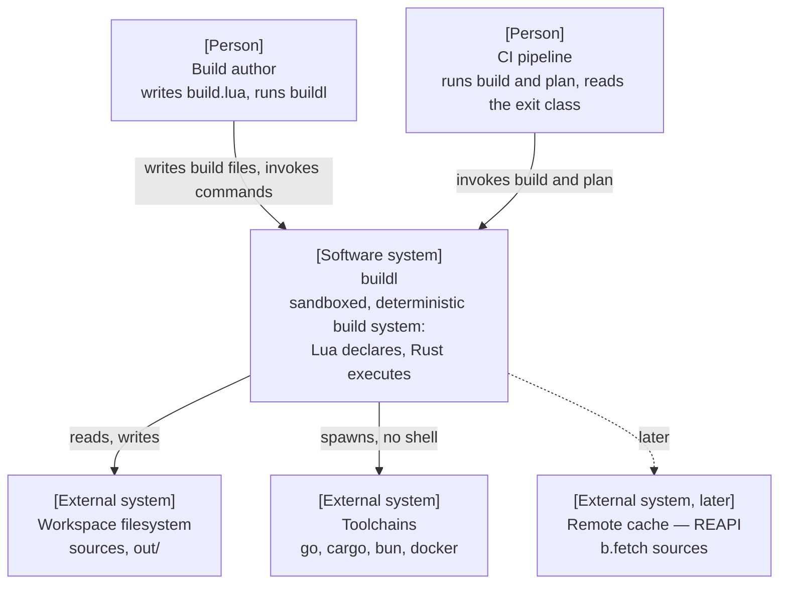
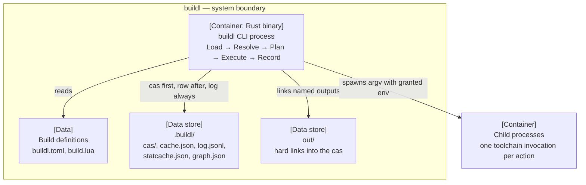
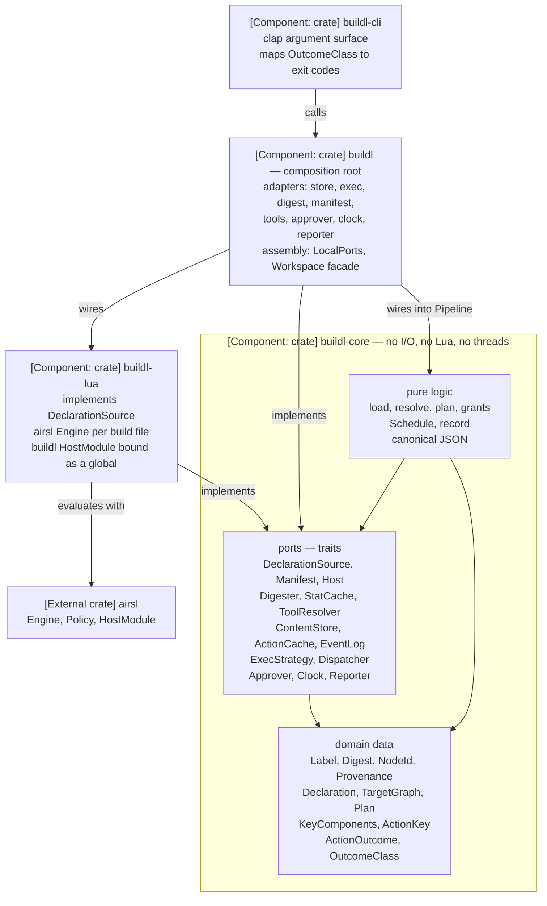
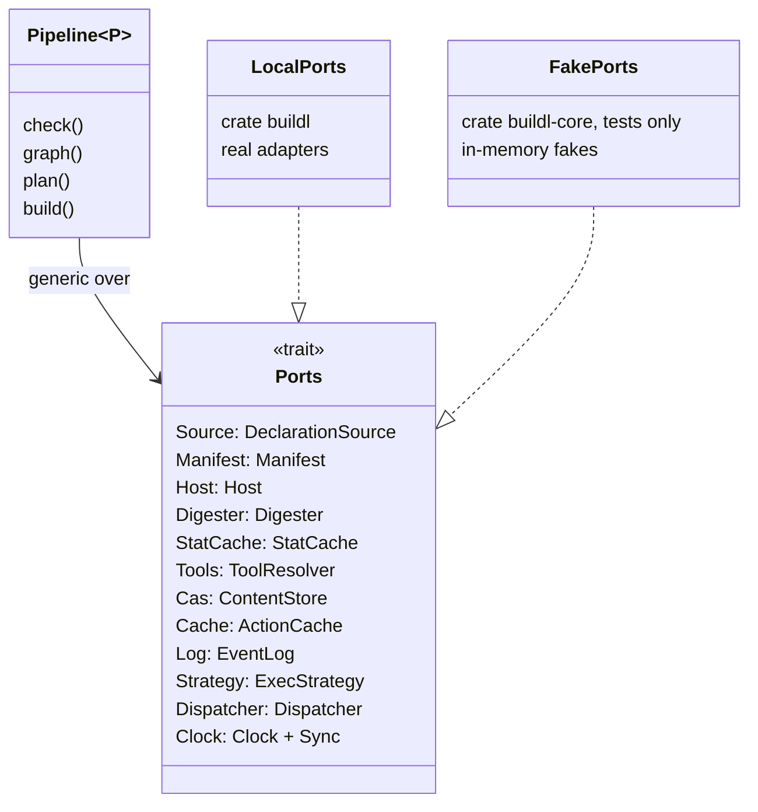
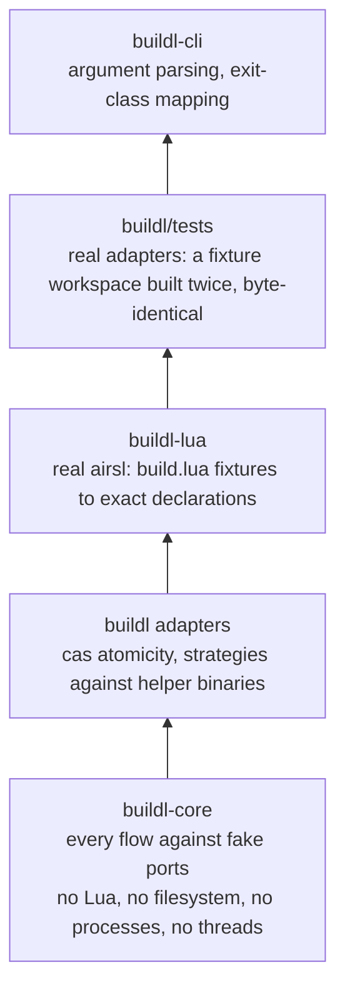
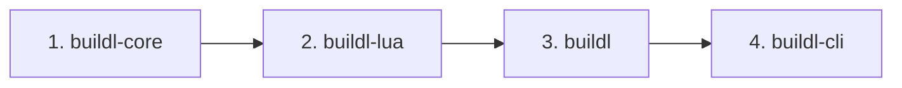

# buildl — architecture building blocks

**Status: draft for review.** Companion to [`design.md`](./design.md) and [`architecture.md`](./architecture.md): `design.md` says _what buildl is and why_, `architecture.md` says _how each part works_ — algorithms, types, determinism rules, runtime decision records — and this document says _how the parts are put together_: the C4 views of the system [2], the four crates, the ports between them, and the dependency rules that keep the logic of a build testable without any concrete implementation. It is the building block view of the architecture [8] and owns the workspace layout; `architecture.md` §1 defers to it.

**Author:** rstlix0x0 · **Date:** 2026-09-13 · **Reviewers:** —

---

## 1. Principles

### 1.1 Dependency inversion

The logic of a build — loading, resolving, planning, scheduling, recording — depends only on abstractions it defines itself. Concrete implementations (the airsl engine, the filesystem, child processes, threads, the system clock) depend on those abstractions, and exactly one place chooses which implementations run together [3]. The abstractions are _ports_ and the implementations are _adapters_ [4].



The consequence the structure exists for: **every flow of the pipeline runs in `buildl-core`'s tests against fake ports** — no Lua state, no filesystem, no process spawn, no thread (§8).

### 1.2 What `buildl-core` may depend on

Dependency inversion targets I/O and volatile subsystems. A stable library doing pure computation is not the implementation of a port, so the core may use one directly.

|`buildl-core` may depend on|`buildl-core` must not depend on|
|---|---|
|`std`, excluding its I/O, process, thread, environment, and clock APIs|`airsl`, `mlua`, `toml`, `clap`|
|`serde`, `serde_json`|`std::fs`, `std::process`, `std::thread`, `std::env`, `SystemTime`|
|`thiserror`|`rayon`, `tempfile`, `walkdir`, `globset`|
|`sha2`|any other buildl crate|

The table is the dependency rule. `crates/buildl-core/clippy.toml` is its enumeration: 130 entries
across `disallowed-methods`, `disallowed-types` and `disallowed-macros`, partitioned into nine
families — the filesystem (41, counting the nine `Path` methods that reach it), the environment
(23, including the compile-time reads and the two `PATH`-format helpers), threads (20), processes
(15), the platform filesystem extensions (13), the standard streams (10, including the print
macros), the clock (3), the network (3) — and floating-point numbers (2), which are not an I/O
surface at all. The nine counts sum to the 130, so the partition is the whole config. A float is
banned because a non-finite one serializes as JSON `null`, so a value could reach an action key
differing from the value it was computed from (`architecture.md` §5 rule 2). `cargo make
guard-core-purity` asserts that every entry still resolves, that no source file suppresses the
lints, and that the config is not switched off.

### 1.3 The name `buildl`

Three different things carry the name, and the crate structure keeps them apart:

|Name|What it is|Lives in|
|---|---|---|
|`buildl` binary|the command users run|`buildl-cli` (`[[bin]] name = "buildl"`)|
|`buildl` Lua global|the declaration framework build authors call (design §5)|`buildl-lua` (the `buildl` `HostModule`)|
|`buildl` Rust crate|the complete framework: every real adapter wired onto `buildl-core`|`crates/buildl`|

## 2. System context — C4 level 1



## 3. Containers — C4 level 2

A C4 container is a separately running process or a data store [2]. The crates are not containers: they compile into one process and appear at level 3.



## 4. Components — C4 level 3

Inside the CLI process. Arrows point at the dependency: every adapter depends on `buildl-core`, and the one edge between adapter crates is `buildl → buildl-lua`, which the composition root alone may hold.



|Crate|Role|Depends on|Must not depend on|
|---|---|---|---|
|`buildl-core`|domain data, ports, the pure logic of every phase|`serde`, `serde_json`, `thiserror`, `sha2`|any buildl crate, `airsl`, any I/O API|
|`buildl-lua`|the `DeclarationSource` adapter: evaluates one build file through airsl|`buildl-core`, `airsl`|`buildl`|
|`buildl`|every other adapter; `LocalPorts`; the `Workspace` facade; re-exports `buildl-core`|`buildl-core`, `buildl-lua`, plus each adapter's own dependencies|— (composition root, §7)|
|`buildl-cli`|argument surface and exit codes|`buildl`, `clap`|`buildl-core` and `buildl-lua` directly|

Adapter dependencies are finalised as each adapter lands, following the per-dependency reasons recorded in the workspace `Cargo.toml`.

## 5. Code — C4 level 4: `buildl-core`

The signatures below are the shape, not the final API.

### 5.1 Domain data

Every value is a validated newtype or a serializable handoff; field-level detail is in `architecture.md` §2.

|Kind|Types|
|---|---|
|Names and identity|`Directory`, `TargetName`, `Label`, `NodeId`, `Provenance`|
|Content|`Digest` — the single SHA-256 type for files, outputs, keys, and log blobs|
|Outputs|`OutputManifest` — what one output is, a file or a directory of files, and the value an output's digest is taken of — with `StoredFile` and `FileMode` (a file's digest and whether it may be run), `Tree`, `TreeEntry` and `TreePath` (a directory's files, in path order); `Found`, `FoundEntry` and `FoundKind` — what a strategy reports at an output path|
|Time|`Timestamp` — nanoseconds since the Unix epoch, the current one obtained only through the `Clock` port|
|Phase handoffs|`Declaration`, `TargetGraph`, `Plan`, `ActionOutcome`|
|Execution handoffs|`OutputPath` — where one output lives under `out/` — `ReadyAction` — one action with its command expanded, and its rule's description expanded with it as an `ExpandedDescription` — `RawOutcome` and `Exit` — how a run ended and what it printed — `OutcomeEvent` — one line of the log — `OnFailure`, `Summary`|
|Incrementality|`KeyComponents`, `ActionKey`|
|Authority|`Ceiling`, `WantedSet`, `Want`, `Workspace`, `Grants`|
|Execution settings|`Execution` — the manifest's `[execution]` table, held in `Workspace` — with `Workers`, `Timeout` and `Isolation`, each validated at construction; none is a key component (`architecture.md` §6)|
|Classification|`OutcomeClass`, `InfraKind` and `OutputRefusal` (`#[non_exhaustive]`, `architecture.md` §4); `TreeFault` — why a list of files is not a tree|

### 5.2 Ports

```rust
/// Evaluates one build file. The directory queue, `subdir` handling, and the
/// sorted merge across files are Load logic in `buildl-core`, not the adapter's.
/// A directory with no build file is `Evaluated::Absent`; whether that is an
/// error is Load's decision.
pub trait DeclarationSource {
    fn evaluate(&self, file: &BuildFile) -> Result<Evaluated>;
}

/// What the workspace's manifest says: its output and state directories, its ceiling,
/// and its execution settings. The phases read the directories and the ceiling; the
/// execution settings are for whoever assembles the dispatcher and the strategy.
pub trait Manifest {
    fn workspace(&self) -> Result<Workspace>;
}

/// The machine actions run on. `Ok(None)` is an unset variable.
pub trait Host {
    fn platform(&self) -> Platform;
    fn env(&self, name: &EnvName) -> Result<Option<EnvValue>>;
}

/// Metadata is asked of every input; digests only of those whose metadata changed,
/// all in one call so an adapter may hash in parallel.
pub trait Digester {
    fn stat(&self, path: &SourcePath) -> Result<Option<FileStat>>;
    fn digest(&self, paths: &[SourcePath]) -> Result<Vec<Digest>>;
}

/// Stores entries. Whether one may be reused is Plan's decision, not the cache's.
pub trait StatCache {
    fn entry(&self, path: &SourcePath) -> Option<StatEntry>;
    fn record(&mut self, path: SourcePath, entry: StatEntry);
    fn commit(&mut self) -> Result<()>;
}

/// `Ok(None)` is a program that cannot be found.
pub trait ToolResolver {
    fn fingerprint(&self, program: &Program) -> Result<Option<Digest>>;
}

/// Workers write output blobs concurrently. What is held is bytes, by their digest
/// alone: whether a file may be run is said each time it is placed.
pub trait ContentStore: Send + Sync {
    fn put(&self, bytes: &[u8]) -> Result<Digest>;
    fn contains(&self, digest: &Digest) -> bool;
    /// The held content; `Ok(None)` when it is not held.
    fn get(&self, digest: &Digest) -> Result<Option<Vec<u8>>>;
    /// Removes whatever is at `at`, a file or a directory with everything below it.
    /// Called before an output is placed, and again when it could not be placed whole.
    fn clear(&self, at: &OutputPath) -> Result<()>;
    /// Makes a stored blob the file at `at`, runnable or not as `mode` says, making
    /// every missing directory above it and replacing a file already there.
    fn place(&self, digest: &Digest, mode: FileMode, at: &OutputPath) -> Result<()>;
}

/// The scheduler side is the single writer. A row is durable once `record` returns
/// `Ok`; after `Err` the cache holds what it held before the call.
pub trait ActionCache {
    fn row(&self, label: &Label) -> Option<&CacheRow>;
    fn record(&mut self, label: Label, row: CacheRow) -> Result<()>;
}

pub trait EventLog {
    fn append(&mut self, event: &OutcomeEvent) -> Result<()>;
}

/// When the command starts, the directory that will contain each declared output
/// exists and nothing exists at an output path itself.
pub trait ExecStrategy: Send + Sync {
    /// Each isolation tier materialises a differently shaped exec dir.
    type Dir;
    fn prepare(&self, action: &ReadyAction) -> Result<Self::Dir>;
    fn run(&self, dir: &Self::Dir, action: &ReadyAction) -> Result<RawOutcome>;
    /// One entry per declared output, in order: what the action left there — nothing,
    /// a file, a directory with everything below it, or something that is neither.
    /// Stores the bytes of every regular file it reports, and follows no symbolic link.
    fn collect<C: ContentStore>(
        &self,
        dir: &Self::Dir,
        action: &ReadyAction,
        cas: &C,
    ) -> Result<Vec<Found>>;
}

/// `work` runs one task, on any thread. `step` runs on the calling thread, first with
/// `None` and then with each result, and returns the tasks that became ready. Every task
/// `step` returns is run and every result reaches `step`; a build over a dispatcher that
/// loses one fails with `Error::DispatcherFault` instead of reporting success.
pub trait Dispatcher {
    fn dispatch<T, R, W, S>(&mut self, work: W, step: S) -> Result<()>
    where
        T: Send,
        R: Send,
        W: Fn(T) -> R + Sync,
        S: FnMut(Option<R>) -> Vec<T>;
}

pub trait Clock {
    fn now(&self) -> Timestamp;
}
```

Every fallible port method returns the crate's one `Result`, not an error type of its own:
`architecture.md` §4 settles the error model as a single structured enum, so `Result<Evaluated>`
above is `core::result::Result<Evaluated, buildl_core::Error>`. The enum is `#[non_exhaustive]`,
and each phase adds the variants it earns.

### 5.3 `Pipeline` and the `Ports` bundle

Static dispatch throughout [7]. One trait of associated types carries every port, so `Pipeline` takes a single type parameter instead of one per port. The bundle is declared in `buildl-core`'s `ports` module, beside the traits it names, so every trait of the crate lives in one module; a composition root implements it.

```rust
pub trait Ports {
    type Source: DeclarationSource;
    type Manifest: Manifest;
    type Host: Host;
    type Digester: Digester;
    type StatCache: StatCache;
    type Tools: ToolResolver;
    type Cache: ActionCache;
    type Cas: ContentStore;
    type Log: EventLog;
    type Strategy: ExecStrategy;
    type Dispatcher: Dispatcher;
    type Clock: Clock + Sync;   // a worker reads the clock
    // Approver, Reporter
}

/// One instance of each port the bundle names, with a public field per port.
pub struct PortSet<P: Ports> { pub source: P::Source, pub manifest: P::Manifest, /* ... */ }

pub struct Pipeline<P: Ports> { /* ports: PortSet<P> */ }

// in `buildl`:
pub type LocalPipeline = Pipeline<LocalPorts>;
```



### 5.4 Pure logic

|Logic|Input → output|Ports used|
|---|---|---|
|load|workspace root → `Vec<Declaration>` (queue, `subdir`, sorted merge)|`DeclarationSource`|
|resolve|`Vec<Declaration>` → `TargetGraph` (validations, cycle detection)|—|
|plan|`TargetGraph` and setting overrides → `Plan` (the settings in force, ceiling check, key assembly, a verdict per target; the plan carries the settings it was made with, as `Plan::settings()`)|`Manifest`, `Host`, `Digester`, `StatCache`, `ToolResolver`, `ActionCache`|
|grants|wanted set ∩ ceiling → grants or refusal|`Manifest`, `Approver`|
|execute|`TargetGraph`, `Plan` and the failure policy → `Vec<ActionOutcome>` (output layout, placeholder expansion of commands and descriptions under the plan's settings, the program check, the `Schedule` state machine, cached or run, what an action left judged into one manifest per output, then cas, row, log; an outcome per target, or `Error::DispatcherFault`)|`Manifest`, `Dispatcher`, `ExecStrategy`, `ContentStore`, `ActionCache`, `EventLog`, `Clock`|
|canonical JSON|value → sorted-key bytes; those bytes, and no others, → the value|—|

## 6. Port catalog

|Port|`buildl-core` uses it for|v1 adapter|Crate|
|---|---|---|---|
|`DeclarationSource`|Load — one build file at a time|airsl engine per file, `buildl` module table|`buildl-lua`|
|`Manifest`|the ceiling and the workspace's output and state directories; the `[execution]` settings, which no phase reads and the composition root hands to the dispatcher and the strategy; declaration limits, settings|`buildl.toml` reader|`buildl`|
|`Host`|the platform in every key, and the values of the env names targets read|the running machine's OS, architecture and environment|`buildl`|
|`Digester`|input content hashes|filesystem + rayon|`buildl`|
|`StatCache`|reusing digests on unchanged mtime + size|`.buildl/statcache.json`|`buildl`|
|`ToolResolver`|tool fingerprints in the key|`PATH` lookup + fingerprint|`buildl`|
|`ContentStore`|the cas: storing a blob, asking whether one is held, reading a held one back (an output's manifest), clearing an output's path under `out/` — before the output is placed, and again when it cannot be placed whole — and making a stored blob a file there, runnable or not|`.buildl/cas/ab/…`, temp file then rename; hard links into `out/`, with a second inode or a copy where one blob is placed both plain and executable|`buildl`|
|`ActionCache`|cache rows: reading the last build's, and recording one durably for each target that was built|`.buildl/cache.json`, written by the canonical serializer and read back by the canonical reader|`buildl`|
|`EventLog`|one event per outcome|`.buildl/log.jsonl`|`buildl`|
|`ExecStrategy`|running one action, started with each output's containing directory in place and nothing at the output's own path, then reporting what the action left at each output path — a file, a directory with everything below it, or neither — and storing every regular file of it|`Bare` (tier 1), `InputSandbox` (tier 2)|`buildl`|
|`Dispatcher`|running ready actions in parallel|std threads + `mpsc`|`buildl`|
|`Approver`|turning the wanted set into grants|interactive, manifest|`buildl`|
|`Clock`|log timestamps and durations|system clock|`buildl`|
|`Reporter`|output blocks and the status line|TTY, plain|`buildl`|

The `Clock` port is `architecture.md` §5 rule 4's quarantine of the wall clock. The crate boundary does not enforce it — `std::time` is in scope for every crate — so `crates/buildl-core/clippy.toml` bans `Instant`, `SystemTime` and `SystemTimeError` by name, and `cargo make guard-core-purity` fails the gate when one is used, when a ban stops resolving, when a source file suppresses the lint, and on three further ways the bans can be switched off that the task itself enumerates.

## 7. Dependency rules

1. **`buildl-core` depends on no buildl crate, no airsl, and no I/O API** (§1.2).
2. **Adapters depend on `buildl-core`.** `buildl-lua` never depends on `buildl`; inside `buildl`, adapter modules never import each other.
3. **`buildl` is the single composition root** — the only adapter crate that depends on another adapter crate (`buildl-lua`), and the only code that names more than one concrete adapter, through `LocalPorts`. This is dependency inversion applied, not violated: the principle constrains the logic, and a composition root is where concrete choices are made [3].
4. **`buildl-cli` reaches core types through `buildl`'s re-exports**, so the binary has one library dependency.

|Rule|Enforced by|
|---|---|
|the dependency half of 1, rule 4, and the cross-crate half of 2|`deny.toml`'s `[bans].deny` wrapper lists, which name the only direct parents a crate may have, plus `cargo make guard-crate-edges`, which diffs every member's direct dependencies against `crates/expected-edges.txt`. The compiler covers only imports: it stops a crate using what its `[dependencies]` omits, but not a dependency being added, and not one being removed.|
|the "no I/O API" half of 1|`crates/buildl-core/clippy.toml`, an enumerated ban on the filesystem, process, thread, network, environment, standard-stream and clock APIs, asserted by `cargo make guard-core-purity`|
|"no phase module names another" (`architecture.md` §1.1)|`crates/expected-module-edges.txt`, a committed list of `buildl-core`'s module-to-module imports, diffed by `cargo make guard-module-edges`. A grouped `crate::{…}` import, a `super::` that climbs to the crate root and an item named through the crate root's re-export (`crate::<Item>`) are refused outright, because the listing cannot read them|
|adapter isolation inside `buildl`|review, until an adapter earns its own crate (§11)|

## 8. Testing layers



The fakes live in `buildl-core`'s integration tests (`crates/buildl-core/tests/flows/common.rs`), not under `#[cfg(test)]`. They implement the public traits through the public API alone, so whatever a fake does an adapter crate can do too, and the compiler checks that on every test build. A port no flow reaches yet keeps a unit-test fake beside its trait; `Clock` still has the one it had before a build read it:

|Port|Fake|What the test no longer needs|
|---|---|---|
|`DeclarationSource`|a fixed staged file, absence or evaluation failure per directory|airsl, Lua|
|`Manifest`|one fixed workspace and ceiling|a `buildl.toml`|
|`Host`|a fixed platform and fixed variables, some of which it can be told to fail on|the real environment|
|`Digester`|files held as bytes with their metadata, counting every call|a filesystem|
|`StatCache`|in-memory, counting commits|a filesystem|
|`ToolResolver`|fixed fingerprints, recording every lookup|a `PATH`|
|`ContentStore`|blobs and placed paths held in memory, each placed path with its mode; digests it can be told to forget, paths and content it can be told to fail on|a filesystem|
|`ActionCache`|rows held in memory, with labels it can be told to fail on|a filesystem|
|`EventLog`|the events appended, and whether to fail|a filesystem|
|`ExecStrategy`|scripted per label: how the action exits, what it prints, and what is at each output — a file, one that may be run, a directory of files and of things that are not, a symbolic link, something special, or nothing|process spawning|
|`Dispatcher`|inline, on the test thread, taking the oldest or the newest waiting task first; tasks it can be told to lose, unrun or run with the result dropped|threads; results are deterministic|
|`Clock`|a counter, one tick per read|wall-clock time|

Flows that run entirely in `buildl-core`'s tests:

|Scenario|Assertion|
|---|---|
|`//:a` fails under `--keep-going`|summary `1 failed, 2 skipped, 2 built`|
|cas write succeeds, cache write fails|no row for the target — the crash-safety invariant (design §8.5)|
|rebuilt output byte-identical|downstream targets stay `Clean` — early cutoff|
|an action leaves a directory at an output|stored file by file under one manifest; the next build puts it back whole without running|
|a directory rebuilt to the same files, then with one file changed|its dependent is cached, then runs|
|one file of a recorded directory has left the cas|the target is built again, never half put back|
|one file of a directory cannot be placed, on a build or on a cache hit|the target fails and nothing of the directory is left at its path|
|wanted program outside the ceiling|an `Error::Refused` before any strategy runs — an error of the build, not an outcome class|
|one input changed|dirty reason is the `KeyComponents` diff|
|a tool named through a build setting is replaced|the target is dirty for the tool, and runs again|
|the `[execution]` settings all change after a build|every target stays `Clean`: none of them is in a key|
|only a rule's `desc` is edited|every target is cached, and no action runs|
|the dispatcher loses a task|`Error::DispatcherFault` naming every target left without an outcome; what ended before keeps its content, row and event|
|a build file enqueues subdirectories out of order|merged declarations sorted by directory, then declared name|

## 9. Publishing

`buildl-cli` is published to crates.io, and crates.io accepts a crate only when its dependencies are published too [6], so all four crates publish, dependency first:



|Requirement|Form|
|---|---|
|internal dependencies|`buildl-core = { version = "…", path = "crates/buildl-core" }` in `[workspace.dependencies]`; packaging keeps the version and drops the path|
|version sync|each workspace dependency version matches the crate's own version|
|metadata|`description` and `readme` per crate; `license` and `repository` inherited from the workspace|
|crate `README.md`|written for crates.io readers of that crate|

All four names were unclaimed on crates.io on 2026-09-13; a name is claimed only by its first publish.

Once published, the ports are a semver contract:

|Concern|Rule|
|---|---|
|sealed or open|**open** — adapters live in other crates, and a sealed trait cannot be implemented outside its own crate [5]|
|growing a port|new methods get default bodies; a required method breaks every implementor|
|growing data|`#[non_exhaustive]` on enums and structs expected to gain variants or fields|
|version line|`0.x` until the port surface settles|

## 10. Decision records

|Decision|Choice|Because|
|---|---|---|
|Where the core lives|**A crate, `buildl-core`** — not a `core` module|A crate-root `mod core` shadows Rust's built-in `core` crate: `use core::fmt::Debug;` fails with `error[E0432]: unresolved import core::fmt` — "could not find `fmt` in `core`" (rustc 1.91.1). A crate boundary also turns the dependency rules into compiler errors.|
|Crate cut|**Four crates**|Only airsl brings a C build and a distinct upgrade risk, so only the Lua adapter earns its own crate; the other adapters share `buildl` until a concrete reason to split appears (§11). `cargo test -p buildl-core` never compiles Lua.|
|Composition root|**`buildl`, not `buildl-cli`**|Embedders — watch mode, editors, other tools — get a wired `Workspace` without copying the CLI's wiring; end-to-end tests live beside the real adapters; the scaffold's crate descriptions already call the CLI a thin shell over the library.|
|Port dispatch|**Generics with one `Ports` bundle**|Static dispatch [7] without a type parameter per port on `Pipeline`.|
|Port openness|**Open, unsealed traits**|Adapters are implemented in other crates [5]; ports grow through default methods.|
|Scheduler|**Pure `Schedule` + `Dispatcher` port**|Keep-going and skip semantics are testable without threads; the scheduler was already the single writer (`architecture.md` §3.4), so counters need no atomics.|
|Load granularity|**`DeclarationSource` evaluates one file**|The directory queue and the sorted merge are determinism-bearing logic, so they stay in `buildl-core` where fakes can test them.|
|Source globbing|**Host-side in `buildl-lua`**|`b.sources()` walks with `globset` and `walkdir`, so the declaration engine holds no grant and `airsstack.glob.walk` is refused; sorting, symlink policy and the containment check are buildl's, in one place. The directories the walk stays out of are a required argument of `LuaSource::new`, so a source cannot be built without them, and the composition root gives it the manifest's output and state directories: the skip list is the adapter's configuration, not part of the port, so `buildl-lua` reads no manifest.|
|Diagram notation|**Mermaid `graph` with C4 element labels**|Renders wherever the other documents' Mermaid renders; Mermaid's dedicated C4 syntax is marked experimental.|

## 11. Open questions

- Whether a shared test kit of fake ports is published or kept internal, once `buildl` or `buildl-lua` tests need `buildl-core`'s fakes.
- When an adapter inside `buildl` earns its own crate: an independent consumer, a heavy dependency, or a platform-specific build.

## References

1. airsstack. _airsl — Embeddable Lua runtime with a host standard library_ (source and docs). GitHub, 2026. URL: [https://github.com/airsstack/airsl](https://github.com/airsstack/airsl)
2. Simon Brown. _The C4 model for visualising software architecture_. c4model.com. URL: [https://c4model.com/](https://c4model.com/)
3. Robert C. Martin. _The Dependency Inversion Principle_. C++ Report, 1996.
4. Alistair Cockburn. _Hexagonal architecture (ports and adapters)_. URL: [https://alistair.cockburn.us/hexagonal-architecture/](https://alistair.cockburn.us/hexagonal-architecture/)
5. Rust library team. _Rust API Guidelines — Future proofing (C-SEALED)_. URL: [https://rust-lang.github.io/api-guidelines/future-proofing.html](https://rust-lang.github.io/api-guidelines/future-proofing.html)
6. The Cargo team. _The Cargo Book — Publishing on crates.io_. URL: [https://doc.rust-lang.org/cargo/reference/publishing.html](https://doc.rust-lang.org/cargo/reference/publishing.html)
7. Microsoft. _Pragmatic Rust Guidelines_. URL: [https://microsoft.github.io/rust-guidelines/](https://microsoft.github.io/rust-guidelines/)
8. arc42. _Building block view_. URL: [https://docs.arc42.org/section-5/](https://docs.arc42.org/section-5/)
