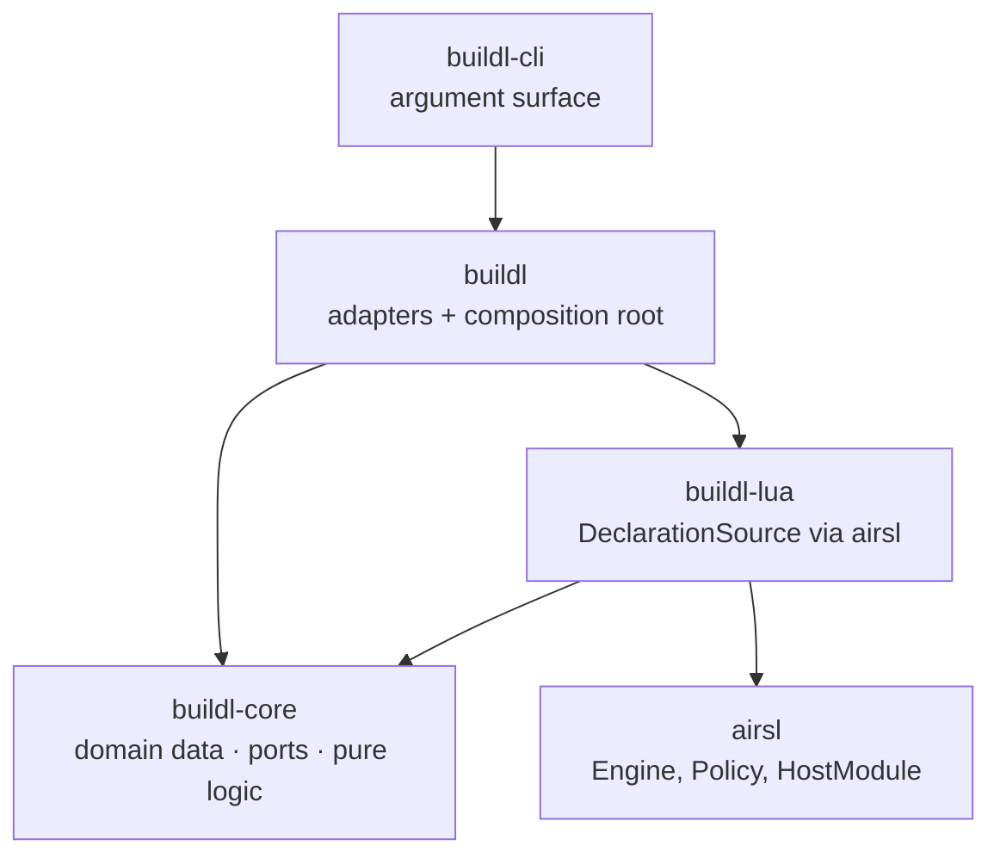
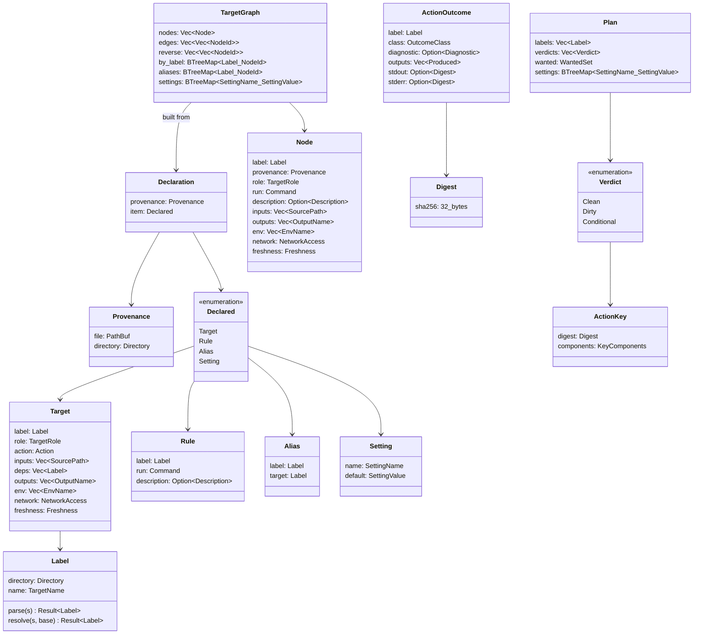
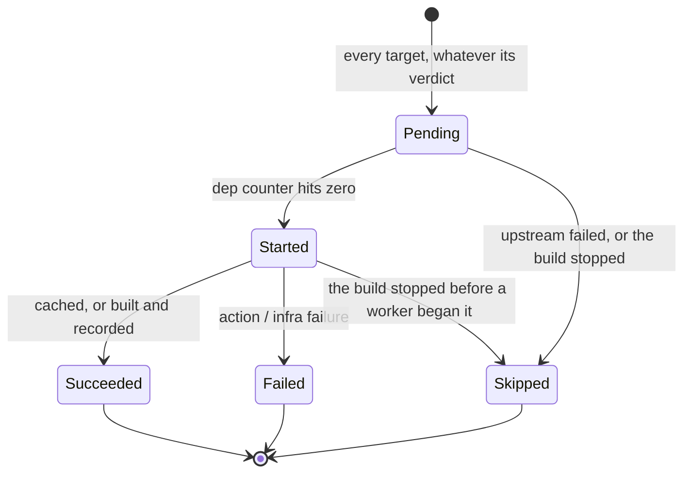

# buildl — internal architecture

**Status: the build-system core is implemented.** Companion to [`design.md`](./design.md): that document says _what buildl is and why_; this one says _how each part works in Rust_, and [`architecture-building-blocks.md`](./architecture-building-blocks.md) says _how the parts are put together_. Scope follows the §13 decision there — the build-system core first: Load → Resolve → Plan → Execute → Record, the action cache and cas, and the `check` / `graph` / `plan` / `build` commands; `query`, `test` and `log`, from the design doc's §13 item 2, are built over the same core. That core is built, with actions run at isolation tier 1 (design doc §12.2): what this document describes runs, except where a section says a part arrives with a later item of the design doc's §13. Plugins, remote, and watch are designed for but not implemented by anything here.

**Author:** rstlix0x0 · **Date:** 2026-08-23 · **Reviewers:** —

---

## 1. Workspace layout

Four crates, split so the logic of a build depends only on abstractions it owns. [`architecture-building-blocks.md`](./architecture-building-blocks.md) owns the layout — its C4 views, the port catalog (§6), and the dependency rules (§7) — and this document refers to crates and ports by those names.

```text
buildl/
  Cargo.toml        # workspace: resolver 3, shared lints (airsl's lint set)
  crates/
    buildl-core/    # domain data, ports (traits), pure logic of every phase: no I/O, no Lua
    buildl-lua/     # DeclarationSource over airsl: engine per file, the buildl HostModule
    buildl/         # every other adapter + LocalPorts: the composition root
    buildl-cli/     # the `buildl` binary: clap argument surface, exit codes
```

Inherited workspace policy, verbatim from airsl [1]: `unsafe_code = "forbid"`, `unwrap_used` and `panic` denied, pedantic + nursery clippy at warn, every dependency commented with its reason in the workspace `Cargo.toml`.

### 1.1 Crate dependency graph

Every dependency points at `buildl-core`; `buildl` is the one crate that names concrete adapters together (building blocks §7):



Two structural rules the graph encodes:

- **airsl is a dependency of `buildl-lua` only.** No other crate knows Lua exists, and `buildl-core` cannot name airsl at all because airsl is not among its dependencies. The whole runtime boundary is one crate deep, which is what keeps the execution side testable without a Lua state and keeps an airsl upgrade's blast radius contained.
- **Phases communicate through values, not calls.** Load produces `Vec<Declaration>`, Resolve consumes it and produces `TargetGraph`, Plan produces `Plan`, Execute produces `Vec<ActionOutcome>`. The pipeline in `buildl-core` owns the sequence; no phase invokes the next. This is §8 of the design doc made literal: each handoff is a serializable value, so each phase is unit-testable alone and `buildl graph` / `buildl plan` are just serializations of a handoff.

## 2. Core types

All in `buildl-core`, all newtypes over primitives, following airsl's `types/` discipline (`ModuleName`, `RootTable`, `ChunkName` — validated at construction, impossible to construct invalid) [1].



The load-bearing decisions:

- **`Label` is the universal name** (`//dir:name`), resolved and validated once at Load: every name and reference a build file writes — absolute, `:sibling` or bare — becomes an absolute `Label` against the declaring directory before Load hands its declarations on; from Resolve onward a target is a `NodeId` (`u32` index into the graph's arenas). Strings appear only at the edges — parsing and reporting.
- **`ActionKey` keeps its components.** The key is a digest _of_ a `KeyComponents` struct (command, input digests, each dependency's output digests, env values, the tool's fingerprint, settings, network access, os/arch — the §12.4 ledger as a Rust struct). Keeping the components alongside the digest is what makes `plan`'s "why dirty" reporting a struct diff instead of archaeology.
- **`Digest` is SHA-256 everywhere** — files, outputs, keys, log blobs — matching the Remote Execution API's digest model [4] so the remote-cache step later is a transport problem, not a re-keying.
- **`Provenance` is threaded, never reconstructed.** Attached in `declare`, carried through `Declaration` into the graph, surfaced in every error. No phase ever asks "which file declared this?" — it always already knows.

### 2.1 The target state machine

Each node in an executing build moves through exactly these states — this enum _is_ the scheduler's bookkeeping:



A started target is _settled_ before it runs: its key is finished from what its dependencies' rows now hold, and when nothing forces it to run, that key equals the one its last build recorded, and everything needed to put its outputs back is still in the cas — what the action printed, the manifest of each output, and every file a manifest names (§3.5) — it succeeds as cached without running. So a target becomes cached when it is settled, not only when the plan called it clean: a conditional target (§3.3) gets its answer here, and a clean one whose output left the cas runs again. `Succeeded` covers cached and built, and the outcome's class tells them apart (§4). What forces a target to run is ranked: `always` first, then a rerun test (`--rerun` forces the run's test targets and no other), then the comparison of keys; `DirtyReason::Rerun` names the second in a plan, beside `Always`. A cached target and a skipped one never run — the two results a task runner cannot represent, and the reason the summary line can say `1 failed, 2 skipped, 2 built, 9 cached`. A test run counts its test targets apart from the rest, in `Summary.tests` beside `Summary.all`, and sums up as `tests: 3 passed (2 cached), 1 failed, 1 skipped` from the tests alone.

## 3. Phase implementations

Each phase's logic lives in `buildl-core` and reaches I/O only through ports; the adapters live in `buildl-lua` and `buildl` (building blocks §6). The subsections keep the phase vocabulary:

|Section|Logic in `buildl-core`|Ports it uses|Adapter crate|
|---|---|---|---|
|§3.1 `declare`|directory queue, `subdir`, sorted merge|`DeclarationSource`|`buildl-lua`|
|§3.2 `graph`|resolve, validations, cycle detection|—|—|
|§3.3 `plan`|the settings in force, ceiling check, key assembly, a verdict per target|`Manifest`, `Host`, `Digester`, `StatCache`, `ToolResolver`, `ActionCache`|`buildl`|
|§3.4 `exec` and §3.5 `store` — one phase module, `execute`|output layout, placeholder expansion of commands and descriptions, the program check, the `Schedule` state machine, cached or run, record ordering: cas, row, log, the dispatcher held to its contract|`Manifest`, `Dispatcher`, `ExecStrategy`, `ContentStore`, `ActionCache`, `EventLog`, `Clock`|`buildl`|
|`log`, reading the log back (§3.5)|`history::last_run` chooses the newest run of a target that stored output; `pipeline::log` reads its two blobs|`RunHistory`, `ContentStore`|`buildl`|

`history` is not a phase: it decides between lines of a log already read, so it sits beside the phase modules, and the `log` command runs it without a `DeclarationSource`. `suggest`, which names the nearest of a set of names to one that names nothing, is a crate-level module: `resolve` uses it for labels and settings, `history` for labels with a logged run.

### 3.1 `declare` — the airsl boundary

The only crate that speaks Lua is `buildl-lua`, which implements the `DeclarationSource` port for one build file at a time; the directory queue and the merge described below are Load logic in `buildl-core`. Per build file: construct an `Engine` with the declaration policy (custom `LanguageSurface` without `os`, curated `ModuleSet` — design doc §12.1), evaluate, drop the engine (~136 µs; isolation by disposal [1]).

Installation: the engine keeps airsl's default `airsstack` root table, the `buildl` `HostModule` populates its own table, and inside `install` it binds that same table to the global `buildl` (design doc §5) — so every build file is evaluated with `buildl` loaded and `airsstack` beside it. `HostModule: Send + Sync` is part of airsl's contract, which is what rules the staging buffer's shape below.

The mechanics of collection: the `buildl` `HostModule`'s closures capture an `Arc<Mutex<Staging>>` for the file being evaluated: the staged records, the file's byte budget (its memory ceiling), and the first refusal, which stands even if the build file catches it with `pcall`. `b.target(...)` validates its option table shape _immediately_ (an unknown field, or a field of the wrong Lua type → `EvaluationFailure::UnknownField` / `WrongFieldType`, airsl-refusal style) and pushes a staged declaration: every value exactly as written, a `Written<T>` typed by what it must become, numbered with its `DeclarationOrder`. `b.subdir(dir)` pushes a `StagedSubdir` into the same buffer. Both return to `buildl-core` inside the `StagedFile` that `evaluate` hands back; Load attaches the `Provenance` (it built the `BuildFile`, so it already knows which file the result belongs to), validates every value, and resolves the requested directories, rejecting escapes, skipping repeats and queueing the rest — Lua never recurses, and the adapter never sees the queue.

`b.sources()` is the phase's one filesystem read, a host-side walk inside `buildl-lua`. The directories that walk must stay out of are a required argument of `LuaSource::new`, so no source exists without them; an empty list is written out and skips nothing. Each is workspace-relative and matched by its whole path from the workspace root: the walk neither lists, enters nor counts anything inside one, and a build file whose own directory is one, or lies inside one, gets an empty list. The composition root passes the manifest's output and state directories (`Workspace::out`, `Workspace::state`), so the adapter reads no manifest and a build file at the workspace root never lists what the build wrote.

Load evaluates build files one at a time today, from one queue of directories. Parallel load is not built with the core pipeline — the design doc's §13 says where it lands — and the rest of this paragraph is its design. Parallel load: the directory queue is processed by a small pool; each worker owns its engines, staging buffers merge at the end, and the merge sorts by (directory, declared name, then the whole declaration) so parallel load yields the identical staging list as serial load. The key holds no declaration order: under `pairs` the same file may issue its declarations in a different order on each evaluation. Determinism rule: parallelism must never be observable in any output (§6).

### 3.2 `graph` — arenas, not pointers

`TargetGraph` is struct-of-arrays with `u32` node ids: `nodes: Vec<Node>`, `edges: Vec<Vec<NodeId>>` (deps, in written order), `reverse: Vec<Vec<NodeId>>`, plus `by_label: BTreeMap<Label, NodeId>`; aliases and build settings sit beside the nodes as two more maps. A `Node` is a target with its rule expanded: it holds the command it runs. Petgraph [2] was considered and declined for the core structure — the graph is built once, never mutated, needs exactly toposort/cycle-detection/reachability, and owning the representation keeps `graph.json` stable: the graph serializes through a hand-written `Serialize` keyed by label, with dependencies as labels and no `NodeId` in the file, so adding a target changes only that target's entry. `query`'s `deps()` and `rdeps()` are reachability over `edges` and `reverse`: `resolve::reach` walks either from one target, with the walk `narrow` uses for a run's targets, and leaves the target itself and every alias out of the answer. (Nothing prevents using petgraph algorithms _over_ this representation later if `query` grows complex.)

Cycle detection is iterative DFS (explicit stack — a deep graph must not overflow the call stack; airsl's require-loader made the same choice for the same reason [1]). The error carries the full cycle path as labels with provenance.

### 3.3 `plan` — keys and the stat cache

The settings in force are fixed first: each declared setting's default, or its override for this run, and an override naming no declared setting fails the plan. Everything after reads those values, and the plan carries them: `Plan::settings()` holds every declared setting with the overrides applied, so Execute takes the graph, the plan and the failure policy, and expands commands and descriptions from the plan's own values, never from overrides handed to it a second time. The ceiling check comes next: every program, env name, declared input and output root is compared with the manifest's ceiling, and nothing is hashed or looked up until it passes. A program is what a command's first argument names once each `$opt:` reference in it is replaced by its setting's value (`Argument::with_settings`), so one named through a setting is wanted, looked up and keyed exactly as one written out. A first argument that is then empty or still holds a `$` — one that runs `$deps` — names no program here; §3.4's program check decides it. Then, once per graph: one fingerprint per distinct program (`ToolResolver`) — the SHA-256 of the bytes of the file the name leads to on buildl's own `PATH`, links followed, with no path, size or time in it, and taken again on every plan — one digest per distinct input (`Digester`, through the stat cache), the platform and one value per env name (`Host`). Each node's own components are assembled from those.

Verdicts are decided bottom-up over a topological order, computed with a queue rather than by recursion. A node whose dependencies are all clean has a finished key — its own components plus what each dependency's cache row says it produced — digested from the canonical serialization of the components and compared with the key in the node's own row: equal is `Clean`, different is `Dirty` with the components that differ. A node with a dependency that is not clean cannot finish its key, because that dependency's output does not exist yet: it is `Dirty` when something already known differs and `Conditional` otherwise, running only if the dependency produces something other than what was recorded. Its unfinished key holds everything the ports supplied, so the executor finishes it from the graph and its dependencies' new rows.

The stat cache holds, per input path, a `StatEntry { stat: FileStat { modified, size }, digest }`, loaded by its adapter from `.buildl/statcache.json`; an entry whose `FileStat` equals the file's current one reuses the digest, anything else re-hashes and records — ninja's mtime discipline with content-hash truth underneath [3]. The reuse rule is Plan's, tested against fakes. The adapter stores, keyed by path alone, with two rules of its own. It keeps an entry only for a file last modified more than two seconds before the run began: an edit inside a filesystem's timestamp granule can leave modification time and size equal, and two seconds is the coarsest granule met. And it discards a file it cannot read back instead of failing on it, since the file holds nothing a hash cannot give again. Plan commits the cache once when it recorded something and not at all otherwise. File hashing fans out with rayon's parallel iterators [5] — files are independent, the work is chunkable, and rayon's pool is confined to the `Digester` adapter in `buildl` (decision record §6). No file is read whole: each is streamed in pieces through `Hasher`, `buildl-core`'s incremental form of the one SHA-256. Digests come back in the order asked, and a failure is always the one for the first failing path in that order, whatever the scheduling. Before anything is hashed, `Digester::stat` says what stands at each input's path, following no symbolic link: a regular file with its metadata; nothing, which Plan raises as `Error::MissingInput`; or a link, a directory or a special file, which Plan raises as `Error::InputNotAFile`, with the target that declares the input.

Output: a `Plan` — one `Verdict` per node, the `WantedSet`, and the settings in force — and a build that would exceed the ceiling is an `Err`, not a plan.

### 3.4 `exec` — the scheduler

Two halves. The scheduling logic is `Schedule`, a pure state machine in `buildl-core`: it owns the state array (§2.1) and one dependency counter per node, hands out the `NodeId`s that became ready, and on `complete(node, finish)` starts dependents or skips them. Its caller is the only writer, so the counters are plain integers — single-writer bookkeeping, so no lock ordering to reason about. Parallelism is the `Dispatcher` port, one method: `dispatch(work, step)`. `work` runs one task and may run on any thread, several at once, and is handed a way to send messages back while it runs; `step` runs on the calling thread, first with `Turn::Begin`, then with each message (`Turn::Told`) and each result (`Turn::Done`), and returns the tasks that became ready. The port is generic over the task, the message and the result, so it knows nothing of builds. Its v1 adapter in `buildl` uses plain threads, no async runtime (decision record §6): a ready queue (`std::sync::mpsc` channel) and up to N scoped worker threads, started as tasks need them — a build of cached targets starts none — that receive a task, run it through `work`, and send its messages and its result back on one channel. A task that panics is reported lost instead of taking its worker down, and the build turns the loss into `Error::DispatcherFault` (below). Tests drive the same two closures through an inline dispatcher on one thread.

The port's contract is that every task `step` returns is run and every result reaches `step`. The signature settles half of it: the port is generic over the task and the result and asks for no way to copy or to build either, so a dispatcher cannot hand `step` a result twice, or one for a task it was never given. What it can do is lose a task or its result, and the build does not take that on trust. A dispatcher that returns `Ok` while a target has no outcome fails the build with `Error::DispatcherFault { targets }`: every target without an outcome, in label order, those that waited on the lost one included. A build therefore never reports success, or a summary, with a target missing; what ended before the loss has its blobs, its row and its log event already, and keeps them.

Everything that can refuse a build is decided before the first task is handed out: the plan belongs to the graph, no two outputs claim one path, and every command is expanded and its program held to the ceiling — the program check. A program written out or named through a setting was already held to it at Plan (§3.3); the check is the only place that knows a program first named by `$in`, `$out` or `$deps`, whose path comes from the output layout, and a command that names no program at all (`Error::NoProgram`). It is one check over every expanded command, whichever way the program was named.

What runs where follows the record ordering (§3.5). A worker first says it has begun — a target counts as started when a worker takes it, not when it is handed out — then prepares the exec dir, runs the action through the strategy (below), stores what the action printed, has the strategy store every file the action left and report what is at each output path, and stores one manifest per output (§3.5). The calling thread clears each output's path under `out/` and places its files there — clearing the path again when an output cannot be placed whole (§3.5) — writes the cache row — or, for a failure under the key the target's row was recorded under, forgets that row — before it appends the log event, then releases dependents. Stopping after a failure is a flag `step` sets and `work` reads before it begins an action: the dispatcher runs every task it was given, so a task handed over before the failure comes back not begun, and its target is skipped.

Execution strategies are one trait, the design doc's isolation ladder (§12.2) as code:

```rust
pub trait ExecStrategy: Send + Sync {
    /// The materialised exec dir; each isolation tier has its own shape.
    type Dir;
    /// Materialise the action's exec dir (inputs visible per this strategy's tier).
    fn prepare(&self, action: &ReadyAction) -> Result<Self::Dir>;
    /// Spawn and wait, capturing output. No shell, ever. With `live`, every run of
    /// bytes the command writes is also handed to it as it is read.
    fn run(
        &self,
        dir: &Self::Dir,
        action: &ReadyAction,
        live: Option<LiveSink<'_>>,
    ) -> Result<RawOutcome>;
    /// Say what the action left at each declared output, one entry per output, in
    /// order, and store the bytes of every regular file reported. No symbolic link
    /// is followed, and nothing is left out because it cannot be kept.
    fn collect<C: ContentStore>(
        &self,
        dir: &Self::Dir,
        action: &ReadyAction,
        cas: &C,
    ) -> Result<Vec<Found>>;
}
```

The trait is a `buildl-core` port, and `buildl` ships one adapter today: `Bare` (tier 1: workspace cwd, granted env only). `InputSandbox` (tier 2: temp dir, symlinked declared inputs) arrives with item 3 of the design doc's §13, and `OsSandbox` and `Container` are later impls of the same trait — the trait is in v1 so the ladder is a seam, not a refactor. `Bare` finds its program through the search path the plan's tools were fingerprinted through, one value handed to both adapters, so the file run is the file fingerprinted. A `ReadyAction` holds its command already expanded to workspace-relative paths (design doc §8.5), so a strategy only makes those paths true in its exec dir. It also holds the rule's description as an `Option<ExpandedDescription>`, expanded with the command from the same paths and settings (design doc §5): `None` for an inline command or a rule without `desc`, otherwise one line of any length, with a control character from a substituted value shown as a space. That is display text for whoever shows the action — no part of the key, the outcome or the log event. `collect` is the strategy's because it alone knows that dir, and an output's files never pass through `buildl-core` as bytes: only its manifest does. `run` returns a `RawOutcome`: how the action ended — an exit status, a timeout, or the signal that ended it — and what it printed. Its `live` argument is how `--stream` works: when it is given, every run of bytes the command writes is also handed to it as it is read, with its channel, and the outcome returned is the same with or without it, so what is stored cannot differ.

A command starts with the directory that will contain each declared output in place and nothing at the output path itself; the command creates what it produces there, a file or a directory. `collect` then reports, and does not judge. Each output path comes back as a `Found`: `Nothing`, `File` (a `StoredFile` — the digest of its bytes and a `FileMode`, `Plain` or `Executable`), `Tree` (everything below a directory, in any order, each entry a file or what it is instead: an empty directory, a symbolic link, something special, a name that is not Unicode), `Symlink` or `Special`. Every decision is `buildl-core`'s, made from those values in declared order and, inside a directory, in path order, so the same files end a build the same way whatever order a filesystem lists them in:

|Found at an output|The target ends as|
|---|---|
|nothing|`OutputMissing`|
|a regular file, or a directory holding only regular files|an `OutputManifest`, and `Built` once it is stored and recorded|
|a symbolic link, a special file, an empty directory, or a name that is not Unicode — at the path or below it|`OutputRefused { name, refusal }`, the action's fault (§4)|
|a list that is no tree: a path that leaves the directory, a path twice, a file where another needs a directory; or an answer for the wrong number of outputs|`InfraFailure { kind: Store }`: a directory walk cannot produce these, so the strategy misreported|

Output capture: piped stdout/stderr read by two reader threads per action, which send what they read to the worker over one channel; the worker appends each chunk to its stream's buffer, so each stream's order is exact, and it alone touches the child. The worker enforces the timeout: it waits with a deadline read from the monotonic clock and kills the child when the deadline passes — the child alone, since tier 1 makes no process group (decision record §6). When the child is gone and something it started still holds a pipe, the readers get one second more, and the action ends with what arrived. Blobs are written to the cas, digests recorded on the outcome.

Printing is owned by a single reporter on the scheduler side — workers never touch the terminal. `Reporter` is a `buildl-core` port of five calls, each made on the thread that called `build` and none able to fail: the build began, an action started, the action shown live printed, a target finished — with its log event and what it printed, read back from the cas for a cached target as for a built one — and the summary. A worker reaches the reporter only through the dispatcher's messages. An event is appended to the log before anything is read for display, so "log always" holds whatever the reporter does. The one adapter is a terminal reporter with two modes, a live one that keeps a status line and a plain one for a pipe; it is lent to one build by whoever calls it, and a build that ends in an error gets no summary.

### 3.5 `store` — cas, action cache, log

The cas is `.buildl/cas/ab/cdef...` (two-char shard dirs). Every write is temp-file-then-rename within the same filesystem — atomic, the `fs.atomic_write` discipline [1]. Blobs are staged in `.buildl/cas/tmp/` and state files in `.buildl/` itself, and both places are swept when a run takes the state lock. Nothing is synced to disk: a rename already gives a reader the old file whole or the new one whole when the process dies, which is what design doc §8.5 promises (decision record §6). The cas holds bytes by their digest and nothing else: whether a file may be run is not stored with it, and is said again each time the file is placed. A blob is read-only, mode 0444. One that was ever placed executable has a twin beside it, `cdef....x`: the same bytes with mode 0555, because a mode belongs to the inode. `put` compares the blob, and a twin that is there, with the bytes in hand and writes again what differs, removing neither; only a placement makes a twin. So the files the store holds after a build depend on the graph alone, never on the order workers finished in. `get` checks what it reads against the digest it was asked for: content that no longer has its digest is removed and reported as not held.

An output is described by an `OutputManifest`, `File(StoredFile)` or `Tree(Tree)`, whose canonical JSON — `{"file":{"digest","mode"}}` or `{"tree":[{"digest","mode","path"},…]}` — is itself a blob in the cas. The digest of those bytes is the output's one digest, for a file and a directory alike: it is what a row, a log event and a dependent's `Produced` hold, so the executable bit and every file of a directory reach a dependent's key, and a file can never share a digest with a tree. A `Tree` is built only by `Tree::new`: at least one file, entries sorted by path bytes, no path twice, no file where another entry needs a directory, each path a `TreePath` that cannot leave the directory. It has no entry for a directory, so a directory is in it exactly when a file lies below it.

Putting an output in place is `clear(path)`, then `place(digest, mode, path)` for the file, or for each file of the tree in path order at its path below the output's — the clear is what stops a file the new tree no longer holds, or a directory where a file now belongs, from surviving. When a `place` fails, the same `clear(path)` is called once more and the target fails as `InfraFailure { kind: Store }` with the placement's error: nothing of that output is left at its path, no later output of the target is touched, and the outputs placed whole before it stay. If that second `clear` fails too, its error is dropped — the target has failed already and no row is written — and what was placed stays until the next placement at that path, which begins with a `clear`. `out/` entries are hard links into the cas: to the blob for a plain file and to its twin for an executable one, since a hard link shares its inode's mode. A link is used only where it protects the store. Once per store the adapter writes a read-only file and tries to open it for writing; where that succeeds — as root, or on a filesystem without permission bits — every placement is a copy. A filesystem that refuses a link gets a copy too. A target is cached only when its row's key still stands and everything needed to put it back is held: what it printed, each output's manifest, reading back as one, and every file a manifest names. One file of a tree gone means the action runs again — a tree is put back whole or not at all — and a store that fails while reading a manifest fails the build.

The action cache is a `BTreeMap<Label, CacheRow { key: ActionKey, outputs: Vec<Digest>, stdout, stderr }>` — one manifest digest per declared output, and the whole key, components included, so the next plan can name the component that changed — serialized as sorted-key JSON and read back through the canonical reader (§5 rule 2). Reading rebuilds each value through its own constructor: a key's stored digest is recomputed from its components and compared, and a row's outputs are counted against the outputs its key declares, so a row is read whole or not at all. A row is written through `ActionCache::record`, one write per target, and is durable when that call returns; a failure under the key a row was recorded under (a test run again with `--rerun`, an `always` target, an output gone missing) removes it through `ActionCache::forget`, durable on return the same way, so a rerun that fails leaves no pass behind. A dependent keys on its dependency's row, so the row must be safe before the dependent starts, and a write that fails leaves no row. On disk the cache is two files: `cache.json`, the canonical snapshot, and `cache.journal`, to which `record` appends one line per row and `forget` one line `{"label":…,"row":null}`, replayed as a removal, because rewriting the snapshot for every row would be quadratic in the number of targets. The journal is folded into the snapshot once, after a build has returned, whatever it returned; one an interrupted run left behind is folded when the cache is next opened, a cut last line left out. The order workers finished in is therefore in the journal alone, and `cache.json` holds the same bytes whatever that order was. Write ordering enforces the §8.5 invariant: **cas first, row after, log always**. `log.jsonl` is append-only, one sorted-key JSON object per outcome, output blobs referenced by digest rather than inlined.

The log is read back through its own port, `RunHistory`, kept apart from `EventLog` because a writer and a reader never share a method. `RunHistory::lines` hands over every line of `log.jsonl`, oldest first, as a `LogLine`: a `LoggedRun`, the twin of the event that is written, or `Damaged` with the line's number. A line is a `LoggedRun` exactly when the canonical reader (§5 rule 2) takes it; one that is not byte for byte an event, however it came to be, is `Damaged` and the rest of the file stays readable, and a last line without a newline is ignored, since the adapter cuts such a line off before it appends the next. `history::last_run` is a pure choice over those lines: the newest line of the label with both output digests, the class of each newer line that stored none, and every damaged line; with no such line it is `Error::NoRun`. `pipeline::log` hands the lines to it and then reads the two blobs from the cas, so a blob the store no longer holds is `Error::MissingOutput`. The command reads no build file and takes no lock, and the only write it can cause is the store's own removal of a blob whose bytes fail their digest.

`gc` is designed and not built: it arrives with item 2 of the design doc's §13, and until then the store, the log and the rows of targets no longer declared only grow. Its design: `gc` walks roots (current `graph.json` outputs + cache rows), follows each output digest to its manifest and marks every file the manifest names, and unlinks unreferenced cas entries — refcounting deferred; mark-and-sweep is enough at v1 scale.

## 4. Error architecture

One `thiserror` enum in `buildl-core`, airsl-style: structured fields, no message parsing anywhere [1]. The design doc's failure classes (§8.7) are carried, not inferred. An action failure and an infrastructure failure are variants of a `#[non_exhaustive]` enum every outcome holds; a policy refusal is an error, `Error::Refused`, raised before any action runs, so no outcome carries one:

```rust
pub enum OutcomeClass {
    Cached,
    Built,
    ActionFailure { status: i32 },          // the build did its job
    Killed { signal: i32 },                 // ended by a signal: no exit status
    OutputMissing { name: OutputName },     // exit 0, a declared output absent
    OutputRefused {                         // exit 0, an output that cannot be kept
        name: OutputName,
        refusal: OutputRefusal,             // Symlink, Special, EmptyDirectory, NotText
    },
    InfraFailure { kind: InfraKind },       // Prepare, Run, TimedOut, Store
    Skipped { because: Label },
}
```

`Killed` is an action failure too: a command a signal ended has no exit status to hold, and it counts as failed. `OutputMissing` is the build revealing a fault, like `ActionFailure`: the action exited zero and left nothing at an output it declared. `OutputRefused` is the same family: the action exited zero and left, where an output it declared should be, something that cannot be put back exactly by placing files (§3.4); `name` is the first such output in declared order. It counts as failed, leaves no cache row, and its diagnostic names what was refused and where. A tree the strategy misreported is the builder's fault instead, `InfraFailure { kind: Store }`. `Skipped` names the failed target by `Label`, so no `NodeId` reaches the log. Classification is structural at the site that knows (spawn error vs non-zero exit vs timeout flag), never downstream. The CLI maps every class and every `Error` variant to one of eight exit codes (design doc §8.7) by matching on the variant, never on text, and one the binary has no row for exits 7, as buildl's own fault; `log.jsonl` carries the class verbatim. Every error that can name a target carries `Label + Provenance`; the display impl renders airsl-refusal-shaped messages — what was wanted, what was granted or found, where it was declared.

An error that is not an outcome fails the build as a whole. Eight kinds carry data a caller branches on, and each is kept apart from `Error::Adapter`, which carries an adapter's own failure as text for display only:

|Variant|Raised when|Carries|
|---|---|---|
|`Refused`|a want is outside the ceiling, at Plan or at the program check (§3.4)|the want, the lowest-labelled target wanting it with its build file, and the ceiling|
|`DispatcherFault`|the dispatcher returned success and left a target without an outcome (§3.4)|`targets`: every target without an outcome, in label order|
|`UnreadableJson`, `NonCanonicalJson`|bytes handed to the canonical reader cannot be trusted (§5 rule 2)|`source`, the `serde_json` error with its line and column; or `offset`, the first byte that differs from the canonical form|
|`CorruptState`|a file an adapter keeps a workspace's state in does not hold what the adapter writes there (§3.5)|`file`, and `source`: the JSON variant that says why|
|`UnknownTarget`|a run was asked for a target, and no target or alias has that label|the label, and the nearest declared one as a suggestion|
|`NoRun`|a log was asked for a target with no logged run that stored its output|the label, the nearest label the log has such a run for as a suggestion, and the number of every damaged line, since one of them may have been this target's run|
|`MissingOutput`|the last run that stored output names a blob the content store no longer holds (§3.5)|the label|
|`InputNotAFile`|a declared input's path holds a symbolic link, a directory or a special file (§3.3)|the lowest-labelled target declaring the input with its build file, the path, and what was found|

The two JSON variants are how a storage adapter tells a corrupt file from one it could not read: the first is one of these, wrapped in `CorruptState` with the name of the file, and the second is its own `Error::Adapter`. `UnknownSetting`, Resolve's error for a `$opt:` that names no declared setting, names the target or rule holding the reference in its command, or the rule holding it in its description.

## 5. Determinism engineering rules

House rules enforcing design-doc §12 at the code level — checkable in review, some in CI:

1. **No `HashMap` iteration reaches any output.** Anything serialized, displayed, or hashed iterates a `BTreeMap`/sorted `Vec`. (`HashMap` is fine as a pure lookup table.)
2. **All JSON leaves through one canonical serializer** — object keys sorted at every level, and
   floating-point values rejected where the serializer can see them. `graph.json`, `cache.json`,
   `log.jsonl`, and the bytes hashed into an `ActionKey` all use it, so "the key of X" and "the
   file of X" can never disagree. The float rule is enforced twice over, because neither half is
   complete alone: the serializer walks the value *after* `serde_json::to_value` has produced a
   tree, so it catches every finite float a dependency's `Serialize` impl might smuggle in — but
   it cannot catch a non-finite one, because `serde_json` turns `NaN` and `±Infinity` into `null`
   before the walk sees them, indistinguishable from a genuine `null`. The real guarantee is
   `crates/buildl-core/clippy.toml`'s ban on `f32` and `f64` in the crate, asserted by
   `cargo make guard-core-purity`; the serializer's walk is the second line, not the first.
   JSON comes back through one place too: `canonical::from_slice` rebuilds the value through its
   type's own `Deserialize`, writes it again and compares the bytes, so it accepts exactly what
   the serializer writes for some value and nothing else. A field left out or unknown, a key out
   of order or written twice, whitespace, and an escape the serializer would not use are all
   refused, and writing a value that was read gives back the bytes it was read from. The build
   log is read back the same way, one line at a time: a line the reader refuses is skipped and
   counted as damaged, not a failure of the file.
3. **Parallelism is never observable.** Parallel load merges sorted (§3.1) — Load is sequential today, so this clause has nothing to hold yet; parallel hashing writes into pre-indexed slots; the executor's completion _order_ appears only in the log's timestamps, never in any artifact.
4. **Wall clock is quarantined.** `now()` is read in exactly two places — log event timestamps and durations — via the `Clock` port, whose only real adapter lives in `buildl`. Two other time values exist, and neither is a wall-clock reading that reaches an output: the `exec` adapter reads the monotonic clock for an action's deadline, a value that reaches no key, file or log; and the stat cache's "began" (§3.3) is a file's modification time, the one the filesystem gave the state lock. The crate boundary does not enforce this: `std::time` is in scope for every crate. `crates/buildl-core/clippy.toml` bans `Instant`, `SystemTime` and `SystemTimeError` under `disallowed-types`, and `cargo make guard-core-purity` runs that ban inside `cargo make dod` — so it is lint configuration, not grep and not the compiler, that keeps the rule true.
5. **Double-run checks are CI, not doctrine.** `buildl check` runs declaration twice and compares the two sorted staging lists by value; the test suite builds each of two fixture workspaces twice — in two directories, once with four workers and once with one — and asserts byte-identical `out/`, `graph.json`, `cache.json`, and cas contents (`two_clean_builds_in_two_directories_are_byte_identical`, in `crates/buildl/tests/e2e`). `log.jsonl` and `statcache.json` are left out of the comparison: the first holds clock readings and completion order, the second modification times.

## 6. Decision records

|Decision|Choice|Because|
|---|---|---|
|Async runtime|**None — threads**|The workload is process-spawning and file-hashing: worker count ≈ core count, no fan-out beyond it, no IO multiplexing need. An async runtime buys nothing and costs a dependency tree and an ecosystem split. Revisit only if remote execution's network fan-out demands it.|
|Graph library|**Own arenas; petgraph declined** [2]|Built once, immutable, three algorithms needed, must serialize stably (§3.2).|
|Parallel hashing|**rayon, confined to the `Digester` adapter** [5]|Chunkable CPU-bound work is its exact use case; confining it keeps the executor's threading model singular.|
|Hash|**SHA-256**|REAPI compatibility [4] outweighs blake3's speed; the stat cache makes hashing rare on warm builds anyway.|
|Cache files|**JSON written by the canonical serializer, read back by the canonical reader**|Diff-stable and debuggable beats compact; airsl's sorted-key JSON is the precedent [1]. Binary formats only if profiling demands. The reader takes only the bytes the serializer writes, verifies a key's digest against its components and counts a row's outputs against its key's, so a file that fails surfaces as `Error::CorruptState`, which names the file and wraps `Error::UnreadableJson` or `Error::NonCanonicalJson` — corrupt, and distinct from an `Error::Adapter` read failure (§3.5, §4).|
|Worker/scheduler channel|**std mpsc**|One producer set, one consumer, no select needed; crossbeam only if the reporter grows a second consumer.|
|Lua exposure|**`buildl-lua` crate only**|An airsl (or mlua [6]) upgrade touches one crate; `buildl-core` compiles Lua-free by construction, since airsl is not among its dependencies.|
|Structure|**Four dependency-inverted crates**|Every flow testable against fake ports; recorded with its alternatives in building blocks §10.|
|Label syntax|**Absolute only, with a separate resolver**|A `Label` is `//dir:name` and nothing else, so no phase downstream asks whether the one it holds still needs resolving. `Label::resolve` is the single place the three forms a build file may write — `//dir:name`, `:sibling`, and a bare `name` — become one. Closes the relative-label half of design §14.|
|Directory-only labels|**Rejected, not resolved to `//dir:dir`**|Bazel's shorthand is not adopted: the design document states no such rule, and one target with two spellings breaks the `Display` → `parse` round-trip and admits two cache keys meaning the same target.|
|Floats in canonical JSON|**Refused outright, banned at compile time**|Nothing in the domain model is float-valued, and a non-finite float serializes as `null`, which would make an action key disagree with the value it was computed from. See §5 rule 2.|
|`Timestamp` representation|**`u64` nanoseconds since the Unix epoch; no date dependency**|The clock feeds durations as well as event timestamps (§5 rule 4) and `Instant` is banned in `buildl-core`, so a duration is the difference of two timestamps — which second resolution could not express. Unrelated to `SOURCE_DATE_EPOCH`, a whole-second value the sandbox hands to an action. Formatting belongs to the adapter that displays it, where a date library may be taken.|
|Execution settings and the key|**`workers`, `timeout` and `strategy` are not key components**|`workers` is scheduling, never observable in an artifact (§5 rule 3). `timeout` bounds whether an action finishes, not what it produces, and a timed-out action is a failure, never cached. `strategy` decides what an action can reach beyond its declared inputs, not what they are: keying on it would rebuild a workspace on every move up the ladder and stop a `sandbox` machine and an `os-sandbox` one sharing a cache, without making any output more correct. The tier-4 image is what changes output, and its digest joins the key per action (design §11.2).|
|Execution settings as types|**`Execution { workers: Workers, timeout: Timeout, strategy: Isolation }` in `Workspace`**|Each grammar is checked once, at construction, and the manifest's `0` never leaves `Workers`: a reader matches `PerCore` or `Fixed`, or asks `Workers::on(cores)`. `Timeout` is whole milliseconds, never zero. `Isolation` is ordered as the ladder is, so "tier 2 or above" is `>= Isolation::Sandbox`, and is named apart from the `ExecStrategy` port. An absent key is the type's `Default`.|
|Program named through a build setting|**Resolved at Plan, under the settings in force**|A setting's value is known before anything runs, so the program is as settled as one written out: it gets the ceiling check, the lookup and a fingerprint in the key. The build-time program check stays one uniform check over every expanded command; it alone knows a program first named by `$in`, `$out` or `$deps` (§3.3, §3.4).|
|A dispatcher that loses a task|**An error of the build, `Error::DispatcherFault`**|A build that answers `Ok` with fewer outcomes than targets reports success for work never done. The fault names the targets as data, so it is its own variant and not `Error::Adapter`'s display text (§3.4, §4).|
|What an output's digest is|**The digest of its `OutputManifest`, for a file and a directory alike**|An output is a file that may or may not be run, or a whole directory, and a row, an event and a dependent's key each hold exactly one digest per output. One manifest blob in the cas says which it is, so those three keep their shapes, the executable bit is in the digest, and a file never shares a digest with a tree. The cost is one small blob per output and one read per output on a cache hit (§3.5).|
|What a directory output may hold|**Regular files only; anything else is refused, not approximated**|A symbolic link, a special file, an empty directory and a name that is not Unicode cannot be put back exactly by placing files, so the action fails as `OutputRefused` rather than having something close to its output stored. A stamp file is the idiom for such a tree (design §9.2).|
|Who judges what an action left|**`collect` reports as `Found`; `buildl-core` decides**|I/O stays in the port and every decision is testable against values. Only the executable bit of a file's mode is kept; other permission bits, the owner and the times of a placed file are the store's to choose (§3.4).|
|A rule's description|**Expanded with the command; display text outside the key**|It reaches a `ReadyAction` as its own type, `ExpandedDescription`, because an expanded list of paths has no length limit while a written `Description` is held to 1024 bytes. Nothing in Plan reads it, so editing only a `desc` leaves every target cached (§3.4).|
|How a running build reaches the reporter|**Messages through the dispatcher: `work(task, tell)` and `step(Turn)`**|The scheduling thread blocks inside `dispatch`, and the dispatcher's own channel is the only way in that needs no second consumer. A target is started when a worker says it began, not when it is handed out: forty ready tasks on eight workers would otherwise show forty running (§3.4).|
|Live output|**One action at a time; the others wait as blocks**|`--stream` shows the first action to begin while none is shown. Outcomes that end meanwhile are logged at once and reported after it, so output is never interleaved and parallelism is kept; `run` returns the same outcome with or without the live sink, so the stored bytes cannot differ (§3.4).|
|A build of named targets|**The graph is narrowed between Resolve and Plan**|Plan asks for the tool and every input of every node it is given, so narrowing any later would fail a build on a missing input of an unrelated target. Output places are still checked over the whole graph, because an unchecked collision would delete another target's output. Narrowing also takes the run's `Purpose`: a whole workspace means every target but tests for a build and every test for a test run, and a test run that names a target that is not a test fails with `Error::NotATest`. A label nothing declares is `Error::UnknownTarget`.|
|When `graph.json` is written|**By every build, right after Resolve, always the whole graph, through the `GraphRecord` port**|The graph on disk then matches the rows and blobs beside it, and is the same bytes for `build` and `build <target>`. `plan`, `graph` and `query` record nothing. Closes the question §8 held.|
|A command a signal ended|**Its own class, `Killed { signal }`, an action failure**|A process a signal ended has no exit status, so `ActionFailure { status }` has nothing true to hold. A timeout is told by the worker's own flag, never by reading the signal (§3.4, §4).|
|The action cache on disk|**A snapshot, `cache.json`, and a journal, `cache.journal`, folded once per build**|A row must be durable when `record` returns, and a removal when `forget` does — a journal line that replays as a removal, with the format of `cache.json` unchanged — while rewriting the whole file for each row is quadratic: seconds for a thousand rows, where one appended line is microseconds. Rows reach `cache.json` only through the sorted map and the canonical serializer, so completion order never reaches it (§3.5).|
|Syncing to disk|**None, for any file**|A rename already covers the death of the process, which is what design §8.5 promises. A sync would add safety only against the machine itself dying, whose remedy is to remove `.buildl/` and `out/`, at some thirty times the cost of the write.|
|Protecting the cas|**Read-only blobs, an executable twin, and a link only where a write through it is refused**|An action that opens a dependency's output for writing would otherwise write into the store. The adapter checks once per store that a write to a read-only file is refused, and copies everywhere when it is not. A tool that changes the mode first can still damage a blob; tier 1 does not defend against that, since such a tool can write under `.buildl/` directly (§3.5).|
|A second buildl in one workspace|**Refused, through a lock on `.buildl/lock` held for one `plan`, `build` or `test` call**|Two builds at tier 1 write the same paths under `out/`. The lock is the system's, so it is freed when its holder dies and no stale lock exists; `check`, `graph` and `query` take none. A state directory outside `fs.write` is refused before it is made, with the error Plan gives for that want, so taking the lock never exceeds the ceiling.|
|Which stat-cache entries are kept|**Those for a file modified more than 2 s before the run began; keyed by path**|An edit Plan cannot see must leave modification time and size equal, so it falls inside the timestamp's granule, and 2 s is the coarsest granule met. The price: a file edited in the two seconds before a run is hashed again on the next one. A renamed file is hashed once more, which closes the `(dev, inode)` question §8 held (§3.3).|
|Stopping an action|**The direct child only; no process group at tier 1**|A child in a group of its own stops receiving the terminal's Ctrl-C, and std can neither signal a group nor forward a signal to one. What an action started is therefore not stopped with it, at a timeout or at its exit (design §12.2).|
|Signals to buildl itself|**No handler**|std has no safe way to install one, and the workspace forbids `unsafe`. Every action stays in buildl's process group, so a terminal's Ctrl-C ends buildl and its actions together; storage survives a kill at any instruction, and an interrupted build prints no summary (§3.5).|
|Finding a program|**One search path, read once, used by the tool resolver and by `Bare`; no trait between them**|The file run must be the file fingerprinted. A search path can be built from any list of directories, so tests need no seam.|
|Tools in adapter and end-to-end tests|**System tools, run by argv; `sh -c` in tests only; no compiled helper**|Cargo hands a test the path of a built binary only for integration tests of the package that owns it, so a helper would cost the published `buildl` crate a binary or a feature, or the workspace a fifth member (§7).|
|Adapter isolation inside `buildl`|**A gate task, `cargo make guard-adapter-isolation`, not review**|Thirteen adapters in one crate is where a cross-import slips in. An adapter module may name the two shared modules, `state` and `search_path`, and nothing else of the crate (building blocks §7).|

## 7. Testing strategy

The narrow handoffs are the test surface. Each flow runs first in `buildl-core` against fake ports — no Lua state, filesystem, process, or thread — and again against real adapters in the crate that owns them; the layers are in building blocks §8.

- **`declare`** (`buildl-lua`): fixture build files → assert exact `StagedFile`s, the adapter's whole output (turning them into `Vec<Declaration>` is Load's, tested in `buildl-core`); hostile fixtures (huge loops, `pairs` tricks, bad option tables) → assert refusal shape and instruction-ceiling stops.
- **`graph`**: staging lists (no Lua) → golden `graph.json`; duplicate/unknown/cycle fixtures → assert full provenance in errors.
- **`plan`**: synthetic graphs against fake ports → dirty sets and reasons; stat-cache hit/miss/mtime-rollback cases. Temp directories belong to the adapter tests, not to Plan's.
- **`exec`**: scripted fake strategies in `buildl-core` → state-machine transitions, keep-going semantics, crash-safety (a failing cache write leaves no row); system tools run by argv against the real `Bare` adapter, with `sh -c` only where one tool cannot print to a chosen stream, pick an exit status or hold a pipe → the timeout, a command a signal ended, exact capture of both streams. An interrupted build is tested as the four states a crash can leave, each made from honest builds: content with no row, a row in the journal that was never folded, a staging file, and a partial output no row names.
- **End-to-end**: a fixture workspace built twice — second run all-cached and byte-identical state (§5 rule 5); then one file touched — assert exactly the expected dirty closure rebuilds.
- **The airsl repo as dogfood**: buildl's own gate eventually runs under buildl. This is an aim; no item of the design's sequence owns it.

## 8. Open implementation questions

- Open until the input sandbox is built (item 3 of the design doc's §13): whether `ExecDir` materialisation for `InputSandbox` uses symlinks (fast, but visible to tools that `readlink`) or hard links (opaque, but same-filesystem only) — likely per-strategy config with hard links default.
- Settled: the stat cache is keyed by path alone. `FileStat` holds no inode, and a renamed file is hashed once more (decision record §6).
- Settled: where settings validation lives. A `$opt:name` reference in a command, or in a rule's description, is checked against the declared settings at Resolve; a `--set` override is checked against them at Plan, the first phase an invocation value reaches, and one naming no declared setting fails the plan.
- Settled: `graph.json` is written by every build, right after Resolve, and by no other command (decision record §6).

## References

1. airsstack. _airsl — source and docs (architecture.md, sandbox.md; workspace Cargo.toml lint and dependency policy)_. GitHub, 2026. URL: [https://github.com/airsstack/airsl](https://github.com/airsstack/airsl)
2. petgraph developers. _petgraph — graph data structures and algorithms (toposort)_. docs.rs. URL: [https://docs.rs/petgraph/](https://docs.rs/petgraph/)
3. Evan Martin et al. _The Ninja build system — manual_. ninja-build.org. URL: [https://ninja-build.org/manual.html](https://ninja-build.org/manual.html)
4. Bazel authors. _remote-apis — Digest and ActionCache model_. GitHub. URL: [https://github.com/bazelbuild/remote-apis](https://github.com/bazelbuild/remote-apis)
5. rayon developers. _rayon — data parallelism with work stealing_. crates.io. URL: [https://crates.io/crates/rayon](https://crates.io/crates/rayon)
6. khvzak et al. _mlua — Lua bindings for Rust_. crates.io. URL: [https://crates.io/crates/mlua](https://crates.io/crates/mlua)
