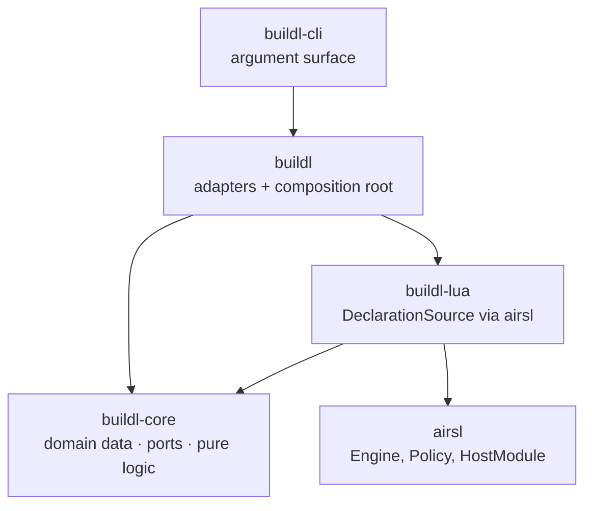
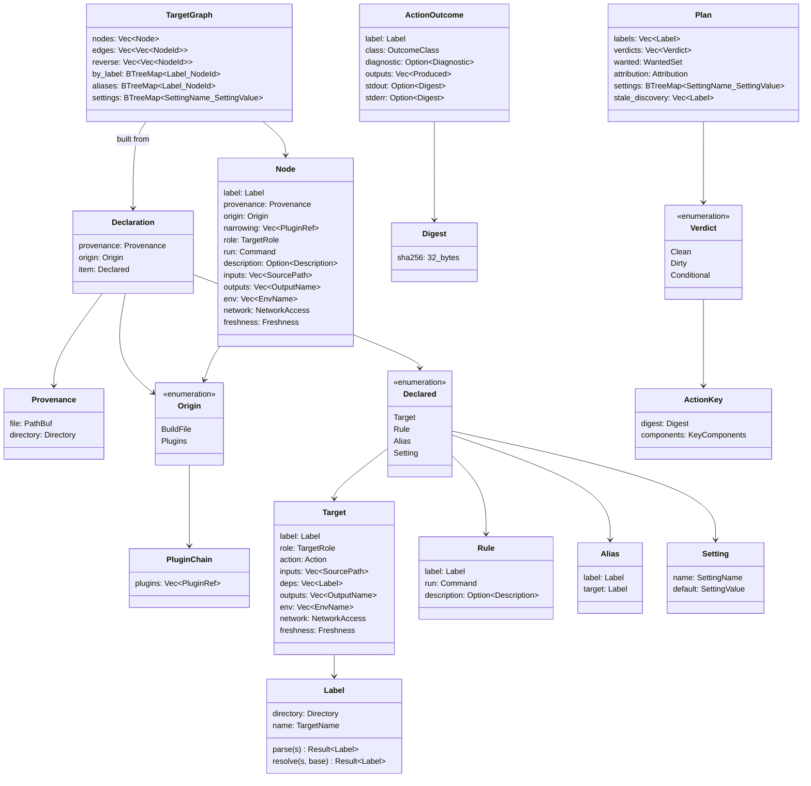
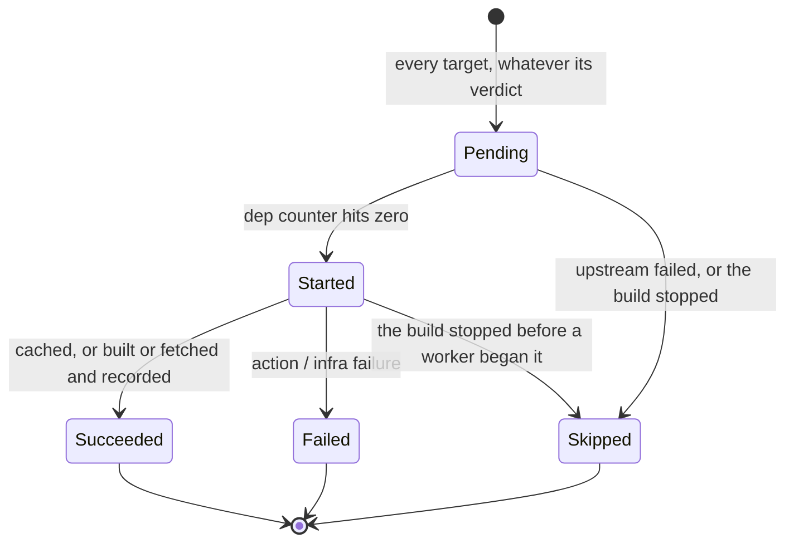
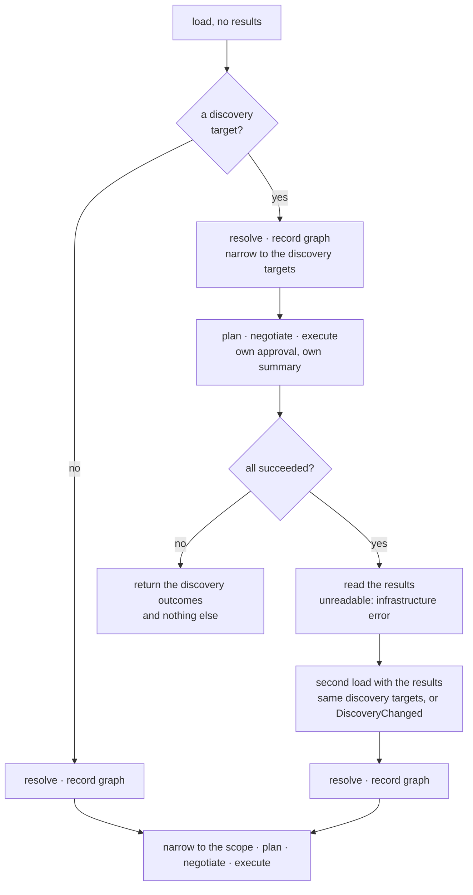
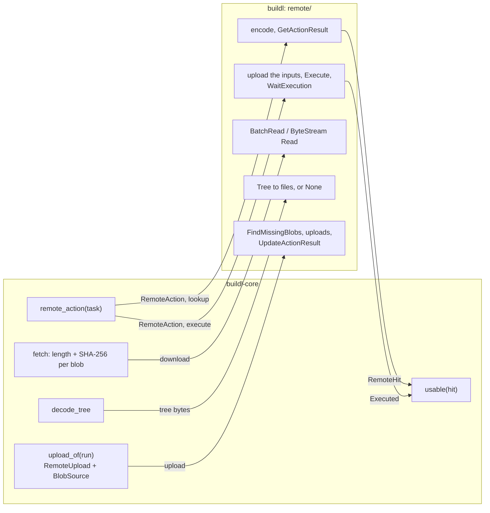
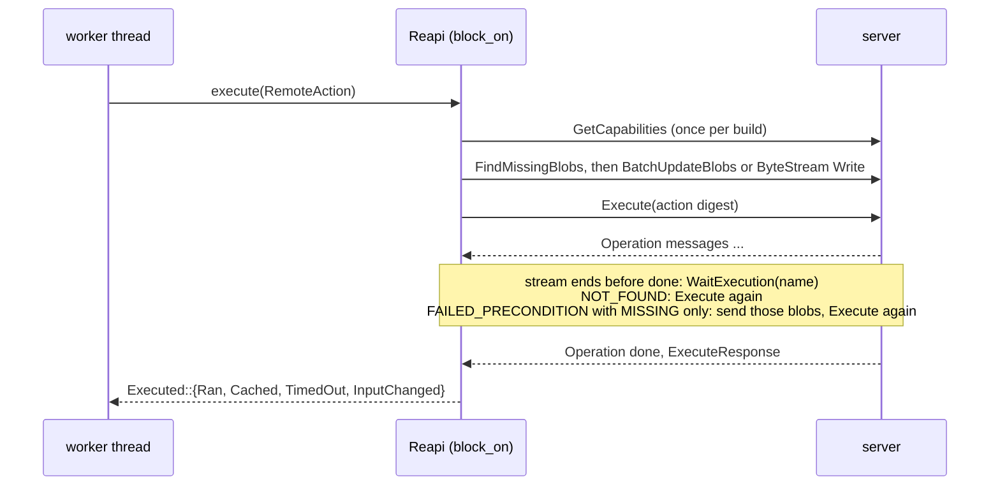
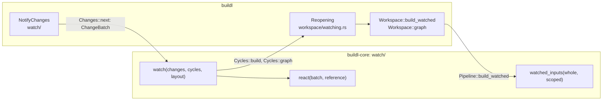

# buildl — internal architecture

**Status: the build-system core is implemented.** Companion to [`design.md`](./design.md): that document says _what buildl is and why_; this one says _how each part works in Rust_, and [`architecture-building-blocks.md`](./architecture-building-blocks.md) says _how the parts are put together_. Scope follows the §13 decision there — the build-system core first: Load → Resolve → Plan → Execute → Record, the action cache and cas, and the `check` / `graph` / `plan` / `build` commands; `query`, `test`, `log`, `clean` and `gc`, from the design doc's §13 item 2, are built over the same core, and so is `verify`, which re-runs cached actions in the input sandbox and compares what they produce with the cache. That core is built, with actions run in the input sandbox, isolation tier 2, by default and at tier 1 on request (design doc §12.2): what this document describes runs, except where a section says a part arrives with a later item of the design doc's §13. Plugins and discovery targets (item 5) are built over the same core: a declaration carries the origin of the code that made it, Plan holds a plugin's targets to the plugin's caps before it looks at the ceiling, and a command that reads targets loads the build files a second time with the results of the discovery targets. The remote cache (item 6) is built over the same core: a worker asks the `RemoteCache` port for the result of a target it would otherwise run, and on request sends it the result of one it ran, while the one adapter that speaks the Remote Execution API lives in `buildl` (§3.8). Watch mode (item 7) is built beside the pipeline and not in it: a loop in `buildl-core` runs a build, waits on the `Changes` port and answers each batch of changed paths with a build, a check of the build files, or nothing, and every cycle is the pipeline run on a workspace opened again (§3.9). Remote execution (item 8) is built over the same port: a worker whose build executes sends a target neither cache could answer to the server to be run there and checks what comes back as it checks a fetched result, two gates in `buildl-core` bound how many actions are with the server and how many run here at once, and the one adapter in `buildl` gains the `Execute` and `WaitExecution` calls, a retry rule for every call it makes, and an in-memory Execution service to test against (§3.4, §3.8).

**Author:** rstlix0x0 · **Date:** 2026-08-23 · **Reviewers:** —

---

## 1. Workspace layout

Four crates, split so the logic of a build depends only on abstractions it owns. [`architecture-building-blocks.md`](./architecture-building-blocks.md) owns the layout — its C4 views, the port catalog (§6), and the dependency rules (§7) — and this document refers to crates and ports by those names.

```text
buildl/
  Cargo.toml        # workspace: resolver 3, shared lints (airsl's lint set)
  crates/
    buildl-core/    # domain data, ports (traits), pure logic of every phase: no I/O, no Lua
    buildl-lua/     # DeclarationSource over airsl: engine per file, the buildl HostModule
    buildl/         # every other adapter + LocalPorts: the composition root
    buildl-cli/     # the `buildl` binary: clap argument surface, exit codes
```

Inherited workspace policy, verbatim from airsl [1]: `unsafe_code = "forbid"`, `unwrap_used` and `panic` denied, pedantic + nursery clippy at warn, every dependency commented with its reason in the workspace `Cargo.toml`.

### 1.1 Crate dependency graph

Every dependency points at `buildl-core`; `buildl` is the one crate that names concrete adapters together (building blocks §7):



Two structural rules the graph encodes:

- **airsl is a dependency of `buildl-lua` only.** No other crate knows Lua exists, and `buildl-core` cannot name airsl at all because airsl is not among its dependencies. The whole runtime boundary is one crate deep, which is what keeps the execution side testable without a Lua state and keeps an airsl upgrade's blast radius contained.
- **Phases communicate through values, not calls.** Load produces `Vec<Declaration>`, Resolve consumes it and produces `TargetGraph`, Plan produces `Plan`, Execute produces `Vec<ActionOutcome>`. The pipeline in `buildl-core` owns the sequence; no phase invokes the next. This is §8 of the design doc made literal: each handoff is a serializable value, so each phase is unit-testable alone and `buildl graph` / `buildl plan` are just serializations of a handoff.

## 2. Core types

All in `buildl-core`, all newtypes over primitives, following airsl's `types/` discipline (`ModuleName`, `RootTable`, `ChunkName` — validated at construction, impossible to construct invalid) [1].



The load-bearing decisions:

- **`Label` is the universal name** (`//dir:name`), resolved and validated once at Load: every name and reference a build file writes — absolute, `:sibling` or bare — becomes an absolute `Label` against the declaring directory before Load hands its declarations on; from Resolve onward a target is a `NodeId` (`u32` index into the graph's arenas). Strings appear only at the edges — parsing and reporting.
- **`ActionKey` keeps its components.** The key is a digest _of_ a `KeyComponents` struct (command, input digests, each dependency's output digests, env values, the tool's fingerprint, settings, network access, os/arch — the §12.4 ledger as a Rust struct). Keeping the components alongside the digest is what makes `plan`'s "why dirty" reporting a struct diff instead of archaeology.
- **`Digest` is SHA-256 everywhere** — files, outputs, keys, log blobs — matching the Remote Execution API's digest model [4]. The remote cache is therefore a transport and an encoding, not a re-keying: the action key stays what it is and travels as the salt of the `Action` a target is looked up under (§3.8).
- **`Provenance` is threaded, never reconstructed.** Attached in `declare`, carried through `Declaration` into the graph, surfaced in every error. No phase ever asks "which file declared this?" — it always already knows.
- **`Origin` is threaded the same way, and is never keyed.** A `Declaration` carries `Origin::BuildFile`, or `Origin::Plugins(PluginChain)`: the plugins from the one a build file used down to the one whose code made it, outermost first, each a `PluginRef` with the name, version and lists its manifest states. A `PluginChain` is never empty: its field is private and reading one from JSON refuses an empty list. Resolve copies the origin onto the `Node` and adds `Node::narrowing`, the plugins whose caps hold the target — its own chain, then each plugin of the chain of the rule it names that is not already there — which is kept out of `graph.json`, where `origin` is shown. An `ActionKey` holds neither: the same declaration built the same way has one key whoever wrote it. Every error that names a target prints the chain after the build file (`build.lua, plugin ourgo@0.1.0 > go@1.2.0`), because an engineer who did not write the target needs to know whose code to read.
- **`Attribution` explains a wanted set and is never part of it.** For each program, environment variable and network want, it keeps the plugin chains whose targets want it, each with the lowest-labelled such target; a read or a write is never attributed. It is computed beside the wanted set on every plan and carried on the `Plan`, so what an approval remembers stays the wanted set alone.

### 2.1 The target state machine

Each node in an executing build moves through exactly these states — this enum _is_ the scheduler's bookkeeping:



A started target is _settled_ before it runs: its key is finished from what its dependencies' rows now hold, and when nothing forces it to run, that key equals the one its last build recorded, and everything needed to put its outputs back is still in the cas — what the action printed, the manifest of each output, and every file a manifest names (§3.5) — it succeeds as cached without running. So a target becomes cached when it is settled, not only when the plan called it clean: a conditional target (§3.3) gets its answer here, and a clean one whose output left the cas runs again. `Succeeded` covers cached, built, fetched and remote, and the outcome's class tells them apart (§4). A fetched target is one the settle step sent to a worker and that never ran: the worker found its result in a remote cache and stored it (§3.4). A remote target is one the worker had a remote server run (§3.4). What forces a target to run is ranked: `always` first, then a rerun test (`--rerun` forces the run's test targets and no other), then the comparison of keys; `DirtyReason::Rerun` names the second in a plan, beside `Always`. A cached target and a skipped one never run — the two results a task runner cannot represent, and the reason the summary line can say `1 failed, 2 skipped, 2 built, 9 cached`. A test run counts its test targets apart from the rest, in `Summary.tests` beside `Summary.all`, and sums up as `tests: 3 passed (2 cached), 1 failed, 1 skipped` from the tests alone. When a remote cache served any target, the summary line counts `fetched` after `cached`, and `remote` after that when a server ran any (`1 built, 3 cached, 2 fetched, 4 remote`); a test run shows its fetched and remote shares beside its cached one.

## 3. Phase implementations

Each phase's logic lives in `buildl-core` and reaches I/O only through ports; the adapters live in `buildl-lua` and `buildl` (building blocks §6). The subsections keep the phase vocabulary:

|Section|Logic in `buildl-core`|Ports it uses|Adapter crate|
|---|---|---|---|
|§3.1 `declare`|directory queue, `subdir`, serial replay, sorted merge; the discovery results handed to every evaluation|`DeclarationSource`, `Dispatcher`|`buildl-lua`, `buildl`|
|§3.2 `graph`|resolve, validations, cycle detection|—|—|
|§3.3 `plan`|the settings in force, output placement and command expansion, the plugin check, the ceiling check, attribution, key assembly, a verdict per target|`Manifest`, `Host`, `Digester`, `StatCache`, `ToolResolver`, `ActionCache`|`buildl`|
|§3.4 `exec` and §3.5 `store` — one phase module, `execute`|output layout, placeholder expansion of commands and descriptions, the program check, the `Schedule` state machine, cached or run, record ordering: cas, row, log, the dispatcher held to its contract|`Manifest`, `Dispatcher`, `ExecStrategy`, `ContentStore`, `ActionCache`, `EventLog`, `Clock`, `RemoteCache`|`buildl`|
|`log`, reading the log back (§3.5)|`history::last_run` chooses the newest run of a target that stored output; `pipeline::log` reads its two blobs|`RunHistory`, `ContentStore`|`buildl`|
|`verify`, re-running cached actions|Plan → restore → re-run → compare, without Record: `verify::verify` puts each clean target's outputs back under `out/`, re-runs a `Sample` of them through `perform`, and compares each output's manifest with the cached one; it records no row and appends no event|`DeclarationSource`, `Dispatcher`, `Manifest`, `Host`, `Digester`, `StatCache`, `ToolResolver`, `ActionCache`, `ContentStore`, `ExecStrategy`, `Clock`|`buildl`|
|`grants`, the build's authority|the "built" rule, the wanted set and what of it lies outside the ceiling, what of it a plugin does not allow (`plugin_violations`), which plugins' targets are behind each want (`attribution`), and `negotiate`, which puts a plan's wanted set and its attribution to the approver in `build`, `test` and `verify`, after Plan and before anything runs|`Approver`|`buildl`|
|`doctor`, reporting the authority|`pipeline::doctor` loads, resolves, places the outputs, and returns a `Checkup`: the wanted set of the whole graph at each setting's default, what of it lies outside the ceiling, which plugins are behind it and every want a plugin does not allow, refusing nothing|`DeclarationSource`, `Dispatcher`, `Manifest`, `RunHistory`, `ContentStore`|`buildl`|
|`discovery`, the second load (§3.6)|`results` reads the last result of each discovery target from the log and the cas; `load_twice` and `second_pass` load the build files with them and hold the second load to the discovery targets of the first; `discovery_labels` names those targets|`DeclarationSource`, `Dispatcher`, `RunHistory`, `ContentStore`|`buildl-lua`, `buildl`|
|`gc`, pruning the store (§3.5)|`pipeline::gc` marks from the kept cache rows and `history::logged_outputs`, then sweeps|`DeclarationSource`, `Dispatcher`, `ActionCache`, `ContentStore`, `Sweep`, `RunHistory`|`buildl`|
|`remote`, the cache of another machine (§3.8)|the worker's two remote steps, in `execute`: `remote_action` describes a task as the cache is asked about it, `fetch` and `Checked::keep` check and store an answer, `upload_of` and `upload` describe a run and send it|`RemoteCache`, `ContentStore`|`buildl`|
|`watch`, the loop around builds (§3.9)|`react` sorts a batch of changed paths into a build, a check or nothing; `watch` runs a first build, then `next` → `react` → check → build; `watched_inputs` names the files a build reads; `Pipeline::build_watched` hands back the graph a build ran on|`Changes`, `Cycles`, `WatchReport`|`buildl`|

`watch` is not a phase either: it sits around the pipeline and runs it, through `Cycles`, once per cycle. `history` is not a phase: it decides between lines of a log already read, so it sits beside the phase modules, and the `log` command runs it without a `DeclarationSource`. `verify` is not a phase either: it serves one command and reuses the internals of `execute` (`prepared`, `restorable`, `restore`, `perform`) rather than copying them, which a phase module may not do to another. `placement` and `grants` are not phases either: Plan, Execute and `verify` each need where every output lives and what a command's placeholders stand for, which `placement` holds, and Plan and Execute each need whether a program is one the build made, which `grants` holds, and none of them may name another. `grants::negotiate` runs between Plan and Execute in `Pipeline::build`, `Pipeline::test` and `Pipeline::verify`, so an approver's no runs nothing, a build of cached targets included; `Pipeline::plan` never asks. There is no grants value to hand on: failure is closed, so a wanted set inside the ceiling is the whole grant, and the approver answers yes or no. The attribution goes to the approver beside the wanted set, to say whose targets are behind a want, and decides nothing: `Approver::approve(wanted, attribution)`. `discovery` is not a phase either, and is crate-private, as `placement` and `suggest` are. Several `pipeline` functions load the build files twice the same way, so that sequence lives in one place that no phase names; it names `load` and `history`, as `crates/expected-module-edges.txt` lists, and only `pipeline` names it. `suggest`, which names the nearest of a set of names to one that names nothing, is a crate-level module: `resolve` uses it for labels and settings, `history` for labels with a logged run.

### 3.1 `declare` — the airsl boundary

The only crate that speaks Lua is `buildl-lua`, which implements the `DeclarationSource` port for one build file per call, and several calls may run at once; the directory queue and the merge described below are Load logic in `buildl-core`. Per build file: construct an `Engine` with the declaration policy (custom `LanguageSurface` without `os`, curated `ModuleSet` — design doc §12.1), evaluate, drop the engine (~136 µs; isolation by disposal [1]).

Installation: the engine keeps airsl's default `airsstack` root table, the `buildl` `HostModule` populates its own table, and inside `install` it binds that same table to the global `buildl` (design doc §5) — so every build file is evaluated with `buildl` loaded and `airsstack` beside it. `HostModule: Send + Sync` is part of airsl's contract, which is what rules the staging buffer's shape below.

The mechanics of collection: the `buildl` `HostModule`'s closures capture an `Arc<Mutex<Staging>>` for the file being evaluated: the staged records, the file's byte budget (its memory ceiling), and the first refusal, which stands even if the build file catches it with `pcall`. `b.target(...)` validates its option table shape _immediately_ (an unknown field, or a field of the wrong Lua type → `EvaluationFailure::UnknownField` / `WrongFieldType`, airsl-refusal style) and pushes a staged declaration: every value exactly as written, a `Written<T>` typed by what it must become, numbered with its `DeclarationOrder`. `b.subdir(dir)` pushes a `StagedSubdir` into the same buffer. Both return to `buildl-core` inside the `StagedFile` that `evaluate` hands back; Load attaches the `Provenance` (it built the `BuildFile`, so it already knows which file the result belongs to), validates every value, and resolves the requested directories, rejecting escapes, skipping repeats and queueing the rest — Lua never recurses, and the adapter never sees the queue.

`b.sources()` is the phase's one filesystem read, a host-side walk inside `buildl-lua`. The directories that walk must stay out of are a required argument of `LuaSource::new`, so no source exists without them; an empty list is written out and skips nothing. Each is workspace-relative and matched by its whole path from the workspace root: the walk neither lists, enters nor counts anything inside one, and a build file whose own directory is one, or lies inside one, gets an empty list. The composition root passes the manifest's output and state directories (`Workspace::out`, `Workspace::state`), so the adapter reads no manifest and a build file at the workspace root never lists what the build wrote.

`b.use(name)` loads a plugin, and the rest of the plugin machinery is in the same crate. The composition root hands `LuaSource::new` a map from plugin name to the canonical directory of its checked files (building blocks §4, `plugins`), so the adapter reads neither `buildl.toml` nor `buildl.lock`. A plugin's `extension.toml` is read with airsl's extension manifest reader, which already refuses an entry file outside the plugin's directory, and becomes a `PluginRef`. The entry file runs once per _instance_, an instance being keyed by the whole chain of plugins that led to it: `go` used by a build file and `go` used by `ourgo` are two instances, with their own modules and their own origin. An instance runs under a new environment table and never reads through to the build file's globals: its `buildl` is a primitives table whose declarations carry `Origin::Plugins(chain)` and which has a `use` of its own, its `airsstack` is a new table holding the curated modules, its `require` is confined to the plugin's directory, and every library or module table in it is a one-level copy recorded when the engine was built. Without the copies a plugin could assign into the build file's `table`, or capture the file's `buildl` and declare outside its cap with `Origin::BuildFile`. A plugin that uses itself, or a plugin already in its chain, is refused. A refusal raised in plugin code names the plugin's chunk (`plugins/p/main.lua:6`), not the build file's line.

`b.discover(...)` declares a target of `TargetRole::Discovery`, an ordinary cached action whose one output is fixed, `<name>.json`, and which is never `always` (Load refuses a discovery target that names outputs or `always`), and `b.discovered(label)` answers the bytes of that output's last successful run, or nothing. The results reach the adapter as the `Discovered` argument of `DeclarationSource::evaluate(file, &Discovered)`: Load passes one map, unchanged, to every file it evaluates, and the same map goes to every plugin instance the file loads. A relative label in `b.discovered` resolves against the directory of the build file, as a dependency does, whichever plugin calls it. `Discovered` shares its map behind an `Arc`, so handing it to each of many evaluations copies no bytes.

Load runs its directory queue through the `Dispatcher` port (§3.4), on up to `[execution] workers` threads. Each worker evaluates one build file per task, with an `Engine` of its own, and a subdirectory is handed out as soon as a result names it, so workers stay busy while a breadth-first walk would still be waiting. Results arrive in any order, so the declarations and the error are not taken from arrival: a serial replay walks the directories in the order a serial load would, reading each result when the walk reaches it, and it alone decides both. The error is serial's first failure, with serial's `requested_by`, and an `AtomicBool` stops new evaluations once the replay meets it. The merge then sorts by (directory, declared name, then the whole declaration), so parallel load yields the identical staging list as serial load. The key holds no declaration order: under `pairs` the same file may issue its declarations in a different order on each evaluation. If the dispatcher returns success, the replay met no error, and a build file was left without a result, the load fails with `Error::LostBuildFiles` (§4) and declares nothing. Determinism rule: parallelism must never be observable in any output (§6).

### 3.2 `graph` — arenas, not pointers

`TargetGraph` is struct-of-arrays with `u32` node ids: `nodes: Vec<Node>`, `edges: Vec<Vec<NodeId>>` (deps, in written order), `reverse: Vec<Vec<NodeId>>`, plus `by_label: BTreeMap<Label, NodeId>`; aliases and build settings sit beside the nodes as two more maps. A `Node` is a target with its rule expanded: it holds the command it runs. Petgraph [2] was considered and declined for the core structure — the graph is built once, never mutated, needs exactly toposort/cycle-detection/reachability, and owning the representation keeps `graph.json` stable: the graph serializes through a hand-written `Serialize` keyed by label, with dependencies as labels and no `NodeId` in the file, so adding a target changes only that target's entry. `query`'s `deps()` and `rdeps()` are reachability over `edges` and `reverse`: `resolve::reach` walks either from one target, with the walk `narrow` uses for a run's targets, and leaves the target itself and every alias out of the answer. (Nothing prevents using petgraph algorithms _over_ this representation later if `query` grows complex.)

Cycle detection is iterative DFS (explicit stack — a deep graph must not overflow the call stack; airsl's require-loader made the same choice for the same reason [1]). The error carries the full cycle path as labels with provenance.

### 3.3 `plan` — keys and the stat cache

The settings in force are fixed first: each declared setting's default, or its override for this run, and an override naming no declared setting fails the plan. Everything after reads those values, and the plan carries them: `Plan::settings()` holds every declared setting with the overrides applied, so Execute takes the graph, the plan and the failure policy, and expands commands and descriptions from the plan's own values, never from overrides handed to it a second time. The refusals come next, and nothing is hashed or looked up until all have passed. Before them, Plan places every output of the graph it was given (`placement::Layout::of`), so two outputs claiming one path fail the plan as `Error::OutputConflict`, and expands every command under those settings (`placement::expand`).

The plugin check (`plugin_check`, beside the ceiling check in Plan's `authority`, over `grants::plugin_violations`) comes before the ceiling check, so the plugin whose code made a want is named before the workspace is. A target is held by each plugin in its `Node::narrowing`. Its wants are the program its command runs, each environment variable it reads, and the network when it declares it; a plugin allows one only when its own manifest lists the program or variable _and_ the workspace's `[plugins.<name>]` cap lists it too, and the network only when the cap allows it. A plugin with no cap allows nothing, and a build-file target that names no plugin's rule is held by none. A program one of the target's dependencies builds is no want here either (`grants::built`). The first violation, in label order and then chain order, fails the plan as `Error::PluginRefused`, naming the want, the target and its build file, the plugin that does not allow it and what that plugin allows of the same kind. A want must then also pass the ceiling check, so a plugin's reach is the intersection of its manifest, its cap and the ceiling, and no cap widens the ceiling. `doctor` runs the same walk and lists every violation instead of stopping at the first. The ceiling check compares every program, env name, declared input and output root with the manifest's ceiling. A command's program is the first text it expands to, so one named through a setting, `$in`, `$out` or `$deps` is wanted and held to the ceiling exactly as one written out. A program that is one of its target's dependency output paths, or lies below one, is built (`grants::built`): it is no want, needs no `proc.run` entry, and is neither looked up nor fingerprinted, since its bytes reach the key as its dependency's output digest. Only a program written out or named through a setting (`Argument::with_settings`) that is not built is looked up; a `$in` program's digest is already its input's. Then, once per graph: one fingerprint per distinct program (`ToolResolver`) — the SHA-256 of the bytes of the file the name leads to on buildl's own `PATH`, links followed, with no path, size or time in it, and taken again on every plan — one digest per distinct input (`Digester`, through the stat cache), the platform and one value per env name (`Host`). Each node's own components are assembled from those.

Verdicts are decided bottom-up over a topological order, computed with a queue rather than by recursion. A node whose dependencies are all clean has a finished key — its own components plus what each dependency's cache row says it produced — digested from the canonical serialization of the components and compared with the key in the node's own row: equal is `Clean`, different is `Dirty` with the components that differ. A node with a dependency that is not clean cannot finish its key, because that dependency's output does not exist yet: it is `Dirty` when something already known differs and `Conditional` otherwise, running only if the dependency produces something other than what was recorded. Its unfinished key holds everything the ports supplied, so the executor finishes it from the graph and its dependencies' new rows.

The stat cache holds, per input path, a `StatEntry { stat: FileStat { modified, size }, digest }`, loaded by its adapter from `.buildl/statcache.json`; an entry whose `FileStat` equals the file's current one reuses the digest, anything else re-hashes and records — ninja's mtime discipline with content-hash truth underneath [3]. The reuse rule is Plan's, tested against fakes. The adapter stores, keyed by path alone, with two rules of its own. It keeps an entry only for a file last modified more than two seconds before the run began: an edit inside a filesystem's timestamp granule can leave modification time and size equal, and two seconds is the coarsest granule met. And it discards a file it cannot read back instead of failing on it, since the file holds nothing a hash cannot give again. Plan commits the cache once when it recorded something and not at all otherwise. File hashing fans out with rayon's parallel iterators [5] — files are independent, the work is chunkable, and rayon's pool is confined to the `Digester` adapter in `buildl` (decision record §6). No file is read whole: each is streamed in pieces through `Hasher`, `buildl-core`'s incremental form of the one SHA-256. Digests come back in the order asked, and a failure is always the one for the first failing path in that order, whatever the scheduling. Before anything is hashed, `Digester::stat` says what stands at each input's path, following no symbolic link: a regular file with its metadata; nothing, which Plan raises as `Error::MissingInput`; or a link, a directory or a special file, which Plan raises as `Error::InputNotAFile`, with the target that declares the input.

Right after the ceiling check, a target that declares a variable `Isolation::pinned` sets for the workspace's strategy is refused as `Error::PinnedEnv` (§4, §6).

Output: a `Plan` — one `Verdict` per node, the `WantedSet`, its `Attribution`, and the settings in force — and a build that would exceed the ceiling, or a plugin's caps, is an `Err`, not a plan. `Pipeline::plan` also names the discovery targets that are not clean (§3.6).

### 3.4 `exec` — the scheduler

Two halves. The scheduling logic is `Schedule`, a pure state machine in `buildl-core`: it owns the state array (§2.1) and one dependency counter per node, hands out the `NodeId`s that became ready, and on `complete(node, finish)` starts dependents or skips them. Its caller is the only writer, so the counters are plain integers — single-writer bookkeeping, so no lock ordering to reason about. Parallelism is the `Dispatcher` port, one method: `dispatch(work, step)`. `work` runs one task and may run on any thread, several at once, and is handed a way to send messages back while it runs; `step` runs on the calling thread, first with `Turn::Begin`, then with each message (`Turn::Told`) and each result (`Turn::Done`), and returns the tasks that became ready. The port is generic over the task, the message and the result, so it knows nothing of builds. Its v1 adapter in `buildl` uses plain threads, no async runtime (decision record §6; the one runtime in the build belongs to the remote adapter, which a worker reaches through `block_on`, §3.8): a ready queue (`std::sync::mpsc` channel) and up to N scoped worker threads (`[execution] workers`, or the larger of that and `[remote] jobs` when the build executes on the remote, below), started as tasks need them — a build of cached targets starts none — that receive a task, run it through `work`, and send its messages and its result back on one channel. A task that panics is reported lost instead of taking its worker down, and the build turns the loss into `Error::DispatcherFault` (below). Tests drive the same two closures through an inline dispatcher on one thread.

The port's contract is that every task `step` returns is run and every result reaches `step`. The signature settles half of it: the port is generic over the task and the result and asks for no way to copy or to build either, so a dispatcher cannot hand `step` a result twice, or one for a task it was never given. What it can do is lose a task or its result, and the build does not take that on trust. A dispatcher that returns `Ok` while a target has no outcome fails the build with `Error::DispatcherFault { targets }`: every target without an outcome, in label order, those that waited on the lost one included. A build therefore never reports success, or a summary, with a target missing; what ended before the loss has its blobs, its row and its log event already, and keeps them.

Everything that can refuse a build is decided before the first task is handed out: the plan belongs to the graph, no two outputs claim one path, and every command is expanded and its program held to the ceiling — the program check. Plan already held every program to it (§3.3), with the same "built" rule, so the check is the last guard: one check over every expanded command, whichever way the program was named, that admits a built program with no `proc.run` entry and refuses a command that names no program at all (`Error::NoProgram`).

What runs where follows the record ordering (§3.5). A worker first says it has begun — a target counts as started when a worker takes it, not when it is handed out — then prepares the exec dir, runs the action through the strategy (below), stores what the action printed, has the strategy store every file the action left and report what is at each output path, and stores one manifest per output (§3.5). The calling thread clears each output's path under `out/` and places its files there — clearing the path again when an output cannot be placed whole (§3.5) — writes the cache row — or, for a failure under the key the target's row was recorded under, forgets that row — before it appends the log event, then releases dependents. Stopping after a failure is a flag `step` sets and `work` reads before it begins an action: the dispatcher runs every task it was given, so a task handed over before the failure comes back not begun, and its target is skipped.

With a remote cache (§3.8) a worker's order has two more steps, both inside `perform` and both through the `RemoteCache` port. Before it begins an action, a worker whose build reads from the remote asks `RemoteCache::lookup` for the task's `RemoteAction`. A result that passes `usable` is downloaded, checked blob by blob and kept in the content store (`fetch`, then `Checked::keep`), and the task ends `Ended::Fetched { outputs, printed }`: the worker never says it began, the strategy is never called, and the calling thread places the outputs and writes the row exactly as it does for `Ended::Produced` (§3.5). A miss runs the action as before. After the action, a worker whose build writes to the remote and whose action left every output describes what it produced (`upload_of`) and calls `RemoteCache::upload`, once the outputs and what the action printed are in the cas and before the result goes back to the calling thread. An action that failed and a task that was fetched never reach that step, and a task restored from its row never reaches a worker at all.

A build that executes on the remote (`RemotePolicy.execution` is `RemoteExecution::On { jobs, local }`, and not `Off`) gives a worker one more step and the build two gates. When both caches miss, and no failed call has turned the remote off, the worker sends the action it described for the lookup to `RemoteCache::execute` and the task ends with the answer, of which `Executed` has four:

|`Executed`|The task ends|
|---|---|
|`Ran(hit)`, `Cached(hit)`|the result goes through `usable`, `fetch` and `Checked::keep` as a lookup's does, and the task ends `Ended::Executed { outputs, printed }` when the server ran the action and `Ended::Fetched` when it held the result already. A `Ran` with an exit status other than zero is not unusable: its stdout and stderr are downloaded, checked and stored, and the task fails as a local run with that status would. Nothing is cached|
|`TimedOut { stdout, stderr }`|the logs the server kept are stored and the task fails as a local timeout does. The action is not run here|
|`InputChanged(path)`|a notice for that target, which then runs here; the remote stays on|
|`Err`|a failed call, `RemoteCall::Execute`, handled in `failed_call` as above|

An action the server ran is not uploaded afterwards, since a server that ran it is expected to keep the result. One that ran here after the remote could not take it is uploaded as any local run is.

The gates are `Gate`s from `execute/gate.rs`: a count behind a `Mutex` and a `Condvar`, with no I/O and no thread, so `buildl-core` stays as pure as it was. `Gate::enter` waits for a free place and returns a `Place`, which gives the place back when it is dropped; a gate of no places is made a gate of one. One gate admits `jobs` workers at once around `execute`, so `jobs` bounds the server's share even when it is below the number of workers. The other admits `local`, the `[execution] workers` count resolved for the machine, around every run here, so a build that falls back to local runs never runs more of them at once than it would without executing. A worker looks at the stop flag, and the remote switch, only after it has its place: a build that stopped, or a remote turned off by another worker, while it waited sends nothing. The lookup and the fetch pass neither gate, and a build that does not execute has no gates.

A worker waiting at the remote gate holds its thread, so the dispatcher is as wide as both gates need: `Wiring::dispatcher` makes `ThreadPool::wide(workers, jobs)`, the larger of the two counts, when the policy executes, and `ThreadPool::new(workers)` otherwise. Up to `jobs` threads then each block on one remote job through `block_on` (§3.8), and the local gate keeps the extra threads from running more than `workers` actions here. A remote job is reported as begun when it is sent and takes no place for live output; what it printed is shown when it ends, as for a fetched target. The calling thread places an `Ended::Executed` outcome and records it exactly as it does `Ended::Fetched` (§3.5), with the class `Remote`.

A failed call is handled in one place, `failed_call`. Under `RemoteFailure::Lenient` the first worker to meet one turns the build's `RemoteSwitch` off with a single compare-exchange, says so through `Told::Remote(RemoteNotice)` (the reporter's `remote` call) and runs the action; any other worker finds the switch off and asks nothing more. Under `RemoteFailure::Strict` the task ends `Ended::RemoteFailed`, and the calling thread fails the build with the `Error::Adapter` for `PortName::RemoteCache`. An upload that answers `Uploaded::InputChanged` is a notice for that target and leaves the switch on. A content store that cannot keep what a fetch checked is the run's `Store` failure and not a remote failure, so it neither turns the remote off nor reads as one. The `RemoteSwitch` lives for one `build` or `test` command, so the second pass of a discovery workspace (§3.6) neither asks a remote the first pass turned off nor warns again. The policy reaches the workers as `RunChoices.remote`, which `Pipeline::set_remote` sets for every later `build` and `test` call until it is changed; `RemotePolicy::OFF` is the default, and under it the port is never called. Before the approver is asked, a policy that writes or executes under `Isolation::Bare` is `Error::UploadUnsandboxed` (`ensure_sandboxed_remote`), whose `which` names the upload or the execution (execution when both are asked for), so a refused build prompts nobody.

Execution strategies are one trait, the design doc's isolation ladder (§12.2) as code:

```rust
pub trait ExecStrategy: Send + Sync {
    /// The materialised exec dir; each isolation tier has its own shape.
    type Dir;
    /// Materialise the action's exec dir (inputs visible per this strategy's tier).
    fn prepare(&self, action: &ReadyAction) -> Result<Self::Dir>;
    /// Spawn and wait, capturing output. No shell, ever. With `live`, every run of
    /// bytes the command writes is also handed to it as it is read.
    fn run(
        &self,
        dir: &Self::Dir,
        action: &ReadyAction,
        live: Option<LiveSink<'_>>,
    ) -> Result<RawOutcome>;
    /// Say what the action left at each declared output, one entry per output, in
    /// order, and store the bytes of every regular file reported. No symbolic link
    /// is followed, and nothing is left out because it cannot be kept.
    fn collect<C: ContentStore>(
        &self,
        dir: &Self::Dir,
        action: &ReadyAction,
        cas: &C,
    ) -> Result<Vec<Found>>;
}
```

The trait is a `buildl-core` port, and `buildl` ships two adapters: `Bare` (tier 1: workspace cwd, granted env only) and `InputSandbox` (tier 2). `OsSandbox` and `Container` are later impls of the same trait — the trait is in v1 so the ladder is a seam, not a refactor. Made with `OutPaths::Cleared`, `InputSandbox::prepare` clears each output path under the real `out/`, as `Bare` does; made with `OutPaths::Untouched`, which only `verify` uses, it leaves `out/` as it is (§6). Either way it then makes the action's exec dir, `<temp>/buildl-<workspace id>/<action id>`, outside the workspace (`state::Scratch` computes and guards the path, and the state lock removes it), and **copies** into it each declared input, every file of each dependency output (from `out/`, where the core placed them before it released the dependent), and a relative program the command writes out that is not already there; a relative program with a `..` component is refused. `run` starts the program with the exec dir as its cwd and an environment of the declared variables plus `Isolation::pinned` (design §12.3); `collect` reads each output from the exec dir with the same `outputs::found` `Bare` uses. Its `Dir` is an `ExecDir`, which removes its directory when the core drops it after `collect`. `Local` is the one `Strategy` of `LocalPorts`: an enum of `Bare`, `InputSandbox` and `Refused(Isolation)`, each method delegating to its variant, so dispatch stays static. `Refused` holds a strategy this buildl cannot run (`os-sandbox`, `container`); `Wiring::ports` builds it so `plan` still works under every strategy, while `Wiring::runs` refuses `build` and `test` before anything is made, `Wiring::verifies` refuses `verify` under those and under `bare` too, `Wiring::verify_ports` builds the ports `verify` runs on, and `Refused::prepare` returns the same refusal, so an action is never run under less isolation than the manifest asked for. What `Bare` and `InputSandbox` both need lives in two sibling files of `exec`, so neither names the other: `outcome.rs` tells how a captured process ended (`ended`) and builds an adapter error (`fault`), and `run.rs` makes the command to start, program found through the search path (`start`), and reads the outputs from a directory (`collect_in`). Both find their program through the search path the plan's tools were fingerprinted through, one value handed to both adapters, so the file run is the file fingerprinted. A `ReadyAction` holds its command already expanded to workspace-relative paths (design doc §8.5), so a strategy only makes those paths true in its exec dir. It also holds the rule's description as an `Option<ExpandedDescription>`, expanded with the command from the same paths and settings (design doc §5): `None` for an inline command or a rule without `desc`, otherwise one line of any length, with a control character from a substituted value shown as a space. That is display text for whoever shows the action — no part of the key, the outcome or the log event. `collect` is the strategy's because it alone knows that dir, and an output's files never pass through `buildl-core` as bytes: only its manifest does. `run` returns a `RawOutcome`: how the action ended — an exit status, a timeout, or the signal that ended it — and what it printed. Its `live` argument is how `--stream` works: when it is given, every run of bytes the command writes is also handed to it as it is read, with its channel, and the outcome returned is the same with or without it, so what is stored cannot differ.

A command starts with the directory that will contain each declared output in place and nothing at the output path itself; the command creates what it produces there, a file or a directory. `collect` then reports, and does not judge. Each output path comes back as a `Found`: `Nothing`, `File` (a `StoredFile` — the digest of its bytes and a `FileMode`, `Plain` or `Executable`), `Tree` (everything below a directory, in any order, each entry a file or what it is instead: an empty directory, a symbolic link, something special, a name that is not Unicode), `Symlink` or `Special`. Every decision is `buildl-core`'s, made from those values in declared order and, inside a directory, in path order, so the same files end a build the same way whatever order a filesystem lists them in:

|Found at an output|The target ends as|
|---|---|
|nothing|`OutputMissing`|
|a regular file, or a directory holding only regular files|an `OutputManifest`, and `Built` once it is stored and recorded|
|a symbolic link, a special file, an empty directory, or a name that is not Unicode — at the path or below it|`OutputRefused { name, refusal }`, the action's fault (§4)|
|a directory, at the output of a discovery target|`OutputRefused { name, refusal: NotAFile }`: a later load reads that output as one file of bytes (§3.6)|
|a list that is no tree: a path that leaves the directory, a path twice, a file where another needs a directory; or an answer for the wrong number of outputs|`InfraFailure { kind: Store }`: a directory walk cannot produce these, so the strategy misreported|

Output capture: piped stdout/stderr read by two reader threads per action, which send what they read to the worker over one channel; the worker appends each chunk to its stream's buffer, so each stream's order is exact, and it alone touches the child. The worker enforces the timeout: it waits with a deadline read from the monotonic clock and kills the child when the deadline passes — the child alone, since tier 1 makes no process group (decision record §6). When the child is gone and something it started still holds a pipe, the readers get one second more, and the action ends with what arrived. Blobs are written to the cas, digests recorded on the outcome.

Printing is owned by a single reporter on the scheduler side — workers never touch the terminal. `Reporter` is a `buildl-core` port of five calls, each made on the thread that called `build` and none able to fail: the build began, an action started, the action shown live printed, a target finished — with its log event and what it printed, read back from the cas for a cached target as for a built one — and the summary. A worker reaches the reporter only through the dispatcher's messages. An event is appended to the log before anything is read for display, so "log always" holds whatever the reporter does. The one adapter is a terminal reporter with two modes, a live one that keeps a status line and a plain one for a pipe; it is lent to one build by whoever calls it, and a build that ends in an error gets no summary.

### 3.5 `store` — cas, action cache, log

The cas is `.buildl/cas/ab/cdef...` (two-char shard dirs). Every write is temp-file-then-rename within the same filesystem — atomic, the `fs.atomic_write` discipline [1]. Blobs are staged in `.buildl/cas/tmp/` and state files in `.buildl/` itself, and both places are swept when a run takes the state lock. Nothing is synced to disk: a rename already gives a reader the old file whole or the new one whole when the process dies, which is what design doc §8.5 promises (decision record §6). The cas holds bytes by their digest and nothing else: whether a file may be run is not stored with it, and is said again each time the file is placed. A blob is read-only, mode 0444. One that was ever placed executable has a twin beside it, `cdef....x`: the same bytes with mode 0555, because a mode belongs to the inode. `put` compares the blob, and a twin that is there, with the bytes in hand and writes again what differs, removing neither; only a placement makes a twin. So the files the store holds after a build depend on the graph alone, never on the order workers finished in. `get` checks what it reads against the digest it was asked for: content that no longer has its digest is removed and reported as not held.

An output is described by an `OutputManifest`, `File(StoredFile)` or `Tree(Tree)`, whose canonical JSON — `{"file":{"digest","mode"}}` or `{"tree":[{"digest","mode","path"},…]}` — is itself a blob in the cas. The digest of those bytes is the output's one digest, for a file and a directory alike: it is what a row, a log event and a dependent's `Produced` hold, so the executable bit and every file of a directory reach a dependent's key, and a file can never share a digest with a tree. A `Tree` is built only by `Tree::new`: at least one file, entries sorted by path bytes, no path twice, no file where another entry needs a directory, each path a `TreePath` that cannot leave the directory. It has no entry for a directory, so a directory is in it exactly when a file lies below it.

Putting an output in place is `clear(path)`, then `place(digest, mode, path)` for the file, or for each file of the tree in path order at its path below the output's — the clear is what stops a file the new tree no longer holds, or a directory where a file now belongs, from surviving. When a `place` fails, the same `clear(path)` is called once more and the target fails as `InfraFailure { kind: Store }` with the placement's error: nothing of that output is left at its path, no later output of the target is touched, and the outputs placed whole before it stay. If that second `clear` fails too, its error is dropped — the target has failed already and no row is written — and what was placed stays until the next placement at that path, which begins with a `clear`. `out/` entries are hard links into the cas: to the blob for a plain file and to its twin for an executable one, since a hard link shares its inode's mode. A link is used only where it protects the store. Once per store the adapter writes a read-only file and tries to open it for writing; where that succeeds — as root, or on a filesystem without permission bits — every placement is a copy. A filesystem that refuses a link gets a copy too. A target is cached only when its row's key still stands and everything needed to put it back is held: what it printed, each output's manifest, reading back as one, and every file a manifest names. One file of a tree gone means the action runs again — a tree is put back whole or not at all — and a store that fails while reading a manifest fails the build.

The action cache is a `BTreeMap<Label, CacheRow { key: ActionKey, outputs: Vec<Digest>, stdout, stderr }>` — one manifest digest per declared output, and the whole key, components included, so the next plan can name the component that changed — serialized as sorted-key JSON and read back through the canonical reader (§5 rule 2). Reading rebuilds each value through its own constructor: a key's stored digest is recomputed from its components and compared, and a row's outputs are counted against the outputs its key declares, so a row is read whole or not at all. A row is written through `ActionCache::record`, one write per target, and is durable when that call returns; a failure under the key a row was recorded under (a test run again with `--rerun`, an `always` target, an output gone missing) removes it through `ActionCache::forget`, durable on return the same way, so a rerun that fails leaves no pass behind. A dependent keys on its dependency's row, so the row must be safe before the dependent starts, and a write that fails leaves no row. On disk the cache is two files: `cache.json`, the canonical snapshot, and `cache.journal`, to which `record` appends one line per row and `forget` one line `{"label":…,"row":null}`, replayed as a removal, because rewriting the snapshot for every row would be quadratic in the number of targets. The journal is folded into the snapshot once, after a build has returned, whatever it returned; one an interrupted run left behind is folded when the cache is next opened, a cut last line left out. The order workers finished in is therefore in the journal alone, and `cache.json` holds the same bytes whatever that order was. Write ordering enforces the §8.5 invariant: **cas first, row after, log always**. `log.jsonl` is append-only, one sorted-key JSON object per outcome, output blobs referenced by digest rather than inlined.

A result fetched from a remote cache takes the same road, and the invariant holds for it unchanged. `fetch` takes no `ContentStore`, so a byte that has not passed its checks cannot be stored; `Checked::keep` then puts every file, both logs and the manifest of each output in the cas, and only after that does the calling thread's `store` place the outputs, write the row and append the event, whose class is `Fetched` through `Finished { key, made, outputs, printed }` and `Made { Built, Fetched, Remote }`. A result the server ran takes the same road with `Made::Remote`, and its event's class is `Remote`. A crash between the cas writes and the row leaves blobs and no row, and the next build downloads again. A fetched output's digest is the digest of the same manifest a local run would have stored, so a dependency fetched gives its dependents the keys it would have built them, and the same plan built with the remote off and with it reading from an empty one gives byte-identical keys and rows. The upload to a remote cache comes before `store`, as it must: it needs the content a worker has just put in the cas, and the scheduling thread has not yet recorded it. If `store` then fails, the remote holds a sound result for a target whose local record failed, which is intended, since no failure is cached anywhere and the content is what the action produced.

The log is read back through its own port, `RunHistory`, kept apart from `EventLog` because a writer and a reader never share a method. `RunHistory::lines` hands over every line of `log.jsonl`, oldest first, as a `LogLine`: a `LoggedRun`, the twin of the event that is written, or `Damaged` with the line's number. A line is a `LoggedRun` exactly when the canonical reader (§5 rule 2) takes it; one that is not byte for byte an event, however it came to be, is `Damaged` and the rest of the file stays readable, and a last line without a newline is ignored, since the adapter cuts such a line off before it appends the next. `history::last_run` is a pure choice over those lines: the newest line of the label with both output digests, the class of each newer line that stored none, and every damaged line; with no such line it is `Error::NoRun`. `pipeline::log` hands the lines to it and then reads the two blobs from the cas, so a blob the store no longer holds is `Error::MissingOutput`. The command reads no build file and takes no lock, and the only write it can cause is the store's own removal of a blob whose bytes fail their digest.

`gc` is mark-and-sweep over the store, as `pipeline::gc`, a free function over a `DeclarationSource`, a `Dispatcher`, an `ActionCache`, a `ContentStore`, a `Sweep` and a `RunHistory`; refcounting is deferred, since mark-and-sweep is enough at v1 scale. It runs in four steps:

1. **Load.** It loads and resolves the build files once, as `build` does, so it knows which targets are declared.
2. **Forget.** It forgets, through `ActionCache::forget`, every row whose label (`ActionCache::labels` lists them) is not a declared target.
3. **Mark.** For each row that remains it marks the row's stdout and stderr, each output's manifest and every file that manifest names; `history::logged_outputs` adds the stdout and stderr of each target's newest logged run that stored them, so `log` still answers for a target whose row is gone. A manifest the store does not hold, or whose bytes are not a manifest, marks only itself.
4. **Sweep.** It removes, through `Sweep::remove`, every digest `Sweep::held` lists that is not marked.

The order is the §8.5 invariant seen from the other side: rows go before blobs, so a `gc` that stops part way leaves blobs behind and never a row whose blobs are gone. `Sweep` is its own port, kept out of the `Ports` bundle (building blocks §5.3), so a build, which holds a `ContentStore`, cannot remove what it stored. The staging leftovers of an interrupted run are not part of the mark: taking the state lock clears them, and `Workspace::gc` and `Workspace::clean` take it. `clean` is no pipeline: `Workspace::clean` takes the lock and removes `out/`, leaving the cache rows, the cas and the log whole, so the next build places every output from the cas.

### 3.6 `discovery` — the second load

A discovery target (design §10) is an ordinary cached action whose one output a later declaration pass reads, so the declarations of a workspace can depend on what a tool printed without Lua running the tool. Everything it adds to the pipeline is a second Load. Pass one evaluates every build file with an empty `Discovered`. `discovery::results` then reads, for each discovery target pass one declared, the bytes of its newest successful run, from the log (`history::last_success` over `RunHistory`) and the cas (`ContentStore`). Pass two evaluates every build file again with those results as the `Discovered` argument of `DeclarationSource::evaluate(file, &Discovered)`. A result that cannot be read counts as none, never as an error: a log that will not parse, a damaged line, a blob the store no longer holds, and an output that is a directory each leave the label without a result. A workspace whose state is unreadable declares as if nothing had run, and the labels without a result come back beside the declarations for the command to note.

One rule holds the passes together: pass two may not declare different discovery targets than pass one (`discovery::second_pass`, `Error::DiscoveryChanged`). A discovery target that depended on a discovery result would have no result to start from, so each discovery target is compared whole — label, every field, build file and origin — and the error names the first, in declaration order. Which commands do what:

|Command|Loads|Runs discovery targets|State lock|
|---|---|---|---|
|`check`|pass one; with a discovery target, pass two and a third load with the same results, which must agree (§5 rule 5); with none, a second load without results|no|none|
|`graph`, `query`|`load_twice`: pass one, then pass two when pass one declared a discovery target|no|none|
|`doctor`|as `graph`, then the wants of the loaded graph|no|none|
|`log`|no build file|no|none|
|`plan`|as `graph`, from the pipeline's own log and cas; then a plan of the narrowed graph, and a plan of the discovery targets alone, whose not-clean ones are `Plan::stale_discovery`|no|held|
|`verify`|as `plan`, then the approver and `verify`|no|held|
|`gc`|`load_twice`, so a target declared from a result is declared and its row and blobs are kept|no|held|
|`build`, `test`|`prepare`: pass one, the discovery run, pass two (below)|yes, first|held|

`check`, `graph`, `query`, `doctor` and `log` read the log and the cas without the state lock, so a build in progress does not stop them. A command that reads only build files was lockless already (decision record §6); what it reads now includes `log.jsonl` and the cas, and it writes neither, but for the store's own removal of a blob whose bytes fail their digest (§3.5). `LocalLog` and `LocalCas` touch the disk only when read, so these commands still create no `.buildl/` and are stopped by no damaged state file. The `pipeline` functions `check`, `graph` and `query` take a `DeclarationSource`, a `Dispatcher`, a `RunHistory` and a `ContentStore` and nothing else, and `doctor` takes a `Manifest` as well.

`Pipeline::plan`, `Pipeline::verify` and `gc` read the same results through ports they already hold, which is why `Ports::Log` is bound by `EventLog + RunHistory` (building blocks §5.3); `gc` is a free function that takes its own `RunHistory`. Only `build` and `test` run a discovery target:



The discovery run is a build of the discovery targets and what they depend on, through the same `run` as any build: planned, put to the approver, executed, reported. A workspace with a discovery target therefore asks for approval twice, each ask covering its own wants, and the reporter receives two summaries, the discovery run's first. A `test` command's discovery run is summarised as a build, counting the discovery targets in `Summary.all` and no test in `Summary.tests`. The outcomes returned are the discovery run's followed by the main run's; a discovery target that `scope` names too is in both, cached the second time. The build files are evaluated twice, never three times, and the graph is recorded for each load that goes on to be run against.

After a discovery run that succeeded, a result that cannot be read back is an error, not a missing result: `Error::Adapter` naming `PortName::RunHistory` when the log cannot be read at all and `PortName::ContentStore` otherwise (exit 3). `build` would otherwise declare nothing from a target that had just run, and exit 0. A discovery target is forced like a build target (`Forcing::of`), and `perform` refuses a directory at its output as `OutputRefused { refusal: NotAFile }`, so a `Task` carries its target's role. A `test` that names a label nothing declares, or a discovery target, runs discovery before it is refused, because the label may exist only after pass two.

### 3.7 `plugins` — checked before any build file opens

A plugin is a directory of Lua files and an `extension.toml`. `buildl.toml` names each one in a `[plugins.<name>]` table: exactly one of `path` (a directory of the workspace), `git` and `github`, and a `rev` with the last two — a tag or a full commit. The source becomes a `PluginSource`, `Path` or `Git { url, rev }`. The same table's `proc.run`, `env.read` and `network` become the plugin's cap, a `PluginCap` in `Workspace::plugins` that Plan holds the plugin's targets to (§3.3), and a plugin whose table gives none allows nothing. The `manifest` adapter reads both and offers the sources beside the `Manifest` port. What the rest needs lives in one module of `buildl` that serves no port:

|Part|What it does|
|---|---|
|`Lock`, `LockEntry`|`buildl.lock` in the workspace root, committed with it: canonical JSON, one `LockEntry { commit, git, rev, sha256 }` per git plugin in name order, none for a path plugin. A damaged lock is `Error::CorruptState`, one that cannot be read is `Error::Adapter` for the manifest, one that cannot be written is `Error::Adapter` for `PortName::PluginStore`.|
|`tree_digest`|the one digest of a stored plugin: the regular files below its directory as an `OutputManifest::Tree`, so a plugin is digested as an output directory is, with the executable bit and nothing else of the mode. A top-level `.git` is skipped. A link, a special file or a name that is not Unicode is `Error::PluginTree`.|
|`check` → `Checked`|the rule every command that makes a source applies, from the lock and the store and never the network. A path plugin must be a directory (else `Error::PluginNotFetched`). A git plugin must have a lock entry for the url and rev `buildl.toml` names and a store directory `<state>/plugins/<name>/<commit>` (else `PluginNotFetched`), and its files must digest to the entry's `sha256` (else `Error::PluginChanged`). Plugins are checked in name order and the first failure is returned.|
|`Git`, `fetch` → `Fetched`|`buildl plugins fetch`. For each git plugin in name order: nothing, when its entry matches `buildl.toml` and its stored files digest to the entry. Otherwise a depth-1 fetch of the tag or commit by the system `git` into `<state>/plugins/fetching~<name>`, the checkout's `.git` removed, its files digested, compared with the entry when there is one — a moved tag or a changed tree is `PluginChanged`, never a silent repin — and moved into the store. The lock is written once, after every plugin and only when it differs; whatever it no longer names is then removed from the store. `git` is looked for on the search path the plan's tools are found on, and only when something must be fetched; a `git` that is missing, or that refuses the repository or the revision, is `Error::PluginFetch`.|

`Wiring::source` runs `check` and hands the directories of the plugins that pass to `LuaSource::new`, so a command that makes a source refuses a missing, unpinned or changed plugin before a build file opens, and `buildl-lua` reads neither the lock nor the store. Checking digests every git plugin's store on every such command, which is the price of a lock that a changed file cannot slip past. `plugins fetch` takes the state lock like the other commands that write under the state directory, reads no build file and asks no approver. The `git` it runs is the engineer's own, with their configuration but without the variables that point `git` at a repository (`GIT_DIR` and the rest of what `git rev-parse --local-env-vars` prints), with `GIT_TERMINAL_PROMPT=0`, `LC_ALL=C` and a closed standard input, and `--end-of-options` before the url. A `GitUrl` that begins with `-` or names a transport helper (`ext::…`) is refused where it is parsed, and a `PluginName` is at most 246 bytes so that `fetching~<name>` fits a 255-byte file name.

`plugins` names only `state` and `search_path` of the rest of the crate, and the `manifest` adapter and it name each other not at all: they share values in `buildl-core` (`PluginSource`, `PluginName`, `GitUrl`, `Rev`), never code (building blocks §7). The lines `plugins fetch` prints are the CLI's, since `report` may not import `plugins`.

### 3.8 `remote` — the cache of another machine

A remote cache (design §11.2) is a store the core does not own, keyed by a description of the work and not by buildl's key, answering with a result it has not checked, and reached over a network by several workers at once. When a build asks, it is also a server that runs the work it was asked about. The core therefore has a port of its own for it and does all the judging; the adapter moves bytes and encodes.



`RemoteCache: Send + Sync` is blocking, since workers call it from their own threads, and has five methods: `lookup(&RemoteAction) -> Option<RemoteHit>`, `download(&[Blob]) -> Vec<Vec<u8>>` in the order asked, `decode_tree(&[u8]) -> DecodedTree` (`Files` in path order, or the path of the first symbolic link or empty directory the tree holds, which a build cannot place, so that the result is refused as a local run leaving the same would be; `Unreadable` for bytes that are not a tree) and `upload(&RemoteAction, &RemoteUpload, &dyn BlobSource) -> Uploaded`, which is `Done` or `InputChanged(path)`, and `execute(&RemoteAction) -> Executed`, which asks the server to run the action. `Executed` is `Ran(RemoteHit)` for an action the server ran, `Cached(RemoteHit)` for one whose result it already held, `TimedOut { stdout, stderr }` for one it gave up on after its time limit, with the logs when it kept them, and `InputChanged(path)` for an input that changed after its digest was taken, so that nothing was sent. The hit of `Ran` and `Cached` is unchecked, and a `Ran` may hold a non-zero exit code: the core judges both (§3.4). A miss is `Ok(None)` and every other failure is an `Error::Adapter` naming `PortName::RemoteCache`; the core decides what a failure does (§3.4). `BlobSource` is the one new `dyn`: a callback through which the adapter reads the output and log blobs of an upload from the content store it may not import (building blocks §7 rule 2). `Ports` carries the cache as `type Remote: RemoteCache`, and `NoRemote`, which misses, drops uploads and answers an adapter error if it is asked to execute, stands in wherever a flow has none; a run is never asked to execute with it, since the policy that turns execution on needs a cache that is there.

`remote_action` builds the `RemoteAction` from a task, the execution settings and the content store, and it is pure apart from reading the manifests of dependency outputs from the store:

|Part|Holds|
|---|---|
|`command`|the ready action's expanded command|
|`env`|the action's environment with `Isolation::pinned` laid over it, as the sandbox sets it|
|`outputs`|the output paths, sorted, without repeats|
|`files`|every declared input, with its digest and no mode, and every file of every dependency's outputs, with the mode its manifest records, sorted by path|
|`platform`|`RemotePlatform::of` the key's platform: the OS kept, `aarch64` and `x86_64` renamed `arm-a64` and `x86-64`|
|`timeout`|`[execution] timeout`, which always has a value|
|`properties`|the workspace's `[remote] properties`, beyond the machine's own two; the adapter lays them with those two in the `Platform`, sorted by name, so the lookup, the upload and the execution of a target share one description|
|`salt`|the target's action key digest|

Everything protobuf is the adapter's: it encodes the `Command`, the `Platform` (properties sorted by name), the `Action` and its input-root `Directory` tree, whose file sizes and input executable bits it reads from the workspace on disk, and prost's tag-order encoding makes every digest stable. The digest of a message is taken over its encoding, so nothing in the core ever sees a message. The core's checks of an answer are the ones design §11.2 lists: `usable` for the exit code, the declared paths and the discovery target's output, `fetch` for every blob's length and SHA-256, and `Tree::new` for a tree a build can place. An adapter that returns a symbolic link as a file, or a blob that is not the one asked for, is caught there, and each check is tested against a fake port.

The adapter is the module `remote` of `buildl`. A module for each concern:

|File|Holds|
|---|---|
|`runtime`|the tokio runtime, created and owned by the adapter; worker threads reach it through `block_on` and nothing outside the module names tokio|
|`channel`, `login`|the one gRPC channel a build shares, `grpc://` plain and `grpcs://` TLS over the system's roots and `[remote] ca`; the token read once and sent in the configured header as `Bearer <token>` under `authorization` and bare under any other name|
|`capabilities`|`GetCapabilities` once per build, before the first call that needs it: SHA-256 must be among the digest functions, uploading needs action-cache updates enabled, executing needs `exec_enabled` and SHA-256 among the execution digest functions (the legacy single one when that list is empty), and the batch limit is read here; a failed answer is kept and returned at once to every later caller|
|`transfer`|blobs to and from the cache: batch calls under the server's limit and under tonic's 4 MiB message cap less 64 KiB, each entry charged 128 bytes of framing; a blob over that goes through ByteStream, written in 1 MiB chunks under a fresh version 4 UUID; a batch read that names a digest twice asks for it once; `FindMissingBlobs` in chunks that fit one message|
|`client`|the blocking client: the calls above as plain methods over the generated services, connected by the first call that needs the channel, with the cache's timeout bounding the connection, each unary call and each message of a ByteStream read or write, and the retry rule around every call|
|`retry`|`Retry`, the one rule for when a failed call is made again: the codes, the count, the delays (below)|
|`execution`|`run`: one execution on the server driven to its end over `Execute` and `WaitExecution`, one `Retry` budget for the whole of it (below)|
|`input_tree`, `encode`|the input root as the canonical `Directory` tree, and `RemoteAction` and `RemoteUpload` as REAPI messages and back; a tree is expanded into files up to 2^18 entries, past which it is not a tree a build places|
|`reapi`, `configured`|`Reapi`, the `RemoteCache` over the client (`execute` uploads the inputs, the `Command` and the `Action` that `FindMissingBlobs` reports missing, as an upload does without the output blobs, then drives `execution::run` for a wait of at most `queue_timeout` plus the action's own `[execution] timeout`), and `Remote`, the cache a run is given: `Reapi` when the policy consults the cache and `buildl.toml` names one, `Off` otherwise, with no adapter made and no token read|
|`proto`, `error`, `vocabulary`, `token_presence`|the generated types, the failure of a call with the call named, the names the test server shares, and whether the token the settings name can be found, for `doctor`|
|`test_server`, `test_execution`|behind the `test-server` feature: an in-memory REAPI server on loopback, the one the adapter's, the end-to-end and the binary's tests share. It serves the Execution service too: `test_execution` writes an action's input root into a temporary directory, runs its `Command` there with the `Command`'s environment variables and nothing of the host's, and reads back the logs and the outputs the `Command` listed. The server can be told to break a stream, forget an operation, report a blob missing once, refuse a call with a chosen code a chosen number of times, answer `DEADLINE_EXCEEDED`, hold a job, and advertise that it does not execute|

One execution, from the worker's call to the answer the core judges:



`execution::run` reads the operation's messages until one says it is done. A stream that ends, or fails with a code the retry rule recovers from, after delivering a message is resumed with `WaitExecution` on the operation's name, and a `WaitExecution` the server answers with `NOT_FOUND` starts the execution again with `Execute`. A stream that fails with `UNKNOWN` or `INTERNAL` after a message, as a reset connection does, is resumed the same way and uses one retry. A `FAILED_PRECONDITION` whose `google.rpc.PreconditionFailure` names only `MISSING` blobs, as the call's error or in `ExecuteResponse.status`, has those blobs sent and `Execute` called again; any other precondition failure is a failed call. A final response with a status the retry rule recovers from is retried as the same code from a call is. `DEADLINE_EXCEEDED` in the response is `Executed::TimedOut`, and any other non-OK status is a failed call. The whole of it is bounded by `queue_timeout` plus the action's `[execution] timeout`, pauses included; `[remote] timeout` bounds the connection, each unary call and each ByteStream message, and does not bound the silence between the messages of an `Execute` stream, since a queued job may say nothing for a long time. A blob of the answer that fails its length or SHA-256 check, or an `ActionResult` that names a path the `Command` did not list, is a failed call: the server, not the action, gave bad bytes. buildl does not call `CancelOperation`, which a server need not implement: a build that stops waits for the jobs it has sent and does not send others.

The retry rule is `Retry`, one value in the client that every call goes through, so every call gets the same treatment:

```text
 retries = 5 (default): the first call, then up to 5 retries
 call ─✗─► 100 ms ─► retry 1 ─✗─► 200 ms ─► retry 2 ─✗─► 400 ms ─► ... ─✗─► failed call
            (each pause doubles, at most 5 s, plus 0–50 ms at random)
 retries = 0: the first call only
```

The codes retried are `UNAVAILABLE`, `RESOURCE_EXHAUSTED`, `ABORTED` and `CANCELLED`, as a call error and in `ExecuteResponse.status`; a connection that cannot be made, or a call that passes `[remote] timeout`, counts as `UNAVAILABLE`, and no other code is retried. `[remote] retries`, 0 to 10 and 5 by default, is the number of retries after the first call. A stream that delivered messages and then ended or broke before `done` starts the count over, so a long job on a server that closes its streams from time to time is not given up while it makes progress; a stream that reaches `done` with a status that is retried does not, nor does one that breaks with `UNKNOWN` or `INTERNAL`, so a server that answers every try that way is given up. The pause is a `tokio::time` sleep inside the adapter's runtime, so no wall clock reaches `buildl-core` (§5), and its random part comes from the standard library's `RandomState`, not a crate. `RetryInfo` is not read. After the last try the call has failed and the core decides what that does (§3.4).

Many threads call one runtime at once: each polls its own future on its own thread while four runtime workers carry the connection's I/O, and eight threads on one runtime and one channel all completed against a server that held each call for half a second. An upload hashes every input file once, as it reads it, and reads again only the inputs the server lacks, checking each against its digest; a file whose digest no longer matches the key's, or that is gone, gives `Uploaded::InputChanged`. The blobs of an upload are read and written in groups that close before they pass 32 MiB, so a large result is not held in memory whole, though one blob over 32 MiB forms a group of its own; the encoded messages are held from the start.

The REAPI messages are generated code that is vendored and committed, not built. The `.proto` files are copied byte for byte under `crates/buildl/proto/` at the commits recorded in its README, the REAPI [8] at `c2c07e3d718d3d490a4958344d9c3e47de0bfaf3` and the googleapis files it imports at `dff1cd0c7ff8c26ff4c9f7a87cbe175fb5124d4e` [9]. The prost and tonic output is committed under `crates/buildl/generated/reapi/`, outside `src/` because its `super::super` paths are refused there by `guard-adapter-isolation`, and `src/remote/proto.rs` pulls each file in with `include!` and carries the lint suppressions the generated code needs, each with its reason. A generator, `tools/reapi-codegen/`, regenerates the files with `cargo make reapi-codegen`. It is a package of its own outside the workspace, so its build tools (`protox`, `prost-build`) never enter the workspace's graph or `cargo deny`: generating at build time would add a license outside the allowed set, a banned `tempfile` parent and a duplicate `hashbrown`. A CI job regenerates the code, fails on any difference, and checks the files ship in the published `buildl` package, without which `buildl` would not compile from crates.io.

### 3.9 `watch` — the loop around builds

Watch (design §8.6) decides between builds, and what it decides depends on the operating system and on a workspace read from disk, neither of which the core may touch. The core therefore owns the decisions and three ports, and the adapters notice files and open workspaces.



|Item|Holds|
|---|---|
|`ChangedPath`, `ChangeBatch`|a workspace-relative path; a non-empty, sorted set of them, so nothing depends on the order events arrived in|
|`WatchLayout`, `Built`, `Reference`|the output and state directories and the config paths (`buildl.toml`, `buildl.lock`, the `extension.toml` of each plugin kept in the workspace) the last open read; the whole graph a build ran on with its watched inputs; the two together, renewed by every cycle|
|`Reaction`|`Build`, `Check` or `Ignore`|
|`Trigger`|`Start`, or `Changed` with the paths that were kept|
|`Cycle`, `Watched`|a cycle's layout, absent when the workspace could not be opened, and its build: `built` absent when the build ended before it had a graph, and the outcomes or the error|
|`Changes`|`fn next(&mut self) -> Result<ChangeBatch>`: blocks until a settled batch exists; an error ends watching|
|`Cycles`|`fn build(&mut self) -> Cycle`, which cannot fail, since a failed build is a cycle that ended; `fn graph(&mut self) -> Result<TargetGraph>`, the graph of the build files loaded on a workspace opened again|
|`WatchReport`|`building(&Trigger)`, `failed(&Error)`, `waiting()`; no call can fail|

`react` is pure. It first drops the paths under the output directory, the state directory and `.git`, taken from the layout the last open read, so a changed `[workspace] out` moves the dropped directory with it; a directory holds a path when the path is the directory or starts with it followed by `/`, so `out` does not hold `outer/x`. With nothing left it answers `Ignore`; with no graph from the last cycle, `Build`; with a path that is a watched input or a config path, `Build`; otherwise `Check`. It never reads an event kind (design §8.6). `watch` runs the first cycle before it asks `Changes` for anything, cuts each batch with the same drop before it calls `react`, and names only the paths kept in the `Trigger`, so the line a person reads never lists the build's own writes; a batch with none left is skipped. On `Check` the loop calls `Cycles::graph`; a load error or a graph unequal to the one the last build ran on becomes a build, an equal graph nothing. The loop returns only when `Changes` fails, with that error.

`Pipeline::build_watched` is `Pipeline::build` returning, beside the outcomes, the whole graph resolved and the files a watcher must see: `watched_inputs` takes the declared inputs of the targets the scope selected and what they need, and of every discovery target of the whole graph and what it needs, since a build runs those first whatever it was asked for (§3.6). `built` is absent when the build ended before the graph was narrowed to the scope, and present from then on, a build the ceiling refused included. `Pipeline::build` calls it and keeps the outcomes, so there is one build and not two.

`NotifyChanges`, the adapter, is the module `watch` of `buildl`, the one place the crate names `notify` [10]. It canonicalizes the root once, because macOS reports canonical paths, and starts `notify::recommended_watcher` (FSEvents, inotify) recursively before the first cycle. An event path is made relative to the root, and one outside it, or the root itself, is dropped. `next` blocks in `recv` with no timer running; after the first kept path it collects with `recv_timeout` of 50 ms until a window passes with no event, a dropped path included. Events that arrive while a cycle runs queue in the channel and drain into the next batch, so one cycle runs at a time. That window is a span the adapter waits and reads no clock; the instant the watch began is passed to `NotifyChanges::start` by its caller, read from the `Clock` port just before, so the adapter reads no wall clock (§5 rule 4). An event of notify's `Access` kinds is a read, not a change, and is dropped, since inotify reports one for every open and the watch's own reads of `build.lua` and `buildl.toml` would otherwise start a cycle again and again; an access event that closes a file written is kept. On macOS only, an event for a path that still exists and whose status-change time (`ctime`, which `cp -p` and `tar` cannot set back, unlike the modification time) is earlier than the start instant is dropped, compared at full precision: FSEvents can deliver, after the watch began, events for writes made before it, and the build that runs before the first wait has already read those files. inotify and ReadDirectoryChangesW replay nothing from before the watch, and on Linux `ctime` comes from a coarse kernel clock that can trail the start instant, so there the rule would drop real edits and is off. A path that cannot be examined, because it was removed or renamed away, is kept; a negative `ctime` is before the start, so its path is dropped. The rule takes `ctime` and the clock to agree, which they do on a local volume; on a network volume (SMB, NFS), where `ctime` is the server's clock, or one with coarse timestamps (exFAT, HFS+), an edit made just after the watch began could be dropped. A batch left empty by the dropping keeps waiting. An error from `notify`, a closed channel, and an event flagged `need_rescan`, which says the operating system dropped events, all end `next` with `Error::Adapter` naming `PortName::Changes` and the root: a gap in the events is a failure, never a silent miss. The loop returns that error, and `buildl-cli` prints it as `watch: <error>` and exits 3.

`Reopening`, in `crates/buildl/src/workspace/watching.rs`, implements `Cycles`. It holds the first `Wiring` only as the recipe for the next one, and borrows the reporter once, so one value writes the build's lines and the watch's. `build` calls `Wiring::reopened`, which reads the manifest again, keeps the data directory and the search path of the first wiring, and refuses a root whose `buildl.toml` is found only above it, since opening that one would watch one workspace and build another. It then takes `watch_layout` and runs `Workspace::build_watched`, which takes the state lock, builds, folds the cache and lets the lock go. `graph` reopens the same way and calls `Workspace::graph`, which takes no lock and writes nothing. A cycle whose workspace would not open returns no layout, and the loop keeps the old one. `Workspace::watch` reads the layout once, from the workspace it was called on, and hands the loop a `Reopening`.

## 4. Error architecture

One `thiserror` enum in `buildl-core`, airsl-style: structured fields, no message parsing anywhere [1]. The design doc's failure classes (§8.7) are carried, not inferred. An action failure and an infrastructure failure are variants of a `#[non_exhaustive]` enum every outcome holds; a policy refusal is an error, `Error::Refused`, `Error::PluginRefused` or `Error::NotApproved`, raised before any action runs, so no outcome carries one:

```rust
pub enum OutcomeClass {
    Cached,
    Built,
    Fetched,                                // not run: a remote cache held the result
    Remote,                                 // not run here: a remote server ran the action
    ActionFailure { status: i32 },          // the build did its job
    Killed { signal: i32 },                 // ended by a signal: no exit status
    OutputMissing { name: OutputName },     // exit 0, a declared output absent
    OutputRefused {                         // exit 0, an output that cannot be kept
        name: OutputName,
        refusal: OutputRefusal,             // Symlink, Special, EmptyDirectory, NotText, NotAFile
    },
    InfraFailure { kind: InfraKind },       // Prepare, Run, TimedOut, Store
    Skipped { because: Label },
}
```

`Fetched` is a success, like `Cached` and `Built`: the target did not run, its result came from a remote cache and was stored and recorded as a local run's would be (§3.5), and the exit code and the log carry the class by name. `Remote` is a success too: the remote server ran the action, and its result was checked, stored and recorded as a fetched one is. `Killed` is an action failure too: a command a signal ended has no exit status to hold, and it counts as failed. `OutputMissing` is the build revealing a fault, like `ActionFailure`: the action exited zero and left nothing at an output it declared. `OutputRefused` is the same family: the action exited zero and left, where an output it declared should be, something that cannot be put back exactly by placing files (§3.4); `name` is the first such output in declared order. A discovery target's output must be a file, so a directory there is refused as `NotAFile`. It counts as failed, leaves no cache row, and its diagnostic names what was refused and where. A tree the strategy misreported is the builder's fault instead, `InfraFailure { kind: Store }`. `Skipped` names the failed target by `Label`, so no `NodeId` reaches the log. Classification is structural at the site that knows (spawn error vs non-zero exit vs timeout flag), never downstream. The CLI maps every class and every `Error` variant to one of eight exit codes (design doc §8.7) by matching on the variant, never on text, and one the binary has no row for exits 7, as buildl's own fault; `log.jsonl` carries the class verbatim. Every error that can name a target carries `Label + Provenance`; the display impl renders airsl-refusal-shaped messages — what was wanted, what was granted or found, where it was declared.

An error that is not an outcome fails the build as a whole. Twenty kinds carry data a caller branches on, and each is kept apart from `Error::Adapter`, which carries an adapter's own failure as text for display only:

|Variant|Raised when|Carries|
|---|---|---|
|`Refused`|a want is outside the ceiling, at Plan or at the program check (§3.4)|the want, the lowest-labelled target wanting it with its build file, and the ceiling|
|`PluginRefused`|a plugin's target wants a program, an environment variable or the network that one plugin holding it does not allow, at Plan, before the ceiling is asked (§3.3)|a `PluginViolation`: the want, the target that made it with its build file and origin, the plugin that does not allow it, and what that plugin allows of the same kind; exit 4, as `Refused`|
|`NotApproved`|the approver did not approve a plan's wanted set (`grants::negotiate`, §3)|`unapproved`, the wants it did not approve, and `reason`, a `DenialReason` in words for the user; exit 4, as `Refused`|
|`DispatcherFault`|the dispatcher returned success and left a target without an outcome (§3.4)|`targets`: every target without an outcome, in label order|
|`LostBuildFiles`|the dispatcher returned success and left a build file without a result (§3.1)|`directories`: every directory handed out without a result, in directory order|
|`UnreadableJson`, `NonCanonicalJson`|bytes handed to the canonical reader cannot be trusted (§5 rule 2)|`source`, the `serde_json` error with its line and column; or `offset`, the first byte that differs from the canonical form|
|`CorruptState`|a file an adapter keeps a workspace's state in — or the approvals it remembers for a workspace, outside it — does not hold what the adapter writes there (§3.5)|`file`, and `source`: the JSON variant that says why|
|`UnknownTarget`|a run was asked for a target, and no target or alias has that label|the label, and the nearest declared one as a suggestion|
|`NoRun`|a log was asked for a target with no logged run that stored its output|the label, the nearest label the log has such a run for as a suggestion, and the number of every damaged line, since one of them may have been this target's run|
|`MissingOutput`|the last run that stored output names a blob the content store no longer holds (§3.5)|the label|
|`InputNotAFile`|a declared input's path holds a symbolic link, a directory or a special file (§3.3)|the lowest-labelled target declaring the input with its build file, the path, and what was found|
|`PinnedEnv`|a target declares a variable the strategy sets itself, under any strategy above `bare` (§3.3)|the variable, the value the sandbox sets, and the lowest-labelled target declaring it with its build file|
|`DiscoveryChanged`|the load that read discovery results declared different discovery targets than the load without them (§3.6)|the first such discovery target in declaration order, and its build file|
|`PluginTree`|a plugin's directory holds a symbolic link, a special file or a name that is not Unicode (§3.7)|the plugin, and the first such path|
|`PluginNotFetched`|a plugin `buildl.toml` names is not there to use: a path that is no directory, a git plugin `buildl.lock` does not pin as `buildl.toml` names it or whose store is missing, or a revision that holds no file (§3.7)|the plugin, and what is missing and what to do about it|
|`PluginChanged`|the files of a stored plugin are not the ones `buildl.lock` pinned, or a fetch of a pinned plugin returned another commit or other files (§3.7)|the plugin, and how the files differ from the lock|
|`PluginFetch`|the system `git` could not fetch a plugin: it is not installed, or it refused the repository, the revision or the checkout (§3.7)|the plugin, and the `Diagnostic` of what `git` printed, for display only|
|`RemoteToken`|the token `[remote]` names cannot be used: the variable is unset or not text, the file cannot be read, or the token holds a character a header cannot carry (§3.8)|`from`, the `TokenSource`: the variable or the file, never the token|
|`RemoteSwitch`|`BUILDL_REMOTE_UPLOAD`, `BUILDL_REMOTE_STRICT` or `BUILDL_REMOTE_EXECUTE` holds anything but `1` or `0`|`name`, a `RemoteVariable`, and `value`, what it holds|
|`RemoteFlags`|the remote flags of a run contradict each other or the workspace: `--no-remote` with `--remote-upload` or `--remote-strict`, or either of those where `buildl.toml` has no `[remote]` table; `--remote-execute` with `--no-remote` or with `--no-remote-execute`; `--remote-execute`, `--no-remote-execute` or `--remote-jobs` where `buildl.toml` has no `[remote]` table; and `--remote-jobs` in a run that does not execute|`conflict`, a `RemoteFlagConflict`|

`Error::UploadUnsandboxed` names, in an `UnsandboxedRemote`, which was asked for: uploading to the remote cache, or having the remote run actions, was asked for while actions run `bare` (§3.4). `Error::Adapter` names the port that failed with a `PortName`; a failed call to the remote cache, a result that is not usable and a blob that fails its digest name `PortName::RemoteCache`, and the build fails on one only under `--remote-strict` (§3.4); the approver's own failures — a remembered approvals file that cannot be read or written, or no data directory to keep it in — name `PortName::Approver`, and one is never read as approval; a plugin's lock or store that cannot be written, or a stored tree that cannot be read, names `PortName::PluginStore`. The two JSON variants are how a storage adapter tells a corrupt file from one it could not read: the first is one of these, wrapped in `CorruptState` with the name of the file, and the second is its own `Error::Adapter`. `UnknownSetting`, Resolve's error for a `$opt:` that names no declared setting, names the target or rule holding the reference in its command, or the rule holding it in its description.

The exit codes (design §8.7) that plugins and discovery targets added, as `Exit::of_error` and `Exit::of_class` in `buildl-cli` give them, again by variant and never by text:

|Exit|Ending|
|---|---|
|1|`OutputRefused { refusal: NotAFile }`: a discovery target left a directory|
|3|`PluginFetch`; `Error::Adapter` for `PortName::PluginStore`; a discovery result unreadable right after a successful discovery run (`Error::Adapter` for `PortName::RunHistory` or `PortName::ContentStore`, §3.6)|
|4|`PluginRefused`|
|5|`PluginNotFetched`, `PluginTree`, `DiscoveryChanged`; a `buildl.use` or an `extension.toml` the loader refuses (`Error::Evaluation`); a `buildl.lock` that cannot be read (`Error::Adapter` for `PortName::Manifest`)|
|6|`PluginChanged`; a damaged `buildl.lock` (`Error::CorruptState`)|

And those the remote cache added, by variant again:

|Exit|Ending|
|---|---|
|0|`OutcomeClass::Fetched` and `OutcomeClass::Remote`, which succeeded|
|2|`UploadUnsandboxed`, `RemoteToken`, `RemoteSwitch`, `RemoteFlags`|
|3|`Error::Adapter` for `PortName::RemoteCache`: a failed call under `--remote-strict`, or an adapter that cannot be made. A lenient build turns the remote off on a failed call instead (§3.4)|
|5|a `[remote]` table that is invalid: `Error::Adapter` for `PortName::Manifest`, naming the key with its line and column|

## 5. Determinism engineering rules

House rules enforcing design-doc §12 at the code level — checkable in review, some in CI:

1. **No `HashMap` iteration reaches any output.** Anything serialized, displayed, or hashed iterates a `BTreeMap`/sorted `Vec`. (`HashMap` is fine as a pure lookup table.)
2. **All JSON leaves through one canonical serializer** — object keys sorted at every level, and
   floating-point values rejected where the serializer can see them. `graph.json`, `cache.json`,
   `log.jsonl`, and the bytes hashed into an `ActionKey` all use it, so "the key of X" and "the
   file of X" can never disagree. The float rule is enforced twice over, because neither half is
   complete alone: the serializer walks the value *after* `serde_json::to_value` has produced a
   tree, so it catches every finite float a dependency's `Serialize` impl might smuggle in — but
   it cannot catch a non-finite one, because `serde_json` turns `NaN` and `±Infinity` into `null`
   before the walk sees them, indistinguishable from a genuine `null`. The real guarantee is
   `crates/buildl-core/clippy.toml`'s ban on `f32` and `f64` in the crate, asserted by
   `cargo make guard-core-purity`; the serializer's walk is the second line, not the first.
   JSON comes back through one place too: `canonical::from_slice` rebuilds the value through its
   type's own `Deserialize`, writes it again and compares the bytes, so it accepts exactly what
   the serializer writes for some value and nothing else. A field left out or unknown, a key out
   of order or written twice, whitespace, and an escape the serializer would not use are all
   refused, and writing a value that was read gives back the bytes it was read from. The build
   log is read back the same way, one line at a time: a line the reader refuses is skipped and
   counted as damaged, not a failure of the file.
3. **Parallelism is never observable.** Parallel load replays serially and merges sorted (§3.1); parallel hashing writes into pre-indexed slots; the executor's completion _order_ appears only in the log's timestamps, never in any artifact.
4. **Wall clock is quarantined.** `now()` is read in exactly two places — log event timestamps and durations — via the `Clock` port, whose only real adapter lives in `buildl`. Two other time values exist, and neither is a wall-clock reading that reaches an output: the `exec` adapter reads the monotonic clock for an action's deadline, a value that reaches no key, file or log; and the stat cache's "began" (§3.3) is a file's modification time, the one the filesystem gave the state lock. The crate boundary does not enforce this: `std::time` is in scope for every crate. `crates/buildl-core/clippy.toml` bans `Instant`, `SystemTime` and `SystemTimeError` under `disallowed-types`, and `cargo make guard-core-purity` runs that ban inside `cargo make dod` — so it is lint configuration, not grep and not the compiler, that keeps the rule true.
5. **Double-run checks are CI, not doctrine.** `buildl check` runs declaration twice and compares the two sorted staging lists by value (with a discovery target, the two loads that read its result, §3.6); the test suite builds each of two fixture workspaces twice — in two directories, once with four workers and once with one — and asserts byte-identical `out/`, `graph.json`, `cache.json`, and cas contents (`two_clean_builds_in_two_directories_are_byte_identical`, in `crates/buildl/tests/e2e`). `log.jsonl` and `statcache.json` are left out of the comparison: the first holds clock readings and completion order, the second modification times.

## 6. Decision records

|Decision|Choice|Because|
|---|---|---|
|Async runtime|**None — threads**, for the build and its scheduler. Amended: **a tokio runtime confined to the remote adapter, reached only through `block_on`**|The workload is process-spawning and file-hashing: worker count ≈ core count, no fan-out beyond it, no IO multiplexing need. An async runtime buys nothing and costs a dependency tree and an ecosystem split. The remote cache is the one place that changed it: tonic, the gRPC client, needs a runtime. The `remote` module of `buildl` creates and owns it, worker threads call it through `block_on`, and nothing outside that module names tokio, so `buildl-core`, the `Dispatcher` and every other adapter stay synchronous and plain threads (§3.4, §3.8). Several workers block on one runtime at once, which was shown to work before anything was built on it. `deny.toml` bans tonic, prost and uuid outside `buildl`, so the wrapper lists keep the runtime's reach to the one crate; tokio is not banned by name: besides `buildl`, its direct dependents are the HTTP and gRPC stack under tonic, and `guard-crate-edges` keeps every other member off it. The network fan-out of remote execution, which this record said would reopen the question, did not: it is served by more threads blocking on the one runtime, up to `[remote] jobs` of them at once, with the dispatcher as wide as the larger of that and the worker count (§3.4), and nothing else became async.|
|What a remote cache is asked|**A REAPI `Action` built by the core, with buildl's action key as its salt**|The server can only be asked in the API's terms, and the action key is not an `Action` digest. The salt puts everything the key folds in (tool fingerprint, settings, network, unset variables) into the `Action` digest, so two targets with different keys never share an entry, whatever the other fields hold; the core builds the value and the adapter encodes it, so nothing protobuf crosses into `buildl-core` (§3.8).|
|Who judges a remote answer|**`buildl-core`; the adapter only moves and encodes**|A result was written by another machine and is trusted for nothing: exit code, declared paths, a discovery output's kind, and every blob's length and SHA-256 are checked in the core, against a fake port, before a byte reaches the content store (§3.5, §3.8).|
|A remote failure|**Lenient by default: warn once, run locally, turn the remote off for the rest of the command; `--remote-strict` fails the build**|A cache that is down must not stop a build that can run without it, and a flapping one must not be asked again for every target. Strict is for CI, where a silent fall back to a full local build is the thing to find out (§3.4).|
|Uploading from a bare action|**Refused**|At tier 1 an action can read files it did not declare, so its result depends on more than its key and a shared cache would give it to every machine. The refusal comes before the approver is asked (§3.4; design §11.2).|
|The REAPI code|**Vendored protos, committed generated code, a generator outside the workspace**|Generating at build time adds a license outside the allowed set, a banned `tempfile` parent and a duplicate to `cargo deny`, and puts the generator's build tools into every build of buildl. A generator in a package of its own keeps those out, and CI regenerates and diffs so the committed code cannot drift (§3.8).|
|Graph library|**Own arenas; petgraph declined** [2]|Built once, immutable, three algorithms needed, must serialize stably (§3.2).|
|Parallel hashing|**rayon, confined to the `Digester` adapter** [5]|Chunkable CPU-bound work is its exact use case; confining it keeps the executor's threading model singular.|
|Hash|**SHA-256**|REAPI compatibility [4] outweighs blake3's speed; the stat cache makes hashing rare on warm builds anyway.|
|Cache files|**JSON written by the canonical serializer, read back by the canonical reader**|Diff-stable and debuggable beats compact; airsl's sorted-key JSON is the precedent [1]. Binary formats only if profiling demands. The reader takes only the bytes the serializer writes, verifies a key's digest against its components and counts a row's outputs against its key's, so a file that fails surfaces as `Error::CorruptState`, which names the file and wraps `Error::UnreadableJson` or `Error::NonCanonicalJson` — corrupt, and distinct from an `Error::Adapter` read failure (§3.5, §4).|
|Worker/scheduler channel|**std mpsc**|One producer set, one consumer, no select needed; crossbeam only if the reporter grows a second consumer.|
|Lua exposure|**`buildl-lua` crate only**|An airsl (or mlua [6]) upgrade touches one crate; `buildl-core` compiles Lua-free by construction, since airsl is not among its dependencies.|
|Structure|**Four dependency-inverted crates**|Every flow testable against fake ports; recorded with its alternatives in building blocks §10.|
|Label syntax|**Absolute only, with a separate resolver**|A `Label` is `//dir:name` and nothing else, so no phase downstream asks whether the one it holds still needs resolving. `Label::resolve` is the single place the three forms a build file may write — `//dir:name`, `:sibling`, and a bare `name` — become one. Closes the relative-label half of design §14.|
|Directory-only labels|**Rejected, not resolved to `//dir:dir`**|Bazel's shorthand is not adopted: the design document states no such rule, and one target with two spellings breaks the `Display` → `parse` round-trip and admits two cache keys meaning the same target.|
|Floats in canonical JSON|**Refused outright, banned at compile time**|Nothing in the domain model is float-valued, and a non-finite float serializes as `null`, which would make an action key disagree with the value it was computed from. See §5 rule 2.|
|`Timestamp` representation|**`u64` nanoseconds since the Unix epoch; no date dependency**|The clock feeds durations as well as event timestamps (§5 rule 4) and `Instant` is banned in `buildl-core`, so a duration is the difference of two timestamps — which second resolution could not express. Unrelated to `SOURCE_DATE_EPOCH`, a whole-second value the sandbox hands to an action. Formatting belongs to the adapter that displays it, where a date library may be taken.|
|Execution settings and the key|**`workers`, `timeout` and `strategy` are not key components**|`workers` is scheduling, never observable in an artifact (§5 rule 3). `timeout` bounds whether an action finishes, not what it produces, and a timed-out action is a failure, never cached. `strategy` decides what an action can reach beyond its declared inputs, not what they are: keying on it would rebuild a workspace on every move up the ladder and stop a `sandbox` machine and an `os-sandbox` one sharing a cache. It does change the working directory and, under `sandbox`, the pinned `TZ`, `LC_ALL` and `SOURCE_DATE_EPOCH`, so a tool that records its directory or reads the clock, the locale or the time zone can give other bytes under `bare` than under `sandbox` for one key (design §12.2); for every other tool the bytes are the same. The tier-4 image is what changes output, and its digest joins the key per action (design §11.2).|
|Execution settings as types|**`Execution { workers: Workers, timeout: Timeout, strategy: Isolation }` in `Workspace`**|Each grammar is checked once, at construction, and the manifest's `0` never leaves `Workers`: a reader matches `PerCore` or `Fixed`, or asks `Workers::on(cores)`. `Timeout` is whole milliseconds, never zero. `Isolation` is ordered as the ladder is, so "tier 2 or above" is `>= Isolation::Sandbox`, and is named apart from the `ExecStrategy` port. An absent key is the type's `Default`.|
|Program named through a build setting|**Resolved at Plan, under the settings in force**|A setting's value is known before anything runs, so the program is as settled as one written out: it gets the ceiling check, the lookup and a fingerprint in the key. Plan also expands every command, so a program first named by `$in`, `$out` or `$deps` is known there too; the build-time program check stays one uniform check over every expanded command, as the last guard (§3.3, §3.4).|
|A dispatcher that loses a task|**An error of the build, `Error::DispatcherFault`; for Load, `Error::LostBuildFiles`**|A build that answers `Ok` with fewer outcomes than targets reports success for work never done, and a load that answers `Ok` with a build file unevaluated declares a workspace with targets missing. Each fault names what was lost as data, targets or directories, so each is its own variant and not `Error::Adapter`'s display text (§3.1, §3.4, §4).|
|What an output's digest is|**The digest of its `OutputManifest`, for a file and a directory alike**|An output is a file that may or may not be run, or a whole directory, and a row, an event and a dependent's key each hold exactly one digest per output. One manifest blob in the cas says which it is, so those three keep their shapes, the executable bit is in the digest, and a file never shares a digest with a tree. The cost is one small blob per output and one read per output on a cache hit (§3.5).|
|What a directory output may hold|**Regular files only; anything else is refused, not approximated**|A symbolic link, a special file, an empty directory and a name that is not Unicode cannot be put back exactly by placing files, so the action fails as `OutputRefused` rather than having something close to its output stored. A stamp file is the idiom for such a tree (design §9.2).|
|Who judges what an action left|**`collect` reports as `Found`; `buildl-core` decides**|I/O stays in the port and every decision is testable against values. Only the executable bit of a file's mode is kept; other permission bits, the owner and the times of a placed file are the store's to choose (§3.4).|
|A rule's description|**Expanded with the command; display text outside the key**|It reaches a `ReadyAction` as its own type, `ExpandedDescription`, because an expanded list of paths has no length limit while a written `Description` is held to 1024 bytes. Nothing in Plan reads it, so editing only a `desc` leaves every target cached (§3.4).|
|How a running build reaches the reporter|**Messages through the dispatcher: `work(task, tell)` and `step(Turn)`**|The scheduling thread blocks inside `dispatch`, and the dispatcher's own channel is the only way in that needs no second consumer. A target is started when a worker says it began, not when it is handed out: forty ready tasks on eight workers would otherwise show forty running (§3.4).|
|Live output|**One action at a time; the others wait as blocks**|`--stream` shows the first action to begin while none is shown. Outcomes that end meanwhile are logged at once and reported after it, so output is never interleaved and parallelism is kept; `run` returns the same outcome with or without the live sink, so the stored bytes cannot differ (§3.4).|
|A build of named targets|**The graph is narrowed between Resolve and Plan**|Plan asks for the tool and every input of every node it is given, so narrowing any later would fail a build on a missing input of an unrelated target. Output places are still checked over the whole graph, because an unchecked collision would delete another target's output. Narrowing also takes the run's `Purpose`: a whole workspace means every target but tests for a build and every test for a test run, and a test run that names a target that is not a test fails with `Error::NotATest`, which names the function that declared the target (`b.target`, `b.test` or `b.discover`). A label nothing declares is `Error::UnknownTarget`.|
|When `graph.json` is written|**By every build, right after Resolve, always the whole graph, through the `GraphRecord` port**|The graph on disk then matches the rows and blobs beside it, and is the same bytes for `build` and `build <target>`. `plan`, `graph` and `query` record nothing. Closes the question §8 held.|
|A command a signal ended|**Its own class, `Killed { signal }`, an action failure**|A process a signal ended has no exit status, so `ActionFailure { status }` has nothing true to hold. A timeout is told by the worker's own flag, never by reading the signal (§3.4, §4).|
|The action cache on disk|**A snapshot, `cache.json`, and a journal, `cache.journal`, folded once per build**|A row must be durable when `record` returns, and a removal when `forget` does — a journal line that replays as a removal, with the format of `cache.json` unchanged — while rewriting the whole file for each row is quadratic: seconds for a thousand rows, where one appended line is microseconds. Rows reach `cache.json` only through the sorted map and the canonical serializer, so completion order never reaches it (§3.5).|
|Syncing to disk|**None, for any file**|A rename already covers the death of the process, which is what design §8.5 promises. A sync would add safety only against the machine itself dying, whose remedy is to remove `.buildl/` and `out/`, at some thirty times the cost of the write.|
|Protecting the cas|**Read-only blobs, an executable twin, and a link only where a write through it is refused**|An action that opens a dependency's output for writing would otherwise write into the store. The adapter checks once per store that a write to a read-only file is refused, and copies everywhere when it is not. A tool that changes the mode first can still damage a blob; tier 1 does not defend against that, since such a tool can write under `.buildl/` directly (§3.5).|
|A second buildl in one workspace|**Refused, through a lock on `.buildl/lock` held for one `plan`, `build`, `test`, `verify`, `clean`, `gc` or `plugins fetch` call**|Two builds at tier 1 write the same paths under `out/`, and two fetches the same plugin store. The lock is the system's, so it is freed when its holder dies and no stale lock exists, and `StateLock::acquire` lets it go on every path that fails after taking it: a descriptor a forked child inherits would otherwise keep the lock after the failed call returned. `check`, `graph`, `query`, `doctor` and `log` take none, and read the log and the cas without it (§3.6). A state directory outside `fs.write` is refused before it is made, with the error Plan gives for that want, so taking the lock never exceeds the ceiling.|
|Which stat-cache entries are kept|**Those for a file modified more than 2 s before the run began; keyed by path**|An edit Plan cannot see must leave modification time and size equal, so it falls inside the timestamp's granule, and 2 s is the coarsest granule met. The price: a file edited in the two seconds before a run is hashed again on the next one. A renamed file is hashed once more, which closes the `(dev, inode)` question §8 held (§3.3).|
|File events|**`notify` 8.2.1 [10], in `buildl` alone; its CC0-1.0 license by a single-crate exception; no debouncer crate**|Its minimum Rust version (1.85) is under ours, and it is the crate that speaks FSEvents and inotify. Its license is the only one in its dependency tree that `deny.toml` does not already allow, so `exceptions = [{ crate = "notify", allow = ["CC0-1.0"] }]` names that one crate, and `CC0-1.0` stays off the general `allow` list, which holds only what the dependency graph needs. It walks a directory to watch it, so it joins `airsl` and `buildl-lua` among the wrappers of `walkdir`, and a ban of its own lets only `buildl` name it (building blocks §4). A 50 ms settling window over a channel is small enough to write in the adapter, so no debouncer crate is added (§3.9).|
|What starts a build in watch|**A check pass over paths, never over event kinds (read events apart: notify's `Access` kinds are dropped, a closed write kept): a path that is not a declared input or a config file loads the build files, and a build follows only if the graph differs**|On macOS the kinds are merged and unreliable: an in-place write followed by an atomic save of one file produced a create, a rename, a metadata change and a content change, so whether a file is new cannot be read from an event. A new file reaches a build only through a load, so the load is the test (the one kind read is the access kind: inotify reports every open, so the watch's own reads of the build files would be changes, and a rebuild loop; only a file closed after a write is kept): it builds when `b.sources()` now matches a file and ignores a README, an editor's swap file and a comment in a build file, with no list of names to keep. The price is one load for a change that turns out not to matter, and a build that is occasionally one too many; the reference comes from the cycle's own build, so none is missed (design §8.6; §3.9).|
|Taking the state lock in watch|**Per cycle, inside the build only; the workspace is opened again for every cycle and every check pass**|An open `Workspace` reads `buildl.toml` once, so a watch that kept one would never see an edit to the ceiling, the approver or `[workspace] out`. Opening again each time makes a cycle exactly the `buildl build` the user would have typed, and lets the lock go between cycles, so `plan`, `log`, `graph` and `doctor` run while watch waits, and a second `buildl build` is refused only while a cycle is in its build. The check pass's graph takes no lock, as `graph` takes none, because it writes nothing. Reopening refuses a `buildl.toml` found above the watched root, so a deleted manifest does not move the watch to another workspace. The cost is a manifest read and a load per cycle, which a full-reload watch already pays (design §8.6; §3.9).|
|Stopping an action|**The direct child only; no process group at tier 1**|A child in a group of its own stops receiving the terminal's Ctrl-C, and std can neither signal a group nor forward a signal to one. What an action started is therefore not stopped with it, at a timeout or at its exit (design §12.2).|
|Signals to buildl itself|**No handler**|std has no safe way to install one, and the workspace forbids `unsafe`. Every action stays in buildl's process group, so a terminal's Ctrl-C ends buildl and its actions together; storage survives a kill at any instruction, and an interrupted build prints no summary (§3.5).|
|Finding a program|**One search path, read once, used by the tool resolver and by both strategies, through `exec/run.rs`; no trait between them**|The file run must be the file fingerprinted. A search path can be built from any list of directories, so tests need no seam.|
|Tools in adapter and end-to-end tests|**System tools, run by argv; `sh -c` in tests only; no compiled helper**|Cargo hands a test the path of a built binary only for integration tests of the package that owns it, so a helper would cost the published `buildl` crate a binary or a feature, or the workspace a fifth member (§7).|
|Materialising inputs in the sandbox|**Copies, mode kept; no symbolic link, no hard link**|A symbolic link makes a file's real path the workspace's: a script linked into the exec dir resolved its imports from the workspace's `node_modules` under node and bun, and the same script copied in failed with module not found. A hard link shares the file: writing through one overwrote the source (a 1 GiB file hard-linked, then written, left the source 20 bytes). A copy is near-instant where the file system can share the bytes (`fs::copy` of 1 GiB took about 5 ms on APFS, a hard link about 0.4 ms) and a real byte copy where it cannot; that was measured on macOS only, and correctness does not depend on it. Closes the question §8 held.|
|Where the sandbox directory lives|**Outside the workspace, under the temporary directory**|From a directory inside the workspace, tools that search upward leak it: `go env GOMOD` named the workspace's `go.mod`, node and bun resolved the workspace's `node_modules`, and cargo reported a workspace it should not see. From a directory made under the temporary directory, `go env GOMOD` was `/dev/null`. The price is that the path is not under `.buildl/`, so the state lock removes it (when it is taken and when it is let go), and `Scratch::claim` uses an existing directory only if it is a real directory, owned by the lock file's owner, `0700`, and outside the workspace — a `TMPDIR` inside the workspace would bring the leak back.|
|The sandbox directory's name|**Stable per target: the first 32 hex digits of the SHA-256 of the workspace root's path, then of the label**|The directory a compile runs in reaches its output: `rustc -g` run twice in one directory made identical files, and once in each of two directories made files that differ. A random or numbered name would make a debug-info build differ on every run. A name derived from the label gives one target one path on every run on one machine, and two targets never share one. The cost is that outputs match across `bare` and `sandbox` only for tools that do not record their working directory (design §12.2).|
|Where the pinned variables are written|**In `buildl-core`: `Isolation::pinned`, and one check in Plan**|The names and values (`LC_ALL=C`, `SOURCE_DATE_EPOCH=315532800`, `TZ=UTC`) are written once, where the ladder is, and the sandbox reads them from there; a target that declares one is refused by `plan` as `Error::PinnedEnv`, a pure check testable against fake ports, run after the ceiling check (§3.3). `SOURCE_DATE_EPOCH` is 1980-01-01T00:00:00Z because ZIP cannot record an earlier time, and a tool that packs a ZIP from `0` fails. `bare` pins nothing, so a target that declares one plans there as before.|
|Adapter isolation inside `buildl`|**A gate task, `cargo make guard-adapter-isolation`, not review**|Seventeen modules in one crate — sixteen adapters, and `plugins`, which serves no port — is where a cross-import slips in. An adapter module may name the two shared modules, `state` and `search_path`, and nothing else of the crate (building blocks §7).|
|Where approvals are remembered|**Outside the workspace: `<data>/buildl/approved/<workspace id>.json`, `<data>` being `$XDG_DATA_HOME`, else `$HOME/.local/share`**|A repository can ship its own `.buildl/`, so an approval kept inside the workspace would come with the code it approves. direnv likewise keeps what `direnv allow` approved under `$XDG_DATA_HOME`, outside the project [7]. Only an absolute path counts: a relative `XDG_DATA_HOME` is passed over for `$HOME/.local/share`, and when `HOME` is not absolute either the approver fails rather than put the file inside the workspace; a failure is never an approval. `<workspace id>` is the name the sandbox directory has, so one workspace has one name in both places.|
|What `verify` does with `out/`, and what its sandbox does|**`verify` restores `out/` from the cache and its sandbox leaves output paths alone**|The sandbox copies each dependency's output into the exec dir from the workspace's `out/` (`InputSandbox::prepare`, over `action.deps`), and `build`'s sandbox clears an action's own output paths there first (`OutPaths::Cleared`). Re-runs go through the dispatcher on several workers, so a re-run that cleared its output paths could remove what a concurrent re-run of a dependent was copying. `verify` therefore puts every clean target's outputs back first, in graph order, as `build` does for a cache hit; builds its sandbox with `OutPaths::Untouched`, an enum and not a `bool`, so `prepare` clears and makes nothing under the real `out/`; and never places a re-run's outputs. A re-run then reads only what the restore placed and writes only inside its exec dir, so a target and its dependency may re-run at once. A dependent of a target not cached or not placed is skipped, naming it, since its inputs are not there. What only a re-run stored in the cas is named by no row and no log line, so the next `gc` removes it (§3.5). `build` and `test` keep `OutPaths::Cleared`.|
|Whose code made a declaration|**`Origin` on `Declaration` and `Node`, shown and checked, never in an `ActionKey`**|The same declaration built the same way has one key whoever wrote it, so moving a target from a build file into a plugin rebuilds nothing. A plugin's authority cannot be read off the key, so it is checked at Plan, and every error that names a target prints the chain (§2, §3.3).|
|Plugin caps against the ceiling|**The plugin check runs before the ceiling check; a plugin's reach is the intersection of its manifest, the workspace's cap and the ceiling**|The manifest says what a plugin needs and the cap what the engineer lets it have, and a want refused by either names the plugin, which the workspace-wide `Error::Refused` would not. No cap widens the ceiling, which still bounds both (§3.3).|
|What a plugin instance sees|**A new environment per instance, with one-level copies of the library and module tables recorded when the engine is built**|A plugin that reached the build file's `buildl` could declare with `Origin::BuildFile` and slip past its cap, and one that assigned into a shared `table` could replace a function the file calls later. Copies close both, for the price of a few small table copies per instance (§3.1).|
|Discovery results|**Read back from the log and the cas for a second load of the build files; no result is not an error**|The log and the cas already hold what a target produced, so there is no new store, and a command that reads only build files stays lockless. A damaged log or a missing blob degrades `check` and `graph` to "nothing has run" instead of stopping them; only `build` and `test`, which have just run the target, treat an unreadable result as the infrastructure fault it is (§3.6).|
|The `Ports::Log` bound|**`EventLog + RunHistory`**|`Pipeline::plan`, `Pipeline::verify` and `Pipeline::build` read discovery results from the pipeline's own log instead of through a port of their own, and the log adapter implements both (building blocks §5.3).|
|Checking a fetched plugin|**Digest the stored files against `buildl.lock` on every command that makes a source; fetching never repins on its own**|The lock exists so that a changed file cannot go unnoticed, and a check that trusted file times would miss an edit that keeps them. Files that differ from the entry, or a fetch that no longer reproduces it because a tag has moved, are `PluginChanged` and never a silent new pin (§3.7).|
|Where the plugin lock and store live in `buildl`|**A `plugins` module that serves no port**|Plan never sees the lock or the store: only `Wiring::source` and `Workspace::fetch_plugins` do, so a port would be a trait with one caller. The module names only `state` and `search_path`, and shares values with `manifest` in `buildl-core`, so the isolation guard covers it like any adapter (building blocks §7).|

## 7. Testing strategy

The narrow handoffs are the test surface. Each flow runs first in `buildl-core` against fake ports — no Lua state, filesystem, process, or thread — and again against real adapters in the crate that owns them; the layers are in building blocks §8.

- **`declare`** (`buildl-lua`): fixture build files → assert exact `StagedFile`s, the adapter's whole output (turning them into `Vec<Declaration>` is Load's, tested in `buildl-core`); hostile fixtures (huge loops, `pairs` tricks, bad option tables) → assert refusal shape and instruction-ceiling stops.
- **`graph`**: staging lists (no Lua) → golden `graph.json`; duplicate/unknown/cycle fixtures → assert full provenance in errors.
- **`plan`**: synthetic graphs against fake ports → dirty sets and reasons; stat-cache hit/miss/mtime-rollback cases. Temp directories belong to the adapter tests, not to Plan's.
- **`exec`**: scripted fake strategies in `buildl-core` → state-machine transitions, keep-going semantics, crash-safety (a failing cache write leaves no row); system tools run by argv against the real `Bare` and `InputSandbox` adapters, with `sh -c` only where one tool cannot print to a chosen stream, pick an exit status or hold a pipe → the timeout, a command a signal ended, exact capture of both streams. An interrupted build is tested as the four states a crash can leave, each made from honest builds: content with no row, a row in the journal that was never folded, a staging file, and a partial output no row names.
- **plugins and discovery**: the plugin check, attribution and both passes run in `buildl-core` against fake ports, with a `FakeCas` that can be told to lose reads for the unreadable-result case; `buildl-lua` writes its plugin fixtures into a temp workspace at test time and asserts the origin chain, the refusals and the copied environment (§3.1); the `plugins` module runs the system `git` against repositories it makes in a temp directory and fetches them over `file://`, so no test needs a network (§3.7).
- **the remote cache**: every decision runs in `buildl-core` against a `FakeRemote` that holds results, can be told to fail a lookup, a download or an upload, or to serve tampered bytes, and keeps every call it receives: a hit is fetched with its row after its content, a miss runs, an upload follows the run and precedes the row, a failure warns once and turns the remote off or fails a strict build, and a graph the remote holds entirely runs no strategy. The adapter runs against an in-test REAPI server on loopback (the `test-server` feature of `buildl`, which `buildl-cli` also enables as a dev-dependency, never in the shipped binary): every call, the input tree's sizes and bits, batch against ByteStream at the threshold, the capabilities refusal, header and token, TLS against a committed test certificate, and the per-message timeout. The binary is run against the same server. No test reaches the internet; one run against bazel-remote 2.6.4 by hand, a build that uploaded and a second checkout that fetched every target with identical outputs, is not part of CI. Remote execution is tested the same way: in `buildl-core` against a fake port, the gates counted on one thread, in `buildl` over the `ThreadPool` dispatcher against a fake that holds each `execute` until released, in the adapter and the binary against the same in-test server, which runs the actions it is asked to execute, and by one CI job, `remote-execution`, that runs `crates/buildl-cli/tests/real_remote.rs` against NativeLink v1.4.0 (built from `ci/nativelink.Dockerfile`); the file's tests run when `BUILDL_TEST_REAPI_URL` names a server, which the job sets, and skip otherwise: a workspace built with `--remote-execute` ends with every target `remote`, and a second build in a fresh checkout ends with every target `fetched` and byte-identical outputs.
- **End-to-end**: a fixture workspace built twice — second run all-cached and byte-identical state (§5 rule 5); then one file touched — assert exactly the expected dirty closure rebuilds.
- **The airsl repo as dogfood**: buildl's own gate eventually runs under buildl. This is an aim; no item of the design's sequence owns it.

## 8. Open implementation questions

- Settled: how `InputSandbox` materialises an action's inputs. It copies them, so neither a symbolic link nor a hard link is used (decision record §6).
- Settled: the stat cache is keyed by path alone. `FileStat` holds no inode, and a renamed file is hashed once more (decision record §6).
- Settled: where settings validation lives. A `$opt:name` reference in a command, or in a rule's description, is checked against the declared settings at Resolve; a `--set` override is checked against them at Plan, the first phase an invocation value reaches, and one naming no declared setting fails the plan.
- Settled: `graph.json` is written by every build, right after Resolve, and by no other command (decision record §6).
- Settled: a plugin's want is held to its plugin before the ceiling, and a cap never widens the ceiling (§3.3, decision record §6).

## References

1. airsstack. _airsl — source and docs (architecture.md, sandbox.md; workspace Cargo.toml lint and dependency policy)_. GitHub, 2026. URL: [https://github.com/airsstack/airsl](https://github.com/airsstack/airsl)
2. petgraph developers. _petgraph — graph data structures and algorithms (toposort)_. docs.rs. URL: [https://docs.rs/petgraph/](https://docs.rs/petgraph/)
3. Evan Martin et al. _The Ninja build system — manual_. ninja-build.org. URL: [https://ninja-build.org/manual.html](https://ninja-build.org/manual.html)
4. Bazel authors. _remote-apis — Digest and ActionCache model_. GitHub. URL: [https://github.com/bazelbuild/remote-apis](https://github.com/bazelbuild/remote-apis)
5. rayon developers. _rayon — data parallelism with work stealing_. crates.io. URL: [https://crates.io/crates/rayon](https://crates.io/crates/rayon)
6. khvzak et al. _mlua — Lua bindings for Rust_. crates.io. URL: [https://crates.io/crates/mlua](https://crates.io/crates/mlua)
7. direnv authors. _direnv — `internal/cmd/rc.go`, the allow list under `$XDG_DATA_HOME/direnv/allow`_. GitHub. URL: [https://github.com/direnv/direnv/blob/master/internal/cmd/rc.go](https://github.com/direnv/direnv/blob/master/internal/cmd/rc.go)
8. Bazel authors. _remote-apis — `build/bazel/remote/execution/v2/remote_execution.proto` and `platform.md`, at commit `c2c07e3d718d3d490a4958344d9c3e47de0bfaf3`_. GitHub. URL: [https://github.com/bazelbuild/remote-apis/tree/c2c07e3d718d3d490a4958344d9c3e47de0bfaf3](https://github.com/bazelbuild/remote-apis/tree/c2c07e3d718d3d490a4958344d9c3e47de0bfaf3)
9. Google. _googleapis — `google/bytestream/bytestream.proto` and the other protos the REAPI imports, at commit `dff1cd0c7ff8c26ff4c9f7a87cbe175fb5124d4e`_. GitHub. URL: [https://github.com/googleapis/googleapis/tree/dff1cd0c7ff8c26ff4c9f7a87cbe175fb5124d4e](https://github.com/googleapis/googleapis/tree/dff1cd0c7ff8c26ff4c9f7a87cbe175fb5124d4e)
10. notify-rs authors. _notify — cross-platform filesystem notification library for Rust_ (8.2.1: FSEvents on macOS, inotify on Linux). crates.io, 2026. URL: [https://crates.io/crates/notify](https://crates.io/crates/notify)
