# buildl — design document

**Status: the core pipeline is implemented; the rest is design.** Item 1 of the sequence in §13 is built: Load, Resolve, Plan, Execute and Record, the `check`, `graph`, `plan` and `build` commands, the local cache and the cas, with actions run in the input sandbox, isolation tier 2, by default and at tier 1 on request (§12.2). Of item 2, the `query`, `test`, `log`, `clean` and `gc` commands are built. Of item 3, the input sandbox and the `verify` command are built; the tiers above it are not. Item 4, grant negotiation with the approver and `doctor`, is built, and so is item 5: plugins, fetched by `buildl plugins fetch` and narrowed per plugin, and discovery targets (§10). Item 6, the remote cache, is built: `build` and `test` read results from a server that speaks the Remote Execution API, and write theirs there on request (§11.2). Everything else from item 2 on is described here and not built. Every design decision builds on the shipped `airsl` runtime [1][2]; sections note where buildl depends on airsl work that is itself still proposed (the extension system).

**Author:** rstlix0x0 · **Date:** 2026-08-23 · **Reviewers:** —

---

## 1. Overview

`buildl` is a build system whose build files are written in Lua and evaluated on the [`airsl`](https://github.com/airsstack/airsl) embedded runtime [1]. Its founding constraint is inherited from airsl: **nothing is ambient**. A build file cannot read a file, spawn a process, or see an environment variable unless that authority was declared and granted. Where other build systems retrofitted hermeticity onto tools that assumed ambient authority [5], buildl starts from declared authority and adds capability.

Three properties follow from that constraint, and they are the product:

1. **Sandboxed build files.** A cloned repository's build files can be evaluated safely before any trust decision is made, because evaluation grants them nothing.
2. **Deterministic, explainable incrementality.** Dirtiness is decided by content hashes over declared inputs, so `buildl plan` can always answer _what_ would rebuild and _why_.
3. **Visible authority.** The set of programs, paths, and environment variables a build may touch is derived from the build graph and checked against a workspace ceiling before anything executes.

The positioning in one sentence: Lua where Starlark sits in Bazel [5], ninja's execution discipline underneath [4], and airsl's capability model as the trust layer neither of them has.

### 1.1 Why Lua, why airsl

Configuration languages for builds sit on a spectrum: inert data (YAML, TOML) cannot express repetition or conditionals; full scripting (Make + shell, Rake, xmake [10]) can express anything, including things a build file should never do. Lua-with-a-sandbox sits at the useful midpoint — real loops and functions, but a capability surface the host decides. xmake demonstrates the demand for Lua build configuration [10]; buildl differs from it by making the sandbox, not the convenience, the organizing principle.

airsl supplies exactly the substrate this needs [1]:

- Lua 5.4 statically linked, no interpreter to install, integer/float distinction preserved (byte-stable JSON).
- A policy model with three independent axes: language surface, parameterised grants, resource ceilings.
- A host-module seam (`HostModule`, `ModuleSet`, `InstallContext`) so buildl's declaration API installs as its own `buildl` module table without forking airsl.
- Deterministic primitives: sorted JSON keys, sorted directory walks, locale pinned to C.
- Measured engine economics: ~128 µs to construct an engine, ~4.6 µs per reused evaluation, ~136 µs for a fresh engine per evaluation — cheap enough to give every build file a disposable engine.

## 2. Architecture: the two-phase model

The single most important decision. Build files **declare**; the host **executes**. Lua never runs a compiler, never writes an artifact — it produces a description of the build, and the Rust host schedules, sandboxes, parallelises, and caches. This is the Bazel/ninja separation of concerns [4][5], with airsl's boundary enforcing it rather than convention.

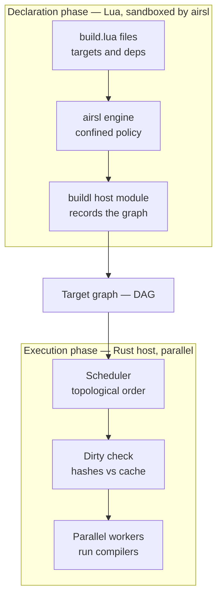

The line between the two subgraphs is airsl's boundary. Everything the declaration phase can do arrives through the `buildl` host module; everything dangerous happens in Rust, where the host controls parallelism, working directories, and output streaming — capabilities the Lua side deliberately does not have.

Consequences of the split:

- **Declaration is safe on untrusted input.** The declaration engine holds no grant at all. Its one filesystem read, source globbing, is done host-side by `b.sources()` (§5) and confined to the declaring directory.
- **Parallelism lives where it works.** One Lua state cannot execute in parallel; a Rust worker pool can. Evaluation is the cheap front phase and execution the expensive back phase; each runs on the worker pool, one Lua state per build file.
- **Resource ceilings become a feature.** A build file that loops forever is stopped by airsl's instruction ceiling in the declaration phase, before it can waste anyone's time.

## 3. Workspace layout and artifacts

buildl is delivered as a Cargo workspace of four crates: `crates/buildl-core` (domain data, ports, and the pure logic of every phase), `crates/buildl-lua` (the airsl adapter that evaluates build files), `crates/buildl` (the remaining adapters and the composition root), and `crates/buildl-cli` (the `buildl` binary). Their building blocks are in [`architecture-building-blocks.md`](./architecture-building-blocks.md). On disk in a user's project:

```text
myproject/
  buildl.toml          # workspace manifest: ceiling, limits, execution, plugins (§4)
  buildl.lock          # what each plugin fetched from a repository was fetched as; committed (§4)
  build.lua            # root build file (declaration only)
  src/...
  lib/
    build.lua          # per-directory build files
  .buildl/             # buildl state — gitignored
    lock               # held while a plan, a build or a test run uses the directory
    graph.json         # the graph the last build resolved, written by every build (sorted keys, diff-stable)
    cache.json         # action cache: per target, its action key and what its last build produced and printed
    cache.journal      # a row, or the forgetting of one, recorded since cache.json was written; gone once a build has returned
    statcache.json     # per input: its modification time, size and content digest (§8.3)
    cas/ab/cdef…       # content-addressed artifact store: two hex digits of the SHA-256, then the other 62
    cas/ab/cdef….x     # the same bytes as an executable file, kept for an output placed executable
    cas/tmp/           # staging for the store
    log.jsonl          # one JSON event per action
    plugins/go/<commit>/  # the files of a plugin fetched from a repository (§4)
  out/                 # named outputs, out/<directory>/<name>: read-only links into the cas, copies where linking is not used
```

All metadata files are written by buildl's own canonical JSON serializer — object keys sorted at every level, no whitespace — so they diff cleanly in review. `graph.json` and `cache.json` are byte-identical across two builds of the same workspace on one machine, wherever the workspace stands; `log.jsonl` holds clock readings and `statcache.json` modification times, so those two are not. The cache is read back by the same rule it is written by: a file that is not byte for byte what buildl writes for the rows it holds — a field missing or unknown, a key out of order, a key digest that does not match its components — is refused as corrupt rather than trusted. The refusal is an error that names the file and the remedy: remove it and build again, and every target is built anew. `log.jsonl` is read back more leniently, since losing a line costs a report and not a build: a whole line that is not byte for byte an event is skipped, `buildl log` warns which lines, and the rest stays readable; a last line without a newline is ignored. `statcache.json` is the exception: one that fails to read is discarded and written again, since it holds nothing a hash cannot give back. The `cas` + action-cache pairing deliberately matches the model of the Remote Execution API, where a content-addressed store is keyed by SHA-256 digests and an action cache maps action keys to results [6][7] — see §10.

An output lives at `out/<directory>/<name>`: the directory of its target's label, then the output's name, so `//lib:text` writes `out/lib/text` and `//:app` writes `out/app`. Two targets may not claim one path, and no target may claim a path another needs as a directory: either is an error before anything runs.

An output is whatever its action leaves at that path: one regular file, or a directory of regular files, however deep. Each file's bytes go into the cas by their own digest, and the output itself is described by one **output manifest** — the file's digest and whether it may be run, or, for a directory, every file's path, digest and mode, in path order — stored in the cas like any other content. The digest of that manifest is the output's one digest: the cache row, the log and every dependent's action key hold it, for a file and for a directory alike. So two outputs share a digest exactly when they are the same files with the same bytes and modes at the same paths, a built program is still executable when a cache hit puts it back, and a directory is put back whole or not at all: when one of its files cannot be put in place, the files already placed are removed and the target fails (§8.5). What a directory may not contain is in §8.7.

## 4. The workspace manifest: `buildl.toml`

Parsed by the Rust host before any Lua runs. It is the workspace owner's statement of maximum authority — the **ceiling** in airsl's extension-system vocabulary [1]:

```toml
[workspace]
name    = "myproject"
entry   = "build.lua"
out     = "out"
config  = 1                # buildl config version

[ceiling]                  # maximum authority any build may be granted
proc.run = ["cc", "ld", "go", "cargo", "bun", "docker", "protoc"]
env.read = ["HOME", "PATH", "GOCACHE", "CARGO_HOME"]
fs.read  = ["."]           # workspace-relative; expanded by the host, never by Lua
fs.write = ["out", ".buildl", "target"]

[declaration]              # ceilings for the Lua phase — it only declares
memory       = "16MB"
instructions = 10_000_000
walk_entries = 100_000     # directory entries b.sources() may visit per build file

[execution]
workers  = 0               # 0 = number of cores
timeout  = "10m"           # per action
strategy = "sandbox"       # bare | sandbox | os-sandbox | container (§11)

[approver]
default = "interactive"    # manifest | interactive | deny

[remote]                   # a cache to share action results through (§11.2)
url      = "grpcs://cache.example.com:443"
instance = "ci"
token    = { env = "BUILDL_REMOTE_TOKEN" }   # or { file = "path" }; the secret is never written here

[plugins.go]               # a plugin fetched from a repository (§10)
git      = "https://github.com/acme/buildl-go"   # or github = "acme/buildl-go"
rev      = "v1.2.0"        # a tag or a full commit
proc.run = ["go"]          # the workspace's cap for this plugin
env.read = ["HOME", "GOCACHE"]

[plugins.ourgo]            # a plugin kept in the workspace
path = "plugins/ourgo"     # workspace-relative
```

Two rules carried over from airsl's extension design deliberately: variables and relative roots are expanded **host-side** (a build file that could expand them could widen its own grant), and the ceiling can never be exceeded by anything a build file or plugin requests — requests are intersected with it, never unioned.

The manifest is read strictly. A key this version of buildl does not read is an error that names the key with its line and column, so a misspelt `fs.wirte` cannot silently drop a grant. Every table and every key is optional, and an empty file is a valid manifest: every default, and an empty ceiling, under which `check`, `graph` and `query` work and `plan` and `build` are refused, since an empty ceiling allows nothing. A directory with no `buildl.toml` in it or above it is not a workspace: that is an error, never a default ceiling (§7). `config` must be `1`. `out` may not be the workspace root, and may not be `.buildl`, contain it or lie inside it. The state directory is always `.buildl`; no key names it. A directory entry of the ceiling is workspace-relative, and `"."` is the workspace root. `memory` is a whole number directly followed by one unit — `B`, `KB`, `MB` or `GB`, each 1024 times the one before — and never zero.

`[execution]` says how the workspace wants its build files evaluated and its actions run. Each key has one grammar and one meaning when it is left out, and a value outside its grammar makes the manifest invalid:

|Key|Written as|When absent|
|---|---|---|
|`workers`|a whole number in digits; `0` is one worker per core|`0`|
|`timeout`|a whole number directly followed by one unit — `ms`, `s`, `m` or `h` — and never zero: `500ms`, `90s`, `10m`, `2h`|`"10m"`|
|`strategy`|exactly one of `bare`, `sandbox`, `os-sandbox`, `container`, in order of increasing isolation (§12.2)|`"sandbox"`|

`build` and `test` run `bare` and `sandbox`, and `sandbox` is the default: a manifest that writes no `strategy` line runs its actions in the input sandbox (§12.2). `verify` also runs actions, and runs them under `sandbox` only: a manifest whose strategy is `bare` is refused before anything is loaded, because at tier 1 a re-run would write into `out/`; the error names the line to write, `strategy = "sandbox"`. `build`, `test` and `verify` refuse a manifest whose strategy is `os-sandbox` or `container`, rather than run its actions under a weaker tier than the one asked for; the error names the line to write, `strategy = "sandbox"`. `check`, `graph`, `query`, `plan`, `log`, `clean` and `gc` run no action, and work under any strategy. A workspace whose tools read files they do not declare fails under `sandbox`; where that is the tools' doing and not a missing declaration, the manifest writes `strategy = "bare"` to run as before.

None of the three is an action-key component (§8.3): they decide how an action is run, never which action it is.

`proc.run` lists the programs of the host a build may run. A program a dependency built needs no entry: a command whose program, once expanded, is one of its target's dependency outputs or lies below one runs it because the graph declares that dependency (§6, §12.2). `[approver]` names who settles whether a build may run once its wants are inside the ceiling (§6). Its one key is `default`, exactly one of `manifest`, `interactive` and `deny`; a table or a key left out means `manifest`, and any other key or value makes the manifest invalid.

`[plugins.<name>]` names one plugin: where its files come from, and the most the workspace lets its targets want. `<name>` is what a build file calls `buildl.use` with (§5), and follows the grammar of a target name, at most 246 bytes. Like the ceiling's, a plugin's list is empty when left out, and the table is read as strictly as the rest of the manifest: any other key is an error naming its line and column.

|Key|Written as|When absent|
|---|---|---|
|`path`|a workspace-relative directory holding the plugin, like a ceiling directory; it may not be, hold or lie inside the configured output or state directory (`out` and `.buildl` by default)|—|
|`git`|the URL of a git repository, anything the engineer's own `git` can reach; empty, starting with `-`, whitespace, a control character and a transport helper (`ext::…`) are refused|—|
|`github`|`owner/repo`, which is `git = "https://github.com/owner/repo"`|—|
|`rev`|a tag, or a full 40-digit lowercase commit; required with `git` and `github`, refused with `path`|—|
|`proc.run`, `env.read`|lists: the programs and the environment variables the plugin's targets may want|empty: nothing|
|`network`|`true` lets the plugin's targets declare `network = true`|`false`|

Exactly one of `path`, `git` and `github` is written. A branch is no `rev`: it is read as a tag, and git finds no such tag when the plugin is fetched. The cap narrows and never widens: what a plugin's target wants is held to its plugins first and to the ceiling after (§10), so a cap that lists more than the ceiling grants adds nothing.

**`buildl.lock`** sits beside `buildl.toml` and is committed. It is canonical JSON, one entry per plugin fetched from a repository, by name: `commit`, the full commit `rev` resolved to; `git`, the URL; `rev`, as `buildl.toml` wrote it; and `sha256`, the digest of the plugin's files, each by path with its bytes and whether it may be run, the way an output directory is digested (§3). A path plugin has no entry. Only `buildl plugins fetch` writes it (§7). The files themselves are kept in `.buildl/plugins/<name>/<commit>/`, outside git with the rest of `.buildl/`, so each engineer fetches into their own checkout.

Every command that loads build files checks every plugin `buildl.toml` names, once, before the first build file is evaluated, against the lock and the store, and never reaches the network. A workspace that names a plugin must have it fetched even when no build file uses it:

|State|Result|Exit|
|---|---|---|
|a path plugin's directory is missing|refused: the plugin is not fetched|5|
|a git plugin has no lock entry, or the entry's `git` or `rev` differs from `buildl.toml`|refused: the plugin is not fetched, and the message names `buildl plugins fetch`|5|
|the entry is there and its directory in the store is not|the same refusal|5|
|the stored files digest to something other than `sha256`, or hold a link, a special file or no file|refused: the plugin was changed after it was fetched|6|
|the digest matches|the plugin's directory is handed to the build files' `buildl.use`||

`[remote]` names the one remote cache the workspace shares action results with (§11.2). The table is optional, and a workspace without it never uses a remote cache: no flag and no variable (§7) turns one on. Its keys are read as strictly as every other table's, and each value is checked once, where it is read:

|Key|Written as|When absent|
|---|---|---|
|`url`|`grpc://host` or `grpcs://host`, with an optional `:port` and nothing after it; a host name or an IPv4 address. `grpcs` is TLS, trusting the system's root certificates|— (required with the table)|
|`instance`|the Remote Execution API's instance name, such as `ci` or `team/ci`: no leading, trailing or doubled `/`, and no segment the API's resource names use (`blobs`, `uploads`, `actions`, `actionResults`, `operations`, `capabilities`, `compressed-blobs`)|empty: the server's own default|
|`ca`|a PEM file of certificate authorities to trust besides the system's, workspace-relative or absolute; a relative path holds no `..`|none|
|`token`|`{ env = "NAME" }` or `{ file = "path" }`, exactly one of the two: the environment variable or the file the secret is read from, a file workspace-relative or absolute|none: no login is sent|
|`header`|the request header the token travels in. `authorization` carries `Bearer <token>`, any other name the bare token; `te`, `content-type` and `user-agent`, which the transport sets itself, are refused|`"authorization"`|
|`timeout`|the grammar of `[execution] timeout`: a whole number directly followed by `ms`, `s`, `m` or `h`, never zero|`"30s"`|

The secret is never in `buildl.toml`, which is committed: it is named, and read from the environment or a file when a build needs it. A `token` with a `grpc://` url is refused, since the secret would cross the network unencrypted. A `[remote]` table without a `url`, an unknown key, a scheme other than `grpc` and `grpcs`, a `token` with both or neither of `env` and `file`, and a `timeout` outside its grammar are each an error naming the key with its line and column. No `[remote]` key is an action-key component (§8.3): where a result is shared through never changes what an action produces. Whether a run reads from the cache, writes to it, or fails when it cannot be reached is the machine's and the run's to say, not the manifest's (§7).

## 5. The Lua declaration API

Delivered as the **`buildl` module table**: one airsl `HostModule` whose table holds every helper a build file calls. The engine keeps airsl's default root table, so the curated host modules (§12.1) stay reachable as `airsstack.json`, `airsstack.path`, `airsstack.glob` and the rest, and the `buildl` module is installed beside them as `airsstack.buildl`. During installation the module also binds that same table to the global `buildl` — one table, two names — so build files write `buildl.target(...)` rather than `airsstack.buildl.target(...)`. The binding holds because airsl installs modules after it withholds unsafe globals and never locks the global table afterwards [1]. airsl's root-table validation does not cover a global a module binds, so keeping the name `buildl` clear of Lua's reserved words and standard globals is buildl's responsibility.

Every `build.lua` is evaluated with the `buildl` table already loaded. It begins as the declaration primitives below and is the framework surface everything later builds on: plugins (§10) arrive through `buildl.use`, and whatever a plugin generates is still these primitives.

```lua
-- build.lua (workspace root)
local b = buildl

b.subdir("lib")                          -- host evaluates lib/build.lua in its own scope

b.rule("cc", {
  run  = { "cc", "-c", "$in", "-o", "$out" },
  desc = "compile $in",
})

for _, src in ipairs(b.sources("src/**/*.c")) do
  b.target(airsstack.path.stem(src) .. ".o", { rule = "cc", inputs = { src } })
end

b.target("app", {
  deps = { "main.o", "util.o", "//lib:text" },   -- label syntax for cross-directory refs
  run  = { "cc", "$deps", "-o", "$out" },
})

b.alias("default", "app")
b.test("app_test", { deps = { "app" }, run = { "$deps", "--self-test" } })
```

The design decisions in those lines:

- **Labels, not `require`.** Cross-directory references are graph names (`//lib:text`), resolved in Rust. airsl's confined `require` stops at the script's directory, and that is correct here: build files should not load each other's code, they should reference each other's _targets_. `b.subdir("dir")` asks the host to evaluate `dir/build.lua` in its own scope, so every declaration is namespaced by — and attributable to — the directory that made it.
- **Placeholders expand host-side.** `$in`, `$out` and `$deps` are substituted by the executor, the ninja model [4]. Each is a list of paths: the target's inputs, its own outputs, and every output of its dependencies. An argument that is exactly one placeholder becomes one argument per path, and none when the list is empty; inside other text the paths are joined by one space. So `{ "$deps", "--self-test" }` above runs `out/app --self-test`. A placeholder is `$` and the longest run of letters after it: `$input` is plain text, and `$out/app` is the outputs followed by `/app`. Every command is expanded before any action runs. When a command starts, the directory that will contain each declared output exists and nothing exists at the output path itself: a command creates what it produces there, a file or a directory (§3). Lua never holds a real artifact path.
- **A rule's `desc` is the line shown for an action.** It is expanded host-side with the command, from the same paths and the same setting values: `$opt:name` becomes the setting's value, and `$in`, `$out` and `$deps` become their paths, always joined by one space, since a line has no arguments to split a list across. A control character a substituted value brings in, such as a newline in a `--set` value, is shown as a space, so the text stays one line. A `$opt:` in a `desc` must name a declared setting, exactly as in a command (§8.2). A target with an inline `run`, or whose rule has no `desc`, has no description, and none is made up for it. The description is display text only: it is no part of the action key, so editing a `desc` rebuilds nothing, and it is not written to `log.jsonl`.
- **`b.sources()` is the declaration phase's only filesystem read**, done host-side rather than through an engine grant. It returns the regular files under the declaring directory that match the pattern, relative to that directory and sorted by the host, so declaration is deterministic regardless of filesystem order. Symlinks are never followed, and a declaring directory that resolves outside the workspace is refused. The walk never enters the workspace's output directory or its state directory (`out` and `.buildl`, §3), so a pattern at the workspace root does not list what the build itself wrote. Each is matched by its whole path from the workspace root — `out` is skipped, `lib/out` is not — and a build file declared inside either gets an empty list. Every list field accepts one level of nesting, spliced in order, so `inputs = { b.sources("src/*.c"), "go.mod" }` is one flat list.
- **`b.target` accepts a small closed table**: `rule` or inline `run`, `inputs`, `deps`, `outputs` (default: the target name), `env` (names checked against the ceiling), `network = true` (visible in `plan`, §11), and `always = true` for phony targets. Every field but `always` is an action-key component; the surface grows reluctantly. A `b.test` target takes the same table, and its `outputs` default to none: what it records is its exit status and what it printed, so a test that leaves nothing behind still passes and is cached. Naming `outputs` holds it to them, as it holds any target.
- **A declared input is a regular file inside the workspace.** A symbolic link, a directory or a special file at an input's path is refused at plan as a mistake of the build file, like an input that does not exist: the error names the target that declares the input and what stands at the path.
- **`b.option(name, { default })` declares a build setting** — an invocation-time parameter with an explicit default, referenced in argv as `$opt:name` and overridden with `--set name=value`. The settings a command names fold into its action key, so differently-parameterised runs cache separately and correctly (§10.2). A setting may also name the tool: a first argument that is a complete program name once its `$opt:` references are replaced is a host tool like one written out — held to `proc.run` at plan, looked up, and fingerprinted into the key (§9.6).
- **`b.use(name)` loads a plugin and returns its module table** (§10). The name is one the workspace's `[plugins]` table lists (§4), and it is the only argument: what a plugin lets a build file choose is the arguments of the functions it returns. An unknown name, or a plugin already among those using it, is an error of the build file that names it. Every declaration the plugin's functions make is the plugin's, and carries its name.
- **`b.discover(name, { … })` declares a discovery target and `b.discovered(label)` reads what it last produced** (§10). `b.discover` takes `b.target`'s table without `outputs` and `always`: its one output is `<name>.json`, placed by buildl, and the target runs when its key changes like any other. `b.discovered` takes a label, a relative one resolved against the declaring directory as `deps` are, and returns the output's bytes as a string, or `nil` when there is none yet; decoding it is the build file's, with `airsstack.json.decode`. A workspace that declares a discovery target has its build files evaluated twice, the first time with `nil` for every label and the second with the results (§7).
- **`b.alias(name, target)` gives a target a second name.** An alias names a target, never another alias or a rule. A dependency may name an alias, and resolves to the target behind it.
- **A list keeps the order it was written in.** `deps`, `inputs`, `outputs` and `env` reach the graph in written order with repeats dropped, so `$deps` and `$in` expand in that order. Reordering `deps`, `inputs` or `outputs` changes the action key. Reordering `env` does not: an environment is a set of variables, and the key holds each one by name.

## 6. Grant negotiation: the DAG is the request

buildl needs no per-file capability manifest, because the build's authority is **derived, not requested**. After Resolve, Plan places every output and expands every command under the settings in force, and computes what the build wants — the program of every command, whether written out, named through a build setting (§5) or named through `$in`, `$out` or `$deps`, every env name, every declared input, every output root — and checks each against its list in the ceiling: `proc.run`, `env.read`, `fs.read`, `fs.write`. A program a dependency built is not a want: a command whose program, once expanded, is one of its target's dependency outputs or lies below one runs it with no `proc.run` entry, because declaring the dependency is the permission. The _wanted set_ a plan reports lists the programs, the env names, the output roots and the targets declaring `network = true`; the inputs stay in the graph, where each target declares them. That set flows through the model airsl's extension system defines [1] — intersect, never union; the approver only narrows; fail closed — with buildl's own `Approver` port:

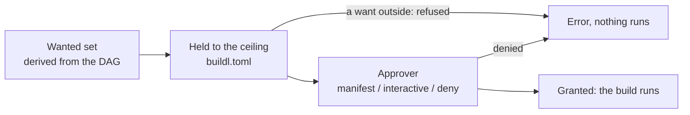

An extension's manifest is a promise; buildl's wanted set is derived truth. Failure is closed: a want outside the ceiling refuses the plan, before anything runs, naming the want, the target that wants it and the ceiling, and never silently degrades the build. A wanted set inside the ceiling is the whole grant, so there is no narrower set to hand on: the approver answers yes or no. `build`, `test` and `verify` ask it after planning and before anything runs; `plan` asks nothing, and `doctor` (§7) shows the result. The workspace's `[approver]` table (§4) chooses it:

|`default`|Answer|
|---|---|
|`manifest` (when absent)|yes: the ceiling is the whole decision|
|`interactive`|asks once on the terminal, remembers a yes, and asks again only about wants no yes covered|
|`deny`|no, even when every target is cached: the refusal is the workspace's, not the plan's|

Under `interactive`, a build whose wants a remembered yes covers asks nothing. Otherwise it prints the new wants on stderr, in the wanted set's own order, and reads one line from stdin; `y` or `yes`, in any case, is a yes:

```text
this build wants to
  run programs:      go, protoc
  read variables:    HOME, PATH
  write into:        .buildl, out
  reach the network: //:fetch
allow? [y/N]
```

A line that would list nothing is left out. When plugins' targets are behind the new wants, one line for each plugin chain follows the list, as `  go: declared by plugin go@1.2.0 for //services/api:server` (§10). When stdin or stderr is not a terminal there is no one to ask, and the build is refused, never approved: the error says to run the build in a terminal once, or to write `default = "manifest"`. A yes is remembered in `<data>/buildl/approved/<workspace id>.json`, where `<data>` is `$XDG_DATA_HOME`, or `$HOME/.local/share` when that is not an absolute path, and `<workspace id>` names the workspace root as its sandbox directory does (§12.2). The file lies outside the workspace on purpose: a repository can ship its own `.buildl/`, and an approval kept there would come with the code. A refusal exits 4 (§8.7), as a want outside the ceiling does; a remembered file that is not what buildl writes exits 6, and one that cannot be read or written exits 3. Every failure is a refusal, and nothing runs.

## 7. The build workflow

Five phases with clean boundaries. Each CLI command is the pipeline truncated at a different point.

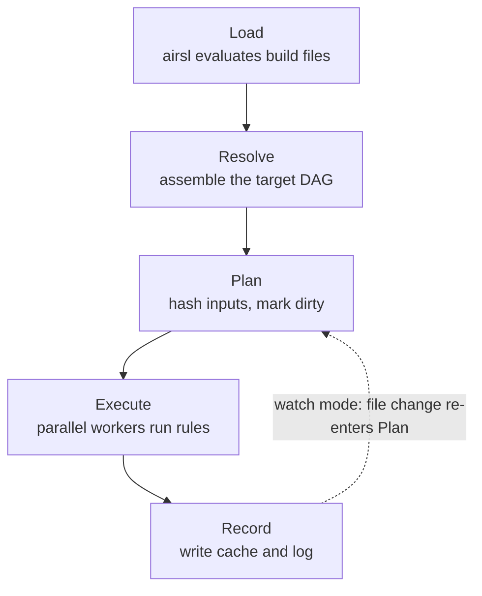

|Command|Stops after|Purpose|
|---|---|---|
|`buildl check`|Load|syntax-check every build file, run nothing|
|`buildl graph`|Resolve|emit the DAG (`--json`, the default, or `--dot`)|
|`buildl plan [target]...`|Plan|dry run: what would rebuild, and why|
|`buildl build [target]...`|Record|the full pipeline|
|`buildl watch [target]`|loops|persistent process, re-plans on file change|
|`buildl test [target]...`|Record|run test targets and what they need|
|`buildl verify [target]... [--sample N]`|Plan, then re-run without Record|restore the cached outputs, re-run those cached actions in the input sandbox (all, or the `N` whose key digests are lowest), and compare each output with the one its cache row records; no row, no log|
|`buildl clean` / `gc`|— for `clean`, Resolve for `gc`|`clean` removes `out/`, and the next build puts the outputs back from the cas; `gc` drops the cache rows of undeclared targets and removes the blobs no kept row and no newest logged run names|
|`buildl log <target> [--stdout \| --stderr]`|log + cas|show what a target printed when it last ran (§8.7)|
|`buildl query <expr>`|Resolve|graph queries: `deps()`, `rdeps()` (§10.2, §10.3, §11.1)|
|`buildl doctor`|Resolve|print the workspace root, the approver, the execution settings, the remote cache, the ceiling, and each want with whether the ceiling allows it and whether it is approved|
|`buildl plugins fetch`|— (loads no build file)|pin each plugin that comes from a repository in `buildl.lock` and store its files; the only command that reaches the network|

`check`, `graph`, `query`, `plan`, `build`, `test`, `log`, `verify`, `clean`, `gc`, `doctor` and `plugins fetch` are built; each other command arrives with the item of §13 that names it. A command may run what a dependency built, with no `proc.run` entry for it (§6). `doctor` evaluates the build files once (twice when the workspace declares a discovery target, below) and takes no lock, writes nothing, plans nothing, hashes nothing, asks nothing and connects to nothing; its wants are those of every target, tests included, at each setting's default, and it reports a want outside the ceiling or not approved and still exits 0. `plan` and `build` take any number of targets and, with none, every target but the tests (and the tests a target depends on); `plan` takes exactly what `build` takes, because it is that build's dry run. Both accept `--set name=value`, repeated, to give a build setting a value for the run (§10.2); `build` adds `--keep-going` (§8.4) and `--stream` (§8.7). `build` and `test` also take `--remote-upload`, `--remote-strict` and `--no-remote`, which say what the run does with the remote cache (below). `test` takes any number of targets and, with none, every test; it accepts `--set` like the others and adds `--stop` (§8.4), `--stream`, `--rerun` (§9.1) and `--verbose` (§8.7). It builds what the tests it runs depend on, as `build` would. Naming a target that is not a test is a usage error (exit code 2, §8.7). A command finds its workspace at the nearest `buildl.toml` at or above the current directory and prints paths relative to it. A target is written `//dir:name`, or `:name` and `name`, which are read against the current directory. `query` takes one expression, `deps(<target>)` or `rdeps(<target>)`, and prints the targets the named one depends on, or that depend on it, any number of steps away and without the target itself: one label a line in label order, or with `--json` as canonical JSON. Like `check` and `graph` it takes no lock and writes nothing. `log` takes exactly one target and at most one of `--stdout` and `--stderr`. It reads the log and the cas and nothing else: it takes no lock and loads no build file, so it answers while a build runs and whatever the build files now say, and it writes nothing but the cas's own removal of a blob whose bytes fail their digest. It looks the target up as the log names it, so it does not follow an alias. A target with no run that stored output is a usage error, which can offer the nearest label that has one; an output blob gone from the cas is an infrastructure failure. `verify` takes what `build` takes, the targets and `--set`, and with no target every target but the tests (and the tests a target depends on); it adds `--sample N`, a whole number of at least one. It plans as `build` does and checks only the targets the plan finds clean: it puts their outputs back under `out/` as a cache hit would, re-runs their actions in the input sandbox, and compares each output with the one the cache row records. Every other target in scope is counted as not cached, and so is a clean target whose stored content is gone or whose manifest does not hash to its digest. With no `--sample` every clean target is re-run; with `--sample N` the `N` whose key digests are lowest are, so the same keys check the same targets on every run and machine, and the rest are counted as not sampled. A target with a dependency that is not cached is skipped, because its re-run could not find that dependency's outputs. `verify` takes the state lock, since it writes to `out/`, and records nothing: no cache row is written or forgotten, no log line is appended, and a re-run's bytes never reach `out/`. What only a re-run stored in the cas is named by no row and no log, and the next `gc` removes it. It prints on stderr, in label order, one line for each target that was checked, skipped or could not be put back, and for a re-run that failed a block (a header, a FAILED line, the diagnostic and what the action printed), then a summary line, and nothing on stdout; a mismatch line names the target, the output and the first difference (§12.3).

`plugins fetch` loads no build file and asks no approver, and takes the state lock while it writes. For each plugin that comes from a repository, in name order, it does nothing, and runs no `git`, when the lock holds an entry for the `git` and `rev` `buildl.toml` names and the stored files digest to that entry's `sha256`. Otherwise it runs the engineer's own `git`, with its credentials and configuration and with its repository-locating variables cleared: it fetches the one commit the tag or the commit names, at depth 1, into a staging directory under `.buildl/plugins/`, drops `.git`, digests the files, and moves them to `.buildl/plugins/<name>/<commit>/`. When the lock already holds an entry for that `git` and `rev` and the fetch brings another commit or other files, the tag has moved or the content changed, and the fetch is refused (exit 6) rather than re-pin silently; changing `rev` in `buildl.toml` is how a plugin is moved on. The lock is written once at the end, and only when an entry changed, and what no entry names is removed from the store. On stderr it prints, for each plugin in name order, `fetched <name> <commit>` or `unchanged <name> <commit>`. A `git` that is not on `PATH`, cannot be started, or refuses the repository or the revision is an infrastructure failure (exit 3) naming the plugin and what `git` printed; a fetched tree that holds a symbolic link, a special file, a name that is not Unicode, or no file at all is refused (exit 5), as an output that holds one is (§8.7). A `rev` that is a commit needs the server to serve a bare commit; a tag never does, and a host that will not serve a commit says so in `git`'s own words.

**Remote cache.** `build` and `test` share action results through the cache `[remote]` names (§4, §11.2), and no other command connects to it. A workspace with a `[remote]` table reads from the cache by default. Writing to it, and failing when it cannot be reached, are switched on per machine or per run:

|Switch|Per machine|Per run|
|---|---|---|
|upload: the results of the targets that ran are also stored in the cache|`BUILDL_REMOTE_UPLOAD=1`|`--remote-upload`|
|strict: a failed call to the cache fails the build|`BUILDL_REMOTE_STRICT=1`|`--remote-strict`|
|remote off|—|`--no-remote`, which overrides both|

Each variable is `1` or `0`, and anything else is a usage error (exit code 2) naming the variable. A flag turns its switch on whatever its variable says. `--no-remote` together with either other flag, and either other flag in a workspace with no `[remote]` table, are usage errors too. Uploading is refused under `strategy = "bare"` (exit code 2), before the approver is asked: an action outside the sandbox can read inputs it did not declare, so its result must not reach other machines (§11.2). Reading works under every strategy. A `token` that `buildl.toml` names and the environment or the file does not supply is a usage error before anything runs, unless `--no-remote` is given. The token appears in no output, no event log and no error.

A target that must run is first looked up in the cache, under a description of its action (§11.2). A usable result is downloaded, every blob is checked against its digest, and what it holds is stored as a local run would have stored it. The target then ends `fetched`: its outputs are placed from the cas, its cache row is written after them (§8.5), and its log event has the class `fetched`, with its key and the span of the lookup and the download. What the original run printed is replayed, the target's block is marked `(fetched)`, and it is not reported as started. The summary counts `fetched` after `cached` (`1 built, 3 cached, 2 fetched`); a test run counts a fetched test as passed and shows its share beside the cached ones (`tests: 4 passed (1 cached, 2 fetched), 1 failed`). A target the local cache serves is never looked up, and a miss runs the action as it would run without a cache.

A cache that fails does not fail a build by default. A call that errors or times out, a result that is not usable, and a blob that does not match its digest each give one warning that names the call and what went wrong, run the target locally, and turn the cache off for the rest of the command. With `--remote-strict` the build fails instead, naming the call, as an infrastructure failure (exit code 3). A failed upload is the same either way, and leaves the target's local result standing. A target whose input file changed on disk after its key was taken is not uploaded, with a warning that names the target and the file, and the cache stays on, since the server did nothing wrong.

`doctor` prints a `remote` section after the execution settings: `url`, `instance`, `ca`, `header` and `timeout` as `buildl.toml` holds them, `token` as `set`, `not set`, or `-` when the table names none, and `upload` and `strict` as this machine's variables set them, with a note that the flags turn either on for one run. A workspace with no table prints `remote: none`. The section never holds the secret.

**Discovery.** A workspace that declares no discovery target (§10) loads its build files once, and every command is as above. One that does has them evaluated twice: the first time with no discovery results, to find the discovery targets, and the second with the last result of each, so the targets declared from a result exist. Only `build` and `test` run discovery targets; every other command declares from the last result this checkout recorded, so that commands which run nothing never run anything.

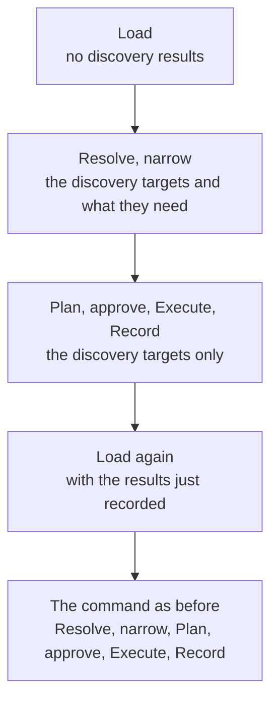

|Command|What it does with discovery targets|
|---|---|
|`build`, `test`|the flow above. Two approvals: `interactive` asks the second time only about wants the first yes did not cover. A discovery target that does not succeed ends the command with that failure, and nothing is declared from it. A result that cannot be read back right after its target succeeded is an infrastructure failure (exit 3) naming the target. Their default scope leaves discovery targets out; `buildl build //svc:pkgs` builds one. `buildl test //svc:pkgs` is a usage error, after discovery has run, since a label may exist only once the second load has declared it|
|`plan`, `verify`, `gc`|load, read the last results, load again, then as before; nothing is run to get them. `plan` also lists each discovery target that is not up to date, as `//svc:pkgs is not up to date; targets declared from it may change`, since what it declares may differ once it has run. `gc` therefore keeps the rows of targets declared from a result|
|`check`, `graph`, `query`, `doctor`|the same, without the state lock and without writing anything, but for the cas's own removal of a blob whose bytes fail their digest when a result is read. `check` evaluates the build files once without results and twice with them, and compares those two as it compares any two evaluations. A discovery target with no result prints `//svc:pkgs has not run; run buildl build` on stderr, never stdout|

A result is the one output of the newest logged run of that discovery target that succeeded, built or cached, read from the cas; the log and the cas are what `log` reads (§8.7). One that cannot be read counts as none, so a damaged log never stops `check`. The second evaluation must declare the discovery targets the first did, field for field: one added, removed or changed is refused, naming the target and its build file (exit 5), since discovery may not depend on discovery. The graph is then a function of the sources, the plugins, the settings and the results; a fresh clone has no results until its first `build`, and the commands that run nothing show the graph without the targets discovery adds, and say so.

Three workflow rules adopted deliberately:

1. **`plan` explains itself.** Dirtiness is hash-based, so "why did this rebuild" has a mechanical answer; it is surfaced from day one.
2. **Load and Resolve always run.** The graph is never cached across edits — only artifacts are. A build file reaches a key through what it declares, not through its own hash: every field of a target that changes what its action produces is a key component (§8.3), so an edit that changes a target rebuilds it and an edit that changes nothing rebuilds nothing.
3. **The log is an artifact.** `log.jsonl` records one sorted-key JSON object per action: target, command, hashes, duration, cache hit or miss. It grows across builds, and the newest line for a label is that target's current one.

## 8. Internal workflows

### 8.1 Load

A directory queue drives evaluation. Each build file gets a **fresh, disposable engine** (~136 µs [1]) so one file's stray globals cannot leak into the next — the same isolation decision airsl's own test runner made. The only surviving output is the staging list.

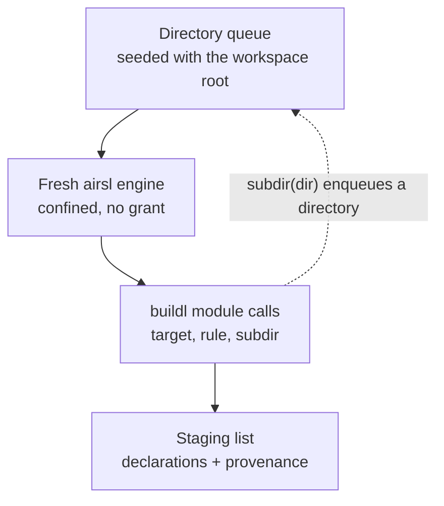

Every staged declaration carries provenance (the file that made it), which later phases use for attributable errors. Load evaluates build files through the same dispatcher as actions, up to `[execution] workers` at once, each file with its own engine — `Engine` is `Send + Sync`.

### 8.2 Resolve

Pure in-memory Rust: intern names namespaced by directory, resolve labels, then three validations that each fail with provenance — duplicates (both declaration sites named), unknown references (with a did-you-mean from the interned set; a `$opt:` in a command or in a rule's `desc` that names no declared setting is one of them), and cycles (the whole cycle path reported, not just its existence). Output: the DAG, including the reverse edges. A node's dependency count is the length of its edge list; the counters that change during a build belong to the scheduler (§8.4).

### 8.3 Plan: the action key

The core incremental mechanism, deliberately aligned with the Remote Execution API's action model [6][7]:

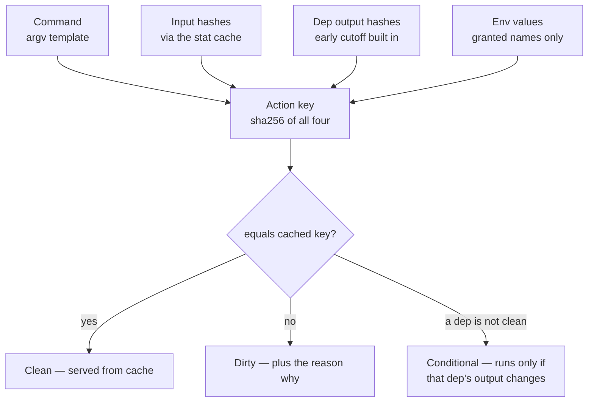

A key folds what each dependency _produced_ — the name of each of its outputs with the digest of that output's manifest (§3), which covers a file's bytes, its executable bit and every file of a directory — not the dependency's own key, so a dependency rebuilt to the same bytes leaves everything downstream clean (early cutoff, §8.5). A dirty dependency's new output does not exist at plan time, so a target whose only open question is that output is neither clean nor dirty but _conditional_: it runs only if the dependency produces something other than what the last build recorded. Two internals matter at scale: a **stat cache** (mtime + size unchanged since the last run means the recorded content hash is reused — the trick behind ninja-class no-op builds [4]), and parallel hashing, since files are independent. The mismatching component of the key is retained per dirty target — that is the entire implementation of `plan`'s explanations. The wanted-set ∩ ceiling check (§6) also runs here, so refusals precede execution.

Plan first fixes the value every build setting has for the run — its default, or its `--set` override — and the plan carries those values, so Execute expands commands and descriptions from exactly what was planned. The tool a target runs is read from its command's first argument under those values (§9.6), which is why a tool named through a setting is checked, looked up and keyed here like one written out.

What a key leaves out is as deliberate as what it holds. The `[execution]` settings (§4) are not components: `workers` is scheduling, which no artifact may observe; `timeout` bounds whether an action finishes, not what it produces, and an action that timed out is a failure, never cached (§8.7); `strategy` decides what an action can reach beyond its declared inputs, not what those inputs are, so one action has one key at every tier and a `sandbox` laptop shares cache entries with an `os-sandbox` CI runner. What does change an output at tier 4 is the image, and its digest joins the key per action (§11.2). A rule's `desc` is not a component either (§5).

### 8.4 Execute: the scheduler loop

A ready queue, a worker pool, and per-target dependency counters:

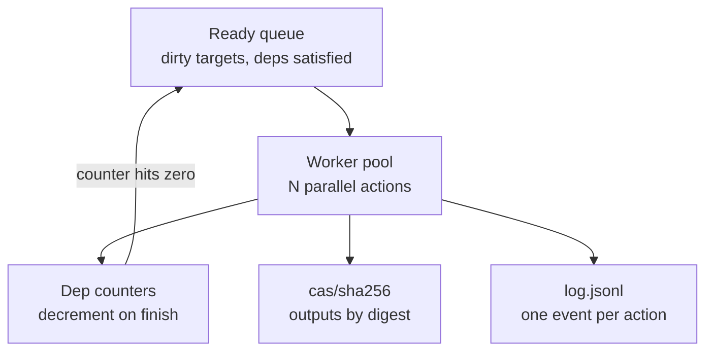

On failure, either stop scheduling new work (default) or continue with everything not downstream of the failure (`--keep-going`, for CI). That is `build`'s default; `test` keeps going by default, since one failing test says nothing about the next, and stops with `--stop`. A build ends with one outcome per target or with an error, never with a target missing: a worker pool that returns having lost an action or its result fails the build, naming every target left without an outcome. What finished before that is already in the cas, the cache and the log, and stays. Each worker's output is captured and printed as a block on completion, never interleaved. Scheduling order cannot leak into results: an action's inputs are declared and materialised before it starts, so its position in the schedule is unobservable to it.

### 8.5 One action's lifecycle — the crash-safety invariant

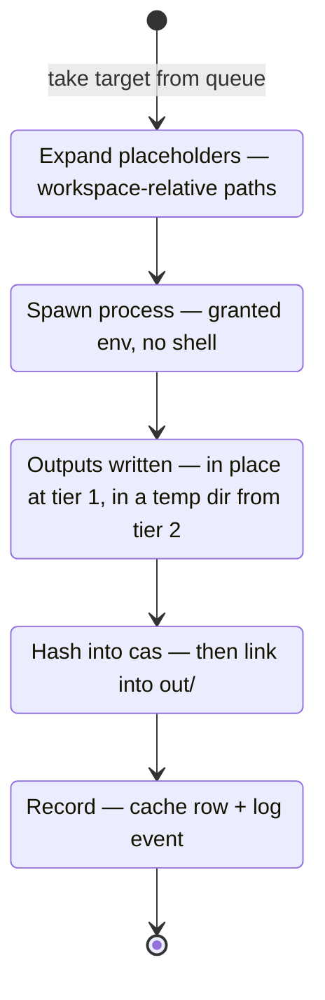

The ordering is the consistency story: **a cache row is written only after its outputs exist in the cas.** An interrupted build means some finished work is remembered and unfinished work is not; the next run re-plans and continues. For a build that is interrupted — stopped, killed, or ended with its terminal — no "corrupt cache, run clean" state is representable: every state file and every blob is renamed into place whole, and a row follows its content. The same holds for removing a row: a failure under the key a row was recorded under forgets that row, and the forgetting is durable before the target's log line, as a recorded row is. Nothing is synced to disk, so that does not cover the machine itself dying mid-build; the remedy then is to remove `.buildl/` and `out/` and build again. `gc` keeps the same order: it forgets rows before it removes any blob, so a `gc` that is interrupted leaves extra blobs, never a row naming a missing one. A result fetched from a remote cache (§11.2) keeps the same order: its blobs are checked and stored in the cas, and only then is the row written. The hash-into-cas step also yields early cutoff: a byte-identical rebuilt output leaves downstream action keys unchanged, so dependents stay clean.

Where an action writes depends on the tier. At tier 1 it runs in the workspace root and writes its outputs in place under `out/`; what it left there is then hashed into the cas and placed again from the cas, so a finished output is always a link into the store or a copy of it. An action that fails or is interrupted can leave a partial output at its path: no cache row names it, nothing reads it as a result, and the next build clears the path before it runs the action again (§12.2). From tier 2 an action runs and writes in an exec dir of its own, outside the workspace (§12.2), and `out/` is filled only from the cas, after an output is stored. A failed or timed-out action leaves nothing at its output paths under `out/`: the build clears them before it runs the action, and the action does not write there through its relative paths.

Hashing into the cas means every regular file the action left at an output path, then one manifest per output (§3). Linking into `out/` starts by removing whatever is at the output's path, so nothing an earlier build left there outlives it — a file where a directory now belongs, or a file a rebuilt directory no longer holds — and then places the file, or each file of the directory, with its mode. When a file cannot be placed, the output's path is cleared again before the target fails, so `out/` holds an output whole or not at all, and the failure reported is the placement's. Should that second clearing fail as well, it is not reported in the placement's stead: what was placed stays at the path until the next build, which removes it before placing anything there.

Placeholders expand to workspace-relative paths — `lib/a.c`, `out/lib/text` — the same in every isolation tier (§12.2), so a command is one text whichever tier runs it. Each tier makes those paths true in the directory it runs the action in.

### 8.6 Watch mode

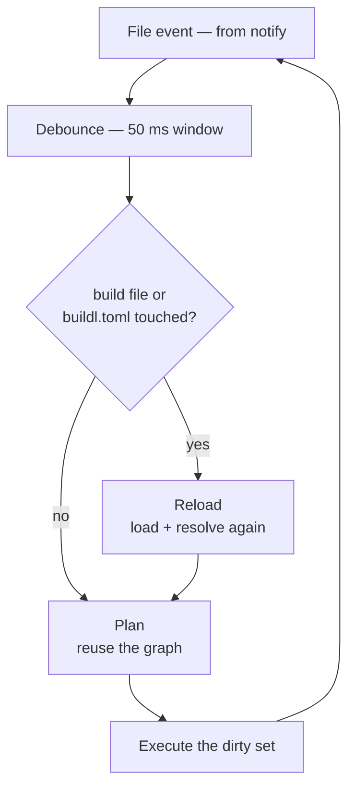

Events invalidate stat-cache entries for the touched paths. A changed build definition re-enters at Load (cheap — §8.1); a changed source file skips straight to Plan. Plain watch mode needs neither airsl's persistent-engine dispatch nor the extension `ext.on` machinery — full reload is fast enough to ship watch long before those exist.

### 8.7 Output capture and failure semantics

**Output.** Each worker captures stdout and stderr separately via pipes — the same shape airsl's `proc.run` returns (`stdout`, `stderr`, `status`) [1]. Output is printed as one block per action on completion, under a header naming the target — never interleaved across workers. It is also persisted: output blobs go into the cas by digest, referenced from the action's `log.jsonl` event. That keeps large outputs out of the JSON and lets a cache hit replay the warnings from when the action actually ran — otherwise warnings vanish on every incremental build. It is also what `buildl log <target>` reads back: it shows the newest run with stored output — built, cached (the bytes of the real run) or failed — under one header line on stderr that names the target, how that run ended and when; lines for the target newer than it that stored no output (a skipped target, for one) are counted on the same line, the newest named. A log with damaged lines adds a warning on stderr. With no flag the stored stdout goes to stdout and the stored stderr to stderr; `--stdout` or `--stderr` prints only that one stream, on stdout. Everything a build prints about how it went — blocks, the status line, the summary — goes to stderr; stdout carries only what a command was asked for, the graph of `graph`, the plan of `plan` and the stored bytes `log` was asked for, so a pipe never mixes the two. A TTY gets a live status line with blocks as actions finish; CI gets plain sequential blocks. Under `--stream` one running action at a time is shown as it prints, under its header, and every other action prints as a block once that one has ended: output is still never interleaved, and what is stored is what a quiet build stores. A build ends with one summary line, and an interrupted build prints none.

`buildl test` prints on stderr as a build does and nothing on stdout. A test that failed gets a block, and every target a test depends on is shown exactly as `build` shows it; a skipped test, like a skipped target, prints nothing of its own and is counted. A test that passed gets no block, unless `--verbose` asks for one for every test that printed, a cached one marked as such, or `--stream` shows it live as it runs. The run ends with a line that counts tests, not targets: `tests: 3 passed (2 cached), 1 failed, 1 skipped`, leaving out each count that is zero; `no tests` when the run took none; and `tests (rerun): …` under `--rerun`.

**Failure classification.** The airsl principle — a resource breach is not a script failure — applied to builds. Three classes, distinguished structurally (exit status, timeout flag, refusal origin — never message text):

|Class|Meaning|Examples|
|---|---|---|
|Action failure|the build did its job by revealing it|compile error, test failure, a command ended by a signal, a declared output left missing or left as something that cannot be kept, a discovery target's output left as a directory (§10)|
|Infrastructure failure|the builder is sick|missing tool, sandbox error, timeout|
|Policy refusal|the build wants more than the ceiling, more than a plugin allows, or more than was approved|ungranted program or path, a program a command names through `$in` or `$out`, a want outside what the plugin whose target wants it allows (§10), or an approver's no (§6); never a program a dependency built|

A policy refusal precedes execution in every case. Plan expands every command, so a program is refused at plan however the command names it — written out, through a build setting, or through `$in`, `$out` or `$deps` — and a program a dependency built is never refused (§6). The wants of a plugin's targets are held to what their plugins allow before they are held to the ceiling (§10). Execute holds each program to the same rule again before the first action starts, as the last guard. Either way a refusal is an error of the whole build and never the result of one action.

An action that exits zero has still failed when an output it declares is not there, or is something buildl cannot keep. An output holds regular files only (§3), because only those can be put back exactly by placing files. So four things are refused, and the failure report names which one and where:

|Refused|Where|
|---|---|
|a symbolic link|at the output's path, or anywhere below it|
|a device, a socket or a named pipe|at the output's path, or anywhere below it|
|an empty directory|the output itself, or a directory inside it: a directory is part of an output only as the place a file lies in|
|a name that is not valid Unicode|anywhere below the output's path|

Such an output is refused rather than stored as something close to it, and no cache row is written for the target. Where a tool must leave a tree like that — one holding symbolic links, say — the target declares a stamp file instead (§9.2).

Each class maps to a distinct process exit code, so CI distinguishes "fix your code" from "fix your builder" without parsing text:

|Code|Means|Given for|
|---|---|---|
|0|done|a command that did what it was asked; for `build`, every target built or served from the cache|
|1|fix your code|an action failure: a non-zero exit, a command ended by a signal, an output missing or refused, a discovery target's output left as a directory; for `verify`, a re-run whose output differs from the cached one|
|2|fix the command line|a flag or argument that is wrong, a target nothing declares, a target `test` is given that is not a test, `--set` on a setting nothing declares, `log` of a target with no run that stored output, a remote cache variable that is neither `1` nor `0`, remote cache flags that contradict each other or the workspace, a remote cache token that cannot be read, uploading to the remote cache under `strategy = "bare"` (§7)|
|3|fix your builder, or run again|an infrastructure failure: a missing tool, a command that cannot be started or runs past the timeout, an output that cannot be stored, an output `log` finds gone from the store, a file of the store or the state that cannot be read or written, a remembered approvals file that cannot be read or written or no data directory to keep it in (§6), a workspace another buildl is using, a plugin's store or `buildl.lock` that cannot be written, a `git` that cannot be run or refuses the repository or the revision (`plugins fetch`), a discovery result that cannot be read back after its target ran (§7), a call to the remote cache that fails under `--remote-strict` (§7); for `verify`, a target skipped or not put back because the content the cache names is not held or could not be placed|
|4|the build wants more than the ceiling, than a plugin allows, or than was approved|a policy refusal: a want outside the ceiling, a want outside what a plugin allows (§10), or an approver's no (§6)|
|5|fix your build files or `buildl.toml`|a build file that fails, is missing or declares differently twice; a duplicate, an unknown reference or a cycle; an input that is missing or is not a regular file; two outputs at one path; a command that names no program; a target that declares a variable the sandbox sets itself (§12.3); a plugin `buildl.toml` names that is not fetched (§4); a plugin that cannot be used: an `extension.toml` that is invalid, asks for more than `proc.run` and `env.read` or names another plugin than the table does, an unknown plugin name, plugins that use each other in a cycle, a `require` that leaves the plugin's directory, or plugin Lua that fails (§10); discovery targets that differ once their results are read (§7); a plugin that `plugins fetch` finds holding a link or a special file; no `buildl.toml`, an invalid one, a `[remote]` table included, or a strategy this version cannot run (§4), `bare` for `verify` included|
|6|a state file is not what buildl writes|`cache.json`, or a line of its journal, that is damaged or was edited (§3); the remembered approvals file (§6); `buildl.lock`; a plugin whose stored files are not the ones `buildl.lock` pins, or that `plugins fetch` finds fetching as another commit or other files than the lock pins (§4)|
|7|buildl is at fault|an internal error|

When a build has both, an infrastructure failure decides the code over an action failure: a sick builder means the run says nothing reliable about the code. `verify` exits 0 only when no target mismatched, failed, was skipped or could not be put back; a re-run that fails exits with the code its class gives a build, and when several apply the most severe is given. For `build` and `test`, a skipped target never decides it; the failure that caused the skip does. For `verify` there is no such failure, since a skip comes from content missing from the store, so a skipped target alone gives exit code 3. The codes stay clear of 126, 127 and 128+n, to which a shell gives meanings of its own, and an action's own exit status is never buildl's: it is in the failure report.

**Failure containment.** A failure never cancels actions already running (their results land in the cas and are kept). By default no _new_ work is scheduled; `--keep-going` builds everything not downstream of the failure. Downstream targets are **skipped** — reported distinctly from failed, since they were never attempted: `1 failed, 2 skipped, 2 built`. The failure report carries the target label, the declaring file (provenance from Load), the post-expansion argv, the captured stderr, and the classification — all mirrored in `log.jsonl` for structured consumption.

**Failures are never cached.** The §8.5 invariant — a cache row is written only after outputs land in the cas — means a failed action leaves no row and the next run retries it. Where a row for the target exists under the very key the action failed under — a test run again with `--rerun`, or a target declared `always` — the failure forgets that row, so a failed rerun leaves no pass behind. No cached-failure state exists, so no clean-build ritual is ever needed to un-stick a build. This is a deliberate departure from failure-caching systems: with deterministic inputs a retry costs one action, and flaky failures are exactly what should be re-run rather than remembered.

## 9. Worked examples

For Go, Rust, and Bun the compiler is itself an incremental build system; buildl wraps the whole invocation as one action and adds what those tools lack — cross-stack dependencies, a workspace-wide cache, declared authority.

### 9.1 Go

```lua
local b = buildl
local srcs = { b.sources("cmd/**/*.go"), b.sources("internal/**/*.go"),
               "go.mod", "go.sum" }          -- nested input lists flatten

b.target("server", { inputs = srcs, run = { "go", "build", "-o", "$out", "./cmd/server" } })
b.test("go_test",  { inputs = srcs, run = { "go", "test", "./..." } })
```

The action key covers every source plus the module files, so an untouched tree never spawns `go` — and because tests are cached by the same key, unchanged code skips its tests, with the log recording why. `buildl test --rerun` runs them anyway, and a rerun that fails forgets the pass, so the next run does not take it for one.

### 9.2 TypeScript with Bun

```lua
b.target("deps", {
  inputs  = { "package.json", "bun.lock" },
  run     = { "bun", "install", "--frozen-lockfile" },
  outputs = { "node_modules/.buildl-stamp" },   -- stamp file: the lockfile already pins the tree
})
b.target("bundle", {
  deps   = { "deps" },
  inputs = { b.sources("src/**/*.ts"), "tsconfig.json" },
  run    = { "bun", "build", "src/index.ts", "--outdir", "$out", "--minify" },
})
```

`bun install` is keyed on the lockfile — editing a `.ts` file never reruns it. Its output is a stamp file because that is what suits it, not because a directory cannot be an output: the lockfile already _is_ the tree's hash, so hashing and storing all of `node_modules` again would be waste. A stamp file is also the idiom for a tree buildl refuses to store, one holding symbolic links or empty directories (§8.7).

`bundle` is the other case. Its `--outdir $out` makes `$out` a directory output: `bun build` creates the directory, and what it writes there is stored as a tree — file by file, under one manifest and one digest (§3) — so a later build puts the whole bundle back without running `bun`, and a dependent rebuilds only when some file of it changed.

### 9.3 Rust

```lua
b.target("release", {
  inputs  = { "Cargo.toml", "Cargo.lock", b.sources("src/**/*.rs") },
  run     = { "cargo", "build", "--release", "--locked" },
  outputs = { "target/release/mytool" },
})
```

Cargo's `target/` stays cargo's cache (the ceiling grants `fs.write = ["target"]`): buildl decides _whether_ to invoke cargo, cargo decides how little to recompile. Two cache layers, each doing its own job.

### 9.4 Docker

```lua
b.target("api_image", {
  deps    = { "//services/api:server" },
  inputs  = { "Dockerfile.api" },
  run     = { "docker", "build", "-f", "Dockerfile.api", "--iidfile", "$out", "services/api" },
  outputs = { "api.iid" },
})
```

Docker's real output lives in the daemon, so the `--iidfile` (the image's content digest) is the artifact buildl hashes. Unchanged image → identical iid → downstream push/deploy targets stay clean.

### 9.5 A polyglot monorepo

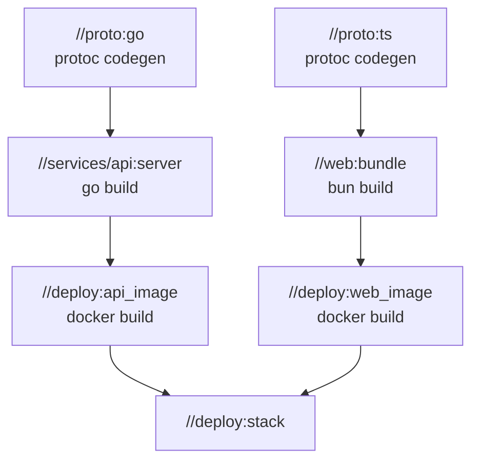

One `.proto` edit rebuilds both columns in the right order, the columns running in parallel; a web-only edit leaves the Go column cache-clean and `go` is never spawned. The workspace ceiling is five program names, and a contributed build file that adds a `curl` step is refused at plan time with both lists named. Every stack above used the same four primitives — `target`, `deps`, `inputs`, `run` — plus two idioms (stamp files, iidfile).

### 9.6 Toolchains: tools are dependencies too

An action's real dependency set is files, dep outputs, env values, **and the tools it runs**. buildl models tools at two levels, both expressed through the action key:

**Level 1 — observed tools (default).** `run = { "go", ... }` names the tool, and so does a first argument that names it through a build setting — `run = { "$opt:compiler", ... }` — once the setting's value for the run is put in (§10.2); the host resolves it on buildl's own `PATH` at plan time (missing tool → plan refusal, naming the target and declaring file), takes as its fingerprint the content hash of the file the name leads to, links followed, and folds the **tool fingerprint into the action key**. A name holding a `/` is not searched for: it is that path, taken from the workspace root when it is relative. The file run is the file fingerprinted, since one lookup serves both. A toolchain upgrade dirties every affected target; machines with different versions never share cache entries. A launcher that chooses the real tool when it runs — the `cc` stub of macOS, a `rustup` proxy — is fingerprinted as the launcher, so a change behind it is not seen, and neither is a change to a library a tool loads; a workspace that needs one seen names the real program by its path in the command and in `proc.run`, or declares the file that pins the version as an input. `buildl doctor` lists each program the build wants and whether the ceiling allows it (§7).

**Level 3 — hermetic toolchains (opt-in, via plugins).** A toolchain is an ordinary target:

```lua
-- toolchains/build.lua
b.fetch("go_sdk", {
  url    = "https://go.dev/dl/go1.22.5.linux-amd64.tar.gz",
  sha256 = "904b924d435eaea086515bc63235b192ea441bd8c9b198c507e85009e6e4c7f0",
})
b.target("go", {
  deps = { "go_sdk" },
  run  = { "tar", "-xzf", "$deps", "--strip-components=1", "--one-top-level=$out" },
})

-- consuming action: the tool arrives as a dep
b.target("server", {
  deps   = { "//toolchains:go" },
  inputs = srcs,
  run    = { "$dep://toolchains:go/bin/go", "build", "-o", "$out", "./cmd/server" },
})
```

`tar` creates `$out` itself and unpacks the SDK's contents directly into it (GNU tar, matching the archive's platform), so the toolchain is a directory output (§3) and `bin/go` lies where the consuming action names it. The SDK checksum flows through the dep chain into every downstream action key — version pinning by the same mechanism that pins everything else. Nothing need be installed on the host; remote workers receive the toolchain as they receive any input; onboarding is "install buildl".

`b.fetch` is the one primitive that needs network (a declared, plan-visible exception), and the checksum makes it deterministic despite the network: the download matches the pinned hash or the action fails. Content-addressing turns an impure operation into a pure one — the `http_archive` + `sha256` pattern [5].

Core buildl ships level 1 (zero-configuration day-one experience); plugins deliver level 3 as one line: with `local go = buildl.use("go")`, a call such as `go.toolchain("1.22.5")` makes the plugin declare the fetch, wire the dep, and rewrite the argv for every generated target. The plugin mechanism (§10) is built; `b.fetch` and the toolchain idiom on top of it are not.

## 10. Plugins

A buildl plugin is Lua that runs in the declaration phase — it cannot execute anything, so its entire power is generating primitives from intent. Structurally it is an airsl extension: manifest plus confined multi-file Lua [1]. The manifest is airsl's own `extension.toml`, read by airsl, so buildl keeps no manifest grammar of its own.

```lua
-- usage
local go = buildl.use("go")
go.binary("server", { main = "./cmd/server", deps = { "//proto:go" } })
```

```toml
# plugins/go/extension.toml
[extension]
name    = "go"          # the same name as the workspace's [plugins.go] (§4)
version = "1.2.0"
entry   = "main.lua"    # the file buildl.use runs
api     = 1
[capabilities]          # what my generated targets will want
proc.run = ["go"]
env.read = ["HOME", "PATH", "GOCACHE"]
```

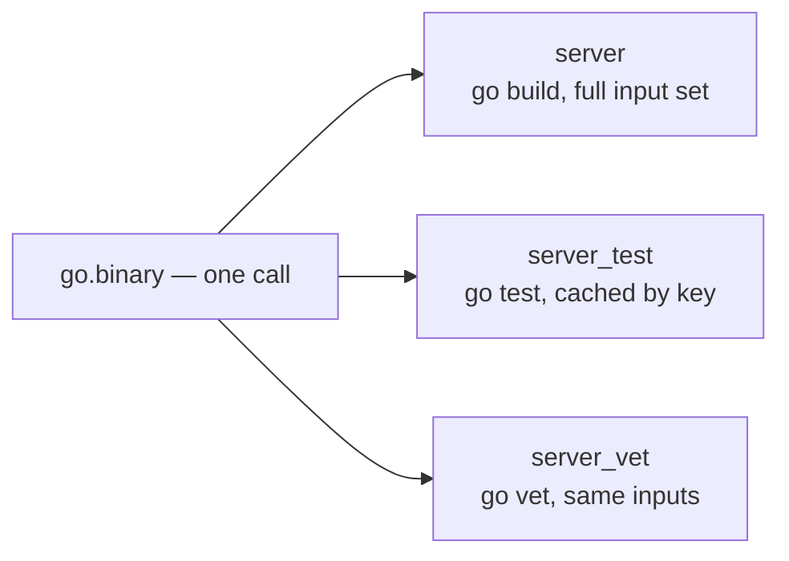

**Where a plugin comes from.** The workspace names every plugin in `buildl.toml` (§4), as a directory of the workspace or as a tag or commit of a git repository on any host, and a build file only says `buildl.use("go")`. A plugin from a repository is fetched by `buildl plugins fetch` and by nothing else; every command that loads build files checks it, before the first file is evaluated, against `buildl.lock` and the store, and never reaches the network. Fetching pins the commit and the digest of its files, so a tag that moves or a store that is edited is refused, not trusted (§4, §7).

**The manifest.** buildl reads `name`, `version` (text for display, never compared), `entry` and `api` from `[extension]`, and `proc.run` and `env.read` from `[capabilities]`. airsl refuses an `api` it does not support before any code runs, and an `entry` that is not a file inside the plugin's directory. buildl refuses, naming `<plugin directory>/extension.toml`, what airsl accepts and buildl would otherwise ignore, because a request silently ignored reads as one granted: `fs.read`, `fs.write`, a module flag, a `[capabilities.optional]` block and a `[limits]` value. A `name` that is not the one the workspace's `[plugins.<name>]` uses is refused too.

**What a plugin sees.** Each instance of a plugin runs in a new environment, never a read-through to the build file's globals, because a plugin that reached the file's `buildl` — directly or as `airsstack.buildl`, the same table (§5) — would declare without its name and skip its cap. It holds, and holds only:

|Name|Value|
|---|---|
|`buildl`|a new table of the declaration primitives whose declarations carry this instance's origin, with its own `use`|
|`airsstack`|a new table holding a copy of each curated module (`json`, `path`, `regex`, `hash`, `glob`) and, as `buildl`, the table above|
|`require`|loads `<plugin directory>/a/b.lua` for `require("a.b")`, and nothing outside the plugin directory|
|`_G`|the environment itself|
|`string`, `table`, `math`, `utf8`, `pairs`, `tostring` and the other language globals|copies, one level deep, of the file's, with buildl's replacements (`tostring`, `string.format`) and withholdings (`print`, `math.random`)|

The library and module tables are copies made when the file's engine was built, so a plugin that assigns into `string`, `table` or `airsstack.json` changes only its own, and cannot change what the build file or another instance calls. airsl's own `require` comes only with a language surface that also exposes `os.time` and `os.clock`, which differ from run to run (§12.1), so the plugin's `require` is buildl's: a module name is names joined by dots, none empty and none holding a slash or `..`; the file must lie inside the plugin's directory, through a link or otherwise; a module that requires itself, directly or through others, is refused; a module runs under its instance's environment, once per instance. A build file may still hand its own `buildl` table to a plugin's function as an argument; what the plugin declares through that table is the build file's, written in the build file. A plugin's Lua counts toward the calling build file's `[declaration]` limits, and an error in it fails that file's evaluation with a diagnostic naming the plugin's file and line.

**Origin.** Every declaration carries its origin: the build file, or the chain of plugins that made it, outermost first, each as `name@version` with the capabilities its manifest states. The `buildl` table of a plugin instance stamps what is declared through it; the stamp is not read off the Lua call stack, where a tail call loses frames. An instance belongs to a chain, not to a name: `go` used by a build file is the instance `[go]`, and `go` used by `ourgo` is another, `[ourgo, go]`, with its own modules, each loaded once per evaluation. A plugin resolves names through the workspace's `[plugins]` only and may not use a plugin already in its chain. Origin is display and policy and is no component of the action key (§8.3): a target moved from a plugin to a hand-written `b.target` with the same fields stays cached. `buildl graph --json` shows each node's `origin`.

**Narrowing.** Before the ceiling, every want of a plugin's target is held to **each** plugin in its chain, and to those in the chain of the rule it names, so a hand-written `b.target{ rule = … }` naming a plugin's rule is held to that plugin. A want is allowed by a plugin only when its manifest lists it and the workspace's cap for it (§4) lists it too:

|Want|Allowed when|
|---|---|
|a program|every plugin's manifest `proc.run` and cap `proc.run` list it|
|an environment variable|every plugin's manifest `env.read` and cap `env.read` list it|
|`network = true`|every plugin's cap has `network = true`|

A plugin the workspace gives no cap allows its targets nothing. Inputs and write directories are not narrowed per plugin, and a program a dependency built is no want (§6). A wrapper is held as well as what it wraps: `ourgo` calling `go.binary` needs both `ourgo` and `go` to allow what the target runs. The first want refused is an error of the whole build, before anything runs, in the class of a want outside the ceiling (exit 4, §8.7), and it names the target, the chain, and what the plugin allows:

```text
services/api/build.lua: //services/api:server (plugin go@1.3.0): program curl is outside plugin go@1.3.0 (proc.run allows: go)
```

A want that passes its plugins is then held to the ceiling as before: request ∩ plugin manifest ∩ the workspace's cap for the plugin ∩ workspace ceiling — the extension host's intersection applied twice, so a compromised plugin update wanting `curl` is caught. Plugins need the manifest/ceiling/approver side of the airsl extension work but not the `ext.on` dispatcher.

**Attribution.** For each program, variable and network target the wanted set holds, `plan`, the approval prompt (§6) and `doctor` (§7) name every plugin chain whose targets want it, each with the lowest-labelled such target:

```text
run programs: go, protoc
  go: declared by plugin go@1.2.0 for //services/api:server
  protoc: declared by plugin ourgo@0.1.0 > go@1.2.0 for //proto:gen
```

`plan` prints them after the wanted set, the prompt after its list, and `doctor` under the want's own row. A network want is shown by its target's label. A write directory is the workspace's own and is never attributed, and a want only hand-written targets want has no line. `doctor` also ends with a `plugin violations` section listing each want a plugin does not allow, worded as the refusal of a build would word it; like the rest of `doctor` it refuses nothing and exits 0. Attribution is kept beside the wanted set and is display only, so the wanted set and the remembered approvals file keep their shape.

**The one hard problem, decided now:** plugins must not execute tools at declaration time (`go list`, etc.) — that would run programs before any plan is shown. A plugin holds no authority a build file lacks. Genuine dynamic discovery uses a _discovery target_: an ordinary cached action whose JSON output the build files read on a second declaration pass. Everything executed stays inside the granted, planned, cached world.

```lua
b.discover("pkgs", { run = { "go", "list", "-json", "./..." }, inputs = { "go.mod" },
                     network = true })
local text = b.discovered("//svc:pkgs")           -- the output's bytes as a string, or nil
local pkgs = text and airsstack.json.decode(text) or {}
```

|Rule|Detail|
|---|---|
|declaration|`b.discover` takes `b.target`'s table without `outputs` and `always`; naming either is an error. Its one output is `<name>.json`, placed by buildl as any output is, and must be a file: an action that leaves a directory there fails as an action failure (exit 1). It is a third role beside build and test targets|
|a target like any other|keyed, cached, run in the input sandbox, held to the ceiling and to its plugins, and logged. A plugin declares and reads discovery targets through its own `buildl` table|
|reading|`b.discovered(label)` returns the output of the target's newest logged run that succeeded, as text, or `nil` when there is none; relative labels resolve as `deps` do|
|scope|`build` and `test` leave discovery targets out of their default scope, and `buildl build //svc:pkgs` builds one|
|passes|a workspace with no discovery target is evaluated once. Otherwise the build files are evaluated without results, then with them; `build` and `test` run the discovery targets between the two, and every other command reads the last result its checkout recorded (§7)|
|consistency|the second evaluation must declare the same discovery targets as the first, field for field; one added, removed or changed is refused (exit 5), since discovery may not depend on discovery|

Downstream of any plugin, the system still speaks primitives: `buildl graph` shows exactly what a plugin declared, which is what makes third-party plugins inspectable.

### 10.1 Customization: three layers of engineer-owned logic

Plugins are a convenience layer, not a correctness layer — so custom logic has three homes, in increasing order of ownership:

**Options on plugin calls.** A plugin's option table is its customization API; the plugin maps options to argv, and since argv is in the action key, every variation caches separately and correctly:

```lua
go.test("auth_test", {
  packages = { "./internal/auth/..." },
  run      = "TestLogin|TestLogout",     -- go test -run filter
  tags     = { "integration" },
  timeout  = "2m",
})
```

**Dropping to primitives.** Plugins generate primitives; they never replace them. A case the plugin author did not anticipate is a raw `b.target` beside the generated ones — same graph, same caching, same grants. No one waits for a plugin release to express something.

```lua
b.target("fuzz_auth", {
  inputs = srcs,
  run = { "go", "test", "-fuzz", "FuzzParseToken", "-fuzztime", "30s", "./internal/auth" },
})
```

**Wrapping and composing.** A plugin is a Lua module returning functions, so a team writes a repo-local plugin encoding house rules on top of a public one — composition is function calls, and the manifest, attribution and narrowing machinery applies to the wrapper like any plugin; what the wrapper generates is held to the wrapper and to the plugin it wraps:

```lua
-- plugins/ourgo/main.lua, the entry its extension.toml names
local go = buildl.use("go")
local M = {}
function M.service(name)
  go.binary(name, { main = "./cmd/" .. name })
  go.test(name .. "_unit", { packages = { "./internal/..." }, short = true })
  go.test(name .. "_integration", { tags = { "integration" }, network = true })
end
return M
```

### 10.2 Build settings: explicit invocation-time parameters

"Run only `TestLogin`, today" is a per-invocation choice, which is in tension with the explicitness principle (§12.4). The resolution is **build settings** — declared options with defaults, overridable per invocation:

```lua
b.option("test_filter", { default = "" })
go.test("go_test", { run = "$opt:test_filter" })
```

```bash
buildl test //services/api:go_test --set test_filter=TestLogin
```

The setting is declared (name and default visible in `buildl graph`), the override is visible in the invocation, and the value folds into the action key — a filtered run caches separately from a full run, and nothing enters the build that is not in the ledger. This is Bazel's build-settings idea [5] expressed through the one mechanism buildl already has.

A setting's value for a run — its default, or the override — is fixed when the plan is made, and an override naming no declared setting fails the plan. The plan carries the values, and Execute expands every command and every `desc` from them, so the run is the one that was planned.

A setting can choose the tool as well as an argument. When a command's first argument is a complete program name once its `$opt:` references are replaced — `run = { "$opt:compiler", "-c", "$in" }` under `compiler = "clang"` — that program is a host tool exactly as if it were written out: unless a dependency built it, it joins the wanted set and is held to `proc.run` at plan, a missing one refuses the plan, and its fingerprint is in the key (§9.6). Overriding the setting to another program therefore dirties the target twice over, for the tool and for the setting. A first argument that is empty after replacement, or still holds a `$`, names no tool to look up; one that runs a file of the build through `$in`, `$out` or `$deps` is held to the ceiling at plan once the command is expanded, unless a dependency built it (§6), and a command that names no program even then is an error of the build.

A pattern that often dissolves the need for filters entirely: **per-unit target generation**. `go.tests_per_package()` is a Lua loop declaring one test target per package, so "run only the auth tests" becomes `buildl test //services/api:auth_test` — and package-granular targets mean `rdeps` runs only the tests a diff actually touches.

### 10.3 Stack plugins: what each one encodes

Each stack plugin is an idiom library — the encoded knowledge of how that toolchain wants to be wrapped. Sketches of the initial set:

**`go`** — `binary`, `test` (packages, run-filter, tags, short), `tests_per_package`, `vet`. Encodes: `go.mod`/`go.sum` in every input set, GOCACHE cooperation, optional hermetic SDK (§9.6). Use cases: service binaries, package-granular CI via `rdeps`, monorepo services sharing generated proto code.

**`bun`** — `deps` (lockfile-keyed install), `bundle`, `typecheck`, `test`, `lint`. Encodes: the stamp-file idiom for `node_modules`, frozen-lockfile discipline, parallel typecheck/bundle. Use cases: SPA bundles, server bundles, shared UI packages consumed across a monorepo.

**`rust`** — `build` (profile option), `test`, `clippy`, `fmt_check`, `doc`. Encodes: `Cargo.lock` + `--locked`, the two-cache-layer contract (buildl decides _whether_ cargo runs, cargo's `target/` decides how little to recompile), `fs.write = ["target"]` in the requested capabilities. Use cases: workspace crates, wasm artifacts feeding a web bundle.

**`docker`** — `image` (iidfile idiom), `push` (`network = true`, depends on the image), `run_in` (execute another target's action inside an image — the tier-4 bridge). Encodes: `--iidfile` digests as artifacts, `SOURCE_DATE_EPOCH`-aware BuildKit flags for reproducible layers [3] so users never learn they exist. Use cases: service images from compiled outputs, push-gated deploys, pinned build environments.

**`proto`** — `gen(languages)` declaring one codegen target per language from one `.proto` set. Encodes: the fan-out pattern of §9.5. Use case: the shared API contract feeding Go and TypeScript simultaneously — the canonical cross-stack edge no single-language tool can see.

**`python`** — `venv` (lockfile-keyed, the `deps` idiom again), `test` (pytest with a filter setting), `wheel`. Encodes: uv/pip-tools lockfile discipline, `.venv` stamp files. Use cases: ML pipelines and tooling scripts living beside compiled services.

The meta-observation the catalog exists to make: **the same few idioms recur across every stack** —

|Idiom|go|bun|rust|docker|python|
|---|---|---|---|---|---|
|Lockfile-keyed environment|`go.sum`|`bun.lock`|`Cargo.lock`|base image digest|`uv.lock`|
|Stamp file for a tree its lockfile already pins|—|`node_modules`|—|—|`.venv`|
|Digest file as artifact|—|—|—|`--iidfile`|—|
|Filter as build setting|`-run`|`--test-name-pattern`|`--test`|—|`-k`|
|Per-unit target generation|per package|per workspace pkg|per crate|per Dockerfile|per module|

A new stack plugin is mostly a matter of instantiating these five idioms for one more toolchain — which is why the plugin API surface can stay small and the core never needs to know a language exists.

## 11. Scale: big monorepos and remote execution

### 11.1 Big monorepos

- **Loading:** 10,000 build files × ~136 µs ≈ 1.4 s single-threaded, and Load parallelises across engines on `[execution] workers` threads. Not the bottleneck.
- **Lazy loading falls out of labels:** `//services/api:server` encodes its own directory, so demand-driven loading (load only directories reachable from the requested targets, as Bazel does) is mostly a traversal change, but not only one: a build setting is a workspace-global name with no directory to load (§5, §10.2), `graph.json` and the output-collision check both cover the whole graph, and a build file is evaluated only because a `subdir` named it (§14). Each would have to change first, or a named build could fail where the whole build passes. Load is eager; flip when a repo makes it matter.
- **Reverse queries are the killer feature:** `buildl query "rdeps(//proto:go)"` maps a diff to the targets that must rebuild and the tests that must run. The reverse edges already exist for the executor; this is a CLI command over an existing structure, and it is worth more than remote execution to most teams.
- **No-op speed past ~100k files:** a filesystem watcher keeping the stat cache warm between runs — a merge of watch mode and the stat cache, both already designed.

### 11.2 Remote cache, then remote execution

Prerequisite for both — **local sandboxed execution** (§12): actions that read undeclared inputs must fail loudly on the developer's machine before any remote work exists, or they get wrongly cached [8][9].

Remote cache is the high-payoff step, and it is built. The cas is already REAPI-shaped [6][7]: SHA-256 digests, blobs by digest. The action key is not an `Action` digest, so a target is described to the server in the API's terms and buildl's key goes along as the salt, and sharing results is a service with two lookups:

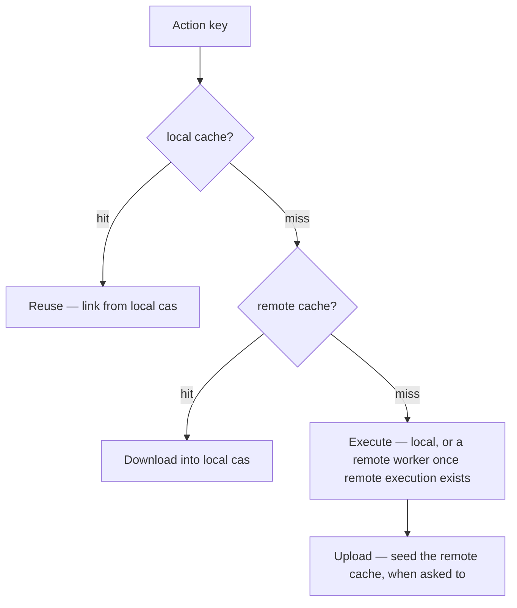

A target the local cache cannot serve is looked up under the digest of an `Action` [12]. The core builds it from the ready action, so every check stays testable without a server:

|`Action` / `Command` field|Value|
|---|---|
|`Command.arguments`|the target's expanded command|
|`Command.environment_variables`|the action's environment with the variables the sandbox pins laid over it (§12.3), sorted by name|
|`Command.output_paths`|the target's outputs, sorted and without repeats|
|`Command.working_directory`|empty: the input root is the workspace root, since every path is workspace-relative (§8.5)|
|`Action.input_root_digest`|a `Directory` tree of every declared input at its path and every file of every dependency's outputs at its path|
|`Action.timeout`|`[execution] timeout`|
|`Action.platform`|`OSFamily` and `ISA`: the OS half of buildl's `os/arch` pair, and `arm-a64` or `x86-64` for `aarch64` or `x86_64` [12]|
|`Action.salt`|the 32 bytes of the target's action key|

The salt puts everything buildl's key folds in (§8.3) — the tool fingerprint, the build settings, network access, the variables left unset — into the `Action` digest, so two targets with different keys never share an entry whatever the other fields hold, and an entry is buildl's own: nothing is shared with Bazel or another client. Keys match across machines only where the declared environment and the platform do (§12.4).

A hit is usable only when its command exited zero, it names every declared output path exactly once as a file or a directory and no other path, holds no symbolic link, and each directory holds regular files only (§8.7); a discovery target's output must be a file (§10). buildl trusts a server for bytes and for nothing else: every blob it downloads, directory trees included, is checked against the length and the SHA-256 it was named with, and one that fails is never stored. What passes is put in the cas, and the target's row is written after it (§8.5): a crash between the two leaves no row, and the next build downloads again.

With uploading on, the worker that ran a target sends its result once the outputs and what it printed are in the cas, and the order is the protocol's [12]: the input files the server is missing, the output files, the `Tree` of each directory output, stdout and stderr, the input-root `Directory` messages, the `Command` and the `Action`, and then the result itself. Only an action that ran and succeeded is uploaded, never a failed one, a target restored from the local cache or a target fetched. The upload comes before the local record, so a local store that then fails leaves the server a sound result for a target whose record failed, which is intended: the content is what the action produced, and a failure is cached nowhere. An input file is hashed as it is read for upload, and one whose bytes no longer match the digest in the key skips that target's upload with a warning.

Uploading is refused under `strategy = "bare"` (§7): at tier 1 an action can read files it never declared, so its result would depend on more than its key and a shared cache would hand it to every other machine, which is the poisoning `verify` exists to find (§12.3). Reading works at every tier: it adds no result that a bare action produced.

The transport is gRPC. `grpc://` is plain HTTP/2 and `grpcs://` is TLS with the system's roots and `[remote] ca`. Every call carries the `token` in the `header` `buildl.toml` names (§4). Before its first call a build asks the server what it supports: SHA-256 must be among its digest functions, and uploading needs the server to accept action-cache updates, otherwise that is a failure like any other (§7). Small blobs travel in batch calls, bounded by the server's own limit and by the transport's message cap; larger ones through ByteStream [13], in 1 MiB chunks. One timeout (`timeout`, 30 seconds by default) bounds the connection, each unary call and each message of a ByteStream read or write, so a large transfer that keeps moving is never cut off. The client needs an async runtime, which the remote adapter alone owns; nothing else in buildl is async (`architecture.md` §6). It was run against bazel-remote 2.6.4 [8]: a build that uploaded seeded it, and a second checkout fetched every target from it, its outputs byte-identical to the first's.

Typical deployment: CI builds `main` with uploading on and seeds the cache; every developer's first build of the day reads by default and is mostly downloads. The remote cache is a client only. Remote execution, the Bazel HTTP cache protocol, compressed blobs, client certificates, any login beyond a header token and evicting entries are not part of it.

Remote execution is not built. It adds workers on other machines:

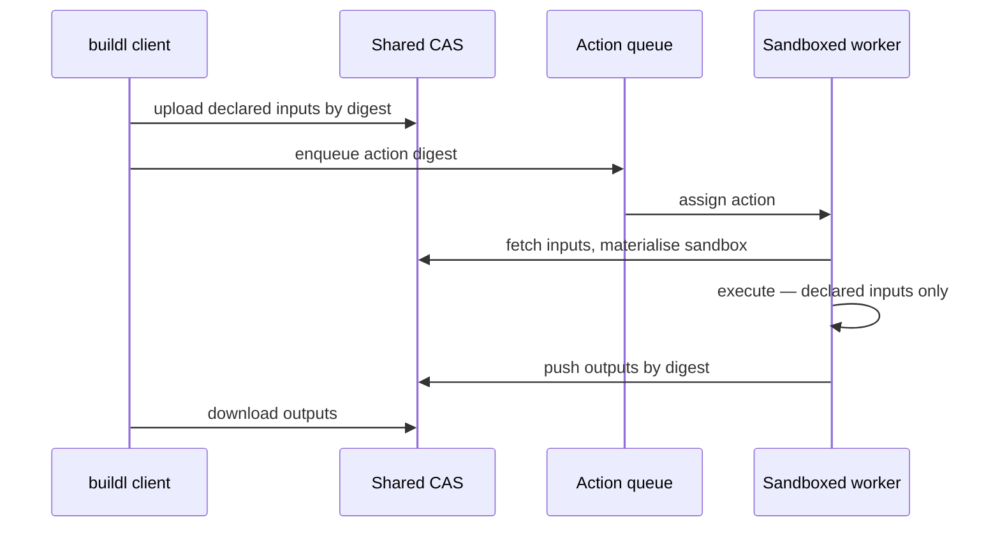

Two decisions: the **toolchain problem** — remote workers need the tools, so toolchains become declared inputs, pragmatically as a per-action container image whose digest joins the action key (the plugin layer declares it once); and **don't build the cluster** — speak the Remote Execution API as a client [7], and BuildBarn, Buildfarm, BuildBuddy, NativeLink become buildl's remote backends [8].

Nothing in this section touches Lua. Scale is a pure host-side concern — the two-phase split paying out again.

## 12. Isolation and determinism

### 12.1 Declaration phase: deterministic by construction

Two adjustments to airsl's `confined` preset close the remaining holes:

1. **Drop `os`, curate the module set, and strip what remains.** `os.time`, `os.clock`, and Lua 5.4's entropy-seeded `math.random` are nondeterministic. The declaration policy uses airsl's minimal language surface, which has no `os`, and a `ModuleSet` installing `json`, `path`, `regex`, `hash`, `glob` while omitting `time`, `proc`, `env`, `stdio`. airsl lets the host choose both — configuration, not new machinery [1]. The minimal surface still loads `math` whole, so buildl removes `math.random` and `math.randomseed` itself. It also removes `airsstack.path.absolute`, which reads the process working directory, and `print`, because stdout belongs to the CLI. Last, it replaces `tostring` and `string.format`, because rendering a table or function renders its address, which can differ between runs: a table, function, thread or userdata with no `__tostring` metamethod, rendered by either, is an error, and so is `%p`.
2. **Canonicalise instead of forbidding `pairs`.** Lua table iteration order is unspecified, so the graph is made insensitive to the order declarations are issued in: keyed by names, numbered in label order at Resolve. A `pairs` loop that issues declarations yields a byte-identical graph in any order. The order inside one list is different: it reaches the graph as written and, for `deps`, `inputs` and `outputs`, the action key (§5), and a list whose order varies between two evaluations fails `buildl check`.

Because declaration is cheap it is also _checkable_: evaluate twice and compare the two sorted staging lists by value; a nondeterministic build file fails `buildl check` with the diff — the first position at which the two runs disagree, with what each run declared there. A `pairs` loop does not fail the check, because both lists are sorted before they are compared.

### 12.2 Execution: isolation is a ladder

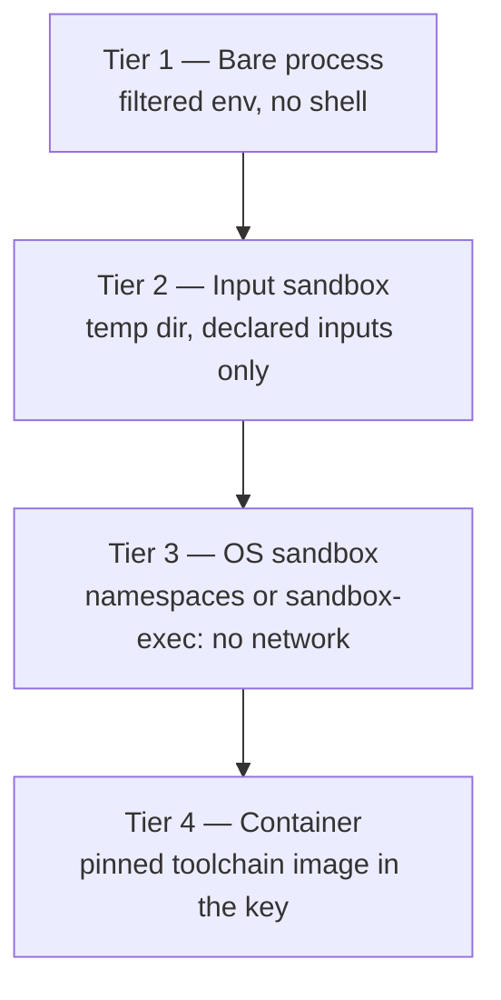

Tier 2 is Bazel's execroot discipline — undeclared inputs are simply absent, so hidden dependencies fail loudly [9]. Tier 3 seals network and system files. The strategy is set in `buildl.toml` with per-target overrides (`network = true` is a declared, plan-visible exception). Remote execution requires tier 2 or above. From tier 2, parallel actions are isolated from each other by construction: own exec dir, own temp outputs, atomic landing in the cas. At tier 1 they share the workspace root, and are kept apart only by each owning its own output paths (§3).

**Tier 1, `bare`, runs an action as a plain process in the workspace root.** It guarantees five things: the command is started as an argument vector, never through a shell; its program, when the command writes it out or names it through a build setting and no dependency built it, is the file the plan fingerprinted; its environment holds exactly the variables the target declared that have a value, and nothing of the host's; its standard input is empty; and its own process is stopped when it runs past the workspace's `timeout`. A program the command names through `$in`, `$out` or `$deps` has no fingerprint: it is known once the command is expanded, at plan, and the file is found by the rule every program is found by. Named through `$deps` — or written as a path that is a dependency's output — it is a built program: the file that dependency's build placed under `out/`, run with no `proc.run` entry, its bytes entering this action's key as its dependency's output digest. Named through `$in` or `$out` its expanded text is held to `proc.run`. Named through `$in` it is the input file, its digest in the key, when the input's path holds a `/`; an input at the workspace root is a bare name, looked for on buildl's `PATH` like any other and never in the workspace. `$out` names the action's own output, which is not there when the action starts. Tier 1 confines nothing. An action can read any file the user can, declared or not, so a hidden input is silent instead of an error; it can reach the network whatever `network` says; it can write anywhere the user can, another target's output included; the processes it starts are not stopped with it, at a timeout or at its exit; and it writes its outputs in place, so an action that fails, times out or is interrupted can leave a partial output at its path. No cache row names such a file, buildl never reads it as a result, and the next build clears the path before it runs the action again. A dependency's output under `out/` is read-only, and a tool that changes its mode first can damage the store. The machine's clock, time zone and locale are the action's. Tier 2 is where an undeclared input becomes an error, and tier 3 where the network does.

**Tier 2, `sandbox`, runs an action in a directory of its own that holds its declared inputs and nothing else of the workspace.** The directory is the action's **exec dir**, `<temp>/buildl-<workspace id>/<action id>`. `<temp>` is the machine's temporary directory, read once when the workspace is opened. `<workspace id>` is the first 32 hex digits of the SHA-256 of the workspace root's path, and `<action id>` the first 32 of the SHA-256 of the target's label, so the path is the same on every run of one target in one workspace on one machine, and no two targets share one. It lies outside the workspace on purpose: from inside it, tools that search upward for a `go.mod`, a `node_modules` or a Cargo workspace find the workspace's own and read what the action did not declare.

|In the exec dir|How|
|---|---|
|each declared input|a copy at its workspace-relative path, mode kept|
|each file of each dependency's output|a copy at its path under `out/`, mode kept|
|the program, when the command writes it out or names it through a setting as a relative path|a copy at its path, unless it is already there as an input or a dependency output, so the file run is the file the plan fingerprinted; a relative program with a `..` component is an infrastructure failure, naming the program: name it by an absolute path or declare it|
|the parent directory of each declared output|exists, so the command can write its output there; nothing is at the output path|
|the environment|the declared variables that have a value, plus the three the sandbox pins (§12.3); nothing of the host's|

Inputs are copied, never linked. A symbolic link makes the file's real path the workspace's, and a tool that follows it resolves its imports from there: a script linked in found the workspace's `node_modules`, and the same script copied in did not. A hard link lets a tool that writes to its input overwrite the workspace's file. A copy of a file on one disk costs little (measured near-instant on APFS; on a file system that cannot share the bytes the copy is real, and a target with large inputs pays for it on every run). The command is the same text as at tier 1, and its paths are true in the exec dir (§8.5). A program given by an absolute path is run from where it is, as at tier 1, and a bare name is looked for on buildl's `PATH`.

The action does not write into `out/` through its relative paths: it writes in its exec dir. Its outputs are read from there into the cas; `out/` is filled from the cas afterwards (§8.5), and the build clears each declared output path under `out/` before the run, as at tier 1. `verify` is the exception: its sandbox clears and makes nothing under `out/`, because the cached outputs it has just put back are what its re-runs read as their dependencies' outputs, and a re-run's own bytes are compared and dropped, never placed. The exec dir is removed when the action is done, whatever the result. Every command that takes the state lock also removes the whole `<temp>/buildl-<workspace id>` directory when it takes the lock and again when it lets it go, so an interrupted build's exec dirs go at the next `plan`, `build`, `test`, `verify`, `clean` or `gc`, and a finished command leaves nothing in the temporary directory. buildl makes that directory with mode `0700` and uses an existing one only when it is a directory, not a link, owned by the user who owns the state lock file, of mode exactly `0700`, and outside the workspace; otherwise the action fails as an infrastructure failure naming the reason. No message the sandbox prints names an exec dir: it names the target, workspace-relative paths, and the program as the command wrote it.

Tier 2 stops an action reading a workspace file it did not declare, and nothing else. An action that names a workspace file by its absolute path, or climbs out of its exec dir with `..`, reaches the workspace; it reads `/usr`, `$HOME` and tool caches as it did at tier 1; it reaches the network; and the processes it starts outlive it. Tier 3 is where those are closed. An action that reads an undeclared file fails with the tool's own message ("file not found", "cannot find module"); buildl does not name the file.

`strategy` is no part of the action key (§8.3), so a target built under `bare` is a cache hit under `sandbox`: switching the manifest does not rebuild it, and so does not re-check it. `buildl verify` (§12.3) is how a cached target is checked, and it runs under `sandbox` only. The two tiers also differ in the directory the action runs in, and the sandbox pins `TZ`, `LC_ALL` and `SOURCE_DATE_EPOCH` where `bare` pins nothing. Outputs are therefore byte-identical across them only for tools that neither record the directory nor read the clock, the locale or the time zone: a compile with debug information records the directory (`rustc -g` run in two directories gave two different files), and `cp` and `cat` read none of these. The exec dir is the same path on each run, so a tool that records it records the same bytes each time.

### 12.3 Determinism: guarantee, mitigate, verify

|Property|Status|
|---|---|
|Same declared inputs → same action invoked|**guaranteed** — the action key|
|Action sees only declared inputs|**enforced** from tier 2 up, for the files of the workspace; a file named by an absolute path, or outside the workspace, is still the action's to read (§12.2)|
|Hidden env, locale, timezone variation|**mitigated** from tier 2 up — the sandbox sets `TZ=UTC`, `LC_ALL=C`, `SOURCE_DATE_EPOCH=315532800` [3]; at tier 1 the time zone, the locale and the clock are the machine's|
|Network as a hidden input|**eliminated** at tier 3|
|Same action → byte-identical output|**the tool's property** — verified, not promised|

The three values the sandbox pins, for every strategy above `bare`:

|Variable|Value|Why|
|---|---|---|
|`LC_ALL`|`C`|sorting, message text and number formats do not follow the machine's locale|
|`SOURCE_DATE_EPOCH`|`315532800`, 1980-01-01T00:00:00Z|the time a tool stamps into its output [3]; this date because it is the earliest a ZIP file can record (an earlier one is refused), so a tool that packs a ZIP from it never fails on it|
|`TZ`|`UTC`|local time is the same everywhere|

A pinned variable is not the target's to set. A target that declares one of them in `env` fails Plan under any strategy above `bare`, exit 5, with an error naming the variable, the first target (in label order) that declares it and the value the sandbox sets; nothing is hashed or run. Under `bare` such a target plans as before, and its value is its own.

buildl cannot make a compiler reproducible; it can pin every input the compiler sees and verify the rest. `buildl verify` re-runs cache-hit actions, all of them or with `--sample N` the `N` whose key digests are lowest, and compares each output with the one its cache row records — nondeterminism becomes a named, attributable defect instead of silent cache poisoning (which a shared remote cache would amplify). The sample is chosen by key digest, not at random, so the same keys check the same targets on every run and machine; a target is checked by a different sample only once its key changes, and `verify` with no `--sample` checks every cached target. The comparison walks the output, a file or a tree in path order, and stops at the first difference: it names the target, the output and that difference, which is a file's bytes or mode, a tree entry's bytes or mode, an entry only the cache or only the re-run holds, or a file where the other holds a tree. A re-run that fails is reported with its class and what it printed, and the others go on. A re-run is as slow as a build of the same targets, and `--sample` is the way to bound it. `verify` repairs nothing: it forgets no row, rebuilds nothing and marks nothing. In practice Go is fully reproducible, rustc very nearly; `docker build` needs `SOURCE_DATE_EPOCH`-aware BuildKit flags [3], which the docker plugin passes so users never learn they exist.

### 12.4 The explicitness ledger

The governing principle: **every behavioral difference between two builds must be traceable to a difference in a declared input.** The action key is the ledger of what is explicit; the isolation tiers enforce that nothing outside the ledger can matter; `verify` audits the residue. The full ledger, and where each entry is handled:

|Input class|Made explicit by|
|---|---|
|Source files|`inputs`, content-hashed via the stat cache (§8.3)|
|Products of other targets|`deps` — the hashes of their outputs fold in (§8.3)|
|Environment variables|granted names only; values in the key (§8.3)|
|Tools|fingerprint (level 1) or toolchain target (level 3, §9.6)|
|Host OS and CPU architecture|an `os/arch` pair in every action key — a mac and a Linux machine must never share entries|
|Network|absent by default (tier 3); `b.fetch` re-admits it behind a checksum; `network = true` is a plan-visible declaration|
|Time, locale, timezone|pinned by the sandbox: `SOURCE_DATE_EPOCH=315532800`, `LC_ALL=C`, `TZ=UTC`; a target may not declare them (§12.3) [3]|
|Build-file logic itself|a build file reaches a key through the fields it declares, not through its own hash (§7); declaration is sandboxed, `os`-free, and double-run checkable (§12.1)|

What remains honestly implicit — the kernel version, libc, filesystem semantics, CPU microarchitecture as it affects codegen — is exactly the set that tier 4 (containers) and `verify` exist to contain. The ledger is finite and named; "surprise" is defined as any behavior difference not in it, and every such surprise is a bug in buildl, not in the user's build.

Two things a workspace sets are deliberately outside the ledger: the `[execution]` settings — `workers`, `timeout`, `strategy` (§8.3) — and a rule's `desc` (§5). Neither is a key component. `workers`, `timeout` and `desc` change nothing an action produces from its declared inputs. `strategy` changes none of the key's components either, but under `sandbox` the action runs in another directory and with `TZ`, `LC_ALL` and `SOURCE_DATE_EPOCH` pinned, so a tool that records its directory or reads the clock, the locale or the time zone can give other bytes than under `bare` (§12.2).

## 13. Sequencing

**Scope decision (2026-08-23): buildl is a build system first.** The defining capability is answering _"does this need to run at all?"_ — the action key, cas, and dirty check. Task-runner use (chores via `always = true`, alias-only graphs, cargo-make replacement) is a degenerate case the model yields for free and is explicitly not a v1 design driver. Nothing is designed _for_ it; nothing needs removing to allow it later.

**Scope decision (2026-09-13): fine-grained per-file C/C++ compilation is out of scope for v1.** The §5 per-`.o` pattern is unsound without dynamic input discovery, since the headers a compiler reads are never declared — traced in the walkthrough's §6. Every stack in §9 and every plugin in §10.3 wraps a toolchain that tracks its own internal dependencies, so no v1 use case needs the fine-grained shape. Where dynamic discovery _is_ needed, the mechanism is the **discovery target** (§10) — a cached action whose output a later declaration pass consumes — not a depfile side channel in the executor. The residual case discovery targets do not cover, per-action mid-execution discovery, extends their contract (§14) if it is ever required. No branch of this decision changes the Lua surface.

Dependency-ordered, with the airsl extension work interleaved:

1. **Core pipeline** — Load/Resolve/Plan/Execute/Record, `check`/`graph`/`plan`/`build`, local cache and cas. Needs only shipped airsl.
2. **`query` (`deps()`, `rdeps()`)** — small work, transforms CI for large repos. With it the commands around a build: `test`, `log`, `clean` and `gc` (§7). Parallel loading of build files (§11.1) lands here; demand-driven loading does not (§11.1).
3. **Local input sandbox (tier 2)** — the correctness discipline everything remote depends on. `verify` (§12.3) lands here, and is built.
4. **Grant negotiation UX** — wanted set, ceiling intersection, approver, and `doctor`, which prints the result (§7). Follows airsl's model (intersect, never union; the approver only narrows; fail closed) with buildl's own `Approver` port rather than airsl's types, which are shaped for an extension manifest; the manifest parser and `ext.on` dispatcher are not needed. Per-target grant narrowing (§14) is settled here, as declined. Built.
5. **Plugins** — `[plugins]` in `buildl.toml`, `buildl.lock` and `buildl plugins fetch` (§4, §7), the airsl extension manifest as `extension.toml`, `buildl.use`, attribution and per-plugin narrowing, and discovery targets (§10). Built.
6. **Remote cache via REAPI** — most of the remote value at a fraction of the complexity. `build` and `test` read results from a server that speaks the Remote Execution API over gRPC, and write theirs there when asked (§4, §7, §11.2). A client only: no remote execution. Built.
7. **Watch mode** — full-reload variant first; persistent-engine dispatch (`ext.on`) only if profiling demands it.
8. **Remote execution, toolchain containers** — when a repo has genuinely outgrown one machine.

## 14. Open questions

- **Label syntax details:** _resolved_ — `//dir:target` is adopted, and relative labels are too: a build file may write `:sibling` or a bare `name`, both resolved against the declaring directory, which is what §5's own `deps = { "main.o", "util.o", "//lib:text" }` already mixes. A directory-only `//dir` is rejected rather than read as `//dir:dir`. `subdir` is explicit only, never implicit via file discovery: a build file is evaluated because an evaluated build file named its directory, never because it exists on disk, so the evaluated set is exactly the root plus the closure of `subdir` requests.
- **Discovery targets** (§10): _resolved_ — `b.fetch` (§9.6) settles the case of an impure operation made pure by a pinned checksum, and the general contract is one extra pass, not a fixpoint. A discovery target is an ordinary cached action with one file output; the build files are evaluated once without results and once with the last result of each, and the second evaluation may not declare different discovery targets than the first. Only `build` and `test` run discovery targets; every other command declares from the last result its checkout recorded, so a fresh clone shows the graph without the targets discovery adds until its first `build` (§7). Still outside the contract: discovery repeated until nothing changes, and discovery in the middle of an action; either extends it if it is ever required.
- **Per-target grant narrowing:** _declined_ — the wanted set stays workspace-granular. Each action already receives only its own declared variables (tiers 1 and 2) and, at tier 2, only its declared inputs (§12.2); a grant narrower per target matters only where an OS sandbox can enforce it (tier 3).
- **`buildl.toml` vs declaration in Lua:** the ceiling must stay in inert TOML (it gates the Lua). How much of `[execution]` belongs there versus in the root build file is taste.
- **API versioning for plugins:** _resolved_ — the `api` key of `extension.toml` is airsl's, and airsl refuses a plugin whose `api` it does not support before any of its code runs [1]. Within `api = 1` the `buildl` table a plugin sees only gains names, the rule airsl follows for its own; buildl has no second version number.

## References

1. airsstack. _airsl — Embeddable Lua runtime with a host standard library_ (source, docs: architecture.md, sandbox.md, extensions.md). GitHub, 2026. URL: [https://github.com/airsstack/airsl](https://github.com/airsstack/airsl)
2. airsstack. _airsl crate_. crates.io, 2026. URL: [https://crates.io/crates/airsl](https://crates.io/crates/airsl)
3. Reproducible Builds project. _SOURCE_DATE_EPOCH specification_. reproducible-builds.org. URL: [https://reproducible-builds.org/specs/source-date-epoch/](https://reproducible-builds.org/specs/source-date-epoch/)
4. Evan Martin et al. _The Ninja build system — manual_. ninja-build.org. URL: [https://ninja-build.org/manual.html](https://ninja-build.org/manual.html)
5. Google / Bazel authors. _Hermeticity_. bazel.build. URL: [https://bazel.build/basics/hermeticity](https://bazel.build/basics/hermeticity)
6. BuildBuddy. _Bazel's Remote Caching and Remote Execution Explained_. buildbuddy.io. URL: [https://www.buildbuddy.io/blog/bazels-remote-caching-and-remote-execution-explained/](https://www.buildbuddy.io/blog/bazels-remote-caching-and-remote-execution-explained/)
7. Bazel authors. _remote-apis — An API for caching and execution of actions on a remote system_. GitHub. URL: [https://github.com/bazelbuild/remote-apis](https://github.com/bazelbuild/remote-apis)
8. Buchgr et al. _bazel-remote — a remote cache for REAPI clients_. GitHub. URL: [https://github.com/buchgr/bazel-remote](https://github.com/buchgr/bazel-remote)
9. Google / Bazel authors. _Sandboxing_. bazel.build. URL: [https://bazel.build/docs/sandboxing](https://bazel.build/docs/sandboxing)
10. xmake-io. _Xmake — a cross-platform build utility based on Lua_. xmake.io. URL: [https://xmake.io/](https://xmake.io/)
11. khvzak et al. _mlua — high-level Lua bindings for Rust_. crates.io. URL: [https://crates.io/crates/mlua](https://crates.io/crates/mlua)
12. Bazel authors. _remote-apis — `build/bazel/remote/execution/v2/remote_execution.proto` and `platform.md`, at commit `c2c07e3d718d3d490a4958344d9c3e47de0bfaf3`_. GitHub. URL: [https://github.com/bazelbuild/remote-apis/tree/c2c07e3d718d3d490a4958344d9c3e47de0bfaf3](https://github.com/bazelbuild/remote-apis/tree/c2c07e3d718d3d490a4958344d9c3e47de0bfaf3)
13. Google. _googleapis — `google/bytestream/bytestream.proto`, at commit `dff1cd0c7ff8c26ff4c9f7a87cbe175fb5124d4e`_. GitHub. URL: [https://github.com/googleapis/googleapis/tree/dff1cd0c7ff8c26ff4c9f7a87cbe175fb5124d4e](https://github.com/googleapis/googleapis/tree/dff1cd0c7ff8c26ff4c9f7a87cbe175fb5124d4e)
